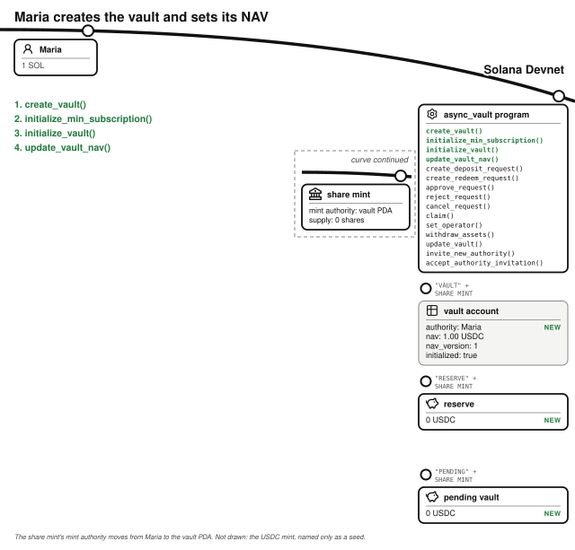
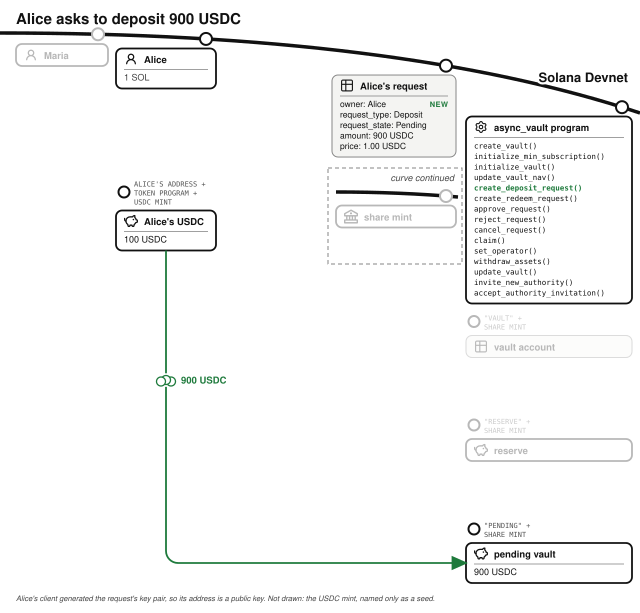
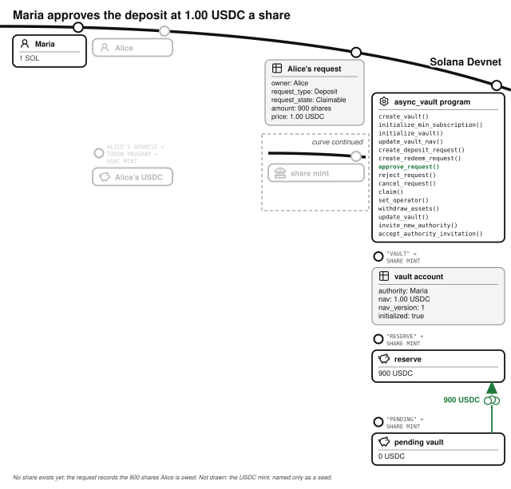
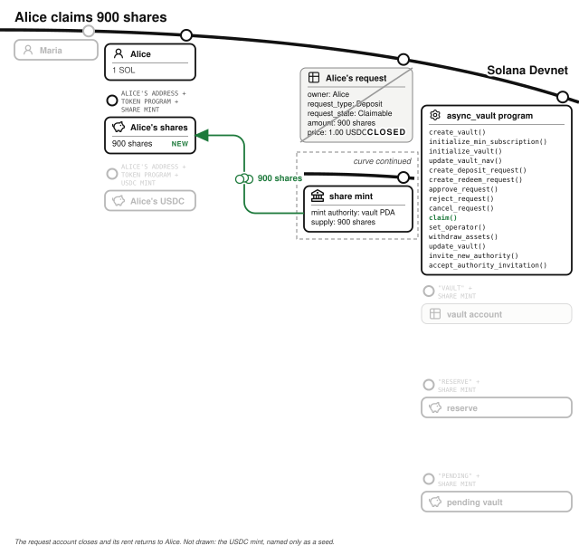
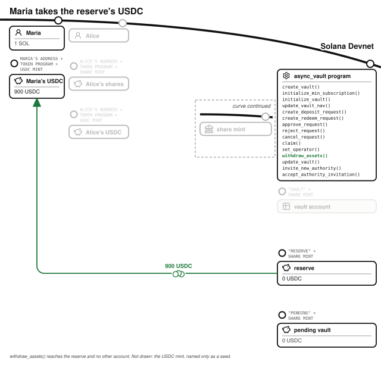
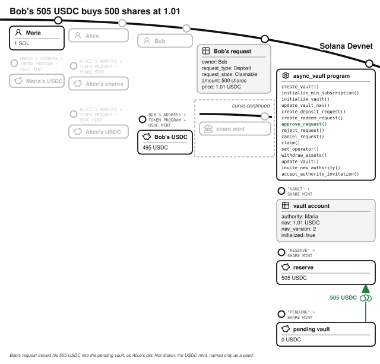
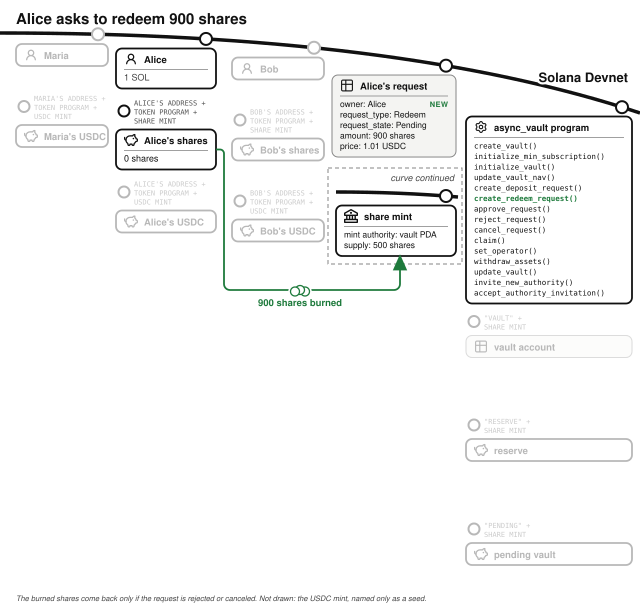
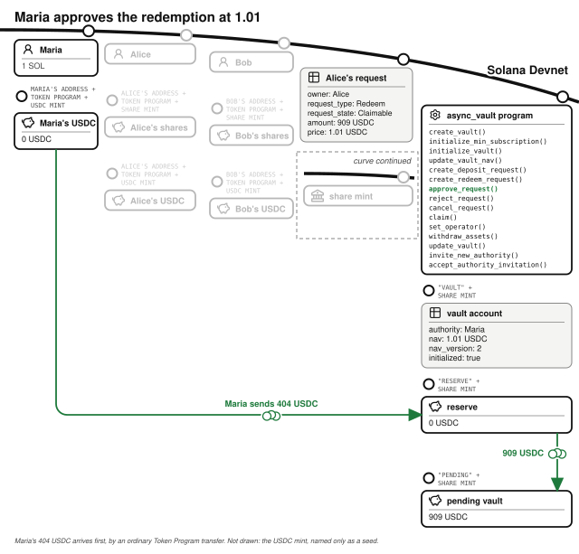
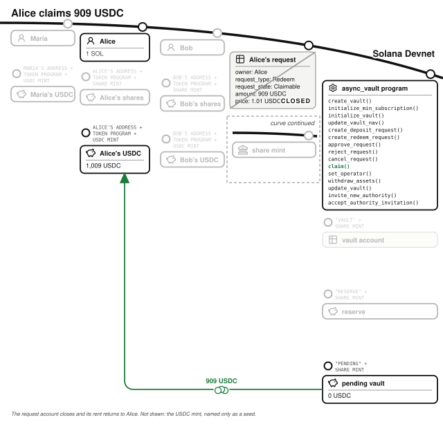

# Bonus Chapter: The Async Vault

An **async vault** is a fund whose deposits and redemptions settle later, in a separate transaction signed by the fund's manager. A user asks to deposit and the manager approves the request at the fund's current price per share, and only then can the user claim the shares. Redemptions work the same way in reverse. The Solana Foundation publishes one as `async_vault`, the program in its Vault Standard Suite, and this chapter describes that program as it stands at one commit.[^vault-source]

Any asset can have a token: issuers already put US Treasury bills and stocks such as NVDAx onchain. The managed fund in the *Managed Fund* chapter needs more than a token for each asset it holds:

- **Its own token accounts hold the asset.** Maria's fund, below, keeps its bills with a custodian.
- **The program trades the asset inside the deposit's transaction.** Maria buys bills through her broker at the Treasury's auctions, and each purchase settles on a later business day.
- **A Pyth price feed values the asset.** Maria works out her bills' value herself.

A fund that lends to businesses, or owns a building, misses all three in the same way. The async vault is for funds like these, and gives the manager two jobs the managed fund's program does itself: holding the assets and publishing their value.

> **Called a "vault".** The Solana Foundation calls the product a vault, and its program stores the fund's state in an account of type `Vault`. The rest of this book uses "vault" for a token account owned by a program, so this chapter keeps the program's own names and says which it means each time. **The vault account** is the `Vault` struct. **The reserve** and **the pending vault** are the two token accounts the vault account holds USDC in.

## A Fund the Program Cannot Price Settles Later

Maria runs a fund of US Treasury bills. A Treasury bill is a short-term loan to the US government: it is sold below its face value and repaid at face value a few weeks or months later, and the difference is the interest. Maria's broker holds the bills, and she earns a management fee, which she takes the way a traditional fund does: it is deducted from the fund's value before she publishes the price per share. Alice wants the interest Treasury bills pay on her USDC without opening a brokerage account, so she buys shares in Maria's fund.

The program is told the fund's value rather than computing it. Only Maria can sign the price per share it uses, so only she can turn a deposit into shares or shares into USDC. A deposit arrives as a request, and Maria settles it once she has a price for it. A traditional fund has the same rhythm: an order placed during the day is filled at the net asset value (NAV) struck after the market closes. Fund administrators call a deposit a **subscription** and a withdrawal a **redemption**. The program uses both pairs of words: a deposit request is checked against the `MinSubscription` extension, and a redeem request against `MinRedemption`.

## The Manager Creates the Vault Around a Share Mint She Brings

Maria first creates a mint for the fund's shares herself, with a supply of zero, six decimals, and her own public key as mint authority. The program takes a share mint as an input rather than creating one, so an issuer can pick the token program and the Token Extensions their shares need without a change to the vault program. Then she runs `create_vault()`, naming herself as the `authority` and as the `fee_recipient`, and signing as the share mint's current mint authority.

`create_vault()` creates three accounts, all at PDAs seeded with the share mint:

- **The vault account** (PDA seeds: `"vault"`, the share mint) records the `asset_mint` (USDC here), the `share_mint`, the `authority`, the `fee_recipient`, the `nav`, a `nav_version` counter, and whether the vault is `initialized` and `paused`.
- **The reserve** (PDA seeds: `"reserve"`, the share mint) is a USDC token account whose authority is the vault PDA. It holds the USDC of approved deposits until Maria takes it out to invest.
- **The pending vault** (PDA seeds: `"pending"`, the share mint) is a second USDC token account under the same authority. It holds the USDC that requests have brought in and that has not been settled yet.

The handler then moves the share mint's mint authority from Maria to the vault PDA, so shares exist only when the program mints them. It refuses a share mint that already has a supply (`ShareMintSupplyShouldBeZero`, checked by `test_create_vault_nonzero_share_mint_supply_fails`). It also refuses a share mint that is the same as the asset mint (`MintsShouldBeDifferent`). The asset mint and share mint are both read for Token Extensions that would break the vault's accounting. An asset mint with a nonzero transfer fee fails with `InvalidAssetMintExtensions`, because the reserve would receive less than each transfer said it sent. A share mint with confidential mint and burn fails with `InvalidShareMintExtensions`, checked by `test_create_vault_confidential_mint_burn_share_mint_fails`.

The vault account is created with `initialized` false, and while it is false the authority may add **extensions**: optional rules stored after the vault account's own fields. Maria's fund takes no investment under 100 USDC, so she runs `initialize_min_subscription()` with a threshold of 100,000,000 minor units. She then runs `initialize_vault()`, which sets `initialized` to true. From then on no extension can be added (`VaultAlreadyInitialized`), though the authority can still change an existing extension's parameters.

The fund cannot take a deposit yet, because it has no price. `nav` starts at zero, and approval refuses to run on a zero NAV (`NavIsNotSet`). Maria runs `update_vault_nav()` with 1,000,000: the NAV is stored as USDC minor units per whole share, so this is 1.00 USDC per share. The handler stores it and adds one to `nav_version`.

## A Deposit Request Moves the USDC Into the Pending Vault

Alice invests from the standard wallet of one SOL and 1,000 USDC. She runs `create_deposit_request()` with 900 USDC. Her client generates a new key pair for the **request** account, and the request lives at that public key rather than at a PDA. Each request is its own account, so a user can have several open at once and the program keeps no counter to derive them from. Alice pays the request account's rent.

The handler refuses a vault that is not initialized (`UninitializedVault`) or is paused (`PausedVault`). It refuses a deposit below Maria's 100 USDC minimum (`SubscriptionAmountBelowMinimum`, checked by `test_create_deposit_request_below_threshold`). It moves the 900 USDC from Alice's token account into the pending vault, and writes the request: `owner` Alice, `request_type` Deposit, `request_state` Pending, and `amount` 900 USDC. It also copies the vault's current `nav` into the request's `price`, and its `nav_version` into `nav_update_version`. No shares exist yet, and Alice's USDC is in an account `withdraw_assets()` cannot reach.

## The Manager Approves at the Current NAV

The program records who Alice is and how much she sent, and nothing about whether Maria may sell her fund shares. A regulated fund usually sells only to investors who have passed identity and eligibility checks, and Maria runs those offchain. Approval is where she acts on them. She can approve the request, reject it, or leave it; while it waits, Alice can take it back with `cancel_request()`, which returns her 900 USDC and closes the request account, returning its rent to her.

Maria runs `approve_request()`. Its arguments repeat the request's `owner`, `request_type`, `amount`, `created_at` and `nav_update_version`, and the handler refuses an approval that does not match the account it is given (`ApprovalRequestMismatch`). Maria's approval names the request she reviewed. If Alice canceled and opened a new request at the same address for a different amount, an approval Maria had already signed for the first one would fail. `test_stale_approval_rejected_on_recreated_request` cancels a 1,000,000 request, recreates it at the same address for 600,000, and checks that the original approval is refused with that error and that a fresh one goes through.

The handler converts at the NAV stored in the vault account when the approval runs, not the one recorded when Alice asked. Her 900 USDC at 1.00 is 900,000,000 × 10^6 ÷ 1,000,000 = 900,000,000 minor units: 900 shares. It moves her 900 USDC from the pending vault to the reserve, and rewrites the request: `request_state` becomes Claimable, `amount` becomes the 900 shares she is owed, and `price` becomes the NAV used. A deposit too small to buy a whole minor unit of a share is refused (`InsufficientDepositAmount`, checked by `test_approve_deposit_rejected_when_shares_round_to_zero`).

Maria could instead have run `reject_request()`, which returns the 900 USDC to Alice and closes the request, returning its rent to her. `test_reject_deposit_request` checks the refund.

## The Depositor Claims the Shares

The shares are owed but not minted. Alice runs `claim()`, and the vault PDA mints 900 shares into her share token account, which must belong to her. The handler closes the request account and returns its rent to her. Alice could also have named an **operator** when she opened the request, or added one later with `set_operator()`, which both she and the operator sign: an operator may claim on her behalf, so a wallet or a broker can finish the deposit for her. Only Alice can cancel.

## The Manager Takes the USDC to Buy Treasury Bills

The reserve's 900 USDC earns nothing while it sits there. Maria runs `withdraw_assets()` for 900 USDC, and the handler moves it to a USDC token account she names, which here is her own. Only the vault's `authority` may sign (`UnauthorizedSigner`), and the vault must not be paused, which `test_withdraw_assets_fails` checks for both cases. Maria redeems the USDC for dollars and buys Treasury bills through her broker.

`withdraw_assets()` reaches the reserve and nothing else. The pending vault holds USDC that is waiting for a decision, and USDC that approved redemptions owe to their holders, and no handler pays it to the authority.

## The Manager Publishes a New NAV

Three months pass, and in this example the bills have earned enough that, after Maria's fee, the fund is worth 909 USDC for 900 shares. Maria runs `update_vault_nav()` with 1,010,000, 1.01 USDC per share, and `nav_version` becomes 2. The figures are illustrative.

That NAV is a fact from offchain, like the prices in the *Offchain Truth* chapter, and the program accepts it on one check: the authority signed it. Nothing compares it with the last NAV or limits how old it may be when an approval uses it. Publishing a NAV and then approving the requests waiting on it is Maria's job, and so is getting the number right. A traditional fund has an administrator calculate its NAV and an auditor check it. The vault account stores the authority as a public key, so Maria can make it a multisig, such as a Squads account, that needs signatures from more than one person before a NAV changes.

## A Later Investor Buys In at the New NAV

Bob deposits 505 USDC of his standard wallet with `create_deposit_request()`, and Maria approves it at the current NAV: 505,000,000 × 10^6 ÷ 1,010,000 = 500,000,000 minor units, or 500 shares. He pays 1.01 per share, the price Alice's shares are now worth, so his arrival does not dilute her gain. His 505 USDC moves from the pending vault to the reserve, and he claims his shares as Alice did.

Bob agreed to a deposit in USDC, not to a number of shares. If Maria had published another NAV before approving, his 505 USDC would have bought shares at that one. The program offers no minimum the request could set. Its designers left one out on purpose: their notes say a slippage limit does not fit a price set after the request, and that a subscriber is expected to understand the fund.

## A Redemption Burns Shares at Once and Pays Later

Alice decides to take her gain. She runs `create_redeem_request()` for 900 shares, and the handler burns them from her share account in the same transaction. The request records `request_type` Redeem, `request_state` Pending, and `amount` 900 shares. If Maria rejects the request, or Alice cancels it while it is pending, the program mints the 900 shares back to her (`test_reject_redeem_request` and `test_cancel_redeem_request` check the shares come back).

To approve, Maria needs the USDC in the reserve, and her bills are at her broker. The reserve already holds Bob's 505 USDC, so she sells 404 USDC of bills and sends 404 USDC into the reserve with an ordinary Token Program transfer. Any wallet can send USDC to the reserve; no vault handler is involved. She then runs `approve_request()`. At 1.01, Alice's 900 shares are worth 900,000,000 × 1,010,000 ÷ 10^6 = 909,000,000 minor units, 909 USDC. The handler moves the 909 USDC from the reserve to the pending vault, and the request becomes Claimable for 909 USDC.

Bob's deposit paid most of Alice's redemption, so the fund sold only 404 USDC of bills instead of 909. A fund that settles its subscriptions and redemptions together does this every day, and here Maria decides it by choosing when to approve.

Alice runs `claim()`, and 909 USDC moves from the pending vault to her token account. The request account closes and its rent comes back to her. Once Maria approved, the 909 USDC was in an account she cannot withdraw from, and nothing Maria does to the NAV afterwards changes what Alice's request pays.

Alice put in 900 USDC and took out 909 three months later. Bob holds 500 shares worth 505 USDC at the current NAV, and Maria holds 505 USDC of Treasury bills for him at her broker. Maria's fee was deducted before the NAV she published, so she was paid offchain from the fund's interest.

## Extensions Add the Rules Regulated Funds Ask For

Each extension is added by its `initialize_` handler before `initialize_vault()`, and changed afterwards by its `update_` handler, both signed by the authority. Maria used one; the program offers eight:

| Extension | What it does | Refusal it adds |
| --- | --- | --- |
| `DepositFee` | Takes a fixed amount or a number of basis points from each deposit at approval, and pays it to the `fee_recipient` | `MissingFeeRecipient` when a fee is due and the fee recipient's token account is not passed |
| `WithdrawalFee` | The same, from each redemption's payout | `MissingFeeRecipient` |
| `MinSubscription` | A minimum per deposit request | `SubscriptionAmountBelowMinimum` |
| `MinRedemption` | A minimum per redeem request | `RedemptionAmountBelowMinimum` |
| `PausableSubscriptions` | Lets the authority stop new deposit requests | `SubscriptionsPaused` |
| `PausableRedemptions` | Lets the authority stop new redeem requests | `RedemptionsPaused` |
| `SubscriptionQueue` | Numbers deposit requests, and makes approvals and rejections take them in order | `SubscriptionQueueOutOfOrder` |
| `RedemptionQueue` | The same for redeem requests | `RedemptionQueueOutOfOrder` |

A queue changes cancellation. A queued request is canceled with `cancel_queued_deposit_request()` or `cancel_queued_redemption_request()`, which refunds it and marks it Canceled instead of closing it, so it keeps its place in the line. Anyone may then run `skip_canceled_queue_request()` to move the queue past it and close it, returning its rent to its owner. `test_approve_request_out_of_order_fails` and `test_cancel_middle_request_queue_unblocks_after_skip` check both halves.

The two pausable extensions stop one kind of request, so a fund can take redemptions only in a quarterly window and still accept deposits. `update_vault()` pauses the whole vault instead: new requests, approvals, claims, cancellations, and `withdraw_assets()` all fail with `PausedVault`. Rejections still go through, so a paused fund can return the USDC of requests it will not fill.

## The Math: Conversions Round Toward the Fund, Fees Toward the Investor

- **Shares for a deposit:** net deposit × 10^(share decimals) ÷ NAV, floored, so the depositor gets no more shares than their USDC buys.
- **USDC for a redemption:** shares × NAV ÷ 10^(share decimals), floored. A result of zero is refused (`ArithmeticError`), so a redemption cannot burn shares for nothing.
- **A percentage fee:** amount × basis points ÷ 10,000, floored, so the fee recipient gets no more than the rate. A fixed fee is taken as stated, and a deposit must be larger than the deposit fee (`InsufficientDepositAmount`, checked by `test_create_deposit_below_fixed_fee_rejected`).

All three use u128 intermediates and checked arithmetic, and multiply before they divide. The conversion happens once, at approval, and the result is stored in the request: a claim pays `amount`, and nothing about the NAV afterwards changes it. A percentage fee is capped at 10,000 basis points, which is 100%, and can be changed at any time.

## The Invariants: What the Program Holds Without Seeing the Assets

- USDC a request brings in stays in the pending vault until the request is approved, rejected or canceled. It leaves to the reserve or the fee recipient on approval, or back to the request's owner.
- USDC an approved redemption owes stays in the pending vault until its owner or their operator claims it, and goes only to the owner's token account.
- `withdraw_assets()` moves tokens out of the reserve and no other account.
- The program mints shares in three places: `claim()` for an approved deposit, and `cancel_request()` or `reject_request()` returning a redeem request's burned shares. It burns them in one, `create_redeem_request()`. It never transfers them.
- Shares owed to an approved deposit that has not been claimed are not yet in the share mint's supply. A NAV Maria calculates from the supply has to count them.
- An approval converts at the NAV in the vault account when it runs, and applies only to the request whose owner, type, amount, creation time and NAV version it names.
- The share mint's mint authority is the vault PDA.

## The Failure Modes: The Authority Is Trusted, So Protect Its Private Key

- **The authority can take the reserve.** `withdraw_assets()` sends any amount to any USDC token account, by design, because the strategy runs outside the program. The same signer sets the NAV, sets and changes the fees, and pauses the vault. The program keeps depositors' tokens away from everyone else: other users, a caller passing the wrong accounts, a stale approval. It does not keep them away from the authority, so the authority's private key is what protects the fund. Make the authority a multisig, so that one stolen private key cannot move the reserve. The program's own design notes recommend a multisig authority for the same reason.
- **Control changes hands in two steps.** `invite_new_authority()` records a `pending_authority`, and nothing changes until the new authority signs `accept_authority_invitation()`, so a mistyped public key never receives the fund. `test_full_authority_transfer_old_authority_loses_access` checks that after the handover the old authority is refused and the new one can act.
- **A NAV is used however old it is.** Approval needs a NAV above zero and nothing else. A request approved after the bills' value moved, and before Maria published it, is filled at the old price, and one of the two sides gains from the other. Publish the NAV, then approve the requests waiting on it.
- **Tokens sent straight to the reserve change no price.** Shares come from the NAV and payouts from the amount stored in each request, never from a token account's balance. A donation to the reserve buys no one anything, and the inflation attack the *Adversary* chapter describes has nothing to inflate.
- **Token Extensions can take what the vault holds.** The program refuses an asset mint with a nonzero transfer fee at creation and again at every deposit and approval, because a fee could be switched on later. `test_approve_rejected_when_transfer_fee_reenabled` turns a fee on between a request and its approval and checks that approval is refused. Other extensions are left to the issuer to check before creating a vault: a permanent delegate on the asset mint can move tokens out of the reserve and the pending vault, and a freeze authority can freeze them.

## Choosing Between Settling Now and Settling Later

The managed fund and the async vault both issue shares against a pool of assets, and they draw the line of trust in different places:

| | The managed fund | The async vault |
| --- | --- | --- |
| A deposit settles | In the transaction that makes it | When the authority approves it, then the user claims |
| The price per share comes from | The fund's recorded holdings and Pyth prices | The NAV the authority publishes |
| The assets sit in | The fund's own token accounts | Wherever the authority sends them |
| Who may take tokens out of the fund | Each shareholder, their own slice | The authority, any amount; each shareholder, once approved |
| A shareholder leaves | At any time, in kind | When the authority approves the redemption |
| Assets it can hold | Tokens with a Pyth price feed | Anything the authority can value |

The managed fund's design works when every asset has a Solana token and a price feed, and in return the manager cannot take the assets. The async vault's design works for holdings the program cannot trade or value within a transaction, and in return the depositors trust the authority with the reserve, the price, and when each redemption is approved. A fund of Treasury bills already trusts its manager, its broker and its administrator to that extent, so the async vault records onchain what that fund already does.

## Testing Considerations

The suite is in `integration-tests` in the vault's repository, and runs each handler against the built program in LiteSVM: a success test, and a test per refusal. The tests named in this chapter cover the cases that matter most for a fund: a recreated request (`test_stale_approval_rejected_on_recreated_request`), a deposit worth less than a share (`test_approve_deposit_rejected_when_shares_round_to_zero`), and a transfer fee switched on between request and approval (`test_approve_rejected_when_transfer_fee_reenabled`). They also cover an authority handover (`test_full_authority_transfer_old_authority_loses_access`), and the queue's ordering and tombstones. Copy the recreated-request test: any handler that takes an approval signed in advance should be tested against an account that changed after it was signed.

## What You Learnt from the Async Vault

A traditional fund that holds Treasury bills relies on its manager, its custodian, its administrator and its transfer agent, the firm that keeps the register of who owns which shares. This program does the transfer agent's work onchain: it keeps the register of shares and the queue of requests, and holds each investor's USDC while their request waits. The manager, the custodian and the administrator are still offchain.

The async vault added five concepts:

- **A request account for every deposit and redemption.** The user's tokens wait in an account no admin can withdraw from, and the request records what was asked for, until the authority approves, rejects or the user cancels.
- **A price fixed at approval.** The NAV is applied once, when the authority approves, and stored in the request, so the claim pays what the approval said.
- **An approval that names what was reviewed.** Repeating the request's fields in the approval's arguments makes an approval signed in advance useless against a request that changed.
- **A share mint the issuer brings.** The program takes over an existing mint's mint authority instead of creating its own, so the issuer chooses its Token Extensions.
- **Extensions fixed before launch.** A fund chooses which rules apply before it opens, and can tune their parameters after, but cannot add a new rule to a fund investors have already joined.

[^vault-source]: The program is at [github.com/solana-foundation/vault](https://github.com/solana-foundation/vault), and this chapter describes commit `c359962`, of 1 October 2026. Its README calls it a reference implementation, not audited for use on mainnet, and links a Cantina review of an earlier commit, `ce2b548`. Every handler, field, error and test this chapter names is in that commit.
