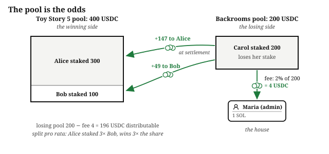
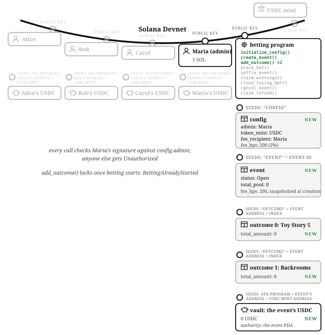
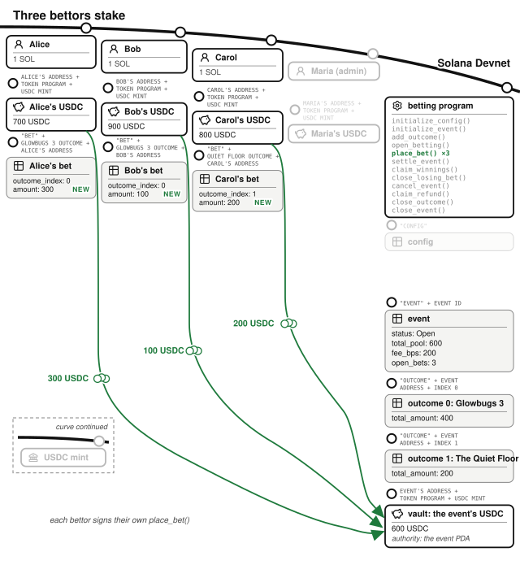
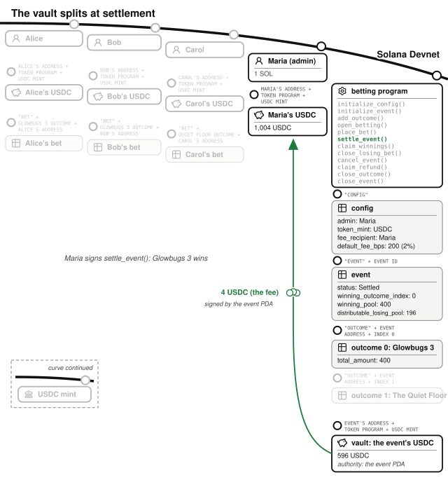
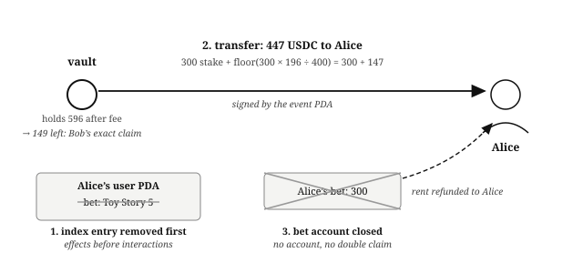
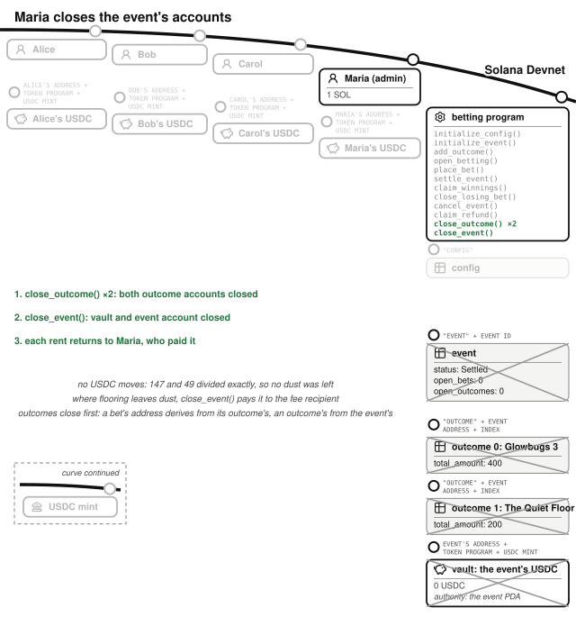
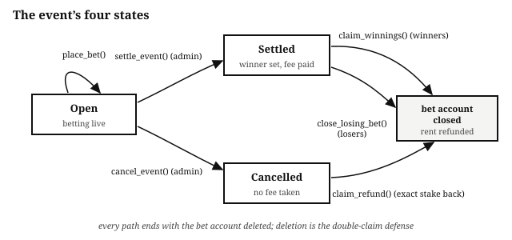

# Chapter 13: The Betting Market

What is going to be the top-grossing film this month? You have an opinion, and so does everyone else. There are two main ways to let everyone put money on it:

- **With a bookmaker.** The house quotes odds and fixes them when each bet is placed. It takes the other side of every bet, so it carries the risk of paying winners more than the losers staked. This is fixed-odds betting, the model of a high-street betting shop or a sportsbook.
- **Without a bookmaker.** Bettors are matched against each other, and the house takes a fee instead of a position. This is **parimutuel** betting, also called pool betting or, in Britain and the Commonwealth, the tote. Joseph Oller, who ran a horse-race betting office in Paris, invented it in 1867. It reached Churchill Downs in Kentucky by 1878 and spread to racetracks around the world. France's law of 2 June 1891 gave authorized racing societies the right to run parimutuel pools, and left the pool as the only legal way to bet on horses there.[^parimutuel-dates] Prediction markets such as Polymarket and Kalshi also have no bookmaker, but they match bettors on an order book, the design the *Order Book Exchange* chapter builds.

This chapter builds a parimutuel market. The program lives at `finance/betting-market` in the companion repository. Its structure is the *Fundraiser* chapter's pooled vault, with one new question: who decides what happened in the real world?

## Payouts Come From the Ratio of the Pools at the Close

In a parimutuel market, all stakes on all outcomes go into one vault. When the event settles, the losing side's stakes, minus the house fee, go to the winning side, based on the size of each winner's stake. Your payout odds are the ratio between the pools when betting closes, not the odds showing when you placed your bet. So the odds change as people bet, and heavy betting on a favorite shrinks what each of its backers can win.

**Parimutuel winnings are proportional to stake.** Bet three times as much as the next winner and you win three times as much of the losing pool.

## The Operator Creates the Market

Maria is the admin. The program's config records her public key, and only she can create events, add outcomes, open betting, settle, cancel, and close a finished event's accounts. Her revenue is a 2% fee, charged only on the losing pool. She runs `initialize_config()` once, naming herself admin, USDC as the token, herself as fee recipient, and 200 **basis points** (2%) as the fee. For this month's market she runs `initialize_event()` with a description ("top-grossing film this month") and a `betting_closes_at` of midnight on the last day of the month. A close time already in the past fails with `CloseTimeInPast`. The event starts as a Draft, and Maria calls `add_outcome()` twice: "Glowbugs 3" and "The Quiet Floor". Then she calls `open_betting()`, which moves the event to Open. Every handler on that list checks its signer against the admin address the config stores and rejects anyone else with `Unauthorized`. `test_only_admin_can_initialize_event` and the last step of `test_open_betting_needs_two_outcomes` check it for creating an event, adding an outcome, and opening betting. `test_only_admin_can_settle_or_cancel_event` and `test_only_admin_can_close_outcomes_and_event` check the rest.

Those calls created five accounts: the config, the event and its vault, and two outcomes.

The **config** is a single account at a PDA (seed `"config"`), created once by `initialize_config()`. It holds the `admin`, the `token_mint` bets are denominated in, the `fee_recipient`, the `default_fee_bps` each new event copies at creation, and a running `event_count`. The program caps the fee at 10,000 basis points (100%), so it can never exceed the losing pool it is taken from.

The **event** is an account at a PDA (seeds: `"event"`, the event ID) with a description, a status (Draft, Open, Settled, or Cancelled), the `betting_closes_at` time when betting stops, and the running `total_pool`. After settlement it also holds the `winning_outcome_index`, `winning_pool`, and `distributable_losing_pool`. Two design details:

- **Each event keeps the terms it was created with**, the *Offchain Truth* chapter's rule. `initialize_event()` copies the config's `default_fee_bps` into the event's own `fee_bps` and sets `betting_closes_at` once. Settlement reads the event's copy, never the config.
- **The vault is one token account for the whole event**, an associated token account whose authority is the event PDA. Stakes on every outcome mix in one vault. The data accounts, not separate vaults, record which stakes belong to which outcome.

Each **outcome** is an account at a PDA (seeds: `"outcome"`, the event, an index byte) holding its label, its `total_amount` staked, and its `bet_count`.

One rule protects the bettors: **the outcome list is fixed before any stake can arrive**. `add_outcome()` works only on a Draft and fails with `EventNotDraft` once the event is Open. `place_bet()` on a Draft fails with `EventNotOpen`, so nobody can bet while the list is still changing. `open_betting()` refuses a market with fewer than two outcomes (`NotEnoughOutcomes`), because a single outcome has no losing side to pay its winners from. The tests `test_outcomes_lock_when_betting_opens` and `test_open_betting_needs_two_outcomes` check all three rules.

A simpler but naive design would lock the list at the first bet, by refusing `add_outcome()` once the pool holds any stakes. That would let anyone freeze a half-built market with a one-minor-unit bet on its only outcome. It would also let Maria's last `add_outcome()` and the first bet land in either order, so the first bettor could stake on a list with an outcome their screen never showed. An explicit status that only Maria can change has neither problem. This is the *State Machines* chapter's rule: record the state explicitly, and never infer it from other fields.

## Bettors Stake on Their Chosen Outcomes

Three bettors place bets. Each starts with the standard wallet of one SOL and 1,000 USDC and bets in USDC, the token the config names. Alice is confident about school holidays and puts $300 on Glowbugs 3. Bob agrees but has less to spend: $100 on Glowbugs 3. Carol believes in word of mouth and puts $200 on The Quiet Floor.

Each bettor calls `place_bet()` with an amount, any time before the close. A zero-amount bet fails with `ZeroAmount`, and a bet made once the clock reaches `betting_closes_at` fails with `BettingClosed`. A first bet on an outcome creates the bet account before the handler code runs. The handler moves the stake immediately from the bettor's token account into the event's vault. The bettor signs this transfer directly, and it needs no PDA signature. It then fills in a fresh account's fields and increases the outcome's `total_amount` and the event's `total_pool`. A fresh bet account has amount zero, and the handler uses that to tell a first bet from a top-up. Only a first bet adds one to the outcome's `bet_count`.

After all three bets, the vault holds 600 USDC: 400 staked on Glowbugs 3, 200 on The Quiet Floor.

Each **bet** is an account at a PDA (seeds: `"bet"`, the outcome, the bettor), holding the bettor, the outcome index, and the amount. The bettor's address is the first field after the account's discriminator. So a wallet app lists someone's open bets by asking an RPC node for every bet account with their address at that offset (`getProgramAccounts` with a `memcmp` filter). The program keeps no list of a wallet's bets, so it sets no limit on how many a wallet holds open at once (checked by `test_no_cap_on_open_bets_per_wallet`).

## The Film Grosses: The Operator Settles the Event

The month ends, and betting closes at midnight. In the real world, Glowbugs 3 wins. For the program, the fact that decides where 600 USDC goes exists only offchain. This program resolves it by having a designated trusted party sign. Maria calls `settle_event()` with the winning outcome's index. The handler checks her signature against the config's admin and writes her answer to the event account as `winning_outcome_index`. The *Offchain Truth* chapter covers the full range, from a single admin signer like this one, through multi-party resolution, to signed price feeds. This program makes the trusted party explicit and limits what their signature can do. Maria can pick which outcome won. She cannot change the payout math, take more than the fee fixed at creation and the dust the floors leave, or take tokens from the vault any other way.

`settle_event()` works only once the clock reaches `betting_closes_at`, and before that it fails with `BettingStillOpen`. A bet needs the clock before the close and settlement needs it at or after. So no bet can land once the event can be settled, and Maria cannot end the market early (checked by `test_betting_closes_at_close_time`).

Settlement does four things, and none of them pays bettors yet:

- Marks the event Settled, so `place_bet()` now rejects with `EventNotOpen` (checked by `test_cannot_bet_after_settle`).
- Validates the winner: the handler derives the winning outcome account again from the index, using its PDA seeds. An outcome nobody bet on fails with `OutcomeHasNoBets` (checked by `test_settle_outcome_without_bets_fails`). With no winning bets nobody could claim the losing pool, and `close_event()` would pay it all to the fee recipient.
- Does the fee math. The losing pool is `total_pool` minus the winning outcome's total: 600 − 400 = 200 USDC. The fee is 2% of the *losing pool only*: 4 USDC, computed in u128 and rounded up. The remaining 196 becomes the `distributable_losing_pool`, stored on the event. Charging the fee only on the losing side gives one guarantee: **a winner can never receive less than they staked**.
- Transfers the 4 USDC fee out of the vault to the fee recipient's token account, signed by the event PDA.

## Winners Claim: Winnings Are Proportional to Stake

Winners claim their payouts whenever they like. Nothing pays out automatically. Alice calls `claim_winnings()`. Her payout is her stake back plus her share of the distributable losing pool, in proportion to her stake:

payout = stake + floor(stake × distributable_losing_pool ÷ winning_pool)

For Alice: 300 + floor(300 × 196 ÷ 400) = 300 + 147 = **447 USDC**. For Bob: 100 + 49 = **149 USDC**. Alice staked three times what Bob staked and won three times the winnings. Carol staked 200 and receives nothing. If The Quiet Floor had won, she alone would have taken the whole 400-dollar losing side, minus the fee.

None of these payouts depended on when anyone bet. Whether Alice bet first, when Glowbugs 3 held only her stake, or last, after Bob, she receives 447 USDC, because the payout reads the pools at the close. A racetrack's tote board works the same way: the odds it shows keep moving until the race starts, and every winning ticket is paid at the final odds.

The multiply runs in u128 and the handler divides once, after the multiplication, so the result is floored a single time. Dividing first would lose precision on every claim. Because of the floor, the payouts can total a few minor units less than the distributable pool. That dust stays in the vault, where no claimant can reach it.

The claim closes the bet account, refunding its rent to the bettor. This is the *State Machines* chapter's rule: **a closed account stops a double claim**. If Alice claims twice, the second claim fails because the bet account it needs is already gone (`test_double_claim_fails` asserts the second claim fails with Anchor's `AccountNotInitialized`). There is no `claimed` flag to forget to check.

## Closing Out, and Getting Assets Out of Every State

Carol's losing bet pays nothing, but its account still holds her rent. She calls `close_losing_bet()`, which checks the event is settled and her outcome is not the winner, then closes the account and returns the rent to her. Called on a winning bet, it fails with `BetWon`. A winner closes their bet through `claim_winnings()`. `test_close_losing_bet_only_after_settle_and_only_for_losers` checks that a close before settlement and a winner's close both fail.

Bob claims his 149 USDC the same way, and once Carol's account closes no bet of the event is open. Maria then closes what the event created, children first: every bet before any outcome, and every outcome before the event. The event counts its open outcomes and bets and refuses to close until both are zero, the *Fundraiser* chapter's rule for an account with derived accounts. `add_outcome()` raises `open_outcomes` and `close_outcome()` lowers it. `place_bet()` raises `open_bets` for each bet account it creates, and `claim_winnings()`, `claim_refund()`, and `close_losing_bet()` each lower it.

She calls `close_outcome()` once per outcome. It refuses while the event is still a Draft or Open (`EventNotFinished`) and while the event's `open_bets` is above zero (`BetsStillOpen`). Otherwise it closes the outcome account and returns its rent to her. No claim or refund reads the outcome account, because each finds its bet from the outcome address the bet stores. `BetsStillOpen` keeps the order: no outcome closes while any bet of the event is open, so no open bet names a closed outcome. Then she calls `close_event()`, which makes the same two checks and also refuses while any outcome is open (`OutcomesStillOpen`). It pays whatever the vault still holds to the fee recipient's token account, closes the vault, and closes the event account, returning both rents to her.

In this market the vault is already empty: 147 and 49 divided exactly. Where the floors leave dust, `close_event()` pays it to the fee recipient, so it ends up where the fee did.

`test_close_event_pays_dust_to_fee_recipient_and_returns_rent` runs a market whose shares do not divide exactly, and checks that the one minor unit left reaches the fee recipient, that every closed account is gone, and that each rent returns to the admin.

An Open event can also be voided. If the studio pulls both films from release, there is no result to settle. `cancel_event()`, which only the admin can call, sets the status to Cancelled. Every bettor then takes back their full stake through `claim_refund()`, with no fee taken, and the refund closes the bet account as `claim_winnings()` does. `test_cancel_and_refund` checks this, then closes the canceled event's accounts, with nothing left in the vault to pay. `cancel_event()` works on a Draft too, which is how Maria abandons a market she set up wrong before anyone has staked on it. Settled and Cancelled are the two ways an Open event ends, and in both every bet account has a handler that pays it out or closes it. The config is Maria's state for the whole deployment, and no handler closes it.

## The Math: One Division, Floored Once, Fee Off the Losers

The financial arithmetic of this program is four expressions:

- **The losing pool**: a subtraction.
- **The fee**: a u128 multiply, divided by 10,000 basis points and rounded up.
- **Each winner's share**: a u128 multiply of stake by distributable pool, then one floor division by the winning pool.
- **The payout**: stake plus share, checked.

Every checked operation that fails returns `MathOverflow`. There are no rates and no curves, and the program uses time only to compare the clock against `betting_closes_at`.

## The Invariants: The Vault Covers Every Claim

- At every moment, the vault holds at least the stakes not yet claimed: before settlement, the total pool; after settlement, the unclaimed winning stakes and their winnings; after cancellation, the stakes not yet refunded. `close_event()` pays whatever else the vault holds to the fee recipient.
- The winning pool, the distributable losing pool, and the fee always sum exactly to the pre-settlement total pool: 400 + 196 + 4 = 600.
- A winner's payout is never less than their stake.
- One bet account per bettor per outcome, and no bet account survives its payout, refund, or close.
- `open_bets` counts the event's bet accounts and `open_outcomes` its outcome accounts. No outcome closes while a bet is open, and the event does not close while an outcome is open.
- The outcome list never changes once the event is Open, and no stake enters the pool at or after `betting_closes_at`.
- Only the admin's signature can settle or cancel an event.

## The Failure Modes: One Person Decides the Result

- **The resolution itself.** Maria could settle the wrong outcome, on purpose or by mistake. This program is the simplest case. The *Offchain Truth* chapter covers what a trusted party loses by lying, and how to replace a single signer with several.
- **Settling an empty outcome** would pay every stake to the fee recipient, so `settle_event()` fails with `OutcomeHasNoBets`.
- **Double claims** fail because the bet account is gone, as the claim step showed.
- **Closing an account too early** fails with the three checks the close step showed, `EventNotFinished`, `BetsStillOpen` and `OutcomesStillOpen` (`test_close_event_refused_while_event_is_open` checks the first, `test_close_event_refused_while_a_bet_is_open` the second, and `test_close_event_pays_dust_to_fee_recipient_and_returns_rent` the third). Only Maria's signature closes anything (`test_only_admin_can_close_outcomes_and_event`).
- **Changing the terms after betting opens** fails: `add_outcome()` on an Open event fails with `EventNotDraft`, and `fee_bps` and `betting_closes_at` have no handler that writes them after `initialize_event()`.
- **Betting on a known result**: a bettor who learns the result before Maria settles cannot stake on it, because `place_bet()` stops at `betting_closes_at` with `BettingClosed`. The program cannot tell when the result becomes public, so choosing a close time before that moment is Maria's job.
- **Betting after settlement or cancellation** fails with `EventNotOpen`, whether the event was settled or canceled.

## Testing Considerations

The suite builds all state through the program's own handlers, and the longest test is `test_full_lifecycle`, which runs from config through claims. It uses the same pools as the story above (400 on the winner, 200 on the loser, a 4 USDC fee), with Alice's and Bob's stakes swapped, and asserts balances after the bets, the settlement, and the claims. Around it, there is one test per failure mode: the admin-only handlers, the outcome list locking when betting opens, the two-outcome minimum, both edges of the close time, a close time in the past, bet-after-settle, double claims, empty-outcome settlement, and cancel-and-refund. The last of those also closes the canceled event once its refunds are in. The closing paths have `test_close_losing_bet_only_after_settle_and_only_for_losers`, `test_close_event_pays_dust_to_fee_recipient_and_returns_rent`, `test_close_event_refused_while_a_bet_is_open`, `test_close_event_refused_while_event_is_open`, and `test_only_admin_can_close_outcomes_and_event`. When you write your own market, do the same: check the math on the happy path, and give every adversarial code path a test whose name says what it refuses to allow.

## What You Learnt from Building the Betting Market

A racetrack's parimutuel pool needs a tote board, a licensed operator, and a payout window. Here the vault holds every stake, the payout formula sets each winner's share from the pools at the close, and the fee is 2% of the losing pool.

This chapter added three concepts:

- **The parimutuel structure.** All stakes go into one pool. Winners split the losing pool in proportion to their stakes, so a larger stake wins more and no one sets odds.
- **Cancellation refunds every stake.** Draft and Open events can be canceled, and stakes in a canceled event are refunded in full, so no stake is left stuck in a voided event.
- **Two levels of derived accounts close in order.** Bets close before outcomes and outcomes before their event, because each close refuses while a counter on the event shows a child still open.

In the *Order Book Exchange* chapter we will build an exchange. Instead of paying into one pool, traders post orders at the prices they want, backed by tokens moved into a vault when the order is placed, and the program matches each new order against the best resting one. You will see how orders are stored, matched, and paid out onchain, where every step costs compute. The trusted signer returns later, first in the *Prop AMM* chapter, where the trusted signature is a price feed. The pooled payout returns in the *Lending and Borrowing* and *Perpetual Futures* chapters, where settlement runs continuously instead of once.

[^parimutuel-dates]: Oller's 1867 system is recorded in the Encyclopaedia Universalis entry on him, at [universalis.fr/encyclopedie/joseph-oller](https://www.universalis.fr/encyclopedie/joseph-oller/); the 1878 Churchill Downs introduction by the Kentucky Derby, at [kentuckyderby.com/horses/news/how-kentucky-derby-betting-traditions-have-changed-over-time-since-1875](https://www.kentuckyderby.com/horses/news/how-kentucky-derby-betting-traditions-have-changed-over-time-since-1875/); and the law of 2 June 1891, whose article 5 lets approved societies organize the pari mutuel, at [weka.fr/base-juridique-weka/loda/JORFTEXT000000512373](https://www.weka.fr/base-juridique-weka/loda/JORFTEXT000000512373).
