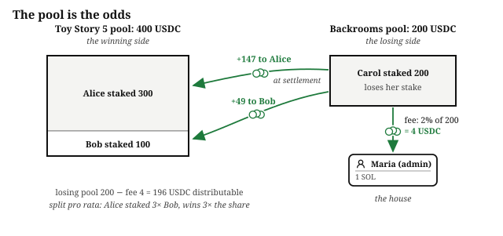
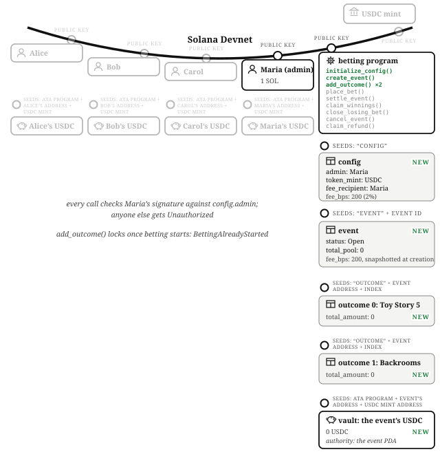
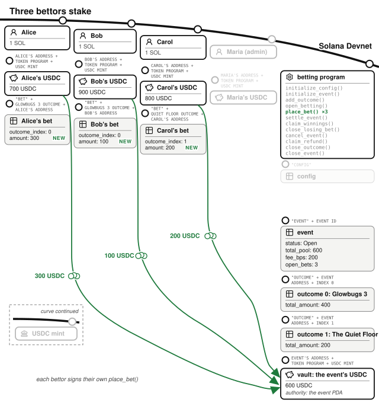
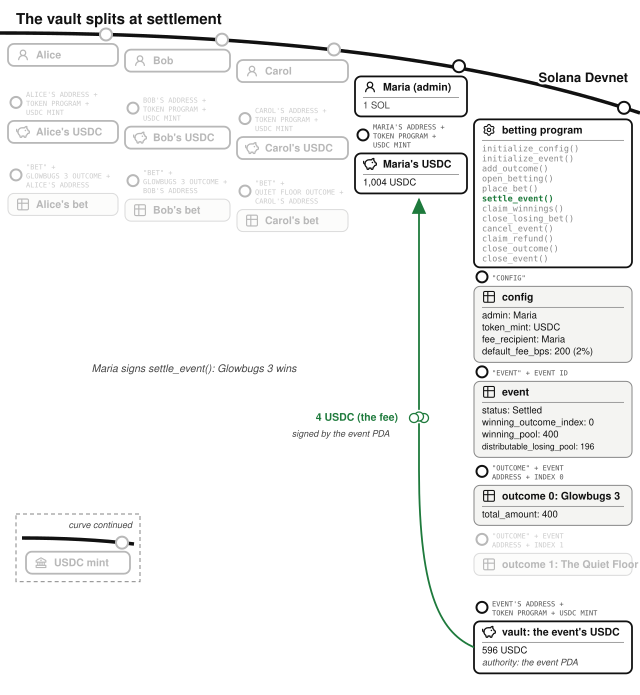
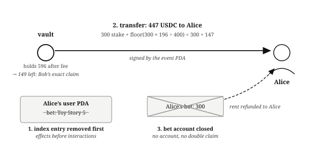
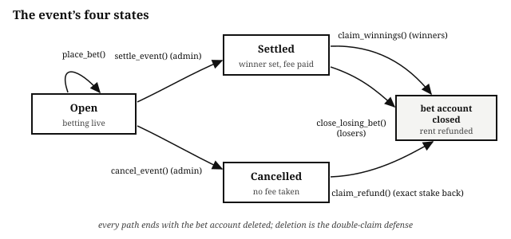

# Chapter 13: The Betting Market

What is going to be the top-grossing film this month? You have an opinion, and so does everyone else. This chapter builds the program that lets everyone put money on it: a **parimutuel** betting market, the kind with no bookmaker. Nobody sets odds. The odds *are* the pool: everyone's stakes go into one vault, and when the event resolves, the winners split the losers' money in proportion to how much they staked. Racetracks have run on this model since the 1870s, because the house never takes a position; it just takes a fee.

The program lives at `finance/betting-market` in the companion repository. Structurally it is the *Escrow* chapter with many parties and one new, serious question: who decides what happened in the real world?

## Nobody Sets the Odds: The Pool Is the Odds

In a bookmaker market, the house quotes odds and carries risk on every bet. In a parimutuel market, the program carries no risk. All stakes on all outcomes pool together. When the event settles, the losing side's money (minus the house fee) is distributed to the winning side, pro rata by stake. Your payout odds are the ratio between the pools at settlement time, which means the odds float as people bet, and betting heavily on a favorite compresses everyone's payout.

**Parimutuel markets reward conviction.** Bet three times as much as the next winner and you win three times as much of the losing pool.

## The Operator Creates the Market

Maria is the admin. Her key is recorded in the program's config, and only she can create events, add outcomes, open betting, settle, and cancel; her revenue is a 2% fee, charged only on the losing pool. She runs `initialize_config()` once, naming herself admin, USDC as the token, herself as fee recipient, and 200 basis points (2%) as the fee. For this month's market she runs `initialize_event()` with a description ("top-grossing film this month") and a `betting_closes_at` of midnight on the last day of the month. A close time already in the past fails with `CloseTimeInPast`. The event starts as a Draft, and Maria calls `add_outcome()` twice: "Toy Story 5" and "Backrooms". Then she calls `open_betting()`, which moves the event to Open. Every one of these instruction handlers checks her signature against the admin address stored in the config and rejects anyone else with `Unauthorized`; the test `test_only_admin_can_initialize_event` checks it.

Financial state on Solana is accounts, and those five transactions created the five accounts the market needs.

The **config** is a single account at a PDA (seed `"config"`), created once by `initialize_config()`, holding the `admin`, the `token_mint` bets are denominated in, the `fee_recipient`, the `default_fee_bps` each new event copies at creation, and a running `event_count`. The fee is capped at 10,000 basis points, because a fee above 100% is nonsense.

The **event** is an account at a PDA (seeds: `"event"`, the event ID) with a description, a status (Draft, Open, Settled, or Cancelled), the `betting_closes_at` time when betting stops, and the running `total_pool`. After settlement it also holds the `winning_outcome_index`, `winning_pool`, and `distributable_losing_pool`. Two design details:

- **Each event keeps the terms it was created with.** Its `fee_bps` is copied from the config's `default_fee_bps`, and `betting_closes_at` is set once by `initialize_event()`. If Maria later changes `default_fee_bps`, markets that bettors already joined keep the fee they signed up under.
- **The vault is one token account for the whole event**, an associated token account whose authority is the event PDA. Stakes on every outcome mix in one vault; the accounting that keeps them straight lives in the data accounts, not in separate pots.

Each **outcome** is an account at a PDA (seeds: `"outcome"`, the event, an index byte) holding its label, its `total_amount` staked, and its `bet_count`.

One rule protects the bettors: **the outcome list is fixed before any money can arrive**. `add_outcome()` works only on a Draft and fails with `EventNotDraft` once the event is Open. `place_bet()` on a Draft fails with `EventNotOpen`, so nobody can bet while the list is still changing. `open_betting()` refuses a market with fewer than two outcomes (`NotEnoughOutcomes`), because a single outcome has no losing side to pay its winners from. The tests `test_outcomes_lock_when_betting_opens` and `test_open_betting_needs_two_outcomes` check all three rules.

The Draft status is what keeps the list fixed. The simpler design locks the list at the first bet, by refusing `add_outcome()` once the pool holds any money. That lets anyone freeze a half-built market with a one-minor-unit bet on its only outcome. It also lets Maria's last `add_outcome()` and the first bet land in either order, so the first bettor can stake on a list with an outcome their screen never showed. An explicit status that only Maria can change has neither problem.

## Bettors Stake on Their Chosen Outcomes

Three bettors take a view, each from the standard wallet of one SOL and 1,000 USDC, and all in USDC, the token the config designates. Alice is confident about school holidays and puts $300 on Toy Story 5. Bob agrees but has less to spend: $100 on Toy Story 5. Carol believes in word of mouth and puts $200 on Backrooms.

Each bettor calls `place_bet()` with an amount, any time before the close. Zero-amount bets reject with `ZeroAmount`, and a bet once the clock reaches `betting_closes_at` rejects with `BettingClosed`. The handler moves the stake immediately from the bettor's token account into the event's vault (the bettor signs this transfer directly; no PDA signature is needed on the way in). It then creates the bet account if this is the bettor's first bet on this outcome, and bumps the outcome's `total_amount` and the event's `total_pool`. A fresh bet account has amount zero, which is how the handler tells a first bet from a top-up: only a first bet adds one to the outcome's `bet_count` and adds the bet to the bettor's list of open bets.

After all three bets, the vault holds 600 USDC: 400 staked on Toy Story 5, 200 on Backrooms.

A bettor's first bet also created two accounts for them. Each **bet** is an account at a PDA (seeds: `"bet"`, the outcome, the bettor), holding the bettor, the outcome index, and the amount. One bet account per bettor per outcome: betting again on the same outcome tops up the existing account rather than creating a second one. And each bettor gets a **user** account, also at a PDA, indexing their open bet accounts, capped at 32 concurrent positions so the account never needs to grow. Removals use swap-remove, because the order of a list of bets means nothing and moving the last entry into the gap is the cheapest deletion.

## The Film Grosses: The Operator Settles the Event

The month ends, and betting closes at midnight. In the real world, Toy Story 5 wins. In program terms, the fact that decides where 600 USDC goes exists entirely offchain. This program resolves it by having a designated trusted party sign. Maria calls `settle_event()` with the winning outcome's index, her signature is checked against the config's admin, and her answer is written to the event account as `winning_outcome_index`. The *Offchain Truth* chapter covers the full spectrum, from a single admin key like this one, through multi-party resolution, to signed price feeds. This program makes the trusted party explicit and limits what their signature can do. Maria can pick which outcome won, but she cannot touch the pro-rata math, take more than the snapshotted fee, or reach into the vault by any other path.

`settle_event()` works only once the clock reaches `betting_closes_at`, and earlier fails with `BettingStillOpen`. The two windows split time exactly: a bet needs the clock before the close, and settlement needs it at or after. So no bet can land once the event can be settled, and Maria cannot end the market early (checked by `test_betting_closes_at_close_time`).

Settlement does four things, none of which involve paying bettors yet:

- Marks the event Settled, so `place_bet()` now rejects with `EventNotOpen` (checked by `test_cannot_bet_after_settle`).
- Validates the winner structurally: the winning outcome account is re-derived from the index via its PDA seeds, and an outcome nobody bet on rejects with `OutcomeHasNoBets`, because a winning pool of zero would put a divide-by-zero in every claim (checked by `test_settle_outcome_without_bets_fails`).
- Does the fee math. The losing pool is `total_pool` minus the winning outcome's total: 600 − 400 = 200 USDC. The fee is 2% of the *losing pool only*: 4 USDC, computed in u128 and floored. The remaining 196 becomes the `distributable_losing_pool`, stored on the event. Charging the fee only on the losing side gives one guarantee: **a winner can never receive less than they staked**.
- Transfers the 4 USDC fee out of the vault to the fee recipient's token account, signed by the event PDA.

## Winners Claim: Conviction Pays Three to One

Winners come and get their money whenever they like; nothing pays out automatically. Alice calls `claim_winnings()`. Her payout is her stake back plus her pro-rata share of the distributable losing pool:

payout = stake + floor(stake × distributable_losing_pool ÷ winning_pool)

For Alice: 300 + floor(300 × 196 ÷ 400) = 300 + 147 = **447 USDC**. For Bob: 100 + 49 = **149 USDC**. Alice staked three times what Bob staked and won exactly three times the winnings. Carol staked 200 and receives nothing; had Backrooms won, she alone would have taken the entire 400-dollar losing side, minus the fee.

The multiply runs in u128 and divides exactly once, after the multiplication, so the result is floored a single time; dividing first would throw away precision on every claim. The floor means at most a few minor units of dust can remain in the vault, and dust belongs to the house, not to whichever claimant happened to arrive last. The *Arithmetic of Money* chapter explains both choices: multiply before dividing, and round so that the leftover dust stays with the program rather than going to a claimant.

Two orderings in this handler close attacks:

- **The bet is removed from the user's index before the token transfer.** Effects before interactions, so no re-entry path can see stale state.
- **The bet account itself closes at the end of the claim**, rent refunded to the bettor, and **a closed account is the double-claim defense**: Alice claiming twice fails because the bet account the second claim needs is already gone (checked by `test_double_claim_fails`).

There is no `claimed` boolean to forget to check.

## Closing Out, and Getting Money Out of Every State

Carol's losing bet pays nothing, but it still occupies one of her 32 position slots and holds rent. She calls `close_losing_bet()`, which checks the event is settled and her outcome is not the winner (a winner trying to use this cheaper path rejects with `BetWon` and must use `claim_winnings()`), then closes the account and frees the slot. Both rules are checked by `test_close_losing_bet_only_after_settle_and_only_for_losers` and `test_closing_a_bet_frees_a_slot_for_a_new_bet`.

And what if the film festival burns down? An Open event can also end another way: `cancel_event()`, admin-only, flips the status to Cancelled, and every bettor reclaims their exact stake through `claim_refund()`, no fee taken, using the same close-the-account-to-prevent-double-claims mechanic (checked by `test_cancel_and_refund`). `cancel_event()` works on a Draft too, which is how Maria abandons a market she set up wrong before anyone has money in it. Draft, Open, Settled, Cancelled: four states, and in each one every bet account has a handler that pays it out or closes it.

## The Math: One Division, Floored Once, Fee Off the Losers

The financial arithmetic of this program is four expressions:

- **The losing pool**: a subtraction.
- **The fee**: a u128 multiply, floor-divided by 10,000 basis points.
- **Each winner's share**: a u128 multiply of stake by distributable pool, then one floor division by the winning pool.
- **The payout**: stake plus share, checked.

Every checked operation maps to `MathOverflow`. There are no rates and no curves, and time appears only as one comparison against the close.

## The Invariants: The Vault Covers Every Claim

- At every moment, the vault balance equals stakes not yet claimed: before settlement, the total pool; after settlement, winning stakes plus unclaimed winnings plus dust.
- The winning pool, losing pool, and fee always sum exactly to the pre-settlement total pool.
- A winner's payout is never less than their stake.
- One bet account per bettor per outcome, and no bet account survives its payout, refund, or close.
- The outcome list never changes once the event is Open, and no stake enters the pool at or after `betting_closes_at`.
- Only the admin's signature can settle or cancel, and only the pro-rata formula decides amounts.

## The Failure Modes: The Oracle Is a Person, and Everything Downstream of That

- **The resolution itself.** Maria could settle the wrong outcome, maliciously or by mistake. The program limits the damage to that one decision (she cannot skim beyond the fee or redirect funds), but the decision is hers alone. This program is deliberately the simplest case; the *Offchain Truth* chapter covers what it costs a trusted party to lie, and how to grow out of a single key.
- **Settling an empty outcome** would divide by zero in every claim; rejected at the source with `OutcomeHasNoBets`.
- **Double claims** fail because the bet account is gone. There is no flag to desynchronize.
- **Changing the game mid-play**: `open_betting()` fixes the outcome list before any bet can land, and the fee and close time are fixed per event at creation.
- **Betting on a known result**: a bettor who learns the result before Maria settles cannot stake on it, because `place_bet()` stops at `betting_closes_at` with `BettingClosed`. The program cannot tell when the result becomes public, so choosing a close time before that moment is Maria's job.
- **Slot exhaustion**: 32 concurrent positions per user, `TooManyBets` beyond it, and `close_losing_bet()` to recycle slots.
- **Betting after settlement or cancellation** rejects with `EventNotOpen`, whether the event was settled or canceled.

## Testing Considerations

The suite builds all state through the program's own handlers, and its centerpiece is `test_full_lifecycle`: the exact story above, config through claims, with balances asserted at each step. Around it, one test per failure mode: the admin-only handlers, the outcome list locking when betting opens, the two-outcome minimum, both edges of the close time, a close time in the past, bet-after-settle, double claims, empty-outcome settlement, cancel-and-refund, and when a losing bet may close. When you write your own market, copy the shape: the happy path checks the math, and every adversarial code path gets a test whose name says what it refuses to allow.

## What You Learnt from Building the Betting Market

A racetrack's parimutuel pool needs a tote board, a licensed operator, and a payout window; a betting site adds a bookmaker carrying risk on every line. Here a vault and four expressions of arithmetic do those jobs: the pool is the odds, the program carries no risk, and the house takes a fee only from the losers.

This chapter added five concepts:

- **The parimutuel structure.** All stakes pool together; winners split the losing pool pro rata by stake, so conviction pays proportionally and no one sets odds.
- **A designated signer decides the result.** The operator's signature is the oracle, and the program's job is making that trust visible and narrow: they pick the winner, but cannot touch the math, the snapshotted fee, or the vault by any other path.
- **Terms locked when money commits.** An explicit Draft status keeps bets out until the admin opens the market, so the outcome list is fixed before the first stake. The fee and close time are fixed at event creation, so the question bettors staked on cannot be rewritten.
- **Account closure as the double-claim defense.** A claimed bet's account is gone, so there is no flag to desynchronize.
- **Cancellation refunds every stake.** Draft and Open events can be canceled, and stakes in a canceled event are refunded in full, so a burned-down film festival strands nobody's stake.

In the *Order Book Exchange* chapter we will build an exchange. Instead of paying into one pool, traders post orders at the prices they want, backed by tokens locked when the order is placed, and the program matches each new order against the best resting one. You will see how orders are stored, matched, and paid out onchain, where every step costs compute. The pooled payout formula and the trusted signer both return later, in the *Lending and Borrowing* and *Perpetual Futures* chapters, where the trusted signature is a price feed and settlement runs continuously instead of once.
