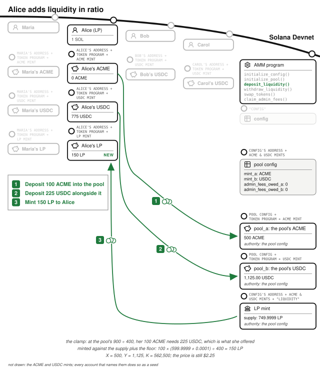
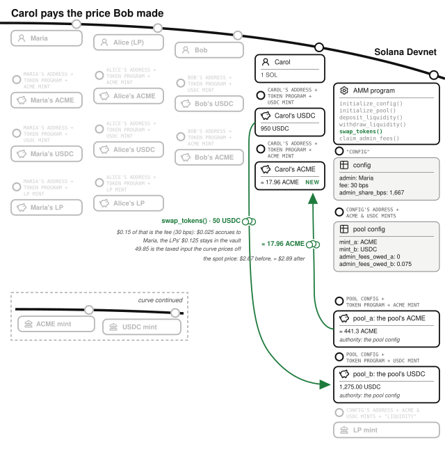
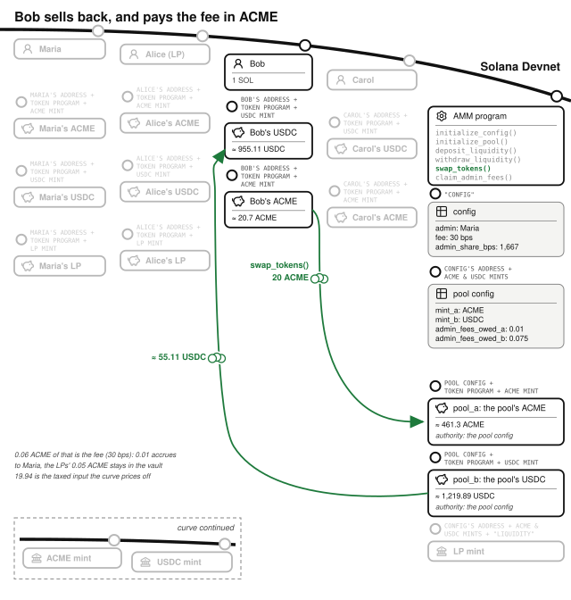
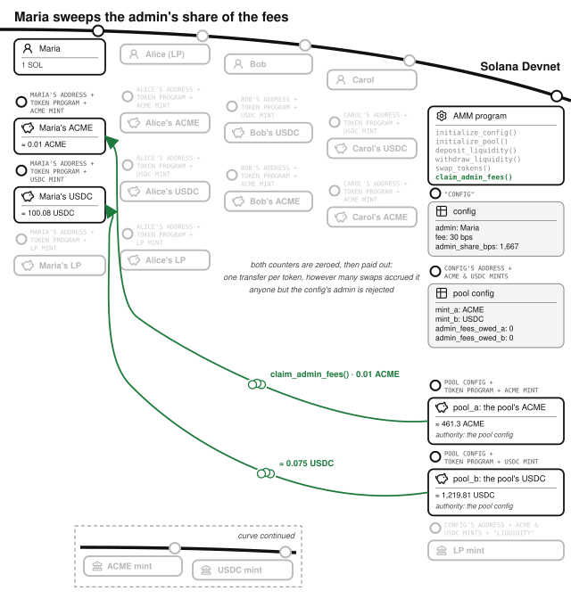
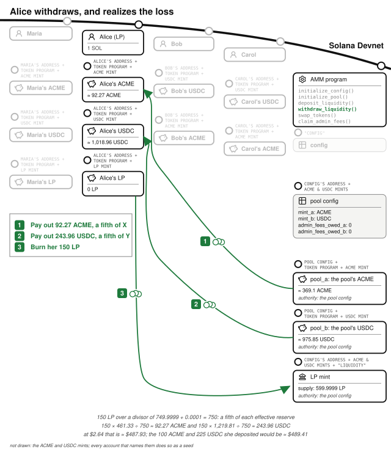
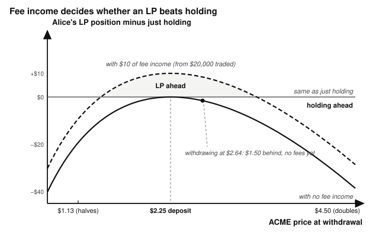

# Chapter 15: The Constant-Product AMM

The *Order Book Exchange* chapter built an exchange where every price is a commitment someone posted. This chapter builds the other kind: an **automated market maker**, where nobody posts prices at all. Every incoming order fills instantly, at a price determined by a formula, against tokens supplied by **liquidity providers** who earn a fee on every trade. That fee compensates them for impermanent loss, the amount by which providing liquidity falls behind holding the same tokens when the price moves, and this chapter calculates it.

AMMs work where order books do not: tokens without much trading volume, where a taker might wait forever for a matching maker. So they are the standard venue for new token launches, and this chapter follows one. Orca, Raydium, and Pump.fun are popular AMMs on Solana. The program lives at `finance/token-swap` in the companion repository.

## X Times Y Equals K, and K Prices Every Trade

The pool holds two tokens. Call the amount of the first one **X** (here, ACME, the freshly listed stock of a robotics startup) and the amount of the second **Y** (USDC, because you quote in the stable asset). **K is X times Y.** Its only job is to hold X and Y in relation to each other during a trade: a buyer who adds USDC to the pool gets exactly the amount of ACME that keeps the product steady at K. Rearranged, that is the pricing formula:

output = taxed_input × other_reserve ÷ (this_reserve + taxed_input)

The spot price is the ratio Y ÷ X, and every trade moves it: buying ACME removes X and adds Y, so the next buyer pays more. Big trades relative to the pool move the price a lot; that is price impact.

**The curve holds K fixed while it prices a trade, and K changes between trades.** It grows two ways:

- **Liquidity deposits** add more of both tokens at the same ratio.
- **Fees**: the liquidity providers' share of every trade's fee is added to the reserves without being used to price the trade. Nobody is paid it at the time; liquidity providers collect it as part of their slice when they withdraw.

Liquidity withdrawals shrink K, by the withdrawer's share of both reserves.

The deeper the pool, the less any one trade moves the price.

## Creating the Venue Sets the Launch Price

Maria operates the AMM and is launching ACME today. She earns twice: an admin share of every trading fee, and LP fees on the liquidity she provides herself. Like every character in this book she starts with one SOL and 1,000 USDC; she also holds 400 ACME of founder stock.

Maria runs `initialize_config()` with a fee of 30 basis points and an admin share of 1,667 basis points, about one sixth of each fee. Then `initialize_pool()` for ACME/USDC, which creates the pool config, the LP mint, and the two vaults, and takes the pool's first deposit in the same instruction. She believes a fair launch price is $2.25, so she passes 400 ACME and 900 USDC, the founder stock and nine-tenths of her cash.

Those two transactions created the venue's five accounts.

The **config** is a singleton account at a PDA (seed `"config"`) holding the `admin`, the trading `fee` in basis points, and the `admin_share_bps`, the slice of each fee that belongs to the admin rather than the LPs. One config per deployed program keeps the example simple.

The **pool config** is an account at a PDA seeded by the config and the two mints, one per trading pair, with one rule enforced at creation: `mint_a` must sort below `mint_b`, or creation fails with `InvalidMintOrder`. Without canonical ordering, an (ACME, USDC) pool and a (USDC, ACME) pool would both exist and split the liquidity between them.

The tokens are held in two vaults, `pool_a` and `pool_b`, whose authority is the pool config PDA, alongside the **LP mint** (`liquidity_provider_mint`), whose tokens are the receipts liquidity providers hold and whose mint authority is the same PDA. Only the program can sign as that PDA, with the pool config's seeds, so nobody else can move the vaults' tokens or mint LP tokens.

Two more fields are `admin_fees_owed_a` and `admin_fees_owed_b` on the pool config. The admin's share of fees is never transferred during a swap; it accrues in these counters as a *virtual claim* while the tokens physically sit in the vaults. So every piece of LP-facing math runs on **effective reserves**: the raw vault balance minus the admin's owed slice. The admin's fees do not boost LP yield, do not distort the price, and get swept out later in one transfer per token. The order book kept its fees in a separate fee vault; this pool leaves them in the trading vaults and records the admin's share in these two counters.

**The first deposit sets the price**, so `initialize_pool()` takes it in the instruction that creates the pool: a pool that existed empty first would let whoever deposited first set the price for its creator. A zero on either side fails with `EmptyInitialDeposit`, so no pool exists with an empty vault. X = 400, Y = 900, K = 360,000.

Her LP tokens come from the formula the *Arithmetic of Money* chapter described: the **integer square root of X times Y**, computed by `initial_lp_amount()` with `integer_sqrt()`, the program's own Newton's method loop on u128, floored. The square root of 360,000 is exactly 600, so that is her LP position, minus one thing: `MINIMUM_LIQUIDITY`. That is a floor of 100 minor units of LP supply (the LP mint has six decimals, so a ten-thousandth of one LP token) that is **never minted to anyone**: it never exists as supply, while the reserves it represents stay in the pool. Many AMMs mint the floor instead, to an address nobody can sign for, so that the LP mint's supply counter is the true total. Either way the reserves behind the floor can never be withdrawn. This program keeps the floor in its own arithmetic rather than in the mint. Its value is a fraction of a cent. Why that floor exists is the inflation-attack defense, covered in the failure modes below. The transfers into the vaults and the mint to Maria are `deposit_and_mint_lp_tokens()`, the same code every later deposit ends with; only the arithmetic that chose the amounts is particular to the first.

## Adding Liquidity in Ratio Does Not Move the Price

Alice works at ACME, holds a grant of 100 ACME alongside her standard wallet, and becomes the second liquidity provider: she wants to earn fees on her ACME grant. Liquidity providers are not allowed to change the pool's ratio, so her 100 ACME must arrive with a matching 225 USDC (100 × $2.25). The handler enforces this by clamping: it computes how much of token B her token A implies at the current effective reserves, uses whichever pairing fits inside what she offered, and rejects with `DepositAmountTooSmall` if the clamp rounds her out entirely. Her LP tokens are minted in proportion to her deposit, the minimum of her share against each side, floored, and checked against her `minimum_lp_tokens_out`. Her share is minted against the LP supply plus `MINIMUM_LIQUIDITY`, which the withdrawal below explains.

X is now 500, Y is 1,125, K is 562,500. The price is still exactly $2.25. **Deposits grow K without touching the price.**

## A Buy Moves the Price Along the Curve

Bob is early and bullish. He runs `swap_tokens()` to spend 100 USDC on ACME, a tenth of everything he has, with a `min_output_amount` as his slippage check. Three things happen in strict order.

**The fee is deducted first.** 30 basis points of 100 is 30 cents. The admin share, about 5 cents (1,667 basis points of it, rounded up in minor units), accrues to `admin_fees_owed_b` as Maria's virtual claim; the remaining 25 cents stays in the pool, where it adds to the reserves that back every LP token. Bob's taxed input is 99.70.

**The curve prices the trade.** It prices against Y plus the taxed input, 1,224.70, so X must fall to K ÷ 1,224.70 ≈ 459.3; the vault itself receives all 100 USDC. Bob receives about 40.7 ACME. He paid an *average* of about $2.46 per token while the quoted price before his trade was $2.25 and the spot price after it is about $2.67: his own trade moved along the curve as it executed.

**The invariant is re-checked.** After the transfers land, the handler reads both vault balances again and requires the new effective product to be at least the old one, failing with `InvariantViolated` otherwise. The program's own comment calls this the most important defensive check in the file; the *Arithmetic of Money* chapter explains what such a check catches. The check tolerates growth, because growth is just LP fees enriching the pool.

K is now about 562,615. It grew mid-trade, from the 25 cents of LP fees.

## The Next Trader Pays the Price the Last One Made

Carol has watched the launch all morning and buys $50 of ACME even though the price has already moved. Her $50 is 15 cents of fees (about 2.5 cents admin, about 12.5 cents LPs) and 49.85 taxed input, and the same arithmetic hands her about 18 ACME at an average near $2.78.

## Selling Back Pays the Fee in the Input Token

Bob sells 20 of his 40.7 ACME. A sell is the same instruction with `input_is_token_a` flipped. Now the fee comes off his ACME input (0.06 ACME, of which 0.01 accrues to `admin_fees_owed_a`), X grows by the taxed amount, and Y falls to keep the product: about 55.11 USDC to Bob, an average near $2.76 against the $2.46 he paid. The spot price falls back to about $2.64. The admin's fee ledger now holds claims in *both* tokens, which is why the claim instruction sweeps two sides.

## The Admin Sweeps Its Share of the Fees

Whenever she likes, Maria runs `claim_admin_fees()`. It zeroes both owed counters and transfers exactly those amounts from the vaults to her token accounts, signed by the pool config; anyone else is rejected (`test_claim_admin_fees_rejects_non_admin`), and claiming when nothing is owed fails with `NothingToClaim`. One transfer per token, however many swaps accrued it: the same consolidation logic as the order book's unsettled balances.

## Withdrawing Realizes Impermanent Loss

Alice wants her capital back. `withdraw_liquidity()` pays her a proportional slice of both effective reserves and burns her LP tokens, dividing by the LP supply *plus* `MINIMUM_LIQUIDITY`, the same divisor her deposit was minted against. The locked floor is backed by reserves but absent from the supply counter. Leaving it out here would overpay every withdrawer, and leaving it out of the deposit would underpay every depositor.

Alice does not get back what she deposited. She deposited 100 ACME and 225 USDC; the pool's mix has shifted since, so her slice is about 92.3 ACME and 244 USDC. Valued at the current price, that is roughly $1.50 *less* than if she had held her original tokens in her wallet. A third of a percent of her position is a small number at launch scale and a serious one once the pool is a million times larger.

That gap is **impermanent loss**, and every LP is exposed to it. A constant-product pool mechanically sells the token that is rising and accumulates the token that is falling, so an LP always slightly underperforms just holding, whenever the price moves in either direction. **An LP position profits from trading volume, not from price direction**: if accumulated fees outrun the divergence, LPing wins; if the price moves far in one direction on low volume, holding wins. It is called "impermanent" because it only crystallizes at withdrawal; had Alice stayed in and ACME returned to $2.25, there would have been no loss.

Fee income is what an LP is paid for carrying that gap, and the gap is small for ordinary moves. It grows with the square of the price change, so a move of a quarter costs Alice $3 or $4 depending on the direction, and a doubling about $39. The LPs keep 25 of every 30 basis points of fee and Alice holds a fifth of the pool, so she earns about five basis points of everything traded: $10 for every $20,000. The table sets the two against each other for her $450 position, counting fee income at face value. Each cell is what she has at withdrawal minus what she would have had by holding, and the fee columns are $20,000, $100,000, and $400,000 of trading, the last roughly a year of trading half the pool's value every day.

| ACME at withdrawal | Just holding | LP, no fees | LP, $10 of fees | LP, $50 of fees | LP, $200 of fees |
|---|---|---|---|---|---|
| $1.13 (halves) | $338 | −$19 | −$9 | +$31 | +$181 |
| $1.69 (down a quarter) | $394 | −$4 | +$6 | +$46 | +$196 |
| $2.25 (unchanged) | $450 | $0 | +$10 | +$50 | +$200 |
| $2.81 (up a quarter) | $506 | −$3 | +$7 | +$47 | +$197 |
| $4.50 (doubles) | $675 | −$39 | −$29 | +$11 | +$161 |
| $9.00 (quadruples) | $1,125 | −$225 | −$215 | −$175 | −$25 |

Across any row, LPing wins once fee income outruns the gap, and for ordinary moves it does not take much: $10 of fees covers a move of a quarter in either direction. Down the "LP, no fees" column, with nobody paying fees, the LP is behind in every row but one; that is the solid curve in the figure, and a pool that pays nothing for the risk it asks LPs to carry. Down the last column the LP is still behind when the price quadruples: a fourfold move opens a $225 gap, wider than a year of $200 in fees can cover.

## The Math: Floors Everywhere, and a Square Root by Newton

Every division in this program rounds against the trader. Swap output, LP minting, and withdrawal amounts floor **in the pool's favor**, and the fee and the admin's share of it round up, so a trader never pays a minor unit less than the rate (`test_swap_fee_rounds_up`). The dust stays in the reserves and accrues to all LPs, the direction the *Arithmetic of Money* chapter sets. Every multiplication runs in u128 before its division (multiply before divide), and every step that can overflow is `checked_*` with `MathOverflow` on failure. The only unusual operation, the first deposit's square root in `initialize_pool()`, is a short loop of Newton's method on integers, floored like everything else.

`swap_tokens()` takes an exact input and a minimum output, so each trade can be written only one way. Many AMMs also accept the reverse, an exact output and a maximum input, and then one trade, such as 100 USDC for about 40.7 ACME, can be sent either way. Both handlers must charge the same fee and round in the pool's favor by the same rule, or traders route every trade through whichever costs less. If your AMM has both, test it by pricing one trade both ways and asserting that the trader pays the same input for the same output.

## The Invariants: K Must Not Decrease

- After every swap, effective X times effective Y is at least what it was before, enforced onchain, after the transfers, not assumed from the algebra.
- The admin's owed fees never participate in LP-facing math, which uses effective reserves.
- LP tokens are a fixed-share claim: minted in proportion to the deposit and burned in proportion to the withdrawal.
- Both effective reserves are positive from creation on: `initialize_pool()` funds them, a withdrawal leaves the floor's share behind, and a swap's output is less than the reserve it comes from. The pool never prices against an empty side (the empty-reserve drain, below).

## The Failure Modes: Empty Pools, First Deposits, and the Vacuous Invariant

- **The empty-reserve drain.** If one reserve were zero, the swap formula outputs the *entire* other reserve (output = input × other ÷ (0 + input) = other). The invariant check would not catch it either, because the pre-trade K would be 0 × other = 0, and "new K ≥ 0" holds vacuously. A check requires both effective reserves positive (`EmptyPoolReserve`) before any pricing runs, in the swap and in the deposit, which would otherwise take the depositor's ratio as the price of a pool that has none. No instruction reaches that state, so `test_pool_creation_cannot_be_front_run` puts a pool there by hand, zeroing a vault's balance, and checks the refusal.
- **The inflation attack.** The `MINIMUM_LIQUIDITY` floor makes the inflation attack from the *Adversary* chapter uneconomic. The smallest pool an attacker can open leaves them 1 minor unit of LP out of 101 units of supply. Rounding a deposit down to zero then takes a donation of about 101 times that deposit, and 100/101 of the donation belongs to units nobody can redeem. The floor has to be in both divisors: a deposit divided by the bare supply of 1 rounds down against a donation merely as large as itself. `test_donation_cannot_round_a_later_deposit_to_zero` runs the attack with a donation of 1,000,000 minor units to each vault: the victim's equal deposit is minted 100 minor units of LP, and the attacker's single unit redeems 9,950 minor units of token A.
- **The first deposit sets the price, so the creator makes it.** Every later deposit is clamped to the creator's price. `test_pool_creation_cannot_be_front_run` opens Maria's pool and has a second wallet deposit 400 ACME against 100 USDC in the next transaction: the USDC binds, 44.44 of the ACME is taken, and the pool still prices at $2.25 to the cent.
- **Slippage and sandwiches.** Every trade and deposit carries a caller-supplied minimum (`min_output_amount`, `minimum_lp_tokens_out`, the withdrawal minimums), and the tests check that each one rejects (`SlippageExceeded`, `DepositBelowMinimum`, `WithdrawalBelowMinimum`). What the program cannot do is choose the number for you; a zero minimum is legal and is what a sandwich attacker hopes you send.
- **Liquidity fragmentation.** Because `initialize_pool()` fails with `InvalidMintOrder` unless `mint_a` sorts below `mint_b`, each pair of tokens can have only one pool, so its liquidity is never split between two.
- **Someone else creates the one pool first.** One pool per pair means anyone can create it, including someone who bought a new token on a launchpad and opens its pool before the launchpad moves the token to the AMM. Here the creator chooses nothing that lasts: the fee and the admin come from the config, and the first price, the one thing the creator does set, is corrected by arbitrage. A launchpad whose graduation calls `initialize_pool()` fails instead, because the pool config account already exists, so a program that moves tokens into a pool has to check whether the pool exists and deposit into it when it does.

## Testing Considerations

The suite (`tests/test_swap.rs`) covers the creation, deposit, swap, withdrawal, and fee sections of this chapter: every test opens its pool through `initialize_pool()`, and `test_pool_creation_cannot_be_front_run` runs the hostile deposit against Maria's. Two tests, `test_invariant_holds_after_normal_swap` and `test_invariant_holds_after_b_to_a_swap`, check K's direction both ways, while `test_lp_mint_after_swap_uses_effective_reserves` and `test_deposit_after_swap_uses_shifted_effective_ratio` check the admin-fee exclusion, the accounting a refactor is most likely to break. Two more, `test_deposit_clamps_excess_amount_a` and `_b`, check the ratio clamp from both directions (both directions of every symmetric flow), and the three reverts-below-minimum tests check every slippage minimum. If you write one invariant test for your own AMM, make it the round trip: swap in, swap back, and assert the pool did not lose value.

## What You Learnt from Building the Constant-Product AMM

The order book needed a tree, a matching engine, and maker accounts, because humans were quoting the prices. The AMM replaced all of it, and the market makers themselves, with a pricing formula: instant liquidity for anything, priced by a curve, funded by anyone willing to earn fees for supplying it.

Six concepts came with the curve:

- **A formula as the market maker.** Output = taxed input × other reserve ÷ (this reserve + taxed input); the first deposit sets the price, and every trade pays its own price impact.
- **How K changes.** Only between trades, never during one; and the K check needs both reserves to be positive first, so `EmptyPoolReserve` runs before it.
- **Assert after the math.** The post-trade K check re-reads both vaults after the transfers; the *Arithmetic of Money* chapter's rule, applied to a swap.
- **Effective reserves.** The raw vault balance minus the admin's owed slice, which is what every piece of LP-facing math uses.
- **The inflation-attack defense.** A locked minimum of LP supply, never minted to anyone, keeps the share divisor from ever being dust-sized.
- **Impermanent loss.** The further the price moves in either direction, the more the LP loses against holding the two tokens, and only fees make up for it.

In the *Prop AMM* chapter we will build a market maker that quotes its own capital at prices taken from an oracle. There is no curve, so a trade does not move the price and there is no impermanent loss, but the firm carries a different risk: the traders who arrive while its quote is stale know something it does not. The *Managed Fund* chapter, later in the book, uses venues like these to trade investors' deposits, and the question there is what the manager is allowed to do with them.
