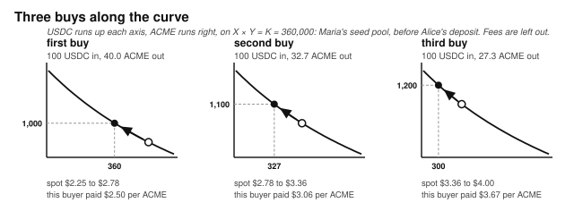
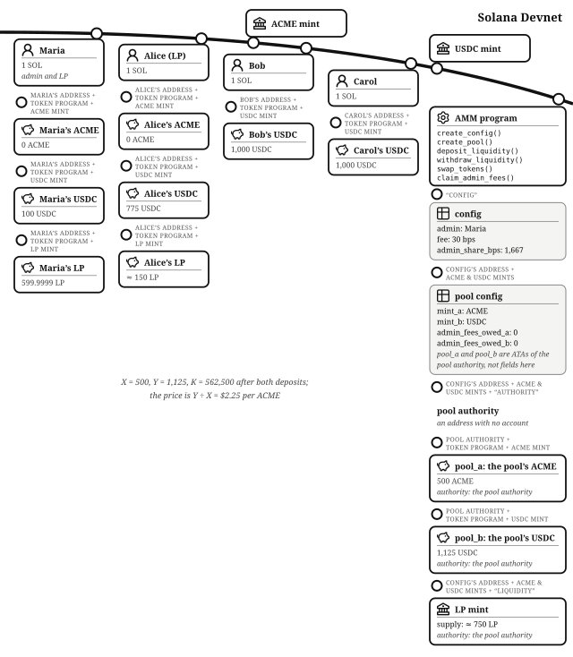
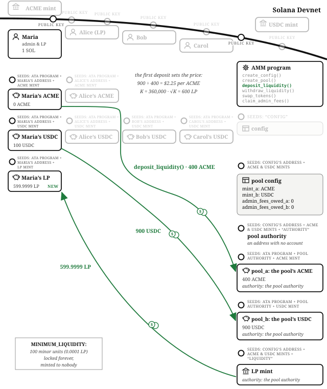
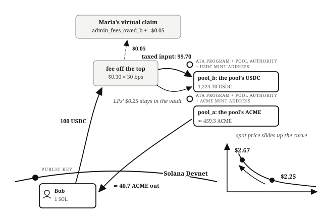

# Chapter 15: The Constant-Product AMM

The *Order Book Exchange* chapter built an exchange where every price is a commitment someone posted. This chapter builds the other kind: an **automated market maker**, where nobody posts prices at all. Every incoming order fills instantly, at a price determined by a formula, against tokens supplied by **liquidity providers** who earn a fee on every trade. That fee is compensation for a loss, and the chapter puts a number on it.

AMMs work where order books do not: tokens without much trading volume, where a taker might wait forever for a matching maker. That is why they are the standard venue for new token launches, and why this chapter's story is one. Orca, Raydium, and Pump.fun are popular AMMs on Solana. The program lives at `finance/token-swap` in the companion repository.

The K in "constant product" is constant only inside a single trade: it grows every time a deposit lands or a fee stays behind. The launch below runs with an operator, trading fees, and liquidity providers, and states X, Y, and K after every trade.

## X Times Y Equals K, and K Prices Every Trade

The pool holds two tokens. Call the amount of the first one **X** (here, ACME, the freshly listed stock of a robotics startup) and the amount of the second **Y** (USDC, because you quote in the stable asset). **K is X times Y.** Its only job is to hold X and Y in relation to each other during a trade: a buyer who adds USDC to the pool gets exactly the amount of ACME that keeps the product steady at K. Rearranged, that is the pricing formula:

output = taxed_input × other_reserve ÷ (this_reserve + taxed_input)

The spot price is just the ratio Y ÷ X, and every trade moves it: buying ACME removes X and adds Y, so the next buyer pays more. Big trades relative to the pool move the price a lot; that is price impact.

**K is constant within a single trade and grows over time.** It grows two ways:

- **Deposits** add more of both tokens at the same ratio.
- **Fees** stay in the pool: the liquidity providers' share of every trade's fee is never paid out to anyone.

The deeper the pool, the less any one trade moves the price.

## The Account Model: One Config, One Pool per Pair, and a Virtual Fee Ledger

The **config** is a singleton PDA (seed `"config"`) holding the `admin`, the trading `fee` in basis points, and the `admin_share_bps`, the slice of each fee that belongs to the admin rather than the LPs. One config per deployed program mirrors how real venues ship.

Each trading pair gets a **pool config** PDA, seeded by the config and the two mints, with one rule enforced at creation: `mint_a` must sort below `mint_b`, or creation fails with `InvalidMintOrder`. Without canonical ordering, an (ACME, USDC) pool and a (USDC, ACME) pool would both exist and split the liquidity between them.

The tokens sit in two vaults, `pool_a` and `pool_b`, owned by the pool config account, alongside the **LP mint** (`liquidity_provider_mint`), whose tokens are the receipts liquidity providers hold. The pool config is a PDA, so the program can sign for the vaults and the mint with its seeds, and nobody else can.

Two more fields are `admin_fees_owed_a` and `admin_fees_owed_b` on the pool config. The admin's share of fees is never transferred during a swap; it accrues in these counters as a *virtual claim* while the tokens physically sit in the vaults. So every piece of LP-facing math runs on **effective reserves**: the raw vault balance minus the admin's owed slice. The admin's fees do not boost LP yield, do not distort the price, and get swept out later in one transfer. Keeping who is owed what separate from where it sits is the order book's fee vault, done with accounting instead of an account.

## Creating the Venue Sets the Launch Price

Maria operates the AMM and is launching ACME today. She earns twice: an admin share of every trading fee, and LP fees on the liquidity she provides herself. Like every character in this book she starts with one SOL and 1,000 USDC; she also holds 400 ACME of founder stock.

Maria runs `initialize_config()` with a fee of 30 basis points and an admin share of 1,667 basis points, about one sixth of each fee, the classic Uniswap-style split. Then `initialize_pool()` for ACME/USDC, which creates the pool config, the LP mint, and the two empty vaults.

Empty pools cannot price anything, so Maria seeds it. She believes a fair launch price is $2.25, so she runs `deposit_liquidity()` with her 400 ACME and 900 USDC, the founder stock and nine-tenths of her cash. **The first deposit sets the price**, because the ratio she deposits *is* the ratio. X = 400, Y = 900, K = 360,000.

Her LP tokens come from the formula the *Arithmetic of Money* chapter described: the **integer square root of X times Y**, computed by `integer_sqrt()`, the program's own Newton's method loop on u128, floored. The square root of 360,000 is exactly 600, so that is her LP position, minus one thing: `MINIMUM_LIQUIDITY`. That is a floor of 100 **minor units** of LP supply (the LP mint has six decimals, so a ten-thousandth of one LP token) that is **never minted to anyone**. It is not sent to a burn address, as Uniswap V2 does; it never exists as supply, while the reserves it represents stay in the pool. Its value is a fraction of a cent. What makes it work is that it is always part of the share supply the pool divides by. Why that floor exists is the inflation-attack defense, covered in the failure modes below.

> **A square root with no floats.** `integer_sqrt()` is **Newton's method** running on integers: start with a guess, then repeatedly replace it with the average of the guess and the target divided by the guess. The sequence converges on the square root in a few dozen iterations, and the result is floored. The same approach covers any real-valued function a program needs onchain (roots, exponentials, logs) becomes an integer iteration with a known, bounded error, because floats can never touch funds.

## Adding Liquidity in Ratio Does Not Move the Price

Alice works at ACME, holds a grant of 100 ACME alongside her standard wallet, and becomes the second liquidity provider: she wants to earn fees on her ACME grant. Liquidity providers are not allowed to change the pool's ratio, so her 100 ACME must arrive with a matching 225 USDC (100 × $2.25). The handler enforces this by clamping: it computes how much of token B her token A implies at the current effective reserves, uses whichever pairing fits inside what she offered, and rejects with `DepositAmountTooSmall` if the clamp rounds her out entirely. Her LP tokens are minted pro rata, the minimum of her share against each side, floored, and guarded by her `minimum_lp_tokens_out`.

X is now 500, Y is 1,125, K is 562,500. The price is still exactly $2.25. **Deposits grow K without touching the price**; that is the first of K's two ways of growing.

## A Buy Moves the Price Along the Curve

Bob is early and bullish. He runs `swap_tokens()` to spend 100 USDC on ACME, a tenth of everything he has, with a `min_output_amount` as his slippage guard. Three things happen in strict order.

**The fee is deducted first.** 30 basis points of 100 is 30 cents. The admin share, about 5 cents (1,667 basis points of it, floored in minor units), accrues to `admin_fees_owed_b` as Maria's virtual claim; the remaining 25 cents stays in the pool, where it adds to the reserves that back every LP token. Bob's taxed input is 99.70.

**The curve prices the trade.** Y rises to 1,224.70, and X must fall to K ÷ Y ≈ 459.3. Bob receives about 40.7 ACME. He paid an *average* of about $2.46 per token while the quoted price before his trade was $2.25 and the spot price after it is about $2.67: his own trade moved along the curve as it executed. Every AMM trade pays its own price impact.

**The invariant is re-checked.** After the transfers land, the handler reloads both vaults and requires the new effective product to be at least the old one, failing with `InvariantViolated` otherwise. The program's own comment calls this the most important defensive check in the file: it catches any bug in the math above it that would hand a user too much. The check tolerates growth, because growth is just LP fees enriching the pool. Assert after the math, not just before.

K is now about 562,615. It grew mid-trade, from the 25 cents of LP fees. That is K's second way of growing.

## The Next Trader Pays the Price the Last One Made

Carol has watched the launch all morning and wants in even though the price has already moved. She arrives late and buys $50 of ACME: 15 cents of fees (about 2.5 cents admin, about 12.5 cents LPs), 49.85 taxed input, and the same arithmetic hands her about 18 ACME at an average near $2.78. The second trader's numbers follow from what the first trader's swap did to the pool.

## Selling Back Pays the Fee in the Input Token

Bob sells 20 of his 40.7 ACME. A sell is the same instruction with `input_is_token_a` flipped. Now the fee comes off his ACME input (0.06 ACME, of which 0.01 accrues to `admin_fees_owed_a`), X grows by the taxed amount, and Y falls to keep the product: about 55.11 USDC to Bob, an average near $2.76 against the $2.46 he paid. The spot price falls back to about $2.64. The admin's fee ledger now holds claims in *both* tokens, which is why the claim instruction sweeps two sides.

## The Admin Sweeps Its Share of the Fees

Whenever she likes, Maria runs `claim_admin_fees()`. It zeroes both owed counters and transfers exactly those amounts from the vaults to her token accounts, signed by the pool config; anyone else is rejected (`test_claim_admin_fees_rejects_non_admin`), and claiming when nothing is owed fails with `NothingToClaim`. One transfer per token, however many swaps accrued it: the same consolidation logic as the order book's unsettled balances.

## Withdrawing Realizes Impermanent Loss

Alice wants her capital back. `withdraw_liquidity()` burns her LP tokens and pays her a pro-rata slice of both effective reserves, with one adjustment: the divisor is the LP supply *plus* `MINIMUM_LIQUIDITY`. The locked floor is backed by reserves but absent from the supply counter, and forgetting it would overpay every withdrawer.

Alice does not get back what she deposited. She deposited 100 ACME and 225 USDC; the pool's mix has shifted since, so her slice is about 92.3 ACME and 244 USDC. Valued at the current price, that is roughly $1.50 *less* than if she had simply held her original tokens in her wallet: a small number at launch scale, and the same number becomes serious money once the pool has six more zeroes on it.

That gap is **impermanent loss**, and it is the price of being an LP. A constant-product pool mechanically sells the token that is rising and accumulates the token that is falling, so an LP always slightly underperforms just holding, whenever the price moves in either direction. Fees are the compensation. **An LP is a bet on trading volume, not on price direction**: if accumulated fees outrun the divergence, LPing wins; if the price runs hard in one direction on thin volume, holding wins. It is called *impermanent* because it only crystallizes at withdrawal; had Alice stayed in and ACME returned to $2.25, the loss would have evaporated. Nobody should provide liquidity without being able to draw this diagram.

## The Math: Floors Everywhere, and a Square Root by Newton

Every division in this program floors. Swap output, LP minting, and withdrawal amounts floor **in the pool's favor** (the one floor that favors the trader is the fee itself, clipped by at most one minor unit). The dust stays in the reserves, where it accrues to all LPs rather than leaking to whoever transacts most often. Every multiplication runs in u128 before its division (multiply before divide), and every step is `checked_*` with `MathOverflow` on failure. The one exotic operation, the initial deposit's square root, is eleven lines of Newton's method on integers, floored like everything else. Every rule in the *Arithmetic of Money* chapter appears in this one file.

## The Invariants: K Must Not Decrease

- After every swap, effective X times effective Y is at least what it was before, enforced onchain, after the transfers, not assumed from the algebra.
- The admin's owed fees never participate in pricing, LP minting, or withdrawal: all LP-facing math uses effective reserves.
- LP tokens are a fixed-share claim: mint pro rata on the way in, burn pro rata on the way out, with the locked floor added back to the divisor on the way out, the one place forgetting it would overpay.
- The pool never prices against an empty side (see below).

## The Failure Modes: Empty Pools, First Deposits, and the Vacuous Invariant

- **The empty-reserve drain.** If one reserve were zero, the swap formula outputs the *entire* other reserve (output = input × other ÷ (0 + input) = other). The invariant check would not catch it either, because the pre-trade K would be 0 × other = 0, and "new K ≥ 0" holds vacuously. A guard requires both effective reserves positive (`EmptyPoolReserve`) before any pricing runs.
- **The inflation attack.** The empty-pool attack from the *Adversary* chapter: a first depositor minting dust-level LP supply, donating tokens to skew the share price, and rounding later depositors down to zero. The `MINIMUM_LIQUIDITY` floor makes the attack uneconomic: because the locked units always sit in the supply, share supply can never be dust-sized relative to the pool, and inflating the value behind each share means inflating the value behind units the attacker can never own.
- **The first deposit sets the price, and anyone can be first.** The program's own source notes that pool creation can be front-run with a bad ratio. The floor bounds the share-math games, but a launch operator should still expect arbitrage traffic (or hostile seeding) until the pool's price matches the market's, and seed with size.
- **Slippage and sandwiches.** Every trade and deposit carries a caller-supplied minimum (`min_output_amount`, `minimum_lp_tokens_out`, the withdrawal minimums), and the tests prove each one rejects (`SlippageExceeded`, `DepositBelowMinimum`, `WithdrawalBelowMinimum`). What the program cannot do is choose the number for you; a zero minimum is legal and is what a sandwich attacker hopes you send.
- **Liquidity fragmentation.** Canonical mint ordering, one pool per pair, by construction.

## Testing Considerations

The suite (`tests/test_swap.rs`) covers each section of this chapter. Two tests, `test_invariant_holds_after_normal_swap` and `test_invariant_holds_after_b_to_a_swap`, check K's direction both ways, while `test_lp_mint_after_swap_uses_effective_reserves` and `test_deposit_after_swap_uses_shifted_effective_ratio` check the admin-fee exclusion, the accounting a refactor is most likely to break. Two more, `test_deposit_clamps_excess_amount_a` and `_b`, check the ratio clamp from both directions (both directions of every symmetric flow), and the three reverts-below-minimum tests check every slippage guard. If you write one invariant test for your own AMM, make it the round trip: swap in, swap back, and assert the pool did not lose value.

## What You Learnt from Building the Constant-Product AMM

The order book needed a tree, a matching engine, and maker accounts, because humans were quoting the prices. The AMM replaced all of it, and the market makers themselves, with one multiplication: instant liquidity for anything, priced by a curve, funded by anyone willing to earn fees for supplying it.

Six concepts came with the curve:

- **A formula as the market maker.** Output = taxed input × other reserve ÷ (this reserve + taxed input); the first deposit sets the price, and every trade pays its own price impact.
- **How K grows.** Constant within a trade, growing across deposits and fees; and an invariant that can hold vacuously (new K ≥ 0 on an empty pool) is not an invariant.
- **Assert after the math.** The post-trade product re-check catches every "computed the output wrong and overpaid" bug, including the ones not written yet.
- **Effective reserves.** The admin's virtual fee claim is excluded from every piece of LP-facing math, the order book's fee vault implemented as accounting.
- **The inflation-attack defense.** A locked minimum of LP supply, never minted to anyone, keeps the share divisor from ever being dust-sized.
- **Impermanent loss.** An LP is a bet on trading volume, not price direction, and nobody should provide liquidity without being able to draw the diagram.

In the *Prop AMM* chapter we will build a market maker that quotes its own capital at prices taken from an oracle. There is no curve, so a trade does not move the price and there is no impermanent loss, but the firm carries a different risk: the traders who arrive while its quote is stale know something it does not. The *Vault Strategy* chapter, later in the book, uses venues like these to trade other people's money, and the question there is what the manager is allowed to do with it.
