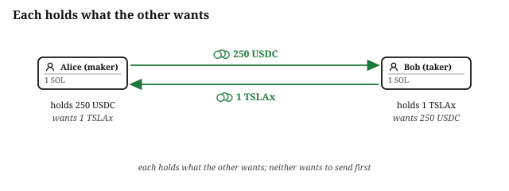
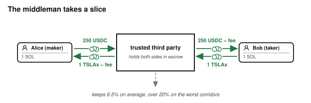
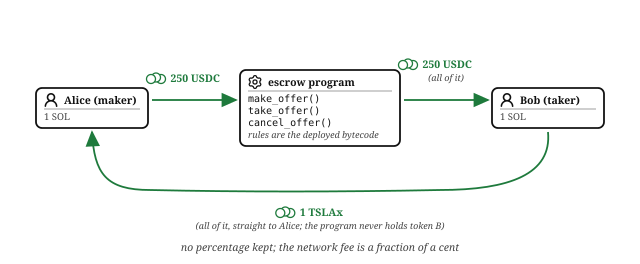
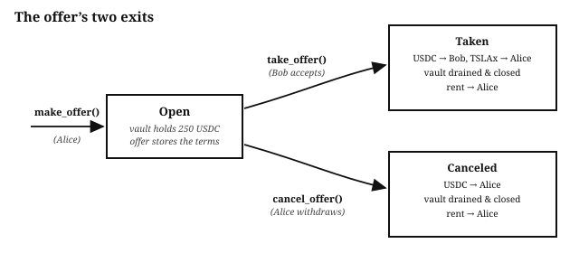
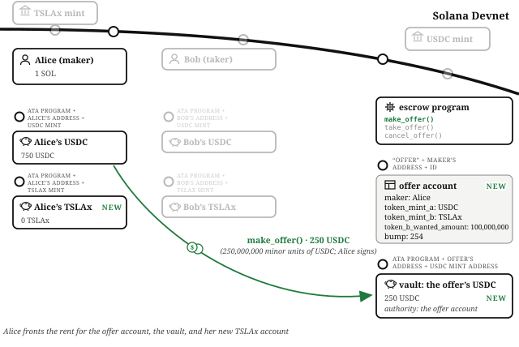
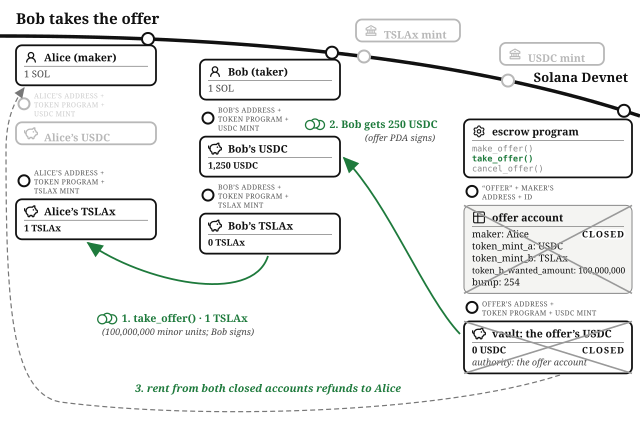
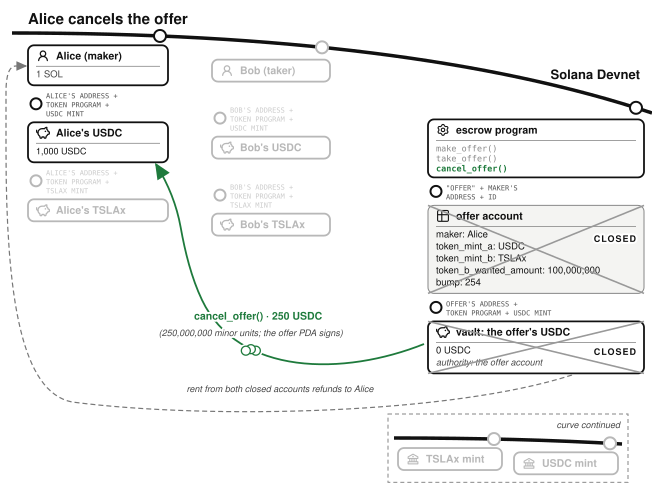

# Chapter 11: Escrow

There is an old saying that once you have built an escrow, everything else looks like an escrow. An auction house is an escrow with competing takers. A betting market is an escrow where an outcome decides the payout. A lending market is an escrow with time and interest attached. This is why escrow is the first program in this book: it is the smallest program that actually handles value, and every pattern it uses (holding tokens in a program-owned account, storing custom data, controlling who may do what) reappears in every chapter that follows.

The program for this chapter lives at `finance/escrow` in the companion repository, with Anchor, Quasar, and native versions, plus machine-checked proofs of its core properties under `kani-proofs`. This chapter walks the Anchor version.

## Escrow Lets Two Strangers Swap Without Trusting Each Other

Alice starts, like every character in this book, with one SOL and 1,000 USDC; she wants a share of Tesla stock and is prepared to spend 250 USDC on it. Bob holds TSLAx and likes that price. They want to trade.

The naive version is that Alice sends Bob her USDC and waits. But what if Bob takes the USDC and leaves? Maybe Bob is just that type of guy. The real problem an **escrow** solves is not moving tokens, it is letting Alice and Bob swap without having to trust each other.

Traditional finance solves this with a trusted third party. Alice sends her funds to the third party, which holds them in escrow until Bob has done the same, then distributes both sides to their destinations. And, as anyone who has bought a house or sent money overseas knows, the third party takes a percentage for itself, typically somewhere between one and six percent of the transaction.

A Solana program replaces the third party. The program holds Alice's tokens under rules that are the deployed program itself: nobody, including the program's author, can move them except along the paths the code defines. There is no operator in this program at all: whoever deploys it earns nothing from it, takes no fee, and holds no key that matters, which is exactly the point. Each side receives one hundred percent of what the other side offered. Solana's transaction fees still apply, but they are a small fraction of a cent regardless of the size of the trade.

## The Deal: A Maker Offers, a Taker Accepts

Two roles run through this chapter, and the code names them the same way:

- **Alice is the maker.** She creates the offer: 250 USDC for 1 TSLAx.
- **Bob is the taker.** He accepts the offer as it stands.

The deal is priced the way all Solana money is priced: in **minor units**, the smallest denomination of each token, the raw integers programs operate on. USDC has six decimals, so Alice's 250 USDC is 250,000,000 minor units. TSLAx has eight decimals, so the single Tesla share she wants is 100,000,000 minor units, the same integer that means one hundred dollars in a USDC account. Identical integers meaning completely different things is exactly why programs track each token's decimals instead of assuming them. The minor-units section of Financial Programming Concepts in Solana covers this in depth; escrow is where you first feel it.

## The Account Model

Financial state on Solana is accounts. The escrow program uses two accounts it creates itself, plus the standard cast of accounts every token-handling program touches.

The **offer account** stores what Alice wants in return. It is the program's custom data, defined in `state/offer.rs`:

- `id`, a number the maker chooses, so one maker can have many offers open at once
- `maker`, Alice's address, recorded so the program knows who may cancel and who receives payment
- `token_mint_a` and `token_mint_b`, identifying the two tokens in the deal
- `token_b_wanted_amount`, how much of token B the maker wants, in minor units
- `bump`, saved once at creation so later instruction handlers can rebuild the account's address cheaply

The offer account is a **PDA** (program derived address), derived from the seeds `"offer"`, the maker's address, and the ID. Because the maker's address is part of the seeds, two different makers can never collide, and one maker attempting to reuse an ID fails at account creation.

The **vault** is where Alice's USDC waits. It is an ordinary token account with one interesting property: its authority is the offer account. Not Alice, not the program's author. The offer account is a PDA, so only the escrow program can sign as it, which means tokens leave the vault only along the code paths the program defines. Concretely, the vault is the offer account's **associated token account** for token mint A, so its address is derivable by anyone from the offer's address and the mint's address.

Around these two sit the accounts every token program interaction needs: the two mint accounts, Alice's and Bob's token accounts, the System Program (which creates accounts), the token program, and the Associated Token Program (which derives where a wallet stores a given token). The escrow uses Anchor's `token_interface`, so the same code works whether the tokens involved use the Classic Token Program or the Token Extensions Program; the constraints only require that every token account in one transaction uses the same one.

## The Instruction Handlers

The program has three instruction handlers, and together they form the offer's complete state machine: `make_offer()` opens it, and it ends in exactly one of two ways, `take_offer()` or `cancel_offer()`. Every state needs an exit, and an open offer has two.

### The Maker Makes the Offer

Alice calls `make_offer()` with three arguments: her chosen `id`, `token_a_offered_amount` (250,000,000 minor units of USDC), and `token_b_wanted_amount` (100,000,000 minor units of TSLAx).

Before the handler body runs a single line, the account constraints in `MakeOfferAccountConstraints` have already enforced the structure of the deal. Alice must have signed, and she is marked mutable because she pays to create the accounts this handler makes. Both mint accounts must belong to the token program named in the transaction. `maker_token_account_a` must be Alice's associated token account for token mint A, which is the account her USDC leaves. The offer account is created here (`init`), with space for the data fields plus Anchor's discriminator, at the PDA address derived from `"offer"`, Alice's address, and the ID; if that account already exists, creation fails and the whole transaction aborts, which is the ID-reuse check. The vault is also created here, as the offer's associated token account for token mint A.

One constraint is easy to miss. `maker_token_account_b`, Alice's account for the token she *wants*, is created now if it does not exist, and Alice pays for it. This is a deliberate piece of economics. The party who chose to open the offer carries its rent burden, and `take_offer()` can then require the destination for Bob's payment to already exist rather than making Bob pay to create an account that belongs to Alice.

With the structure verified, the handler body is two small steps:

- **`handle_send_offered_tokens_to_vault()`** calls the shared `transfer_tokens()` helper to move the 250,000,000 minor units from `maker_token_account_a` into the vault, with Alice as the signing authority.
- **`handle_save_offer()`** writes the offer's fields, including the saved bump, into the offer account.

Alice is done. She can close her laptop.

### The Taker Takes the Offer

Bob calls `take_offer()`. It takes no arguments beyond the accounts themselves: the offer account *is* the argument. Bob names the offer he wants, and the account constraints verify that every other account in the transaction is the one that offer implies. `has_one = maker` ties the maker account to the address stored in the offer. `has_one = token_mint_a` and `has_one = token_mint_b` do the same for the mints. The seeds and stored bump prove the offer is the program's own PDA. The vault must be the offer's associated token account for mint A, and the payment destination must be the maker's associated token account for mint B. Bob cannot substitute an account he controls anywhere in this structure, because every address is derived or checked against the offer's stored data. This is the account-substitution defense the validation section of Financial Programming Concepts in Solana covers in full.

Alice does not need to be awake, online, or anywhere in particular. She signed her part when she made the offer; the program does the rest.

The handler body runs two steps:

- **`handle_send_wanted_tokens_to_maker()`** moves the 100,000,000 minor units of TSLAx straight from `taker_token_account_b` to `maker_token_account_b`, with Bob signing. Bob's payment goes directly to Alice's token account; there is no intermediate stop for token B, because the program never needs custody of it.
- **`handle_withdraw_and_close_vault()`** moves the USDC out of the vault to `taker_token_account_a`, which was created in this same transaction if Bob had never held USDC before (Bob pays for his own account). The vault's authority is the offer account, so for this transfer the program signs with the offer's seeds: `"offer"`, the maker's address, the ID, and the saved bump.

Then the same helper pair closes the vault with `close_token_account()`, sending its rent deposit back to Alice, and Anchor's `close = maker` constraint closes the offer account itself, refunding that rent to Alice too.

Both sides now hold exactly what the other offered. No percentage went to anyone.

### The Maker Cancels the Offer

What if nobody takes the offer and Alice wants her USDC back? Without an exit, her tokens would sit in the vault forever, which is how stranded-funds bugs are born. The exit is `cancel_offer()`.

The constraints make it maker-only: the signer must be the maker, and `has_one = maker` checks the signer against the address stored in the offer. Bob cannot cancel Alice's offer, and the test suite proves it (more below). The handler, `handle_cancel_offer()`, mirrors the second half of `take_offer()`: it signs with the offer's seeds to move the full vault balance back to `maker_token_account_a`, closes the vault to Alice, and lets `close = maker` close the offer account to Alice. Every lamport of rent she fronted comes home.

## The Math

Escrow is the one program in this book whose arithmetic is nearly invisible, because the offer is all-or-nothing: there are no partial fills, no division, and therefore no rounding policy to decide. The amounts the maker states are the amounts that move. The only multiplication hiding in the program is in `transfer_checked()`, which the `transfer_tokens()` helper uses so that every transfer verifies the mint's decimals match what the caller believes they are, one more guard against minor-unit confusion.

The money math that remains is rent. Alice fronts the rent deposits for the offer account and the vault (and for her own token B account if it did not exist). On either exit path, both program-created accounts close and both deposits return to her; when her token B account already existed, her lamports round-trip exactly, and the tests assert that to the lamport. Bob pays rent only for his own token A account if he never held that token, and that account remains his afterward. Nobody's rent ends up with the other party.

## The Invariants

What must hold, before and after every handler:

- Alice's offered tokens are in exactly one place at any instant: her token account, the vault, or (after the take) Bob's token account. Conservation, the escrow edition.
- The vault holds at least `token_a_offered_amount` from the end of `make_offer()` until an exit runs (a direct donation could push it above, and changes nothing), and both exits drain the vault completely before closing it.
- The offer account's data never changes after `handle_save_offer()` writes it. There is no update handler, so there is nothing to get wrong.
- Only the taker's signature moves token B, and only the offer PDA's signature moves the vault.
- Rent returns to whoever paid it, on every path.

## The Failure Modes

- **Reused offer ID.** The offer account is created with `init` at an address derived from the maker and the ID, so a second `make_offer()` with the same ID fails at account creation.
- **Account substitution.** The classic escrow attack is a taker who passes his own account where the maker's payment account should be, or a foreign vault, or a mismatched mint. Every one of these is closed by the constraint structure: associated token account derivation binds each token account to its owner and mint, `has_one` binds the maker and mints to the offer's stored data, and seeds plus bump bind the offer to the program. The Adversary dissects what happens to programs that skip these checks.
- **Unauthorized cancel.** `cancel_offer()` requires the maker's signature and checks it against the offer's stored maker.
- **The abandoned offer.** The failure mode that is a missing feature: without `cancel_offer()`, an untaken offer strands the maker's tokens permanently. Every state needs an exit.
- **Degenerate offers.** The account constraints do the structural validation, and structure is most of an escrow. Two handler-level checks are worth adding to any escrow headed to production: reject amounts of zero, and reject offers where the two mints are the same, since a swap of a token for a different amount of itself means someone is about to be ripped off.

## Testing Considerations

The tests live in `tests/test_escrow.rs`, creating the wallets, mints, and token accounts each scenario needs. Every piece of program state in the tests is created through the program's own instruction handlers, never injected, so a missing constraint or an unusable handler cannot hide behind a hand-built fixture.

- `test_make_offer` calls `make_offer()` and then checks both effects: the vault holds the offered amount, and the offer account's stored fields (ID, maker) match what Alice sent.
- `test_take_offer` runs the full happy path and asserts both directions of the swap: Bob's token A balance and Alice's token B balance. Symmetric flows get tested in both directions, because a bug that favors one side is invisible if you only assert the other. It then asserts the vault and offer accounts are gone, and that Alice's lamports round-tripped exactly, pinning the rent economics.
- `test_cancel_offer` asserts Alice's token A balance returns to its pre-offer value and her rent comes back in full.
- `test_cancel_offer_rejects_non_maker` is the adversarial case: Bob attempts to cancel Alice's offer and the transaction fails. Test the code path the bug lives in; the path where money goes to the wrong person is the one that matters.

The testing section of Financial Programming Concepts in Solana builds the general method; this suite is the method at its smallest useful size. And escrow goes one rung further: the `kani-proofs` crate in the companion repository proves the conservation properties formally, over every possible input, with harnesses like `proof_take_offer_conserves_value` and `proof_cancel_offer_returns_all_to_maker`. The proving section of Operating Financial Software explains the technique.

## What You Learnt from Building the Escrow

In traditional finance, an escrow means a trusted third party: a company that holds both sides' assets, charges one to six percent for the privilege, and must itself be trusted not to walk away. This chapter replaced that company with a program whose rules are its own deployed code, whose operator earns nothing and holds no key that matters, and whose fee is a fraction of a cent.

The concepts you now have:

- **Program custody.** Tokens held in a vault whose authority is a data account (a PDA), so funds move only along the code paths the program defines.
- **Terms in a data account.** The offer account records the deal (maker, mints, wanted amount), and every later handler validates its accounts against that stored data.
- **State transitions gated by signatures and state.** Who signed, and what the stored data says, decide what may happen; `has_one`, seeds, and ATA derivation close every substitution.
- **An exit from every state.** `take_offer()` and `cancel_offer()` both drain and close everything, returning rent to whoever paid it.
- **Minor units.** Every amount is an integer at the mint's declared scale, and identical integers can mean entirely different things.

That is the whole pattern, and you will now see it everywhere. The fundraiser in the next chapter is an escrow with many depositors and a deadline. The AMM is a pair of vaults whose exchange rate is set by a formula instead of a maker. The betting market is a vault whose exit is decided by an outcome. Once you have built an escrow, everything else looks like an escrow.
