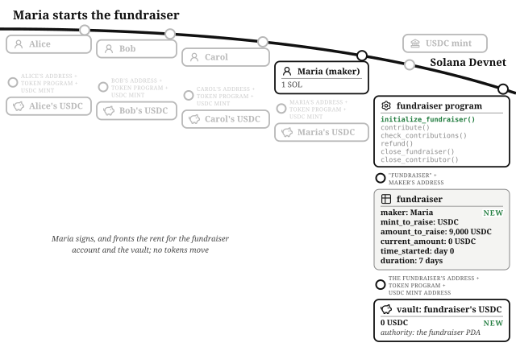
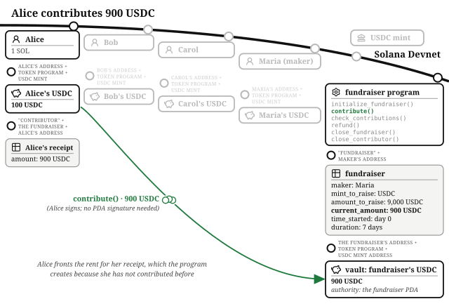
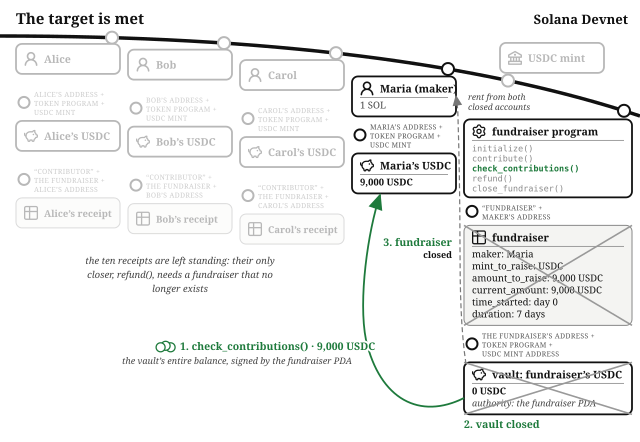
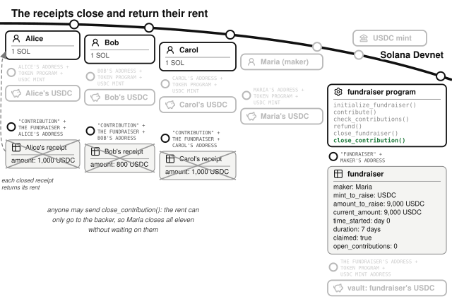
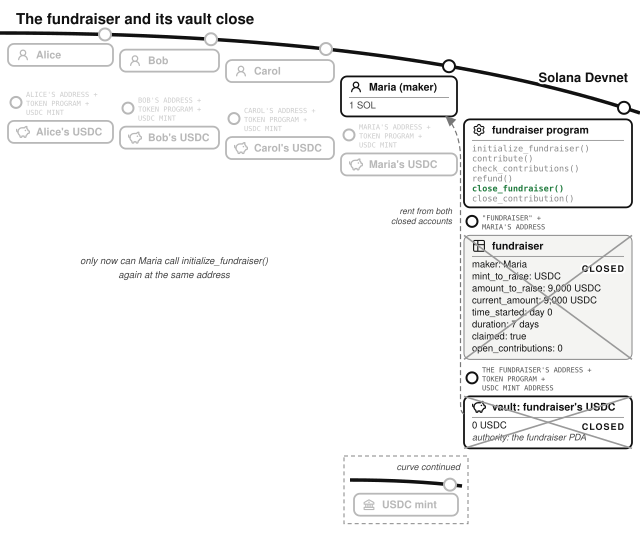
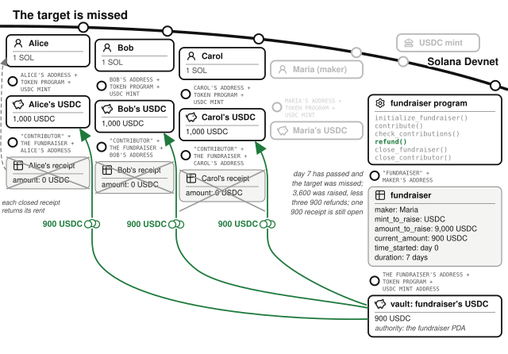

# Chapter 12: The Fundraiser

Maria has designed a compact commercial espresso machine, and the factory quoted 9,000 USDC for the first production run. The cost is indivisible: the injection-mold tooling has to be cut whole, so 6,000 USDC buys not two-thirds of a run but nothing at all. She could collect preorder promises by hand and hope enough of them are real, or she could put one rule onchain: **everyone's contribution comes back unless the full target amount is raised**. This chapter's program enforces that rule. It is an all-or-nothing fundraiser, the same promise Kickstarter makes, enforced by code instead of by a company.

The program lives at `finance/fundraiser` in the companion repository, with Anchor 1, Anchor 2, and Quasar versions; this chapter covers the Anchor 1 version, in `anchor-v1`. It is one of the smallest programs in this part of the book: six instruction handlers, two account types, and one vault. An escrow holds one stranger's tokens in a vault until the other stranger pays for them; a fundraiser holds many strangers' contributions in one vault until one shared condition is met. The vault and the PDA that signs for it work the same way, with one addition: a **deadline**.

The program calls the fundraiser's creator the **maker**, Maria here. She wants all-or-nothing. There is no platform operator and no fee in this program; the maker runs their own raise, and the only costs anyone pays are transaction fees, plus rent deposits that come back when the accounts close.

## The Maker Starts the Fundraiser

Two numbers are recorded the moment the fundraiser opens: the **target** and the **duration**. Maria calls `initialize_fundraiser()` with a target of 9,000 USDC and a duration of 7 days. Nothing in the program lets her extend the deadline, raise or lower the target, or touch the vault before the target is met.

This transaction created the two accounts the raise needs.

The **fundraiser** account lives at a PDA with seeds `"fundraiser"` and the maker's address, which means one live fundraiser per maker; a second `initialize_fundraiser()` from the same public key finds the account already in existence and fails. Its struct, `Fundraiser`, holds the raise's terms:

- `maker` and `mint_to_raise`: who is raising, and in what token, USDC here.[^any-mint]
- `amount_to_raise`: the target, 9,000 USDC in minor units. `initialize_fundraiser()` rejects a target below three major units with `InvalidAmount`, so a dust-sized raise cannot exist.
- `current_amount`: the running total the program itself has counted.
- `time_started` and `duration`: the clock's Unix timestamp at creation, and the window length in days.
- `claimed`: set when Maria claims a successful raise, after which the program accepts no more contributions and no second claim.
- `open_contributions`: how many backers' receipts, described below, are still open. The fundraiser account cannot close until this is zero.

The **vault** is an associated token account whose authority is the fundraiser PDA, the arrangement the escrow used: tokens sit in an account only the program can sign for.

The handler stamps `time_started` from the cluster clock and stores the duration. `contribute()`, `refund()` and `close_fundraiser()` each recompute elapsed days from those two fields and compare the count with the duration, as the *Time* chapter explains, so the window closes exactly 604,800 seconds after `time_started`.

## Every Backer Gets a Receipt

Eleven backers fund this raise, each starting with the standard wallet of one SOL and 1,000 USDC, and each with their own reason. Alice runs three cafes and wants Maria's machine on her counters. Bob distributes restaurant equipment and wants a new product line to carry. Carol is an espresso enthusiast who wants one at home badly enough to help it exist. None of them will trust Maria, or each other, with a refund promise. They will trust a program that gives Maria no way to redirect the vault to herself, and whose deployed code is verified to match its published source.

Alice contributes her whole 1,000 USDC. `contribute()` moves the tokens from Alice's own token account into the vault and adds 1,000 to `current_amount`.

The transaction also created an account for her. Each backer gets a **contribution** account at a PDA with seeds `"contribution"`, the fundraiser, and their own address, holding `amount`, their cumulative contribution, and the stored bump. It is a receipt the program writes for itself. A backer's first `contribute()` creates it and adds one to the fundraiser's `open_contributions`; every later contribution adds to the same receipt. Carol contributes 500 USDC, then comes back the next day with 500 more, and her receipt's `amount` reaches 1,000 while the fundraiser still counts one receipt for her. Anything under one major unit fails with `ContributionTooSmall`, so nobody fills the raise with dust.

So the contributions arrive like this: Alice 1,000, Bob 800, Carol 500 and 500, and eight more backers giving 6,200 between them. Total: exactly 9,000 USDC, from eleven receipts.

The program sets no limit on what one backer may give, and does not stop Maria contributing to her own raise (see the boxout *One person, many wallets* below). What the program guarantees is narrower: Maria receives the vault only when the counter shows the full 9,000 USDC, so she never receives a partial raise. Whether she then builds the machine is outside the program, as it is on Kickstarter.

> **One person, many wallets.** A wallet costs nothing to create, so a count of wallets or receipts says nothing about how many people backed a raise: eleven receipts can be eleven people or one. One person posing as many participants is a **Sybil attack**, and a raise that needs distinct backers has to get proof from outside the program that each contributor is a distinct person. Proof-of-personhood services supply it: a person proves once, to the service, that they are a unique human, and a program can then require that proof before it accepts a contribution. VeryAI and World ID are two such services.[^personhood-services] Each delivers its proof to a Solana program differently, and this program checks none of them.

## The Claim Reads the Program's Counter, Not the Vault Balance

The claim handler compares the target against `current_amount`, the program's own count of accepted contributions, and **never against the vault's token balance**. Anyone can transfer tokens to any token account on Solana, no permission required, and a transfer straight into the vault moves the balance without moving the counter.

`refund()` decides that a raise failed by reading `current_amount`, so the claim has to read the same number. If the claim read the balance instead, a transfer into the vault could make both handlers accept at once. Suppose 3,600 USDC had come in through `contribute()` and someone transferred 5,400 more straight into the vault. The balance would read 9,000, so the claim would pay all of it to Maria. The counter would still read 3,600, so `refund()` would promise each backer their contribution back, out of a vault that was now empty.

Reading the counter keeps the two endings exclusive: the claim needs the counter at or above the target and a refund needs it below. The test `test_check_contributions_ignores_direct_vault_donations` mints the full target straight into the vault and asserts that the claim still fails with `TargetNotMet`. Apply the same check to any handler that releases tokens from a vault: compare a number the program itself wrote, never a token balance anyone can raise by transferring tokens in.

## The Target Is Met: The Maker Claims

`check_contributions()` is the maker's claim. Maria signs, the PDA seeds re-derive her fundraiser, and `current_amount` has reached the target, so the handler does not fail with `TargetNotMet`. It sets `claimed` and transfers the vault's entire balance to Maria's token account, signed by the fundraiser PDA. A second claim fails with `FundraiserClaimed`, and so does a contribution sent after the claim, even with days left before the deadline. The test `test_check_contributions_success_pays_maker_and_marks_claimed` asserts the payment and the flag.

## The Fundraiser Outlives Every Receipt

The fundraiser account and the empty vault stay open after the claim, because the eleven receipts do. Each receipt lives at a PDA derived from the fundraiser's address, and the fundraiser's address is derived from `"fundraiser"` and Maria's address alone. If the claim closed the fundraiser, Maria could call `initialize_fundraiser()` again and get a new fundraiser at the same address, and every receipt still open would belong to it.

Suppose that second raise fails. Alice's receipt from the first raise still reads 1,000 USDC, so `refund()` would pay her 1,000 USDC from the second raise's vault: tokens that the second raise's backers contributed, for a contribution Maria had already been paid. The program prevents this by keeping the fundraiser until `open_contributions` reaches zero, so no receipt can outlive the raise it was written for.

`close_contribution()` closes one receipt after a claim and returns its rent, about a thousandth of a SOL, to the backer it belongs to. It makes one check, that the fundraiser is `claimed`, else `FundraiserNotClaimed`: before the claim the vault still owes the backer their receipt's amount, and only `refund()` may close it. The backer does not have to sign, because the rent can only go to them, so Maria does not have to wait for eleven backers to come back. She sends a `close_contribution()` for each receipt, and each call subtracts one from `open_contributions`. The tests `test_close_contribution_after_claim_returns_rent` and `test_anyone_can_close_contribution_accounts_after_claim` check that the rent reaches the backer either way.

With the counter at zero, Maria calls `close_fundraiser()`. It sends her any tokens transferred into the vault without going through `contribute()`, then closes the vault and the fundraiser and returns both rent deposits to her. While any receipt is open it fails with `ContributionsOpen`.

The test `test_stale_contribution_cannot_refund_from_next_raise` runs the attack in full. A raise succeeds, its receipts and the fundraiser are closed, and Maria starts a second raise at the same address, which then fails. A first-raise backer's refund from the second raise fails, because their receipt no longer exists, and every second-raise backer is refunded exactly what they put in. `test_reinitialize_with_open_contributions_fails` checks that a second `initialize_fundraiser()` fails while the claimed fundraiser, and so its receipts, still exist.

## The Target Is Missed: Everyone Leaves With Exactly What They Brought

Now the other ending: the deadline passes with only 3,600 USDC in the counter, from Alice, Bob, Carol, and Dave, who contributed 800. No handler marks the raise as failed; `refund()` starts accepting calls. Alice calls it. The handler checks the deadline has passed (`FundraiserNotEnded` otherwise) and the target was missed (`TargetMet` otherwise). It then reads her receipt's `amount`, subtracts it from `current_amount`, zeroes the receipt, subtracts one from `open_contributions`, transfers exactly that amount from the vault back to her token account with the PDA's signature, and closes the receipt to return her rent.

A second refund fails because the receipt it would read has been closed, the *State Machines* chapter's rule that a closed account cannot be claimed twice.

Refunds have no deadline. A backer usually sends their own, but `refund()` does not need their signature: the tokens can only go to the backer's token account and the rent to the backer, whoever sends the transaction. `test_anyone_can_refund_a_contributor` checks that a refund Maria sends still pays the backer.

Dave has not come back for his 800 USDC, so Maria sends his refund herself. With every contribution refunded she calls `close_fundraiser()`, which on an unclaimed fundraiser checks the deadline has passed, the target was missed, and the counter is back to zero (`RefundsOutstanding` otherwise, so she cannot close the vault while any backer is still owed). It then closes the vault and the fundraiser as the figure after the claim shows, with `claimed` still false and `current_amount` at zero. Nothing of the failed raise remains onchain, and Maria can try again next quarter with a smaller target. Every account this program creates for itself is closed on both paths: the receipts close through `refund()` here and through `close_contribution()` after a claim.

## The Math: Two Minimums and a Floor

The program's financial arithmetic is three expressions:

- **The minimum target**: `MIN_AMOUNT_TO_RAISE` (3) × 10^decimals.
- **The minimum contribution**: `10^decimals`.
- **Elapsed days**: the *Time* chapter's whole-day count, compared with `duration`.

Every addition and subtraction on `current_amount`, the receipts and `open_contributions` is checked and maps overflow to `MathOverflow`. No rates, no proportional shares, no prices: refunds pay recorded amounts back verbatim, so, like the escrow, this program never has to *compute* what people are owed.

## The Invariants: The Counter Equals the Sum of the Receipts

- Until the claim, `current_amount` equals the sum of all live receipts: contributions add to both together, and refunds subtract from both together.
- `open_contributions` equals the number of receipts that exist for the fundraiser. The companion repository's Kani harness `proof_open_contributions_counts_open_accounts` model-checks this over every order of contributions, refunds and closes up to its bound.
- The fundraiser account exists for as long as any receipt derived from its address does, so a receipt can only ever be read by the raise it was written for.
- Tokens that entered through `contribute()` equal `current_amount` plus tokens already refunded, until the claim pays them all out; the vault can only exceed that by direct transfers, which neither the claim's check nor the refund's check ever reads.
- The claim requires `current_amount` to be at least the target and the refund requires it to be below, so a fundraiser can only end one way.
- Tokens leave the vault through the claim, a refund, or `close_fundraiser()`, all signed by the fundraiser PDA. The claim pays Maria once the counter reaches the target. A refund pays one backer their own receipt's amount after a missed deadline. The close pays Maria only tokens that arrived outside `contribute()`.

## The Failure Modes: One Check per Attack

- **Claiming early or after a miss** fails on the counter: `TargetNotMet`.
- **Claiming twice, or contributing after the claim,** fails with `FundraiserClaimed` (checked by `test_second_claim_fails` and `test_contribute_after_claim_fails`).
- **Refunding early or after a win** fails on the deadline or the counter: `FundraiserNotEnded`, `TargetMet` (checked by `test_refund_before_deadline_fails` and `test_refund_when_target_met_fails`).
- **Contributing after the deadline** fails with `FundraiserEnded` (checked by `test_contribute_after_deadline_fails`).
- **Transferring tokens straight into the vault** leaves the claim failing with `TargetNotMet`.
- **Reusing a receipt in the next raise at the same address** fails because the fundraiser cannot close while a receipt is open: `ContributionsOpen` (checked by `test_close_fundraiser_with_open_contributions_fails` and `test_stale_contribution_cannot_refund_from_next_raise`).
- **Double refunds** fail because the receipt account is gone.
- **Dust contributions** fail on the one-major-unit minimum: `ContributionTooSmall`.
- **Closing the fundraiser early or with contributions inside** fails with `FundraiserNotEnded` before the deadline, `TargetMet` on a raise that met its target but is unclaimed, and `RefundsOutstanding` while any contribution remains unrefunded.
- **Closing a receipt before the claim** fails because the vault still owes it: `FundraiserNotClaimed` (checked by `test_close_contribution_before_claim_fails`).

## Testing Considerations

The suite warps the clock with a helper that advances whole days, and asserts balances and the specific error after every move. Four tests follow a whole lifecycle:

- `test_check_contributions_success_pays_maker_and_marks_claimed` funds the raise with three unequal contributions and claims it.
- `test_close_fundraiser_after_claim_allows_a_new_raise` closes every receipt and the fundraiser after a claim, and checks the same wallet can raise again.
- `test_refund_after_deadline_target_not_met_succeeds` follows the losing timeline to a clean refund.
- `test_close_fundraiser_after_failed_raise_allows_a_new_raise` closes the failed fundraiser and checks the same wallet can raise again.

The remaining tests each call a handler in a state where it must refuse, and assert the error, such as `test_refund_before_deadline_fails`. Every vault program needs a donation test: mint tokens straight into your vault outside your own handlers, then assert that the donation changes nothing the handlers read; `test_close_fundraiser_sweeps_direct_donations_to_maker` checks that `close_fundraiser()` pays such tokens to the maker.

## What You Learnt from Building the Fundraiser

Kickstarter's all-or-nothing promise is a company policy: the platform collects the pledges and charges a fee, and its rules are whatever its terms say this month. This chapter's program enforces the same all-or-nothing outcome in code: no platform, no fee, and terms that cannot change because no handler exists to change them.

The fundraiser added four concepts on top of the escrow's:

- **Checks read the program's counter, not the vault balance.**
- **A receipt account per participant**, at a PDA, created on first use, added to on later contributions, and closed on refund, so a second refund finds nothing to read.
- **An account outlives every account derived from its address.** Count the derived accounts, and refuse to close the parent until the count is zero, so a new account at the same address never inherits the old one's receipts.
- **Every account has a handler that closes it.** A successful raise leaves the receipts open, so a handler exists to close each one, and anyone may send it because the rent can only go to its backer.

In the *Betting Market* chapter we will build a pool that many people pay into, where who gets paid is decided by something the program cannot see: which outcome happened in the real world. Someone has to tell the program the answer, and the program limits what that person can do with the pooled stakes while trusting them for the result.

[^any-mint]: Any mint works, Token Extensions mints included, because every account is declared through the token interface.

[^personhood-services]: VeryAI is at [very.org](https://very.org), and World ID at [world.org](https://world.org).
