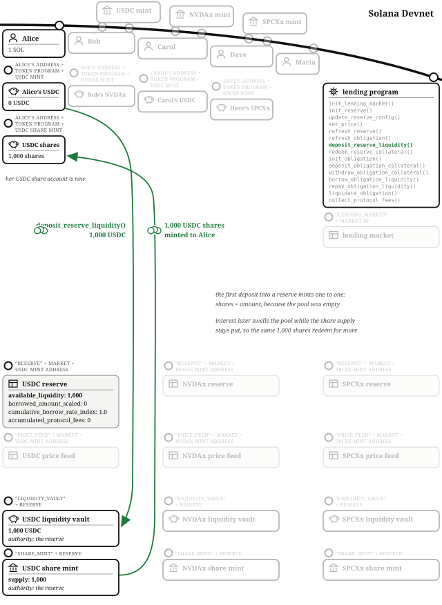
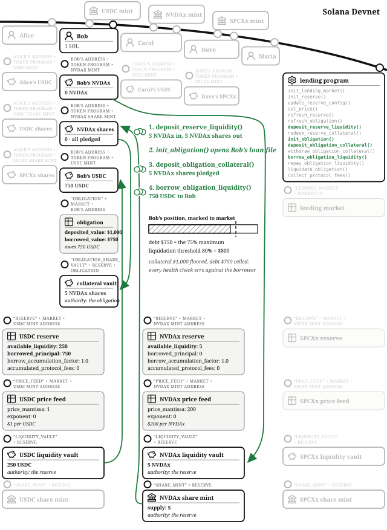
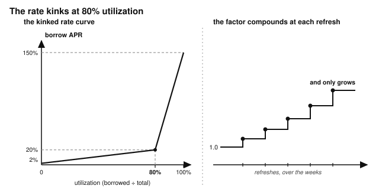
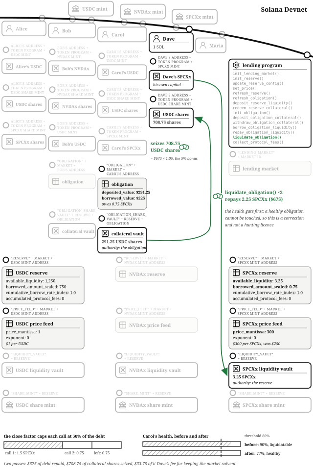
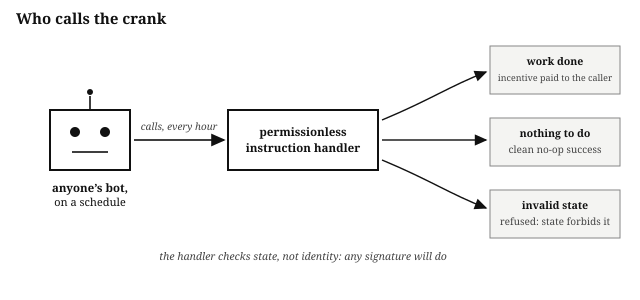

# Chapter 17: Lending and Borrowing

Think about how a commercial bank works. Savers deposit money and earn interest. Borrowers take loans and pay interest. The bank sits in the middle, collecting from the borrowers, paying most of it to the savers, and keeping a slice for itself. The onchain equivalent is a borrow-lend market, usually just called a **lending market**: Save, Kamino Lend, and MarginFi are popular lending markets on Solana, and tens of billions of dollars have moved through the category. The program for this chapter lives at `finance/lending`, and it is the biggest machine in the book so far: interest that compounds by the slot, collateral that gets marked to market, and a liquidation engine that keeps the whole thing solvent when prices move.

One word needs defusing before anything else. This chapter's market trades stocks like NVDAx and SPCXx, which people colloquially call "shares." **In this chapter, a share is a share of a reserve**: a token minted by the program representing your claim on a pool of deposited assets, including the interest it earns. The stocks are just tokens.

## The Account Model: A Market of Reserves, and an Obligation per Borrower

The **lending market** PDA (seeds: `"lending_market"`, a market ID) stores the `owner` (Maria, used only for authorization, never in the address) and the `quote_currency_mint`, the stable asset all values are measured in: USDC. Distinct market IDs give independent, risk-isolated pools.

Each asset gets a **reserve** PDA (seeds: `"reserve"`, the market, the asset's mint). A reserve owns two accounts: a **liquidity vault** holding deposited tokens, and a **share mint** whose tokens are suppliers' claims on the vault plus its accrued interest. The reserve tracks four things: `available_liquidity`, `borrowed_principal`, the `borrow_accumulation_factor` that makes interest work (below), and `accumulated_protocol_fees`, Maria's slice, carved out so it never inflates the suppliers' exchange rate. `available_liquidity` is the un-borrowed pool, and it is deliberately the source of truth instead of the vault's raw balance, so donating tokens to the vault cannot move the exchange rate.

Each reserve carries a `ReserveConfig`, all in basis points, and its validation rules are a compressed education in credit risk:

| Parameter | This market | Meaning |
| --- | --- | --- |
| `loan_to_value_bps` | 75% | How much of your collateral's value you may borrow. |
| `liquidation_threshold_bps` | 80% | The debt level at which your position becomes liquidatable. The validator refuses a loan-to-value above it: you cannot be allowed to borrow past the point you would be liquidated. |
| `liquidation_bonus_bps` | 5% | The liquidator's discount. |
| `close_factor_bps` | 50% | How much of a debt one liquidation may repay. Zero is rejected, because it would make every liquidation a no-op. |
| `reserve_factor_bps` | 10% | The house's cut of interest. |
| `min/optimal/max_borrow_rate_bps` | 2% / 20% / 150% | The interest curve, kinked at `optimal_utilization_bps` (80%), which must sit strictly inside (0%, 100%). |

Finally, each borrower gets one **obligation** PDA per market (seeds: `"obligation"`, the market, the owner): their loan file, listing collateral deposits and borrows (up to four reserves each). It also caches values (`deposited_value`, `borrowed_value`, `allowed_borrow_value`, `unhealthy_borrow_value`) behind a `stale` flag that forces revaluation before anything financial happens.

## Prices Come In by Signature: The Feed, Freshness, and Slots

Every valuation in this chapter multiplies an amount by a price, and the prices come from **price feed** accounts (seeds: `"price_feed"`, the market, the mint) storing a mantissa and exponent. The layout mirrors a Switchboard On-Demand pull feed; in production the account would *be* the Switchboard feed, decoded and verified by the program, and a production read should also reject prices whose confidence interval is too wide. In this example, `set_price()` writes it directly (only the market owner may sign, and the test `non_owner_cannot_write_market_price_feed` pins that), which keeps the tests deterministic and makes the trust arrangement unusually visible: this market's prices are true because a named key signed them recently.

"Recently" is enforced, and it is enforced in **slots**: any price older than 25 slots (about ten seconds) makes the reading handler fail with `StalePriceFeed`, slots being the clock the Time chapter reaches for whenever an adversary would profit from stretching the window. Every handler that values anything requires a `refresh_reserve()` and `refresh_obligation()` to have run in the same transaction, with `ReserveStale` and `ObligationStale` rejecting anyone who skips it: pricing is never allowed to be an afterthought.

## The Market Owner Opens the Market

Maria runs the market, and her revenue is a cut of the interest: the reserve factor you just met. She runs `initialize_lending_market()` with USDC as the quote currency, then `initialize_reserve()` three times, for USDC, NVDAx, and SPCXx, each with its config and price feed. Each reserve's `borrow_accumulation_factor` starts at exactly 1.0, represented as 10^18 in the program's fixed-point scale, chosen so a single slot's interest does not truncate to zero while staying far inside u128's ceiling. All the math in this program is integer-only: no floats, no fixed-point crates, just u128, a scale constant, and two rounding helpers.

## Supplying: Tokens In, Shares Out

Alice has her standard 1,000 USDC, plus four SPCXx (SpaceX stock, $250 each), sitting idle, and she wants yield. She runs `deposit_reserve_liquidity()` with her 1,000 USDC. The first deposit into a reserve mints shares one-to-one, so she receives 1,000 USDC shares; she does the same with her four SPCXx. Later deposits mint by the going rate: shares = amount × share supply ÷ total liquidity, floored, where total liquidity is available plus borrowed (with accrued interest) minus the house's accumulated fees. The share price is how yield arrives: interest swells the pool while the share supply stays put, so each share redeems for more than it did. There is no per-lender interest bookkeeping at all, and there does not need to be.

## Borrowing Against Deposited Collateral

Bob needs cash but does not want to sell his five NVDAx (NVIDIA stock, $200 each): he wants $750 of liquidity while keeping his position. Four instruction handlers, in order:

1. `deposit_reserve_liquidity()`: his five NVDAx go into the NVDAx reserve; he receives five NVDAx shares.
2. `initialize_obligation()`: creates his loan file.
3. `deposit_obligation_collateral()`: moves his five NVDAx shares into a collateral vault owned by his obligation. Note what is pledged: *shares*, not raw tokens, so his collateral keeps earning supplier yield while pledged.
4. `borrow_obligation_liquidity()`: with his collateral worth $1,000 and loan-to-value at 75%, he may borrow up to $750 of USDC, which he does, drawn from the USDC reserve's available liquidity.

The health check behind step 4 is conservative by construction: when `refresh_obligation()` values his position, collateral value is *floored* and debt value is *ceiled*, so every health evaluation errs against the borrower. Borrowing one unit past the allowance fails (`BorrowTooLarge`), and the test `borrow_up_to_max_ltv_then_one_more_fails` pins the boundary from both sides. His NVDAx is not sold, and he gets it back the moment he repays.

## Shorting an Asset by Borrowing It

Carol thinks SpaceX is overvalued and wants to profit if it falls. (Carol, you do you.) Her trade is the classic short, and a lending market is where shorts live: borrow the asset, sell it immediately, and owe *the asset* rather than dollars. She deposits 1,000 USDC as collateral (via shares and an obligation, like Bob) and borrows three SPCXx at $250 each, $750, the maximum her collateral allows. She sells them elsewhere for $750 cash.

Read her position carefully, because everything later hangs on it: **Carol's debt is three SPCXx, not $750.** If SpaceX falls, she buys the three tokens back cheaper and keeps the difference. If SpaceX rises, her debt rises with it, against collateral that does not. She has borrowed at the edge of her allowance with a debt that moves.

## Interest: One Index, No Transfers

Weeks pass, and the loans accrue interest without a single token moving. The mechanism is the **borrow accumulation factor**, and it is the most reusable idea in this chapter.

Each reserve stores one number that starts at 1.0 and only grows. On every `refresh_reserve()`, the program computes the current borrow rate, multiplies it by the slots elapsed, and grows the factor: new factor = old factor × (1 + rate per slot × elapsed slots). Rather than updating every loan, the reserve stores each borrower's `borrowed_principal` and grows the one shared `borrow_accumulation_factor`. A live debt is that principal times the current factor, rounded *up*, because debt rounds against the debtor. No loan is ever visited individually. The moving of actual tokens is consolidated to the moments people repay or redeem, exactly like the order book's unsettled balances but across time instead of across fills.

The rate itself comes from a **kinked utilization curve**. Utilization is borrowed ÷ (available + borrowed). Below the kink at 80% utilization, the rate climbs gently from 2% toward 20% APR; above it, steeply toward 150%. The kink is the reserve begging for liquidity: when nearly everything is lent out, the rate spikes, which simultaneously pushes borrowers to repay and pulls new suppliers in with yield. It is monetary policy in fifteen lines of integer math.

Of the interest that accrues, the reserve factor (10%) is skimmed into `accumulated_protocol_fees`, floored, in the suppliers' favor; the rest belongs to the suppliers through the rising share price.

## The Shorted Asset Rallies and the Position Becomes Liquidatable

The other thing that moves over time is prices. SPCXx rallies from $250 to $300, and the feed says so. Carol's debt is now 3 × $300 = $900 against $1,000 of collateral, and her liquidation threshold is 80%: $800. Her `borrowed_value` exceeds her `unhealthy_borrow_value`, and the market will now pay anyone to fix that.

## A Liquidator Closes the Gap, Twice, by the Rules

Dave watches for liquidation opportunities. He is the reason the market stays solvent. He runs `liquidate_obligation()`, repaying some of Carol's SPCXx debt in exchange for her USDC collateral at a 5% bonus. The handler's rules are exact:

- A healthy obligation cannot be touched: the health gate rejects with `ObligationHealthy` (pinned by `healthy_obligation_cannot_be_liquidated`). A liquidator cannot choose their target; they can only take positions the market has already marked unhealthy.
- The **close factor** caps one liquidation at 50% of the debt. Dave repays 1.5 SPCXx ($450).
- The **bonus** prices his service: he seizes $450 × 1.05 = $472.50 of Carol's collateral, paid in USDC shares, every step of the conversion floored toward the borrower.
- Overreach fails the whole call: asking to seize more collateral than the obligation holds rejects with `LiquidationTooLarge` rather than silently capping, because a silent cap would make the liquidator pay full price for less collateral (pinned by `over_seizing_liquidation_rejected_smaller_succeeds`).

Carol is still slightly unhealthy, so Dave goes again: half of the remaining 1.5 SPCXx debt, 0.75 SPCXx ($225), seizing $236.25. Her loan is healthy again, still hers, partially paid down by her own collateral. Across both passes Dave repaid $675 of debt and collected $708.75, a $33.75 profit: 5% for keeping the market solvent. Why half at a time? The close factor means the borrower loses the minimum collateral needed to restore health, rather than the whole position.

## Cranks: Work With No Natural Caller

Dave is one instance of a pattern this market runs on. Some work in a financial product has no natural caller: interest must accrue, cached prices must refresh, and no user's own transaction is obliged to do any of it. The onchain pattern is the **crank**: an instruction handler that anyone may call, safe to call at any time, so that keeping the machine turning is a permissionless job rather than an operator's promise. A good crank has three properties:

- **Permissionless: the handler checks state, not identity.** If the work is valid, anyone's signature will do. `refresh_reserve()` and `refresh_obligation()` are the canonical examples: they bring interest and cached prices up to date for whoever asks, no special key required, and gating maintenance on the operator's key would turn the operator's absence into everyone's outage. Anyone can run the crank, so a crank that moves funds must calculate their destination from information the program itself stores (like values in a PDA), never by paying the signer: a crank that pays whoever called has made its funds claimable by strangers.
- **Idempotent and quiet: a no-op succeeds.** Calling the crank when there is nothing to do succeeds cleanly (refreshing an already-fresh reserve simply rewrites the same numbers), so a bot on a schedule never needs babysitting and never fails spuriously.
- **Paid, if you need it reliable.** The strongest maintenance carries its own incentive, and Dave is the boundary case worth studying closely. He is not a crank operator turning a handle for a fee: he is a principal who repays someone else's debt from his own pocket and takes their collateral at a discount, risking his own capital on prices holding while he does it. The market stays solvent because that job pays well enough to be worth the risk. If your design has work that must happen and nobody is paid to do it, you have found a bug in your incentives, not your code.

## Repayment, Fees, and Yield: Everyone Leaves Whole

Five weeks in, Bob's cash crunch has passed. His $750 debt has quietly become about $758 through the factor. He runs `repay_obligation_liquidity()` (anyone may repay any obligation, so there is no owner check; over-repayment clamps to the debt, and any sub-unit of principal lingers with the borrower rather than being forgiven by rounding). Then `withdraw_obligation_collateral()` releases his NVDAx shares (the withdraw math rounds *up* the borrow power being removed, so a withdrawal can never squeak past the health check by a rounding sub-unit), and `redeem_reserve_collateral()` turns shares back into his five NVDAx. Total cost of five weeks' liquidity: about eight dollars, and he never sold his NVIDIA.

Maria runs `collect_protocol_fees()` whenever she likes and receives the accumulated 10% of interest, about 78 cents (`NothingToCollect` guards the empty case, and `protocol_fees_accrue_and_owner_can_collect` pins the flow). Of every dollar of interest Bob paid, ninety cents went to the suppliers, ten to the house.

Alice leaves her SPCXx position riding and takes her USDC yield: `redeem_reserve_collateral()` burns her 1,000 shares for about $1,003.50, her half of the supplier interest, since she supplied half the USDC reserve alongside Carol's collateral deposit.

The scoreboard:

- **Alice**: $3.50 for five weeks of otherwise idle capital.
- **Bob**: five weeks of liquidity for $8, and he kept his stock.
- **Carol**: $1,000 became about $817, most of it lost to the price moving against her short, $33.75 of it paid to Dave.
- **Dave**: $33.75 for watching.
- **Maria**: $0.78 on one small loan in one small market, a number that becomes a business at real scale.

## The Math: Two Rounding Helpers and a Rule

Every number in this program flows through `mul_div_floor()` or `mul_div_ceil()`, u128 in, multiply before divide, checked everywhere. The rule deciding which to use fits in one sentence: **quantities favorable to the user round down, debt and house-owed quantities round up.** Shares minted: floored. Redemptions: floored. Collateral value: floored. Debt: ceiled. Health checks: collateral floored, debt ceiled, doubly conservative. The payoff is a property the tests can check: the market never loses a minor unit to rounding, so dust cannot be extracted by repeated round trips, and the test `deposit_redeem_round_trip_creates_no_value` proves it by trying.

## The Invariants: Solvency by Construction

- Total liquidity = available + borrowed-with-interest − the house's accumulated fees, and the share supply is a claim on exactly that; the exchange rate cannot be moved by donating tokens to the vault (pinned by `raw_token_donation_does_not_inflate_exchange_rate`).
- No action may leave an obligation past its allowed borrow value, and every valuation is fresh (same transaction) or refused.
- Loan-to-value ≤ liquidation threshold in every valid config, so there is always a buffer between the most you can borrow and the point you can be liquidated.
- The factor never decreases, and debt computed from it never rounds in the borrower's favor.
- Liquidation can only shrink an unhealthy position toward health, by at most the close factor, at exactly the bonus.

## The Failure Modes: The Liquidation Engine Is Only as Honest as Its Prices

- **A wrong price makes every number wrong.** Every health check multiplies by the feed, so a bad price means wrong collateral values, wrong debts, and liquidations that should not happen. This program refuses stale prices (`borrow_with_stale_price_feed_is_rejected`) and gates who may write them, but the deeper lesson stands: the liquidation engine can only be as honest as its prices. Manipulated prices have produced nine-figure losses on real markets (the price-manipulation section of Financial Programming Concepts in Solana dissects Mango Markets).
- **Skipping the refresh** would let positions be judged on old values; `ReserveStale`, `ObligationStale`, and `borrow_without_obligation_refresh_is_rejected` close the path.
- **Cross-market smuggling**: an obligation in one market pledging reserves from another is refused (`MarketMismatch`, `cross_market_reserve_is_rejected`).
- **Config foot-guns are rejected at write time**: LTV above threshold, zero close factor, misordered rate curves (`rejects_ltv_above_liquidation_threshold`, `rejects_misordered_interest_rate_curve`).
- **The donation attack** dies against `available_liquidity` being the source of truth rather than the vault balance.
- **Self-liquidation** is allowed, deliberately: it is only possible while unhealthy and is economically pointless, matching how Save and Kamino Lend behave. Not every strange-looking path needs a wall; some just need to not be worth taking.

## Testing Considerations

The suite is organized by risk, one file per class. Rounding comes first: the round-trip-creates-no-value property, and the withdraw-at-the-boundary-then-one-more-unit test, which is the "test both sides of every boundary" rule made literal. Then deposits and redemptions, interest over time (using slot-warping to make weeks pass), liquidation (healthy rejected, unhealthy corrected with bonus and close factor, over-seizure refused), borrowing (every rejection path), and security (cross-market and unauthorized-price attempts). All of it drives the program's own handlers, with each action bundling its refresh instructions into the same transaction exactly as a production client would.

## What You Learnt from Building the Lending Market

Strip the branding from a commercial bank and what remains is: pooled deposits earning a rate, loans against collateral marked to market, a margin call when the mark moves, and a spread for the house. This chapter built all four out of PDAs, one growing index, two rounding helpers, and a price that is true only because a named key signed it recently. The loan officer became a loan-to-value check, the risk committee became a config validator that refuses foot-gun parameters, the margin clerk became any bot willing to claim a liquidation bonus, and the bank's interest ledger became a single number that only grows.

The concepts you now have:

- **Shares as the yield mechanism.** Interest swells the pool while the share supply stays put, so each share redeems for more; no per-lender bookkeeping exists or needs to.
- **The accumulation factor.** Store each borrower's principal and one shared factor, and compute a debt by multiplying them. The same shape prices any claim on a growing pool.
- **Conservative-by-construction valuation.** Collateral floors, debt ceils, so every health check errs against the borrower, and no rounding sub-unit can squeak a position past a boundary.
- **Liquidation as a paid correction.** The close factor caps each call at part of the debt, so the borrower keeps what health does not require; the bonus pays the liquidator; the health gate means only positions already past the threshold can be touched.
- **Cranks.** Permissionless, idempotent maintenance whose funds destinations come from stored state, and whose reliability comes from someone being paid.
- **Freshness as a gate.** Every valuation requires same-transaction refreshes, so acting on stale state is a transaction that cannot be built.

The vault strategy in the next chapter asks a different question about other people's money: not "is the loan covered" but "what is the manager allowed to do."
