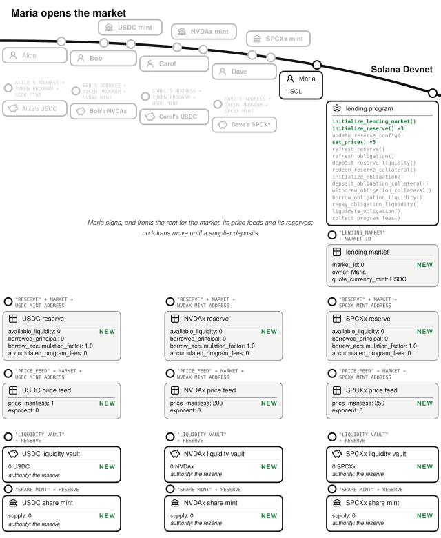
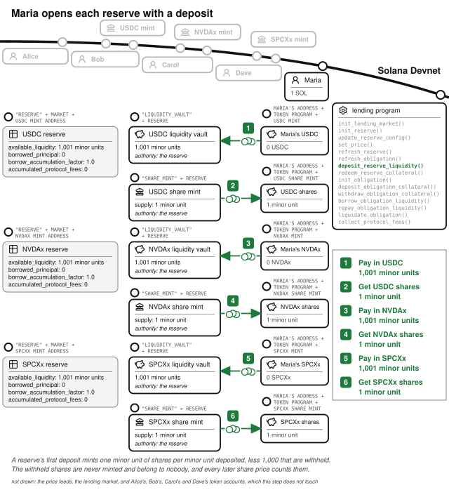
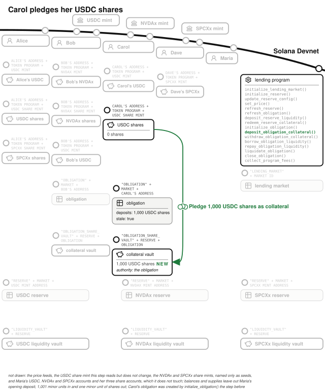
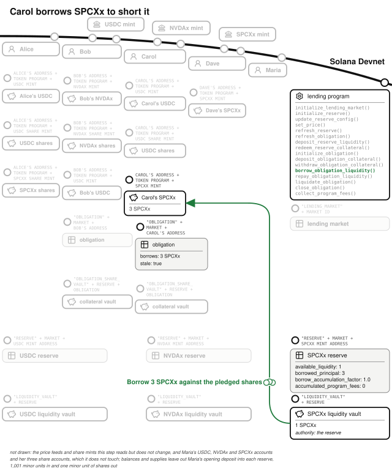
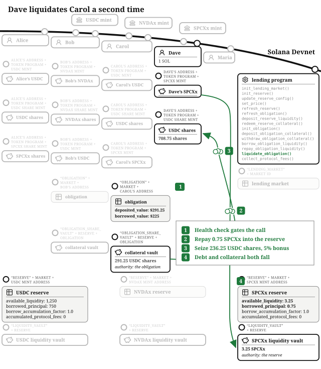
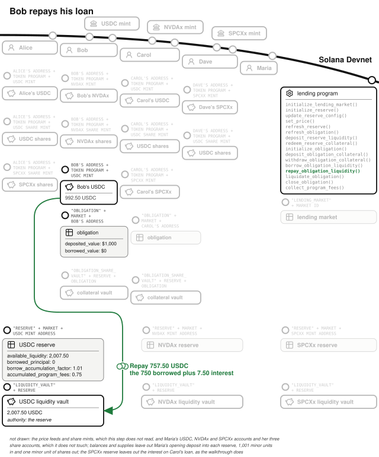
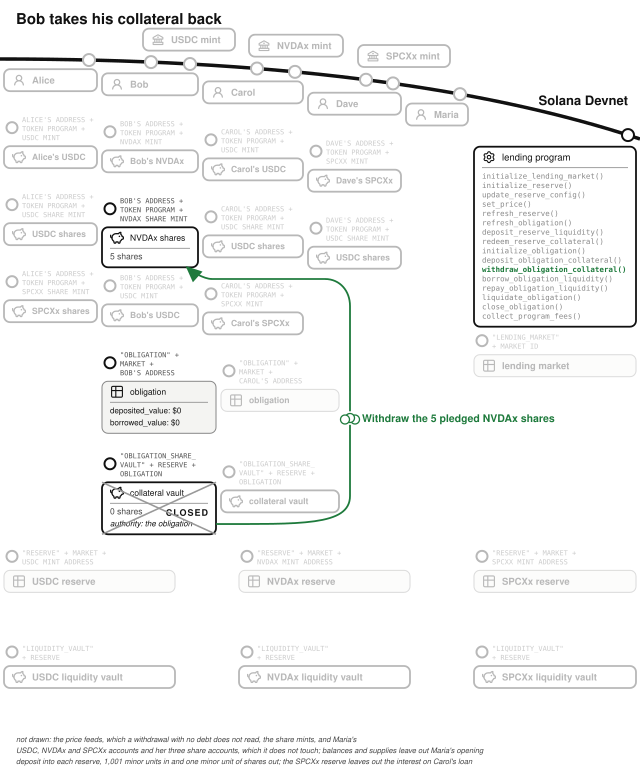
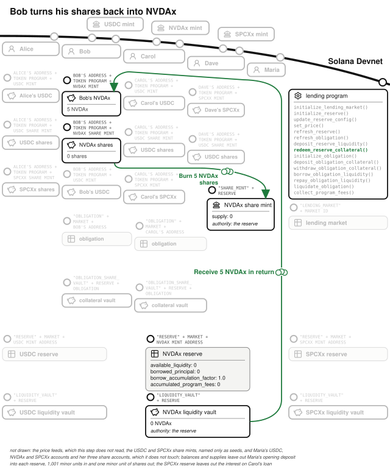
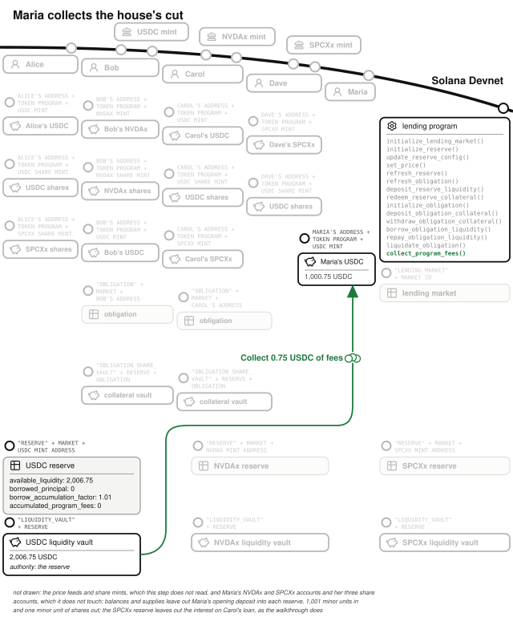
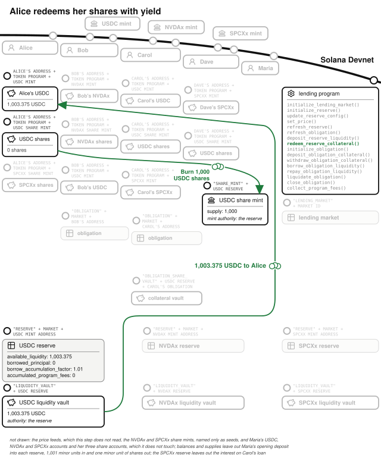

# Chapter 17: Lending and Borrowing

Start with a commercial bank. Savers make deposits and earn interest. Borrowers take loans and pay interest. The bank sits in the middle, collecting from the borrowers, paying most of it to the savers, and keeping a slice for itself. The onchain equivalent is a borrow-lend market, usually just called a **lending market**: Kamino Lend, Jupiter Lend, and Save are lending markets on Solana, and lending is one of the largest categories of capital on the network.[^lending-size] The program for this chapter lives at `finance/lending`, and it is the largest program in the book so far: interest that compounds on every refresh, collateral that gets marked to market, and a liquidation engine that keeps the market solvent when prices move.

One word is overloaded. This chapter's market trades stocks like NVDAx and SPCXx, which people colloquially call "shares." **In this chapter, a share is a share of a reserve**: a token minted by the program representing your claim on a pool of deposited assets, including the interest it earns. The stocks are just tokens.

## Prices Come In by Signature: The Price Feed, Freshness, and Slots

Every valuation in this chapter multiplies an amount by a price, and the prices come from price feed accounts (seeds: `"price_feed"`, the market, the mint) storing a signed mantissa, an exponent, the publisher's confidence band, and the slot the value was written. That is the layout a price feed network publishes. The band is the publisher's own uncertainty, the confidence the *Offchain Truth* chapter explains, stored as half the width of the interval around the price, in the mantissa's units. In production the account would *be* the price feed network's own account, decoded and verified by the program with that network's crate. In this example, `set_price()` writes the price, exponent, and band directly; only the market owner may sign, and the test `non_owner_cannot_write_market_price_feed` checks that. Writing it directly keeps the tests deterministic and shows the trust arrangement: the program accepts a price because the market owner's private key signed it recently.

"Recently" is enforced, and it is enforced in **slots**, the unit this price feed stamps each update in. Any price older than 25 slots makes the reading handler fail with `StalePriceFeed`, and any price stamped at or before the cluster's last restart fails with `PricePredatesRestart`. The *Time* chapter explains both checks. Every handler that values a reserve requires `refresh_reserve()` to have run in the same slot, and every handler that judges an obligation's health also requires `refresh_obligation()`; in practice both run earlier in the same transaction. A transaction that leaves out the reserve refresh fails with `ReserveStale`, and one that leaves out the obligation refresh fails with `ObligationStale`.

A price the publisher is unsure of is refused too. Each reserve's config sets `max_confidence_bps`, the widest band the reserve will still value against, as a fraction of the price; this market sets 1%. Every read of a price feed checks that `confidence × 10,000 ≤ price × max_confidence_bps`, both sides multiplied out in u128 so no division truncates, and fails with `OracleConfidenceTooWide` when the band is wider. The limit is inclusive: a band of exactly 1% of the price passes, and one unit wider fails. `refresh_obligation()` applies the check to every collateral and borrowed asset it values, and `borrow_obligation_liquidity()`, `withdraw_obligation_collateral()`, and `liquidate_obligation()` apply it to the price feeds they read themselves. An asset that has stopped trading, or whose price sources disagree, cannot be borrowed against, withdrawn while it backs a debt, or liquidated until the publisher posts a narrow band again.

## The Market Owner Opens the Market

Maria runs the market, and her revenue is a cut of the interest, the reserve factor set on every reserve below. She runs `initialize_lending_market()` with USDC as the quote currency, then `set_price()` three times, one price feed per asset, then `initialize_reserve()` three times against them, for USDC, NVDAx, and SPCXx, each with its config. Each reserve's `borrow_accumulation_factor` starts at 1.0.

Opening the market created thirteen accounts: the market, and for each asset a price feed, a reserve, and the two accounts the reserve owns.

The **lending market** account (PDA seeds: `"lending_market"`, a market ID) stores the `owner` (Maria, used only for authorization, never in the address) and the `quote_currency_mint`, the stable asset all values are measured in: USDC. Distinct market IDs give independent, risk-isolated pools.

Each asset gets a **reserve** account (PDA seeds: `"reserve"`, the market, the asset's mint). The reserve's PDA is the authority of two accounts: a **liquidity vault** holding deposited tokens, and a **share mint** whose tokens are suppliers' claims on the vault plus its accrued interest. The reserve's five running totals are `available_liquidity`, `share_mint_supply`, the `borrowed_principal` of all its loans, the `borrow_accumulation_factor` that makes interest work (below), and `accumulated_program_fees`, Maria's slice, carved out so it never inflates the suppliers' exchange rate. `available_liquidity` is the un-borrowed pool, and the program prices shares from it instead of from the vault's raw balance, so donating tokens to the vault cannot move the exchange rate.

Each reserve carries a `ReserveConfig`, all in basis points, and its validation rules are the credit-risk controls:

| Parameter | This market | Meaning |
| --- | --- | --- |
| `loan_to_value_bps` | 75% | How much of your collateral's value you may borrow. |
| `liquidation_threshold_bps` | 80% | The debt level at which your position becomes liquidatable. `validate()` refuses a loan-to-value above it: you cannot be allowed to borrow past the point you would be liquidated. |
| `liquidation_bonus_bps` | 5% | The liquidator's discount. `validate()` refuses a bonus the collateral could not pay at the threshold, where threshold × (1 + bonus) exceeds 100% (`LiquidationBonusUnpayable`, `rejects_unpayable_liquidation_bonus_at_initialize`). |
| `close_factor_bps` | 50% | How much of a debt one liquidation may repay. Zero is rejected, because it would make every liquidation a no-op. |
| `reserve_factor_bps` | 10% | The house's cut of interest. |
| `min/optimal/max_borrow_rate_bps` | 2% / 20% / 150% | The interest curve, kinked at `optimal_utilization_bps` (80%), which must sit strictly inside (0%, 100%). `validate()` refuses any rate above 300% a year (`BorrowRateAboveCeiling`). |
| `max_confidence_bps` | 1% | The widest confidence band the reserve will still value against, as a fraction of the price. Zero is rejected, because no live price feed reports a band of zero, so the reserve could never be valued and every obligation holding the asset would be frozen. Above 100% is rejected, as it is for the other six ratios in the table; only the three borrow rates may exceed it, and this market's maximum does. |

## Supplying: Tokens In, Shares Out

Before anyone supplies, Maria makes the first deposit into each reserve herself, running `deposit_reserve_liquidity()` three times with 1,001 minor units of USDC, NVDAx and SPCXx (she bought that much of each stock beforehand for the purpose). A reserve's share token has as many decimals as its asset, and the first deposit mints one minor unit of shares per minor unit deposited, less 1,000 that are withheld and never minted: the program's `MINIMUM_SHARES`. So Maria holds one minor unit of each reserve's shares, and the 1,000 withheld units belong to nobody.

Alice has her standard 1,000 USDC, plus four SPCXx (SpaceX stock, $250 each), sitting idle, and she wants yield. She runs `deposit_reserve_liquidity()` with her 1,000 USDC. Every deposit after a reserve's first mints by the going rate: shares = amount × (share supply + 1,000) ÷ total liquidity, floored, where total liquidity is available plus borrowed (with accrued interest) minus the house's accumulated fees. The withheld 1,000 count in every conversion between shares and liquidity, the defense the *Constant-Product AMM* chapter builds, and the failure-modes section shows the attack it stops here. The USDC reserve holds 1,001 minor units against 1,001 minor units of shares, one to one, so Alice receives 1,000 USDC shares; she does the same with her four SPCXx. The share price is how yield arrives: interest grows the pool while the share supply is unchanged, so each share redeems for more than it did. The program keeps no per-lender interest records.

## Borrowing Against Deposited Collateral

Bob needs cash but does not want to sell his five NVDAx (NVIDIA stock, $200 each): he wants $750 of liquidity while keeping his position. He calls four instruction handlers, in order:

1. `deposit_reserve_liquidity()`: his five NVDAx go into the NVDAx reserve; he receives five NVDAx shares.
2. `initialize_obligation()`: creates his loan file.
3. `deposit_obligation_collateral()`: moves his five NVDAx shares into a collateral vault owned by his obligation. What he pledges is *shares*, not raw tokens, so his collateral keeps earning supplier yield while it is pledged.
4. `borrow_obligation_liquidity()`: with his collateral worth $1,000 and loan-to-value at 75%, he may borrow up to $750 of USDC, which he does, drawn from the USDC reserve's available liquidity.

When `refresh_obligation()` values Bob's position, collateral is floored and debt ceiled, so the check errs against him. Borrowing one unit past the allowance fails (`BorrowTooLarge`), and the test `borrow_up_to_max_ltv_then_one_more_fails` checks the boundary from both sides. Bob's NVDAx is not sold, and he gets it back the moment he repays.

The second step created Bob's **obligation**, one account per borrower per market (PDA seeds: `"obligation"`, the market, the owner): his loan file, listing collateral deposits and borrows (up to four reserves each). It also caches values (`deposited_value`, `borrowed_value`, `allowed_borrow_value`, `unhealthy_borrow_value`) behind a `stale` flag that forces revaluation before any handler judges the position's health. Once it holds no collateral and no debt, its owner can close it with `close_obligation()` and take its rent back; one that still holds either is refused with `ObligationNotEmpty`.

## Shorting an Asset by Borrowing It

Carol thinks SpaceX is overvalued and wants to profit if it falls. Her trade is the classic short, and a lending market is where shorts are built: borrow the asset, sell it immediately, and owe *the asset* rather than dollars. She deposits 1,000 USDC as collateral (via shares and an obligation, like Bob) and borrows three SPCXx at $250 each, $750, the maximum her collateral allows. She sells them elsewhere for $750 cash.

If SpaceX falls, she buys the three tokens back cheaper and keeps the difference. If SpaceX rises, her debt rises with it, against collateral that does not. She has borrowed at the edge of her allowance with a debt that moves.

## Interest: One Index, No Transfers

Weeks pass, and the loans accrue interest without a single token moving. The program tracks that interest with the **borrow accumulation factor**.

It is one number per reserve, and it only grows. The program writes 1.0 as 10^18, a scale chosen so a single second's interest does not truncate to zero while staying far below u128's maximum, so the math needs no fixed-point crates: just u128, the scale constant, and two rounding helpers. On every `refresh_reserve()`, the program computes the current borrow rate, multiplies it by the seconds elapsed, and grows the factor: new factor = old factor × (1 + rate per second × elapsed seconds). Each obligation stores its borrow as `borrowed_principal`: the amount borrowed divided by the factor at the moment of borrowing, rounded up. A live debt is that principal times the current factor, rounded *up*, because debt rounds against the debtor. No loan is ever visited individually. Tokens move only when people repay or redeem, like the unsettled balances in the *Order Book Exchange* chapter, but across time instead of across fills.

The rate itself comes from a **kinked utilization curve**. Utilization is borrowed ÷ (available + borrowed). Below the kink at 80% utilization, the rate climbs gently from 2% toward 20% APR; above it, steeply toward 150%. Above the kink, when nearly everything is lent out, the rate spikes, which pushes borrowers to repay and pulls new suppliers in with yield.

Those percentages are annual, and the accrual is per second, so the conversion divides by the seconds in a year. The seconds elapsed are the Clock's timestamp minus the one the reserve stored at its last accrual, `last_accrual_timestamp`. Changing the curve with `update_reserve_config()` accrues at the old rates first, so the seconds already elapsed are charged at the rates that applied to them.

Of the interest that accrues, the reserve factor (10%) is set aside in `accumulated_program_fees`, rounded up, against the suppliers; the rest belongs to the suppliers through the rising share price.

## The Shorted Asset Rallies and the Position Becomes Liquidatable

The other thing that moves over time is prices. SPCXx rallies from $250 to $300, and the price feed says so. Carol's loan has accrued a little interest by now; the numbers below leave it out, so her debt is the three tokens she borrowed. Carol's debt is now 3 × $300 = $900 against $1,000 of collateral, and her liquidation threshold is 80%: $800. Her `borrowed_value` exceeds her `unhealthy_borrow_value`, and the market will now pay anyone to fix that.

## A Liquidator Closes the Gap, Twice

Dave watches for liquidation opportunities. He buys 1.5 SPCXx for $450 of his USDC and runs `liquidate_obligation()`, repaying that much of Carol's SPCXx debt in exchange for her USDC collateral at a 5% bonus. The handler enforces four rules:

- A healthy obligation cannot be touched: the handler rejects it with `ObligationHealthy` (checked by `healthy_obligation_cannot_be_liquidated`). A liquidator chooses only among positions already past the liquidation threshold.
- The **close factor** caps one liquidation at 50% of the debt. Dave repays 1.5 SPCXx ($450).
- The **bonus** prices his service: he seizes $450 × 1.05 = $472.50 of Carol's collateral, paid in USDC shares, every step of the conversion floored toward the borrower.
- Overreach fails the whole call: asking to seize more collateral than the obligation holds rejects with `LiquidationTooLarge` rather than silently capping, because a silent cap would make the liquidator pay full price for less collateral (checked by `over_seizing_liquidation_rejected_smaller_succeeds`).

Carol is still slightly unhealthy, so Dave buys another 0.75 SPCXx for $225 and goes again: half of the remaining 1.5 SPCXx debt, seizing $236.25. Her loan is healthy again, still hers, partially paid down by her own collateral. Across both passes Dave repaid $675 of debt and collected $708.75, a $33.75 profit: 5% for keeping the market solvent.

## Cranks: Work With No Natural Caller

Some work in a financial product has no natural caller: interest must accrue, cached valuations must refresh, and no user's own transaction is obliged to do any of it. Onchain, that work goes to a **crank**: an instruction handler that anyone may call, safe to call at any time, so that keeping the market's state current is a permissionless job rather than one only the operator can do. A good crank has three properties:

- **Permissionless: the handler checks state, not identity.** If the work is valid, anyone's signature will do. `refresh_reserve()` and `refresh_obligation()` are the canonical examples: they bring interest and cached valuations up to date for whoever asks, no special signer required, and requiring the operator's signature for maintenance would turn the operator's absence into everyone's outage. Anyone can run the crank, so a crank that moves funds must calculate their destination from information the program itself stores in its own accounts, never by paying the signer: a crank that pays whoever called has made its funds claimable by strangers.
- **Idempotent: a no-op succeeds.** Calling the crank when there is nothing to do succeeds cleanly (refreshing an already-fresh reserve rewrites the same numbers), so a bot on a schedule never needs attention and never fails spuriously.
- **Paid, if you need it reliable.** Dave is paid, but not as a crank operator: he acts on his own account, repaying someone else's debt with his own funds and taking their collateral at a discount. He risks his own capital on prices holding while he does it.

## Repayment, Fees, and Yield: Everyone Settles Up

Five weeks in, Bob no longer needs the cash. His $750 debt has become about $757.50 through the factor. He runs `repay_obligation_liquidity()` (anyone may repay any obligation, so there is no owner check; over-repayment clamps to the debt, and any sub-unit of principal stays with the borrower rather than being forgiven by rounding).

Then `withdraw_obligation_collateral()` releases his NVDAx shares. Bob owes nothing now, so the handler reads no price and needs no refresh: a borrower with no debt can take their collateral out while the price feed is stale or silent. While a debt remains, the withdraw math rounds *up* the borrow power being removed, so a withdrawal can never slip past the health check by a rounding sub-unit. Bob's withdrawal empties his collateral vault, so the handler moves the vault's whole balance to him and closes it, returning the rent he paid when it was created. A liquidation that seizes all of one reserve's collateral closes that vault too, but puts its rent into the obligation account, so the liquidation takes no account the borrower controls and nothing the borrower does to their wallet can make it fail. `close_obligation()` later returns that rent to the owner with the obligation's own. An obligation a liquidation leaves with debt and no collateral stays open until someone repays the debt, since `close_obligation()` refuses while debt remains (`close_obligation_refused_while_debt_remains_after_full_liquidation`).

`redeem_reserve_collateral()` then turns the shares back into his five NVDAx. Total cost of five weeks' liquidity: about seven and a half dollars, and he never sold his NVIDIA.

Maria runs `collect_program_fees()` whenever she likes and receives the accumulated 10% of interest, about 75 cents (`NothingToCollect` refuses a collection when nothing is owed, and `program_fees_accrue_and_owner_can_collect` covers the flow).

Alice leaves her SPCXx position in place and takes her USDC yield: `redeem_reserve_collateral()` burns her 1,000 shares for about $1,003.38, her half of the supplier interest, since she supplied half the USDC reserve alongside Carol's collateral deposit.

The final balances are:

- **Alice**: about $3.38 for five weeks of otherwise idle capital.
- **Bob**: five weeks of liquidity for about $7.50, and he kept his stock.
- **Carol**: $1,000 became about $816.25, most of it lost to the price moving against her short, $33.75 of it paid to Dave.
- **Dave**: $33.75 for watching.
- **Maria**: $0.75 on one small loan in one small market, a number that becomes a business on a large market.

## The Math: Two Rounding Helpers and a Rule

Every number in this program flows through `mul_div_floor()` or `mul_div_ceil()`, u128 in, multiply before divide, checked everywhere. The rule deciding which to use is the one the *Arithmetic of Money* chapter sets: quantities favorable to the user round down; debt rounds up, and so does the borrow power a withdrawal removes.

Because every division rounds this way, the market never loses a minor unit to rounding. `deposit_redeem_round_trip_creates_no_value` runs fifty deposit-and-redeem round trips of 777,777,777 minor units against a reserve whose exchange rate a tenth of a year's interest has moved off one-to-one, and asserts after each that the supplier holds no more than they started with.

## The Invariants: What Keeps the Market Solvent

- Total liquidity = available + borrowed-with-interest − the house's accumulated fees, and the share supply plus the 1,000 withheld shares is a claim on exactly that. A donation into the vault changes none of those three terms (`raw_token_donation_does_not_inflate_exchange_rate`).
- No borrow or withdrawal may leave an obligation past its allowed borrow value, and every valuation is fresh (same slot) or refused.
- Loan-to-value ≤ liquidation threshold in every valid config, so there is always a buffer between the most you can borrow and the point you can be liquidated.
- The factor never decreases.
- Liquidation touches only an unhealthy position, repays at most the close factor of one debt per call, and pays the liquidator at most the bonus.

## The Failure Modes: The Liquidation Engine Is Only as Good as Its Prices

- **A wrong price makes every number wrong.** Every health check multiplies by the price feed, so a bad price means wrong collateral values, wrong debts, and liquidations that should not happen. This program refuses stale prices (`borrow_with_stale_price_feed_is_rejected`), refuses prices whose confidence band is wider than the reserve's `max_confidence_bps` (`borrow_against_collateral_priced_with_a_wide_band_is_rejected`, `borrow_of_a_token_priced_with_a_wide_band_is_rejected`), and lets only the market owner write them (`non_owner_cannot_write_market_price_feed`). Manipulated prices have produced nine-figure losses on real markets (the price-manipulation section of the *Adversary* chapter covers Mango Markets).
- **Skipping the refresh** would let positions be judged on old values; `ReserveStale`, `ObligationStale`, and `borrow_without_obligation_refresh_is_rejected` close the path.
- **Cross-market smuggling**: an obligation in one market pledging reserves from another is refused (`MarketMismatch`, `cross_market_reserve_is_rejected`).
- **Dangerous configurations are rejected at write time**: LTV above threshold, zero close factor, misordered rate curves, a rate above 300% a year, a confidence limit of zero or above the price (`rejects_ltv_above_liquidation_threshold`, `rejects_misordered_interest_rate_curve`, `rejects_borrow_rate_above_ceiling_on_update`, `rejects_zero_confidence_limit`, `rejects_confidence_limit_wider_than_the_price`). `update_reserve_config()` also refuses a lower liquidation threshold with `RiskLimitLowered`, so an update cannot pull the liquidation threshold down under an open borrow (`rejects_lowering_liquidation_threshold`). It accepts a lower loan-to-value, down to zero to stop new borrowing (`accepts_lowering_loan_to_value`).
- **Share inflation through the reserve's own borrowing.** Total liquidity counts interest owed on borrows, and a supplier may borrow from the reserve they supply. The attacker is the only supplier of an empty reserve, holding a single minor unit of its shares, and borrows one minor unit from it against collateral in another reserve. Debt rounds up, so a second of interest makes that debt two minor units, and the attacker's unit of shares is worth two without anything being minted. From there, deposits and redemptions push the share price higher, because both round in the pool's favor and the attacker owns the whole pool. Once that unit is worth about 690 USDC, a 1,000 USDC deposit mints one unit of shares, and the attacker's unit redeems half the pool. `inflating_shares_through_own_borrow_does_not_pay` runs this on the default rate curve, and the attacker repays the loan and leaves no bad debt. Without the withheld shares the attacker would keep about 155 USDC of the victim's deposit. With them, the attacker's unit is one of 1,001, and nearly everything the rounding leaves behind goes to shares nobody can redeem. The test asserts that the attacker ends with no more than they started with and the victim gets back at least 99.9% of the deposit. A reserve whose suppliers have all left keeps the 1,000 minor units behind the withheld shares, and the next deposit is priced against them instead of starting the reserve over (`sole_supplier_leaves_the_minimum_behind`).
- **Self-liquidation** is allowed (`owner_can_liquidate_their_own_obligation`): it is only possible while unhealthy and is economically pointless.

## Testing Considerations

The suite is organized by risk, one file per class. Rounding comes first: the round-trip-creates-no-value invariant, and the withdraw-at-the-boundary-then-one-more-unit test, which tests both sides of the boundary. Then deposits and redemptions, including the share-inflation attack and a first deposit too small to clear the withheld shares. Then interest over time (moving the clock forward to make weeks pass). Then liquidation: healthy rejected, unhealthy corrected with bonus and close factor, over-seizure refused, and a seizure of all the collateral that closes the vault and puts its rent in the obligation (`seizing_all_collateral_closes_the_vault_into_the_obligation`). That rent returns to the owner with the obligation's own when the owner closes it after the remaining debt is repaid (`close_obligation_after_full_liquidation_returns_both_rents_to_the_owner`). The borrowing tests cover the loan-to-value boundary, a skipped obligation refresh, a stale price, a price from before a restart, and a confidence band too wide on the collateral or on the borrowed token; `confidence_band_at_the_limit_passes_and_one_unit_over_fails` checks the band from both sides of the limit. `debt_free_withdraw_needs_no_price_and_no_refresh` and `withdraw_after_full_repay_needs_no_price` let the price go stale and take the collateral out anyway, and `withdraw_with_debt_is_refused_while_the_price_is_stale` checks the other side. Closing has its own file: an obligation closes only when empty and only for its owner (`close_obligation_with_collateral_is_refused`, `close_obligation_with_debt_is_refused`, `non_owner_cannot_close_obligation`), a full withdrawal closes the vault and returns its rent (`full_withdraw_closes_the_vault_and_returns_its_rent`), and shares donated to the vault cannot keep it open (`donated_shares_cannot_keep_the_vault_open`). Reserve configuration has its own file: dangerous parameters are refused at write time, among them a confidence limit of zero or above the price and a rate one past the ceiling, and so is an update that lowers the liquidation threshold. The security tests cover cross-market and unauthorized-price attempts. All of it drives the program's own handlers, with each action bundling its refresh instructions into the same transaction as a production client would.

## What You Learnt from Building the Lending Market

A commercial bank is: pooled deposits earning a rate, loans against collateral marked to market, a margin call when the mark moves, and a spread for the house. This chapter built all four out of accounts at PDAs, one growing index, two rounding helpers, and a price feed only the market owner may write. The loan officer became a loan-to-value check, the risk committee became `ReserveConfig::validate()`, which refuses dangerous parameters, the margin clerk became any bot willing to claim a liquidation bonus, and the bank's interest ledger became a single number that only grows.

Six concepts came out of the lending market:

- **Shares as the yield mechanism.** Yield arrives as a rising share price, so no per-lender bookkeeping exists or needs to.
- **The accumulation factor.** One growing index per reserve computes every debt; the same structure prices any claim on a growing pool.
- **Valuation that rounds against the borrower.** Collateral floors and debt ceils.
- **Liquidation as a paid correction.** The bonus pays the liquidator; `ObligationHealthy` rejects any position not already past the threshold.
- **Cranks.** Permissionless, idempotent maintenance that pays funds only to destinations read from stored state, and whose reliability comes from someone being paid.
- **Refreshes in the same transaction.** No handler values anything it has not refreshed in the same slot.

In the *Managed Fund* chapter we will build a fund: investors deposit into a pool of assets, and a manager trades that pool on their behalf. The lender in this chapter protects itself from its borrowers. The fund has to protect its investors from its own manager.

[^lending-size]: [defillama.com/chain/solana](https://defillama.com/chain/solana) ranks Solana's categories by the value locked in them. Where lending sits in that ranking moves with the market.
