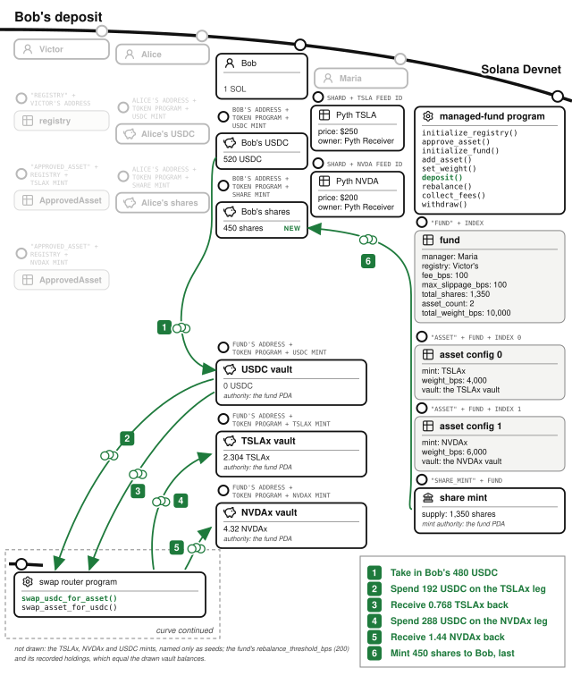

# Chapter 18: The Managed Fund

A **managed fund** is the onchain equivalent of a mutual fund. A list of approved assets, a fund manager who picks the allocation, investors who deposit and receive shares, a management fee for the manager's expertise. Symmetry and Kamino run managed funds on Solana. The program lives at `finance/managed-fund` in the companion repository, and its story trades stocks: TSLAx and NVDAx, quoted in USDC.

In a traditional fund, "the manager cannot run off with client assets" is enforced by custodians, auditors, and courts. Here it is enforced by the program: **the manager can change the allocation and earn the fee, and can do nothing else.** No instruction in the program moves a vault's tokens to the manager.

> **Sometimes called a "vault".** Some Solana platforms sell this product as a "vault": Drift Vaults and Kamino's Earn vaults both pool deposits under a manager or curator. This book uses the finance name because every chapter already uses "vault" for a token account owned by a program. So **the product is the fund, and the token accounts are its vaults.** Nor is it an index fund, though the two look alike: an index fund's weights follow a published index with no manager choosing them, and here a manager chooses them.

## A Curator Decides What Managers May Touch at All

Two different people hold power in this program, and their separation is its first security decision.[^separate-people] Victor runs the registry: he is not a fund manager, but the curator who decides which assets managers may invest in at all, and which Pyth price feed the program reads for each. He operates the platform the funds live on, and his business is his reputation for funds not failing, so vetting price feeds is part of the service his platform offers. Maria, the fund manager you will meet shortly, gets to pick allocations only from what Victor has approved.

Victor runs `initialize_registry()` once, creating the **registry**: the curator record at the root of an approved-asset set. The registry holds no list; the account stores only the curator's authority. Victor then runs `approve_asset()` for each asset he vets, and each call creates an **`ApprovedAsset`** account at a PDA derived from the registry and the asset's mint (seeds: `"approved_asset"`, the registry, the mint), binding that mint to its official Pyth price feed. An asset is approved if it has an `ApprovedAsset` account, and not approved if it does not. Victor vets which assets and which price feeds are safe, so a manager cannot list a token they minted themselves, and cannot pair a real asset with a price feed they control. When Maria later adds an asset to her fund, the price feed address is copied out of the `ApprovedAsset` account; the manager never supplies a price feed.

The approved set is stocks, bonds, whatever investors actually want. It cannot include the manager's own token: `add_asset()` checks approval by deriving the `ApprovedAsset` address for the mint it is handed, so adding an unapproved asset fails because the account does not exist (checked by `test_add_asset_rejects_unapproved`).

## The Manager Creates the Fund and Sets the Weights

Maria is the fund manager: she creates the fund, sets the weights, rebalances, and earns the fee. She runs `initialize_fund()` with index 0, her fee of 100 basis points (1%), a `max_slippage_bps` of 100, a `rebalance_threshold_bps` of 200, and the swap router the fund will trade through. The fee is capped at 10%. It is collected by dilution (below), so an uncapped fee would let a manager drain the fund *by configuration*, and `initialize_fund()` rejects a higher fee with `FeeTooHigh`.

The slippage tolerance is capped at 10% too. It sets how far below the oracle price the swaps in a deposit or a rebalance may fill, so an uncapped tolerance would let a manager sell the fund's assets far below what they are worth. `initialize_fund()` rejects a higher tolerance with `SlippageConfigTooHigh`.

She then runs `add_asset()` twice: TSLAx at 4,000 basis points, NVDAx at 6,000. Weights may not overflow 100% (`WeightOverflow`), and **nobody can deposit until the weights sum to exactly 100%** (`FundNotFullyAllocated`). A deposit into this fund is always fully invested, immediately, at target weights. Maria can change weights later with `set_weight()`, and only Maria: `set_weight()` requires the fund's `manager` to sign, and `test_set_weight_rejects_non_manager` checks that anyone else is refused.

Maria's three transactions created the seven accounts the fund needs.

The **fund** account (PDA seeds: `"fund"`, an index) records the `manager`, the `registry` it is bound to, its `fee_bps`, `max_slippage_bps` and `rebalance_threshold_bps`, and the `swap_router` it is allowed to trade through. It keeps its running `total_shares` and `total_weight_bps`, the `usdc_decimals` of its USDC mint, and `last_fee_accrual_timestamp` for the fee clock. It also records `usdc_holdings` and `asset_holdings`, the amounts the program has counted into its vaults. The **share mint** lives at a PDA (seeds: `"share_mint"`, the fund) with the fund PDA as mint authority: shares only come into existence when the program's own math says so. The fund PDA is also the authority of a **USDC vault**, which every deposit passes through on its way into the basket.

Each basket asset gets an **asset config** account (PDA seeds: `"asset"`, the fund, an index byte) recording its mint and that mint's `decimals`, its price feed (copied from its `ApprovedAsset` account), and its weight in basis points. It also records its **vault**, a token account whose authority is the fund PDA. The fund holds up to `MAX_ASSETS` (16), and the cap is not about storage. A deposit has to reference every asset's accounts at once, five per asset, so a full basket runs to 94 accounts. That fits inside Solana's account-lock limit, but it is far past what a legacy transaction can hold, so clients of big baskets send v0 transactions with an address lookup table.

Every handler that computes the fund's value walks indexes 0 through `asset_count` and refuses to run if any account is missing (`IncompleteAssetAccounts`), so a caller cannot leave an asset out and understate the fund's value. A retired asset (weight set to zero) keeps its index forever rather than being reused, so the contiguous range the valuation loop depends on stays intact.

## A Deposit Makes the Program Acquire Assets

Alice invests from the standard wallet of one SOL and 1,000 USDC. She runs `deposit()` with 900 USDC and a `minimum_shares` floor. The handler does three jobs in one transaction, in this order: it prices the shares before it takes the USDC in, so a deposit never counts toward its own price, and mints last.

**First it values the fund.** It walks every asset: reads the holding the program has recorded for that vault, loads the Pyth price, and accumulates value in u128, multiply before divide. A Pyth price is an integer and an exponent, so $250 arrives as 25,000,000,000 at exponent −8, or as 25,000,000 at exponent −5 on Pyth's US equity price feeds. A holding is in the asset's minor units, so 1.44 TSLAx is 1,440,000 at six decimals and 144,000,000 at eight. The handler reads the exponent from the price feed and the decimals recorded when the asset was added, and scales amount × price into USDC's minor units. With USDC's six decimals, that divides by 10^8 for a six-decimal asset on a −8 price feed, by 10^10 for an eight-decimal asset on the same price feed, and by 10^7 for an eight-decimal asset on a −5 price feed. A program that assumed one of those would value the others 100 or 1,000 times too high or too low. `test_valuation_scales_by_decimals_and_exponent` runs this chapter's story with an eight-decimal TSLAx on a −5 price feed and gets the same share counts. The price load rejects a price feed that is not the one recorded in the asset config, a price that is not positive, a price older than 60 seconds, or a price posted at or before the cluster's last restart. It also rejects a price whose confidence interval is wider than 1% of the price. The recorded USDC is added to the total. That total is the **net asset value**, the NAV. The program keeps these records itself and updates them with what each transfer actually moves; the failure-modes section says why it never values the fund from its vaults' token balances. On the fund's first deposit the NAV is zero and shares are minted one-to-one: Alice's 900 USDC becomes 900 shares.

**Then it deploys the USDC at the weights.** 40% of 900, $360, buys TSLAx at $250: 1.44 TSLAx into the TSLAx vault. 60%, $540, buys NVDAx at $180: exactly 3 NVDAx. The swaps run through the router fixed at fund creation (the example ships a mock router standing in for Jupiter; a router that is not the configured one is rejected, checked by `test_deposit_rejects_unregistered_router`), and the fund PDA signs. The handler measures what each swap moved on the vaults and adds it to the recorded holdings. A swap that returns none of its asset refuses the whole deposit (`DepositTooSmall`).

**And the program, not the manager, decides the acceptable price.** For each leg, the handler computes the expected output *from the oracle price* and floors it by the fund's slippage tolerance: the swap may return at most 1% less than the price feed says it should, or the whole deposit reverts. A manager cannot approve a bad fill, because the minimum is never theirs to supply.

## The Market Moves and Anyone Can Rebalance

NVDAx climbs from $180 to $200. The 1.44 TSLAx and 3 NVDAx in the fund's vaults are now worth $960, and 900 shares exist, so each share is worth about $1.07. The program does not store a share price; each deposit divides the NAV, valued from the price feeds at that moment, by the share supply.

But the weights have drifted: NVDAx's gain pushed it to 62.5% of the fund against a 60% target. Restoring them is not left to anyone's judgment. **Anyone may call `rebalance()`, and the program, not the caller, decides the trade.** The caller names only the pair, NVDAx to sell and TSLAx to buy. The handler values every asset, as a deposit does, and finds NVDAx $24 above its $576 target and TSLAx $24 below its $384 target. It trades the smaller of the two gaps: 0.12 NVDAx sold for $24, $24 of TSLAx bought. Both legs go through the fixed router, and both are floored by oracle-anchored minimums as deposits are. The weights return to 40/60. The tokens moved between fund-owned vaults, through the approved router, at oracle-checked prices, and never through an account the caller controls.

Two rules decide whether there is a trade at all. The asset sold must sit above its target by at least the fund's **rebalance threshold**, which Maria set at 200 basis points, two percentage points of the fund's value. NVDAx's 2.5 points clears it; at 60.5% the call would fail with `DriftBelowThreshold`. The asset bought must sit below its own target, or the call fails with `NotUnderweight`. Because the trade closes the smaller gap exactly, a second call straight after finds nothing to sell.

Every rebalance pays slippage, so a threshold near zero would let anyone trade the fund on every small price move, and a very large one would let the fund drift far from the weights depositors chose. `initialize_fund()` accepts a threshold between one and twenty percentage points (`RebalanceThresholdOutOfRange`), and nothing can change it afterwards. One asset is exempt from it: an asset Maria has retired by setting its weight to zero may be sold down whatever the threshold, since selling it to zero can happen only once. Maria steers the fund through `set_weight()`, and the next rebalance carries out the new weights.

## A Later Investor Buys In at the New Price

Bob, the second investor, deposits 480 USDC of his standard wallet. He is not early, and the share math prices that in: shares = deposit × total shares ÷ NAV, floored, with the NAV valued from the recorded holdings. With 900 shares outstanding against a $960 NAV, his 480 buys 450 shares, not 480. Alice's early position is not diluted by his arrival, and the test suite checks the fairness directly (`test_deposit_fair_pricing`). His USDC deploys 40/60 at current prices, same as hers, same slippage floor.

## The Manager's Fee Arrives by Dilution

Traditional funds sell assets to pay the management fee. This program **mints new shares to the manager** instead, so the fee is paid by diluting every holder proportionally, with no asset ever sold. `collect_fees()` computes shares owed as total shares × fee rate × elapsed time over a year, from the fund's fee clock: at 1% with 1,350 shares outstanding and a year elapsed, 13.5 new shares to Maria. The instruction is deliberately callable by anyone (the fee accrues by time, not by the manager's diligence in claiming it), and the fee rate itself has no setter: it is fixed at fund creation, so the deal investors joined under cannot be worsened. The *Betting Market* chapter stored each event's fee when the event was created, for the same reason.

## Withdrawing In Kind

Alice takes profit with `withdraw()`, burning her 900 shares. The program does not sell anything to pay her: it transfers to her **her proportional slice of every vault, in kind**. That is her share of the recorded holdings in the USDC vault, the TSLAx vault (about 1.52), and the NVDAx vault (about 2.85), each amount floored, each destination account verified to be hers and of the right mint (`InvalidRecipient`). The share count drops by her 900 shares, and her `min_usdc_out` floor protects the USDC leg (`test_withdraw_rejects_slippage`).

She entered with $900, held through NVIDIA's rise, paid Maria 1% by dilution, and left with about $950 of assets. Bob still holds 450 shares, unrealized. Maria holds 13.5 shares, about $14, for managing the fund. Victor took no fee on any of it. What he gained is what his platform depends on: a track record of funds whose managers cannot take the assets.

## The Math: One Valuation Loop, Floors Toward the Fund

Every formula in the program is a proportion, and they all round the same way:

- **Shares minted:** deposit × supply ÷ NAV, floored.
- **Withdrawal legs:** recorded holding × shares ÷ supply, floored per asset, with each payout subtracted from the record.
- **Fee shares:** supply × rate × time over a year, floored.
- **Deployment per leg:** deposit × weight ÷ 10,000, floored.
- **Rebalance trade:** the smaller of the sell asset's excess over its target and the buy asset's shortfall below its own, converted to the sell asset at the oracle price, floored.

All of them use u128 intermediates and multiply before dividing, and the remainders stay with the fund rather than the transactor. The one multiplication that is not a proportion is the valuation itself: amount × price, scaled by the asset's decimals and the price feed's exponent. The share price is right only if that line runs over every asset, on every deposit, with a fresh price.

## The Invariants: Assets Stay in the Fund's Vaults

- From first deposit to last withdrawal, assets live only in fund-owned vaults. No instruction handler transfers vault tokens to the manager; the fee path mints shares and touches no vault.
- Deposits are accepted only at 100% allocation, and every deposit is fully deployed in the same transaction.
- NAV computations include every asset index or refuse to run.
- Share supply changes only through `deposit()`, `withdraw()`, and `collect_fees()`, and `total_shares` moves before the corresponding CPIs.
- Every swap leg, deposit or rebalance, clears at no worse than the oracle price minus the configured tolerance, through the router fixed at creation.
- A rebalance sells only an asset at least the threshold above its target, or a retired one, and buys only an asset below its target. It trades neither past its target, and spends only what its sale brought in.
- Every share price and every payout comes from the recorded holdings, never from a vault's token balance. The recorded holdings never exceed the balances, and they equal them unless someone has transferred tokens in directly.

## The Failure Modes: The Manager, the Price Feed, and the First Deposit

- **The manager is included in the threat model**, and the program treats them as such: assets only from Victor's list, price feeds only from Victor's entries, swaps only through the fixed router, minimums only from the oracle, fee capped and immutable. No handler sends vault tokens to them, and no handler lets them choose a trade.
- **Nobody can churn the fund.** Churn is trading a fund back and forth for no investment reason, so that it pays slippage on every leg. If the manager chose the rebalancing trades, they could sell a balanced fund's NVDAx for TSLAx and back again, each leg filling up to 1% below the oracle price. The fund would end each round trip at 40/60 and poorer, through trades every rule allowed. That is not only carelessness: the value lost goes to whoever fills the trades, and a manager who controls when and how much the fund trades can arrange to be that party. Here no caller chooses a trade. `rebalance()` computes it, refuses below the threshold, and finds nothing to sell once the weights are restored, which is what makes it safe to open to anyone. `test_rebalance_cannot_churn` rebalances once and checks that a second call, in either direction, is refused.
- **Every number in the fund depends on the price feed.** A stale price is refused (`StalePriceFeed`, 60-second window), as is a non-positive price (`NegativePrice`) and a substituted price feed account (`InvalidPriceFeed`), so no deposit or rebalance runs on a bad price. A price posted at or before the cluster's last restart is refused too (`PricePredatesRestart`). After a halt the timestamp trails real time, so a price from before the halt can still look under a minute old, and the *Time* chapter explains why. So is a price whose confidence interval is wider than 1% of the price (`OracleConfidenceTooWide`). The *Offchain Truth* chapter explains what confidence means and why "fresh but uncertain" is its own failure mode. Here the cost is concrete: a deposit is priced from the price feed and a rebalance sets its slippage floor from it, so a band wider than the fund's 1% slippage tolerance would let a trade fill outside that tolerance. Withdrawal reads no price, so while deposits and rebalances wait for the band to narrow, investors can still take their slice in kind. `test_wide_confidence_price_rejected` widens NVDAx's band to 2% of its price and checks that deposit and rebalance are refused, that withdrawal still pays out, and that a band of exactly 1% is accepted.
- **Donations are ignored, which prevents the inflation attack.** Anyone can transfer tokens straight into a vault. A program that valued the fund from its vaults' balances is open to the inflation attack from the *Adversary* chapter. This program values the fund from `usdc_holdings` and `asset_holdings`, so a donation changes a balance and nothing the handlers read. Run the *Adversary* chapter's numbers against it: after the attacker's one minor unit and 1,000 USDC donation, the next depositor's 1,000 USDC still buys 1,000 shares. The donation stays in the vault, and no withdrawal ever pays it out. Nor can a donation force a rebalance or pay for one: the handler values the recorded holdings, so donated tokens cannot push an asset over its target, and the buy leg spends only what the sale brought in (`test_rebalance_ignores_donations`).
- **A deposit too small to buy anything is refused.** Ignoring donations leaves one gap: a deposit so small that a swap takes its USDC and returns none of the asset. It would mint shares against a fund recorded as worth nothing, and every later deposit would then divide by zero, so it fails with `DepositTooSmall`. A depositor's `minimum_shares` floor would also stop the inflation attack on its own, by reverting a deposit that rounds to too few shares, but only for a depositor whose wallet sets it, so the program does not rely on it. It remains for what neither check covers, a share price that moved between signing and landing. The empty-pool section of the *Adversary* chapter compares this defense with the others.
- **Partial baskets are refused**, on deposit, withdrawal, and valuation alike (`IncompleteAssetAccounts`): an attacker who could get the fund valued without its best-performing vault could buy shares at a discount.

## Testing Considerations

The suite (with hand-built Pyth price-update accounts injected so prices are deterministic) covers the full lifecycle end to end (`test_full_lifecycle`). It then checks each rule separately. Under-allocated funds refuse deposits, unapproved assets refuse listing, weight overflows refuse, the 17th asset refuses, and non-managers cannot set weights. Unregistered routers refuse, slippage floors reject on deposit and withdrawal, incomplete account lists refuse, and later depositors pay fair NAV. `test_full_lifecycle` checks after every step that the recorded holdings equal the vaults' balances. `test_donation_does_not_inflate_share_price` runs the *Adversary* chapter's attack and checks that the victim gets exactly the shares they would have got without the donation. `test_deposit_rejects_leg_that_buys_nothing` and `test_rebalance_ignores_donations` test the other two checks. Every rebalance test signs as a stranger, neither the manager nor a depositor. `test_rebalance_refuses_fund_at_target`, `test_rebalance_refuses_drift_below_threshold`, and `test_rebalance_cannot_churn` check that a fund at its targets, within its threshold, or just rebalanced cannot be traded. `test_rebalance_refuses_buying_overweight_asset`, `test_rebalance_sells_retired_asset`, and `test_initialize_rejects_threshold_out_of_range` cover the rest of its rules. `test_deposit_rejects_price_from_before_restart` simulates a halt, checks that a deposit is refused while the prices predate the restart, and checks that it goes through once Pyth posts again. `test_wide_confidence_price_rejected` moves a price feed's confidence interval instead of its price. Copy the price injection: valuation code cannot be tested against prices you do not control, so make the price feed a fixture and move it deliberately.

## What You Learnt from Building the Managed Fund

A mutual fund needs a custodian, a compliance officer, a fee schedule in a prospectus, and an auditor checking that the manager's trades match the mandate. This chapter needed a registry account, a weight sum that must hit 10,000, a fee constant with no setter, and a slippage floor computed from a price feed the manager cannot choose.

The managed fund added five concepts:

- **The manager included in the threat model.** The manager is a user in the threat model: assets only from a curator's list, a router fixed at creation, minimums only from the oracle. Rebalancing moves tokens between program-owned vaults, in trades the program sizes; the fee path mints shares and touches no vault.
- **A curator separate from a manager.** Victor's approved-asset set binds each asset to its official price feed, so a manager can neither list their own token nor pair a real asset with a price feed they control.
- **Oracle-anchored minimums.** When an untrusted party routes the trade, the acceptable outcome must be computed from a price source they do not control.
- **NAV as the share price, from the program's own records.** Value every holding with a fresh price feed or refuse to run; a valuation that skips an asset lets a depositor buy shares for less than they are worth.
- **Fees by dilution, at a rate fixed at creation.** The fee mints shares against everyone proportionally, accrues by time rather than the manager's diligence, and has no setter, so the deal investors joined under cannot be worsened.

In the *Options* chapter we will build a program that takes no credit risk at all. A writer posts the whole of what they might owe before the option is sold, so there is no margin, no liquidator, and no oracle, and you will see how much simpler the program is for it. The *Perpetual Futures* chapter, the last program chapter, then builds a program that needs all of it at once: vaults, shares, oracles, funding, margin, and liquidation.

[^separate-people]: The program sees two public keys, not two people, and nothing onchain stops one person holding both the curator's and the manager's private keys. Keeping Victor and Maria separate people needs proof from outside the program, from a proof-of-personhood service like those in the *Fundraiser* chapter's footnote.
