# Chapter 19: Options

Alice holds five NVDAx, a token that tracks a share of NVIDIA stock, and NVDAx is trading at $165. She would be happy to sell at $180, and she would like to be paid while she waits.

Bob thinks NVIDIA will pass $180 within the week, and he wants that upside for less than the $825 five shares would cost him.

An **option** serves them both: Alice sells Bob the right, but not the obligation, to buy her five NVDAx at $180 any time in the next week, and Bob pays her 25 USDC for it now. If NVIDIA rallies, Bob buys the shares below the market. If it does not, he loses the 25 USDC and Alice keeps it as income on shares she still owns.

Alice's offer to sell five NVDAx for 900 USDC, 180 USDC a share, is an ordinary offer with two additions: it expires, and the taker pays to reserve it. The program lives at `finance/options` in the companion repository. It keeps one account per option, which simplifies the custody, and the whole lifecycle is three states: `Listed`, `Held`, and `Exercised`. The limits of this approach are covered in the failure-modes section.

## An Option Is a Right on One Side and an Obligation on the Other

Options have some unique terminology:

- Its **premium** is what the buyer pays for the right, once, up front.
- Its **kind** is a **call**, the right to buy the underlying asset, or a **put**, the right to sell it.
- Its **strike** is the price the trade happens at if the right is used.
- Its **expiry** is the last moment the right can be used.
- The **writer** creates the option, which is called **writing** it, and in doing so agrees to sell or buy the underlying asset at the strike if asked.
- The **holder** buys the option and may use the right it carries. Using the right is **exercising** the option.

The two sides have different payoffs:

- **The writer** keeps the premium whatever happens, and in exchange takes on an obligation: to sell the underlying at the strike (a call) or to buy it at the strike (a put) whenever the holder asks. The writer's gain is capped at the premium, and the writer's obligation is not.
- **The holder's** loss is capped at the premium whatever happens, and the holder's gain is open-ended.

Every option has exactly two endings, and the price at expiry decides which: the holder exercises, or the option expires and the writer takes the collateral back. Where the price lands inside each ending decides how much each side made.

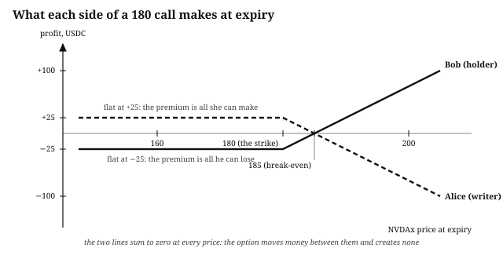

Traditional options venues let a writer take on that obligation with only a fraction of it posted as **margin**, and then watch the position every day to make sure the fraction still covers it. This program does something simpler. **A writer posts the whole obligation, up front, into the vault.**

- A call writer supplies the underlying asset to the program, so the call is **covered**: the shares the holder might buy are already in custody, and the writer cannot fail to deliver them.
- A put writer supplies the program with enough of the quote token to buy every share at the strike price, so the put is **cash-secured**: the money the holder might be paid is already in custody, and the writer cannot fail to pay.

Nothing in this program is ever undercollateralized, so it has no margin, no health factor, no liquidator, and no oracle.

## Settlement Is Physical, So No Price Is Read

Exercising moves tokens, and no price is computed:

- When a holder exercises a call, they pay the strike into the vault and take the underlying out.
- When a holder exercises a put, they deliver the underlying and take the strike.

This is **physical settlement**, and it is why the program has no oracle.[^psyoptions] The name is inherited from markets where settling meant delivering the share certificates or the barrels of oil themselves, and it does not mean anything happens offchain. Physical here means the underlying asset itself changes hands at the strike, where cash settlement moves only the difference between the strike and the market price, in the quote token, and the underlying stays where it was. Whether exercising is worth doing is the holder's decision, made against whatever the market is doing offchain, and a holder who exercises an option that is out of the money only hurts themselves. The program enforces the terms of the deal and has no opinion about the price.

The other design, **cash settlement**, pays the holder the difference between the market price and the strike in the quote token, USDC here, and that difference is a number only a price feed can supply. A cash-settled venue needs a price feed, a staleness check on it, and a defense against its manipulation. Zeta Markets took that road on Solana, with margin and an oracle.[^zeta]

## The Operator Opens the Venue

Maria runs the venue. Her incentive is a fee of 1% on every premium paid, and her power is limited to collecting it. She calls `initialize_market()` with `fee_bps` of 100. The handler refuses two configurations, both as `InvalidParameter`:

- A venue whose underlying and quote are the same token.
- A fee of 100% or more, which would leave a writer nothing from a sale.

A fee of zero is allowed: a venue run at cost is a valid choice, and `test_zero_fee_venue_pays_the_writer_the_whole_premium` checks that the fee transfer is then skipped rather than sent for nothing. Her key is stored as the market's `admin`, and the only handler that reads it is `collect_fees()`.

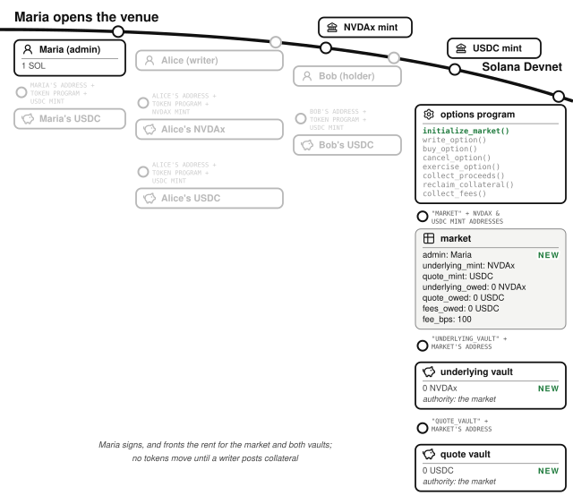

Financial state on Solana is accounts, and this one transaction created the three the venue needs.

The **market** is a PDA with seeds `"market"`, the underlying mint, and the quote mint, so one venue exists per pair: every call and put on NVDAx settled in USDC shares the same two vaults and the same fee schedule. Its struct, `Market`, holds the `admin`, the two mints, the two vault addresses, the `fee_bps` charged on every premium, and three counters that are the reason the account exists:

- `underlying_locked`: how much of the underlying vault the market owes, as call writers' collateral and as put holders' deliveries waiting for the writer to collect them.
- `quote_locked`: how much of the quote vault the market owes, as put writers' collateral and as call holders' strike payments waiting to be collected.
- `fees_owed`: how much of the quote vault belongs to the admin.

The market owns the **underlying vault** and the **quote vault** (seeds `"underlying_vault"` and `"quote_vault"` + market) and, being a PDA, signs for them with its own seeds. Both vaults hold other people's money, mixed: the underlying vault holds every call writer's shares together, and the quote vault holds every put writer's cash, every exercised call's strike payment, and the venue's fees together. One rule keeps that safe: a vault balance is custody, and the three counters are the truth about who is owed what.

## A Writer Posts the Whole Obligation and Names a Price

Alice, carrying the standard wallet of one SOL and 1,000 USDC plus her five NVDAx, calls `write_option()`. She passes an `id` of 1 and an `OptionTerms` struct: kind `Call`, 5 contracts, 1 NVDAx per contract, a strike of 180 USDC per contract, a premium of 25 USDC for the whole option, and an expiry one week out.

The handler checks the terms before it touches a token:

- **A zero quantity** in `contracts`, `underlying_per_contract`, or `strike_per_contract` is refused (`InvalidParameter`). Every quantity is a multiplier in the settlement math, so a zero is an option that delivers nothing or costs nothing to exercise.
- **A zero premium** is refused the same way. It would make the option a gift rather than a sale.
- **An expiry at or before now** is refused (`ExpiryInPast`). The holder may exercise while `now < expiry`, so such an option could never be exercised.
- **An option whose settlement overflows** is refused (`MathOverflow`). Both settlement products are computed now, at write time, so the overflow is found before anyone pays for it, and `test_write_option_rejects_a_lot_whose_collateral_overflows` checks it.

Then the effects come before the transfer, in this order:

1. The `OptionContract` is written with status `Listed` and an empty holder.
2. The market's `underlying_locked` rises by 5 NVDAx.
3. The custody check runs against what the vault balance will be once the transfer lands.
4. Alice's 5 NVDAx move into the underlying vault.

From this moment the vault holds everything a future holder could ever claim from her.

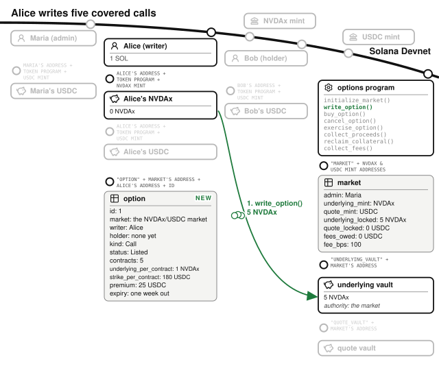

The transaction also created the option itself. Each option is an `OptionContract`, a PDA with seeds `"option"`, the market, the writer, and an `id` the writer chooses, so one writer can have many options open. Its fields are the five terms plus the bookkeeping around them:

- `kind`, `Call` or `Put`, and `status`, which is `Listed` (written and collateralized, unsold), `Held` (sold), or `Exercised`.
- `writer` and `holder`. The holder is empty until someone buys.
- `contracts`, `underlying_per_contract`, and `strike_per_contract`. Alice's option is 5 contracts, each on 1 NVDAx, each with a strike of 180 USDC.
- `premium`, in the quote token, for the whole option.
- `expiry`, a Unix timestamp. An option's expiry is a calendar date the two parties agreed on, so it is measured in wall-clock time rather than in slots. Nothing in this program reads a price, so slot-measured freshness never comes into it.

The three quantities are the account's most deliberate decision. **Every amount the option ever moves is a product of two of them.**

- A call writer posts `contracts` times `underlying_per_contract`, and a call holder pays `contracts` times `strike_per_contract`.
- A put is the same two products with the roles swapped: the writer posts the strike total, and the holder delivers the underlying total.

There is no strike *price* to multiply by a quantity and divide by a decimals factor, so there is no division anywhere in settlement, and no rounding direction to get wrong. The strike is stored as an amount per contract rather than as a price, and the chapter's "180 USDC strike" is what that amount reads as when a contract is one whole NVDAx.

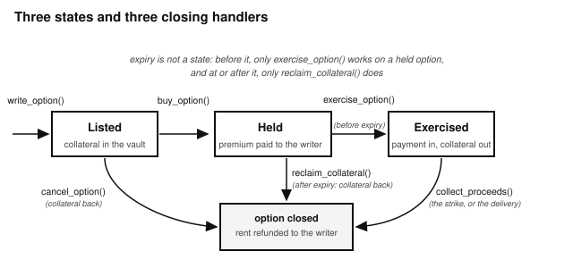

One more account is set up here. Alice's USDC account, where her premium will arrive, is created if it does not exist, paid for by Alice, so that `buy_option()` can require it to exist rather than make the buyer pay rent on an account that belongs to the writer.

Nobody has paid anything yet. Until someone does, Alice can call `cancel_option()` at any time, which returns her collateral and closes the account, rent back to her. That includes after the expiry: an unsold option has no holder whose rights the cancel would cut short, and `test_cancel_unsold_option_works_after_expiry` checks it. Without this exit, an option nobody buys would hold the writer's shares forever.

## A Buyer Pays the Premium, and the Collateral Does Not Move

Bob calls `buy_option()`. The handler does four things:

- It requires the option to be `Listed` and unexpired (`OptionNotListed`, `OptionExpired`), because a right nobody can exercise any more is not for sale.
- It splits the premium: `fee_bps` of it, 0.25 USDC, goes into the quote vault and is added to `fees_owed`.
- It sends the remaining 24.75 USDC straight from Bob to Alice.
- It sets the option's `holder` to Bob and its `status` to `Held`.

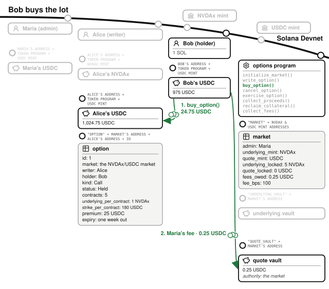

The premium is the only money that changes hands, and it is Alice's from this moment whatever Bob does later. The 5 NVDAx do not move. Bob's downside is fixed at the 25 USDC he just paid, and Alice's upside on the shares is capped at $180 until the week is out.

A writer cannot buy their own option. Their address would fill both the `buyer` and `writer` slots, and the premium's source and destination would be the same token account in two mutable slots, which the runtime rejects before the handler runs (`test_writer_cannot_buy_their_own_option`). A second buyer is refused because the option is no longer `Listed` (`test_buy_is_refused_once_sold`).

## The Holder Exercises Before Expiry, and the Tokens Change Hands

NVIDIA reports earnings and NVDAx moves to $200. Bob calls `exercise_option()` before the week is out. The handler requires the option to be `Held`, the clock to be before `expiry` (`OptionNotHeld`, `OptionExpired`), and the signer to be the holder. Then it moves both legs and updates the ledger:

- Bob pays the strike, 5 times 180 USDC, 900 USDC, into the quote vault.
- The underlying vault pays Bob the 5 NVDAx.
- The market's `underlying_locked` falls by 5 NVDAx, because that collateral is no longer owed to anyone.
- The market's `quote_locked` rises by 900 USDC, because the strike is now owed to Alice.

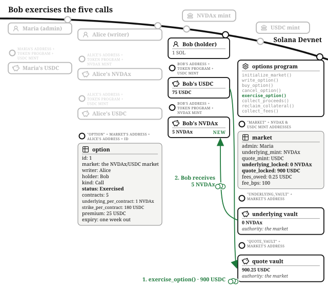

Bob now holds 5 NVDAx worth $1,000 and has spent 925 USDC to get them, 25 of premium and 900 of strike. His 1,000 USDC is 75 USDC. Had NVDAx stayed at $165, he would not have exercised (paying 900 for shares the market sells for 825), and the 25 USDC would have been his whole loss. The call would have expired, and once the week was out Alice would have called `reclaim_collateral()` for her 5 NVDAx, keeping the premium and the shares.

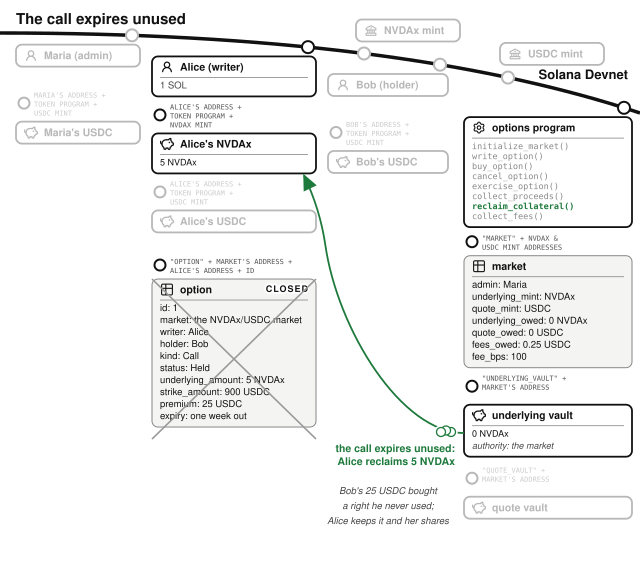

The strike payment stays in the vault, owed to Alice, rather than being sent to her directly. Paying the writer inside the exercise would mean requiring the writer's token account to exist at that moment, and a writer who closed it could then block the holder from ever exercising. The vault holds it instead, and the writer comes to get it.

A put exercises the same way with the two tokens swapped: the holder delivers the underlying into the underlying vault and the quote vault pays them the strike. `test_put_lifecycle_delivers_the_underlying_for_the_strike` runs that path with five puts at a 150 strike, whose writer collects five NVDAx at the end.

## The Writer Collects the Strike, and the Account Closes

Alice calls `collect_proceeds()`. The handler requires the option to be `Exercised` (`OptionNotExercised`) and the signer to be the writer, pays her the 900 USDC from the quote vault, reduces `quote_locked` by the same amount, and closes the option with its rent back to her.

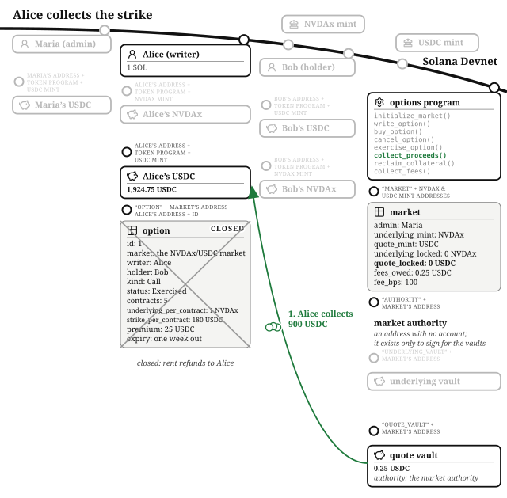

Alice sold her five NVDAx for 900 USDC and had already been paid 24.75 USDC for agreeing to. She holds 1,924.75 USDC, an effective $184.95 a share against the $200 they now trade at. The $15.05 a share she gave up is the writer's side of the four-ways figure, its last column: the premium was all she could make, and she made it.

## A Put Writer Posts Cash, and the Option Expires Unexercised

The put is the mirror image, and it also shows the other exit. Carol would like to own NVDAx at $150 and would like to be paid for standing ready to buy. She calls `write_option()` with kind `Put`, 5 contracts, 1 NVDAx per contract, a strike of 150 USDC per contract, a premium of 20 USDC, and an expiry a week out. A put writer's collateral is the strike, so 5 times 150 USDC, 750 USDC, leaves her account for the quote vault, and `quote_locked` rises to match. Her 1,000 USDC is 250.

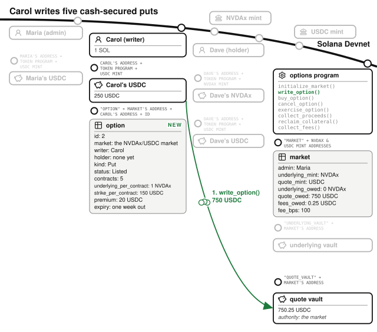

Dave holds five NVDAx and wants insurance against a fall below $150 for the week. He calls `buy_option()`: 19.80 USDC to Carol, 0.20 USDC into the quote vault for Maria, and the option is `Held`. This is a **protective put**, the position a stockholder buys the way a homeowner buys fire insurance, and like fire insurance it is meant to expire unused.

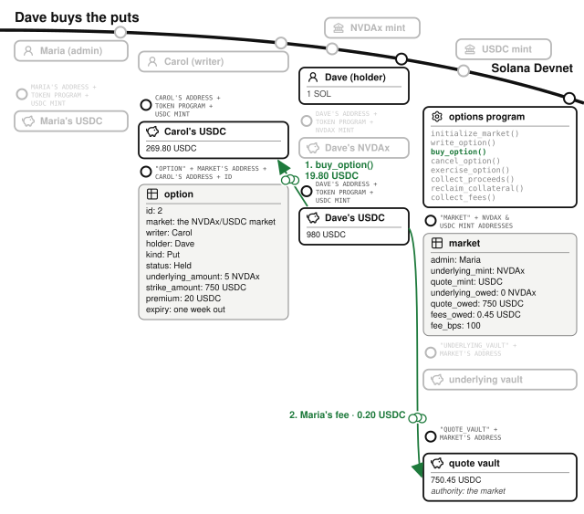

The week passes with NVDAx above $150, and Dave does nothing: selling at 150 when the market pays more would be a gift to Carol. Once the expiry has passed, Carol calls `reclaim_collateral()`. The handler checks two things and then unwinds the option:

- The option must be `Held`, because an exercised option has no collateral left to reclaim (`OptionNotHeld`).
- The clock must be at or past `expiry` (`OptionNotExpired`).
- It returns her 750 USDC from the quote vault, reduces `quote_locked`, and closes the account.

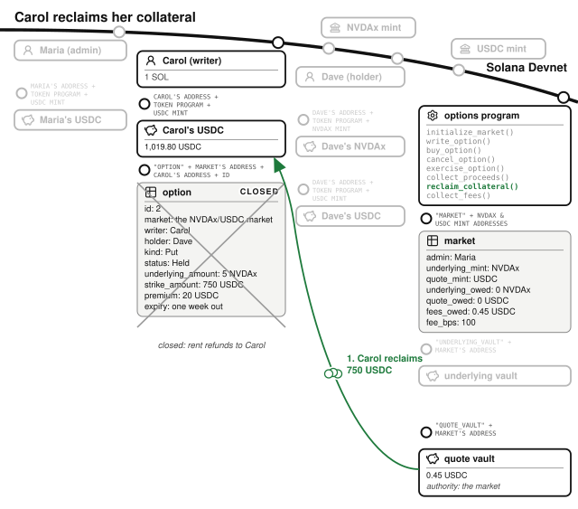

Carol's return is the 19.80 USDC premium on a purchase that never happened. Dave's insurance cost him 20 USDC and paid nothing.

Had NVDAx fallen below $150, Dave would have exercised instead: his 5 NVDAx into the underlying vault, the 750 USDC out to him, and the shares owed to Carol, who would have bought at $150 what the market then sold for less.

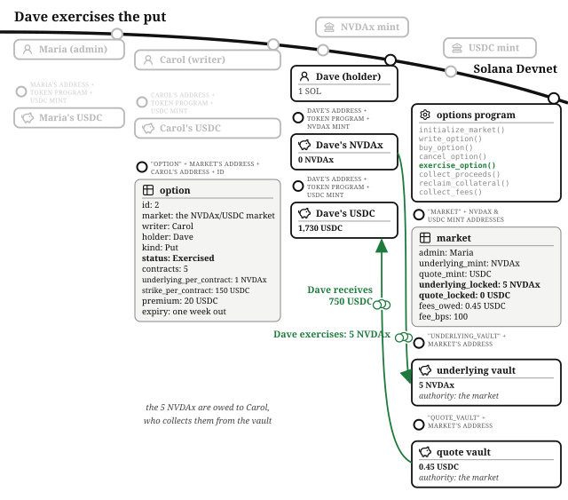

## The Operator Collects the Fees

Maria calls `collect_fees()`. The handler pays her `fees_owed`, 0.45 USDC across the two sales, zeroes the counter, and refuses to run when there is nothing to collect (`NothingToCollect`). The vaults are empty: every token that entered has left to the party it was owed to.

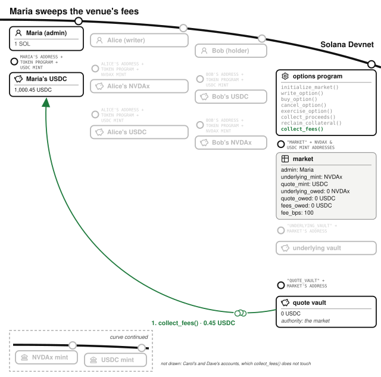

Everyone ends the story with what their position promised:

- Alice earned a premium and sold her shares at her price.
- Bob turned 25 USDC of premium into five NVDAx at a $20 discount to the market.
- Carol was paid to wait for a purchase that never came.
- Dave bought insurance he did not need.
- Maria earned 1% of every premium.

## The Math: Two Products, One Floor, One Comparison

The arithmetic lives in `contract_math.rs` and is the smallest in this book:

- **The underlying total**, `contracts` times `underlying_per_contract`, and **the strike total**, `contracts` times `strike_per_contract`. Each is one checked multiplication. `collateral_amount()` picks the first for a call and the second for a put; `exercise_payment()` picks the other. There is no division, so there is no rounding.
- **The premium split.** `split_premium()` floors the fee, `premium` times `fee_bps` over 10,000, and gives the writer the rest. The writer keeps the rounding minor unit; the venue gives up at most one minor unit per sale, and a sale needs a real premium, so the leak cannot be industrialized.
- **The expiry.** `may_exercise()` is `now < expiry` and `may_reclaim()` is `now >= expiry`. They are exact complements.

Every checked operation maps to `MathOverflow`. There is no rounding rule to choose anywhere in settlement, which is the payoff of storing the strike as an amount per contract rather than as a price.

## The Invariants: The Vaults Cover the Ledger, and the Clock Picks One Exit

- **Each vault covers what the market owes.** The underlying vault holds at least `underlying_locked`; the quote vault holds at least `quote_locked` plus `fees_owed`. Every handler that moves tokens updates the counters first and then calls `check_custody()` against the balances its transfers will leave behind, and fails with `CustodyInvariantViolated` if a refactor ever breaks the accounting. The tests strengthen it to equality after every step, because nothing in them donates to a vault.
- **A held option has exactly one open exit at every instant.** Before `expiry` the holder can exercise and the writer cannot reclaim; at and after it, the reverse. There is no moment at which both can claim the same collateral and none at which neither can.
- **Every exit closes the account.** Cancel, collect, and reclaim all end by closing the option account and returning its rent to the writer, so an option cannot be collected twice: the account is gone.
- **The admin reaches only the fees.** `collect_fees()` moves `fees_owed` and nothing else; no handler moves collateral or a strike payment to the admin under any parameters.
- **Physical settlement moves exactly the posted terms.** What the writer collects is what the holder paid, and what the holder receives is what the writer posted, to the minor unit, for every option the program would accept.

The companion repository's `kani-proofs` crate proves the last two and the first: `proof_vault_ledger_stays_consistent_across_every_lifecycle` writes two options of either kind into shared vaults, sends each down one of its three exits, and shows the ledger consistent after every step and both vaults empty at the end. `proof_exercise_and_reclaim_windows_partition_time` is the second invariant over every pair of timestamps.

## The Failure Modes: What Can Go Wrong When Nothing Can Be Liquidated

- **The writer defaults.** This cannot happen. `write_option()` takes the entire obligation into the vault, and the only paths that return it are `cancel_option()` before anyone buys and `reclaim_collateral()` after the holder's window has closed. `test_cancel_is_refused_once_sold` and `test_reclaim_is_refused_before_expiry` check the two refusals that must hold while a holder could still exercise.
- **The clock.** Expiry is a Unix timestamp read from the Clock sysvar, which validators set and which can drift from wall-clock time by seconds. A holder who waits until the final second to exercise is betting against that drift, and the program cannot help them. The boundary itself is tested from both sides: exercise at `expiry` minus one second succeeds and at `expiry` fails, and reclaim does the reverse (`test_exercise_is_allowed_up_to_but_not_at_expiry`, `test_reclaim_is_refused_before_expiry`).
- **A writer blocks the exercise.** If the strike were paid to the writer's token account inside `exercise_option()`, a writer could close that account and make every exercise fail, keeping the premium and the collateral both. The strike goes into the vault instead, owed to the writer, and the holder's exercise depends on no account of the writer's.
- **The wrong account carries the premium.** The buyer pays the writer directly, so the destination has to be bound to the writer or a buyer could name their own account and buy the option for free. The Anchor build derives it as the writer's associated token account; the Quasar build, whose token accounts are not associated token accounts, checks the account's owner and mint in the handler, and `buy_refuses_a_premium_account_the_writer_does_not_own` checks it.
- **What the design gives up.** A held option cannot be resold, and an option cannot be exercised in part. Venues that want both represent each option as two tokens, an option token the holder can sell on any exchange and a writer token that claims the proceeds. Adding that back means introducing the tokens, and with them an accounting of who holds how much of each option.
- **What is absent.** Most of the usual attacks on a financial program return "not applicable" here. No oracle to lag or manipulate, because no price is read. No liquidation to front-run, because no position can be under water. No inflation attack, because there are no shares. No rounding to drain, because there is no division. The venue's entire risk surface is the custody ledger and the two comparisons against the clock, which is why both are proved rather than only tested.

## Testing Considerations

The suite (`tests/test_options.rs`) follows the call from write to collected strike and the put from write to exercise and to expiry, asserting every balance to the minor unit, and it calls the custody check's equality form after every step. Around the happy paths there is one test per gate:

- The expiry boundary, from both sides.
- Cancel after a sale, and buy after a sale or after expiry.
- Exercise by anyone but the holder, and collection by anyone but the writer or before an exercise.
- Reclaim after an exercise, and fee collection by anyone but the admin.
- The four zero terms, and the overflowing option at write time.

When you build your own, copy the shape of the two boundary tests: a deadline needs one test that stays inside it and one that steps past it, and `expiry: 0` would have let both directions pass.

## What You Learnt from Building the Options Venue

An options exchange needs a clearing house standing behind every writer, a margin department watching every account, and a settlement desk on expiry day. In this program, making the writer post the whole obligation before they sell the right does all three jobs. The clearing house is the vault, the margin department has nothing to watch, and settlement is two token transfers the holder triggers.

The options venue added six concepts:

- **The option's terms.** A call or a put, a strike, an expiry, and a premium; a writer who keeps the premium and takes on an obligation, and a holder whose loss is capped at the premium.
- **Full collateralization removes whole categories.** A covered call and a cash-secured put cannot default, so the program needs no margin, no liquidator, and no oracle; everything the *Perpetual Futures* chapter adds is the cost of letting writers post less than they owe.
- **Physical settlement needs no price.** The holder's decision replaces the feed, and the program's job is to enforce the terms, not to value them.
- **Amounts as products, not prices.** Storing the strike as an amount per contract makes every settlement a checked multiplication, with no division and no rounding direction to defend.
- **A ledger for mixed custody.** When one vault holds several parties' money, the state account counts what each is owed and every handler asserts the vault still covers it, after the math.
- **A deadline is a comparison and its complement.** The holder's window and the writer's window partition time, tested from both sides and proved over every timestamp.

In the *Perpetual Futures* chapter we will relax the collateral rule. Traders post a fraction of their exposure, an oracle values the rest continuously, and a liquidator is paid to close what the fraction no longer covers. Keeping such a venue solvent is hard, and you will see how much machinery it takes to handle positions whose collateral no longer covers what they owe.

[^psyoptions]: PsyOptions pioneered physically settled, fully collateralized options on Solana, with no oracle, and this chapter's venue follows its settlement design. PsyOptions represented each option series as fungible SPL tokens, one mint per series; this program keeps one account per option instead, trading that composability for legible custody.

[^zeta]: Zeta Markets describes its margined, cash-settled design at [docs.zeta.markets](https://docs.zeta.markets). The comparison is between two settlement designs, not two products: a cash-settled venue can offer leverage and needs a price feed to do it, and a physically settled one offers neither.
