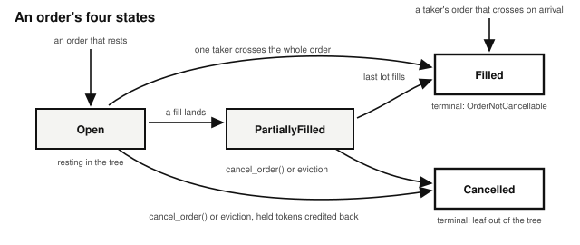

# Chapter 14: The Order Book Exchange

NYSE, NASDAQ, and the CME are order book exchanges. On Solana, Manifest, OpenBook, and Phoenix are order book exchanges, and by mid-2026 Manifest was carrying more spot volume than any other order book on the network.[^order-book-venues] All of them run the same machinery: orders arrive carrying a price their owner refuses to cross, wait in two sorted lists, trade when one order reaches across the gap, and settle out of vaults the venue's operator cannot reach.

The program lives at `finance/order-book` in the companion repository. It assumes you know the escrow pattern from the *Escrow* chapter: tokens held in program-owned vaults, terms recorded in data accounts, and every movement gated by who signed. An exchange is that pattern scaled up from one deal to thousands of simultaneous ones.

## A Limit Order Is a Price You Refuse to Cross

A **limit order** is an order with a price limit attached. A **bid** says "I will buy, but only at or below this price." An **ask** says "I will sell, but only at or above this price." The **order book** is the two lists where those orders wait: bids on one side, asks on the other, best prices at the front. The gap between the best bid and the best ask is the spread, and when a new order's limit reaches across that gap, a trade happens.

The other model for an exchange is the automated market maker, where there are no limit orders and every trade fills immediately against a pooled formula; that is the next chapter. An order book is better at price discovery, because every price on it is a real commitment someone funded. An AMM is better for new assets without much liquidity around them.

One naming note: this design is traditionally called a *central limit* order book, because the book lives in one central place. Here that place is a Solana account, so the "central" book is stored on a decentralized network.

## Why the Book Is a Tree, Not a List

The first instinct is to store the bids and asks as sorted arrays. Arrays get slow when an exchange gets busy: inserting into the middle of a sorted list means shifting everything after it, and on a chain where compute is metered, your users pay that cost.

So the book's two sides are **critbit trees**. Each resting order gets a fixed-size binary key, and the tree branches at the first bit where keys differ (the "critical bit"). Inserting an order means walking to where its key diverges and adding one node there; nothing shifts. The key is built from the price in the high bits and a sequence number in the low bits, which yields the exchange rule you want for free: walking the tree visits orders best price first, and within a single price, earliest order first. That ordering has a name, **price-time priority**, and it is the fairness rule the major exchanges use.

A critbit tree does not balance itself, so an attacker can place asks at 2, 4, 8, and so on to deepen the tree. That only adds a minor cost: 64 levels at most, and under 15,000 extra compute units per instruction, out of a default budget of 200,000.

## The Market Authority Opens the NVDAx/USDC Market

The market this chapter builds trades NVDAx over USDC: NVDAx, a stock, is the **base token**, the thing being bought and sold; USDC is the **quote token**, the thing prices are stated in. You quote in the stable asset so that "250" always means dollars.

Maria runs the exchange. She is the market authority: she creates the market and she alone can withdraw its fees. Her revenue is a fee of 25 **basis points**, a quarter of one percent, carved out of each fill's quote proceeds when orders match, so it is borne by whichever side of the fill receives the quote token.

Maria's client first creates the empty order book account, then calls `initialize_market()` with her chosen parameters: `fee_basis_points` (25), `tick_size`, `base_lot_size`, `quote_lot_size`, and `min_order_size`. The handler validates all of them: every size must be nonzero, and the fee is capped at 10,000 basis points, because a fee above 100% is nonsense. It creates the market account and the three vaults with the market as authority, records every address on the market account, and stamps the order book's first bytes so each tree knows which side it is.

The tick size and minimum order size keep the book usable, and they do different jobs. Orders below `min_order_size` are rejected outright, and this is the gate that protects the book: every slot in the tree costs its occupant at least that much locked capital, so filling the tree costs real money. Prices must be a multiple of `tick_size` or the order is rejected, which keeps the book from fragmenting into thousands of dust price levels. The tick also sets the price of queue-jumping: a maker who wants to stand in front of the queue must improve the price by a whole tick, which is an improvement the taker actually receives.

Both are set per market, at creation, and cannot change afterward. A tick right for a $250 stock is far too coarse for a token priced at a fraction of a cent, so somebody has to choose one for each market, and the choice is final. Manifest removed the tick entirely and lets an order name any price in minor units. Its own README states the trade: without a tick, the newest order can stand in front of the queue by improving the price by a negligible amount, which inverts time priority.[^manifest-tickless]

Financial state on Solana is accounts, and opening the market created five of them: one by Maria's client, and four by the handler.

The **market** is a PDA holding one trading pair's configuration: the two mint addresses, the fee in basis points, the tick size, the lot sizes, the minimum order size, an `is_active` flag, and the authority (Maria). Its seeds are the string `"market"` plus the two mints, so one base/quote pair maps to one market. The market PDA is also the authority of all three vaults, so tokens leave them only through the program's own instruction handlers.

The **order book** is the largest account: about 180 KB holding two trees of resting orders (one per side, 512 orders each) plus a monotonic `next_order_id` counter. Each tree has 1,024 nodes, and every order after the first takes two of them: a leaf for the order and a branch point where its key splits from the others. It is **zero-copy**: an account this large would be prohibitively expensive to deserialize on every instruction, so the program reads and writes fields in place through an `AccountLoader` instead.

> **Why the order book is not a PDA.** Solana caps account allocations made from inside a program at 10 KB, so `initialize_market()` cannot create a 180 KB account. Instead, the client creates the account directly with the System Program before calling `initialize_market()`, sized to `ORDER_BOOK_ACCOUNT_SIZE` and owned by the program. And it cannot be a PDA at all, because creating an account that way requires the new account's own signature, which a PDA cannot give. The program instead ties the book to its market with a stored-address check: the market records the book's address, and every instruction that touches the book checks it against that record. So the book's address is a public key, and the figures draw its dot on the curve, with the book's box above it at the top right. Its private key signs once, at creation; after that the program owns the account and the key can do nothing to it.

Three **vaults** hold the money: a base vault for locked NVDAx, a quote vault for locked USDC, and a separate **fee vault** for Maria's earnings. Unlike the book, all three are PDAs of the market (seeds: `"base_vault"`, `"quote_vault"` or `"fee_vault"`, then the market), created by `initialize_market()` with the market as their authority. The fee vault holds the same token as the quote vault, and keeping them separate means balances owed to users and balances earned by the market can never be confused. That separation is what stops a caller from being paid out of Maria's fees; the failure modes section shows the attack it blocks.

## Every Trader Gets a Ledger Line

Three traders use the market this chapter: Alice, Bob, and Carol, each starting with the standard wallet of one SOL and 1,000 USDC, plus (for the two sellers, Alice and Carol) some NVDAx. Before trading, each of them calls `initialize_market_user()` once. It creates their market user account with zeroed unsettled balances and an empty open-order list. It is their line in the exchange's internal ledger: the account the exchange will owe money to.

That **market user** account (seeds: `"market_user"`, the market, the owner) tracks their `open_orders` (capped at 20) and two numbers that keep the design cheap: `unsettled_base` and `unsettled_quote`, the amounts the program owes them. When the program takes tokens from a user it transfers them immediately into a vault; when it owes tokens to a user it just increments these counters. Users claim what they are owed whenever they like, and many small payouts consolidate into one transfer, saving compute units on the path every fill takes.

## An Ask Rests Above the Best Bid

Alice holds NVDAx and thinks AI is overhyped. She wants out, but not at any price: she calls `place_order()` with side `Ask`, price 265, quantity ten shares.

The handler validates first: the market is active, the price is nonzero and tick-aligned, the quantity meets the minimum, and Alice is under her 20-open-order cap. Then it takes her money up front. An ask locks the base: her ten shares move immediately from her token account into the base vault. (A bid locks the quote instead: price times quantity.) This lock-on-entry rule is what makes every order on the book a funded commitment rather than a promise; there is no path where a matched order turns out to be backed by nothing.

The book's ask side is empty and no bid reaches 265, so there is nothing to match. Alice's order becomes a **resting order**: a leaf in the ask tree, an order account stamped Open, and an entry in her open-order list. Placing it cost her nothing but rent and the transaction fee; the exchange's own fee only ever applies to fills.

Every order placed becomes an **order** account of its own (seeds: `"order"`, the market, the order ID): side, price, original quantity, filled quantity, a status that walks Open, PartiallyFilled, Filled, or Cancelled, and a timestamp.

## A Bid Below the Best Ask Rests Too

Bob wants in, but he is not prepared to pay more than 250. He calls `place_order()` with side `Bid`, price 250, quantity four. The handler locks 4 × 250 = 1,000 USDC from his token account into the quote vault: every dollar he has, committed the moment the order rests. The best ask is Alice's 265, and Bob's limit refuses to cross it, so his bid rests too. The book now has a spread: bid 250, ask 265.

## A Crossing Ask Fills Against the Resting Bid

Carol also owns NVDAx and also wants out, and she is less patient than Alice: she asks three shares at 245. Her limit is at or below the best bid, so this order crosses.

The planning function, `plan_fills()`, walks the opposite side of the book in price-time priority and returns the list of fills without mutating anything. Bob's bid is the best (and only) bid, it covers all three shares, so the plan is one fill: three shares against Bob's order. The walk stops at the first resting order that fails to cross, because if the best price fails, every price behind it fails too.

The fill executes at **the resting order's posted price**: 250, not Carol's 245. This is the standard order book rule. The maker's posted price is the deal on offer; the taker chose to hit it. Any difference always favors the taker: a taker bid pays less than its limit allowed, and a taker ask, like Carol's, receives more.

One Solana-specific mechanic makes this work: the program cannot load arbitrary accounts mid-instruction, so Carol's transaction must carry the accounts of the makers she will match with, passed as pairs of (order account, market user account) in the order the book would walk them. The program does not trust that list. It plans fills from its own tree, then verifies each supplied pair against the plan: the order IDs must match, the accounts must belong to this market, and each maker order's owner must match its market user. A wrong or missing account fails the transaction with `MakerAccountMismatch`, `MakerOwnerMismatch`, or `MissingMakerAccounts`.

Now the money moves, in the unsettled-balance style. Gross proceeds are 3 × 250 = 750 USDC. Maria's fee is 25 basis points of that: 1.875 USDC, computed with ceiling division so any rounding goes to the market rather than leaking value one minor unit per fill (the fee section below returns to this). Carol's `unsettled_quote` is credited with the net 748.125 USDC. Bob's `unsettled_base` is credited with three shares. The fee moves from the quote vault to the fee vault in a single program-signed transfer at the end, aggregated across all fills in the order. Bob's order account is stamped PartiallyFilled with three of four filled, and the leaf in the bid tree has its remaining quantity reduced to one in place. Carol's order account is stamped Filled; nothing of hers rests.

Bob did nothing at all. Like Alice in the *Escrow* chapter, a maker signs once when placing and the program handles their side of every subsequent fill.

## Canceling Returns the Unfilled Lock

Bob decides three shares is enough. He calls `cancel_order()` on his order account. The handler checks the signer is the order's owner, and that the status is still Open or PartiallyFilled; a Filled or already-Cancelled order rejects with `OrderNotCancellable`. His remaining share at 250 means 250 USDC of his original lock is still sitting in the quote vault, so his `unsettled_quote` is credited 250, using the same price-times-remaining formula that locked it. The leaf comes out of the bid tree, the order ID leaves his open-order list, and the order account is stamped Cancelled, closing out its state machine.

Traditional exchanges also offer a resize, which changes a resting order's quantity in place. This program has no handler for it: to change a price or a quantity, Bob cancels and places again, and the new order goes to the back of the queue at its price.

## Settlement Turns Claims Into Tokens

Unsettled balances are claims, not tokens. When Bob and Carol want their assets in hand, each calls `settle_funds()`, and the market PDA signs the transfers out of the vaults: Bob receives three NVDAx shares and his 250 USDC refund; Carol receives her 748.125 USDC.

One line in the handler belongs in everything you build: it snapshots the unsettled amounts and **zeroes the counters before making the transfers**. If a token transfer could ever call back into this program (token extensions can attach hooks to transfers), a caller re-entering mid-transfer would find balances already zeroed instead of still-credited, so double-withdrawal is impossible. The pattern is called checks-effects-interactions, and the *Adversary* chapter explains it fully.

## The Market Authority Withdraws the Fees

At any time, Maria calls `withdraw_fees()`, and the fee vault's balance (1.875 USDC so far) transfers to her token account. The handler compares the signer against the authority recorded on the market at creation and rejects anyone else with `NotMarketAuthority`. When the fee vault is empty, the handler succeeds as a no-op instead of failing, so Maria can run it on a schedule unattended. Scheduled maintenance that succeeds as a no-op when there is nothing to do is a **crank** (the *Lending and Borrowing* chapter explains it fully), though this handler adds an authority gate because it moves fee money.

## The Math: Lots, Ticks, and a Fee That Rounds Up

**Lots.** The program never stores "shares" or "dollars"; both sides of the book are denominated in **lots**. The market defines `base_lot_size` and `quote_lot_size`, and the two conversion rules are: raw base = quantity × base lot size, and raw quote = price × quantity × quote lot size. Choosing the lot sizes from the two tokens' decimals (each is ten to the power of the decimal difference, floored at one) makes `price` read as the human quote-per-base rate regardless of how mismatched the mints' decimals are. For NVDAx (8 decimals) over USDC (6 decimals) that gives a base lot of 100 raw NVDAx and a quote lot of 1, and a stored price of 250 reads directly as $250.00 per share. OpenBook and Phoenix both use a lot model like this. Manifest instead stores every quantity in minor units and widens the arithmetic, as this program already does for its intermediates.

**Wider intermediates.** The bid lock and the gross fill amount both multiply three u64 values (price × quantity × lot size), which can overflow 64 bits with high-decimal mints. The program promotes to u128 for the multiplication and narrows back down afterward, so the failure mode is an explicit error on an amount too large to transfer, never wrong arithmetic.

**The fee rounds up.** Fee = gross × fee basis points ÷ 10,000, computed with ceiling division. Rounding down would hand up to one minor unit of quote back per fill, and one minor unit per fill is not small when an attacker can manufacture thousands of tiny fills; rounding against the user, in the program's favor, closes the leak. A defensive check that the fee never exceeds the gross backs the arithmetic up. The rounding section of the *Arithmetic of Money* chapter states the general rule.

**Price improvement is computed, not assumed.** When a taker bid locks at its own limit but fills at a better resting price, the difference between the lock and the gross is credited back to the taker's unsettled quote, calculated per fill with the same u128 care.

## The Invariants: The Vaults Equal What the Book Owes

- Every resting order's full lock is in a vault: quote for bids (price × remaining × quote lot size), base for asks. The vaults always hold at least the sum of all resting locks plus all unsettled balances.
- Every locked minor unit is accounted for on exit: a fill splits the lock into maker proceeds, taker rebate, and fee, and those three always sum exactly to what was locked for that fill. Cancellation and eviction each return exactly the remainder's lock.
- `filled_quantity` never exceeds `original_quantity`, and order status only moves forward: Open to PartiallyFilled to Filled, or out to Cancelled.
- The fee vault only ever receives the computed fee, and only the recorded authority can withdraw from it.
- Every leaf in a tree corresponds to exactly one Open or PartiallyFilled order account, and to an entry in its owner's open-order list.

## The Failure Modes: Vault Swaps, Fake Makers, and Book Spam

- **The vault swap.** The fee vault and the quote vault hold the same token and have the same authority, so a token-program transfer cannot tell them apart. Without further checks, a caller invoking `settle_funds()` could pass the fee vault where the quote vault belongs and be paid out of Maria's fees. The defense is a stored-address check on every instruction, binding every vault and mint to the addresses recorded on the market at creation, and the test suite proves the attack fails. This is the same account-substitution attack the *Escrow* chapter described, against a bigger program.
- **The fake maker list.** Takers supply the maker accounts they match against, so a hostile taker will supply the wrong ones. The program re-derives the fills from its own book and verifies every supplied account against that plan: order ID, market, and owner all have to line up, or the transaction fails.
- **The rounding drain.** Floor the fee instead of ceiling it and every fill leaks a minor unit, which an attacker turns into a drain with thousands of tiny fills. The math section covered it, and a test below checks it.
- **Book spam.** Each side holds 512 orders, so a trader willing to lock the minimum order size and pay rent 512 times can fill a side with orders far from the spread. If a full side refused every new order, that trader could keep every new order off the side for as long as they liked. Maria could not move the pair either, because the market PDA's seeds are the two mints. The program stops this with **eviction**. When an order would rest on a full side, `place_order()` compares its price with that side's worst order, the lowest bid or the highest ask. A better price removes the worst order and takes its slot, and the evicted owner is refunded through their unsettled balance, exactly as `cancel_order()` refunds them. An order that is no better, including one at an equal price, where the resting order was there first, is rejected with `OrderBookFull`. The orders that go are the ones least likely ever to fill, so a book full of far-off orders stays open at the prices that trade. The placer passes the worst order and its owner's market user account after the maker pairs, and the program checks them against the book the way it checks maker accounts, rejecting anything else with `EvictedAccountMismatch`. Tick alignment, the minimum order size, and the 20-open-orders-per-user cap still apply, so every slot costs its occupant locked capital.
- **The unauthorized paths.** Canceling someone else's order rejects with `Unauthorized`; withdrawing fees without being the authority rejects with `NotMarketAuthority`; placing orders on a paused market rejects with `MarketPaused`.

## Testing Considerations

The suite in `tests/test_order_book.rs` builds all state through the program's own instruction handlers, and covers each code path above by name:

- Locking: `place_bid_locks_quote_in_vault`, `place_ask_locks_base_in_vault`, and the rejection tests for zero prices, unaligned ticks, and undersized orders.
- Matching, both directions and both partial-fill shapes: `taker_bid_fully_crosses_best_ask`, `taker_ask_fully_crosses_best_bid`, `taker_partially_fills_resting_order_rest_stays_on_book`, `taker_partially_filled_remainder_rests_on_book`, and `taker_crosses_multiple_resting_orders_best_price_first`.
- The fairness rules: `resting_orders_at_same_price_fill_by_time_priority` and `taker_bid_gets_price_improvement_from_resting_ask`.
- The money: `fee_vault_receives_exactly_bps_of_taker_gross`, `fee_rounds_up_when_gross_is_not_a_bps_multiple`, `cancel_and_settle_bid_refunds_full_quote`, and `settle_funds_after_match_pays_out_both_unsettled_balances`.
- The adversarial cases: `settle_funds_rejects_fee_vault_substituted_for_quote_vault`, `cancel_order_rejects_non_owner`, and `authority_can_withdraw_fees_after_match`.
- The tree's worst case: `doubling_prices_build_the_deepest_path_prices_allow` and `deepest_path_adds_little_compute_to_insert_fill_and_cancel`.
- Eviction, each test starting from a bid side filled with 512 orders: `full_side_refuses_an_order_no_better_than_its_worst`, `better_order_evicts_the_worst_and_rests`, `evicted_maker_settles_their_refund`, `eviction_rejects_missing_or_wrong_evicted_accounts`, and `trader_can_evict_their_own_worst_order`.

If you write one test after reading this chapter, write the vault-swap one for your own program. The code path where two accounts are interchangeable to the token program but not to your accounting is the path the bug lives in.

## What You Learnt from Building the Order Book Exchange

NYSE, NASDAQ, and the CME each run a matching engine, a clearing house, and a settlement system, staffed and audited. This program's matching engine is two critbit trees holding the book in price-time order, its clearing house's internal ledger is the unsettled balances, and its settlement is `settle_funds()`, permissionless and instant. The one operator who remains sets the market's parameters and collects its fee, and can do nothing else.

The order book added six concepts on top of the escrow's:

- **Every resting order is a funded commitment.** Lock-on-entry means no matched order can turn out to be backed by nothing.
- **A data structure chosen for onchain cost.** The critbit tree gives insertion without shifting and price-time priority for free, on a chain where compute is metered.
- **An internal ledger that consolidates payouts.** Unsettled balances turn many small payouts into one claimed transfer, and zeroing them before the transfer (checks-effects-interactions) makes double-withdrawal impossible.
- **A fee whose rounding direction is a security decision.** Ceiling division on the fee closes a leak an attacker could industrialize through thousands of tiny fills.
- **Vault separation plus stored-address checks.** Two vaults holding the same token are indistinguishable to the token program; only stored-address checks keep user money and fee money apart.
- **A full book evicts its worst order.** Account space is finite, so a side that refused every order once full would let anyone with the capital to fill it keep every new order off it. Eviction trades the order least likely to fill for a better one, refunding it as a cancel would.

In the *Constant-Product AMM* chapter we will build a market with no order book. Two vaults hold the pair of tokens, and a formula sets the price from their balances, so anyone can trade at any time without waiting for a counterparty to post an order. You will see what the people who fill the vaults earn for it, and what it costs them.

[^order-book-venues]: [blockworks.com/analytics/solana/solana-spot-dexs](https://blockworks.com/analytics/solana/solana-spot-dexs) ranks Solana's spot venues by volume, order books and AMMs together. In June 2026 Manifest held about a tenth of weekly spot volume, second only to the prop AMM BisonFi and ahead of every other order book. The share moves week to week.

[^manifest-tickless]: [github.com/Bonasa-Tech/manifest](https://github.com/Bonasa-Tech/manifest) is Manifest's source. Its README describes the atomic lot sizes, and asks in its own words whether tickless is a good idea.
