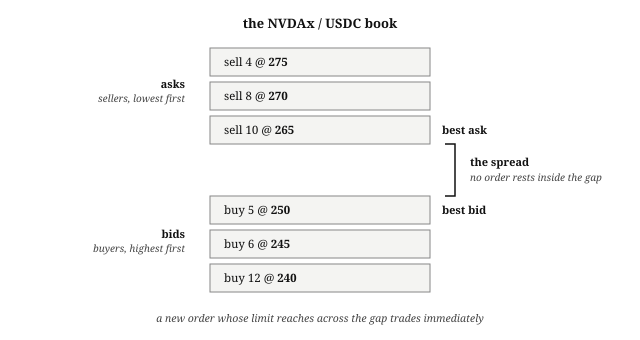
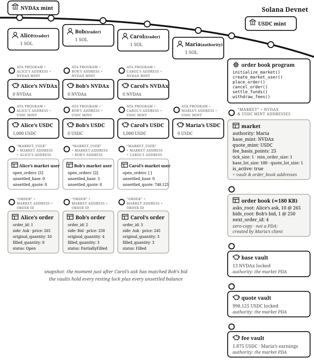
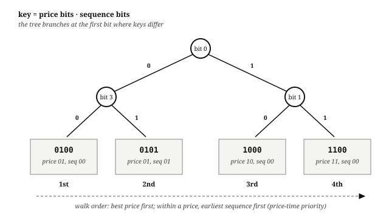
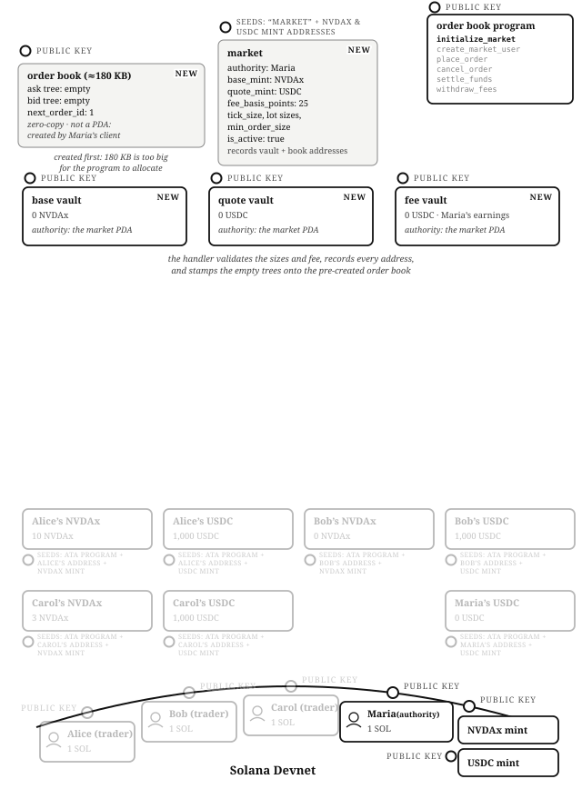
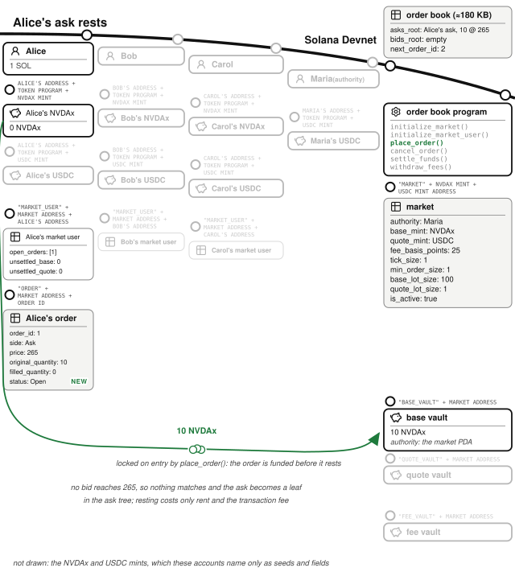
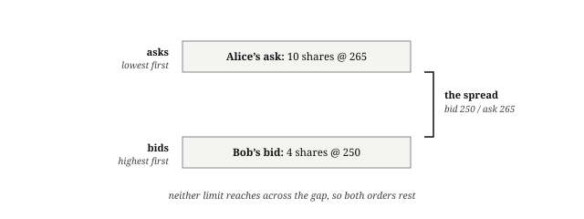
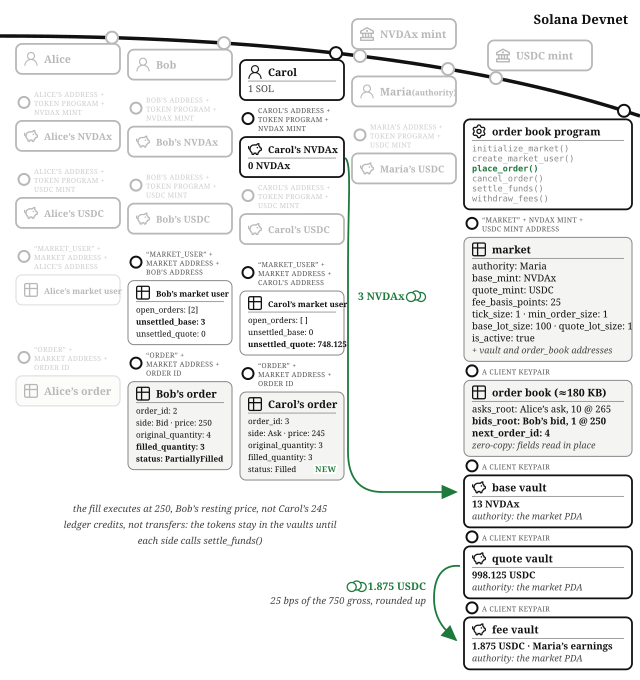
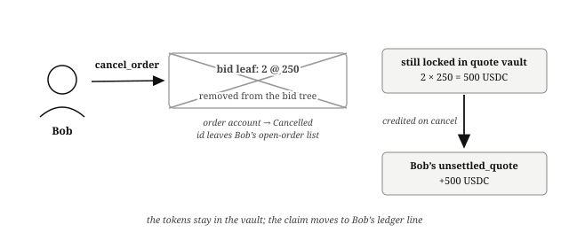
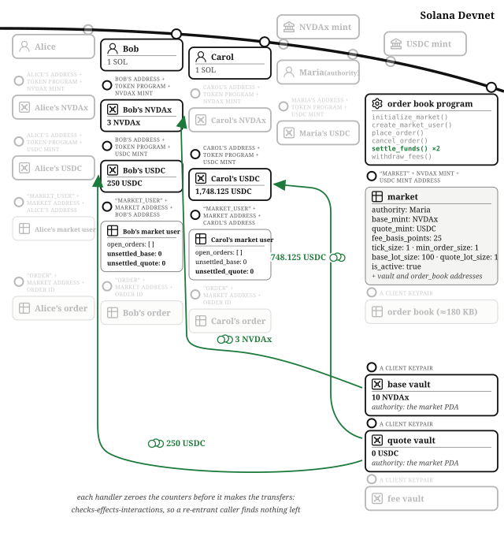
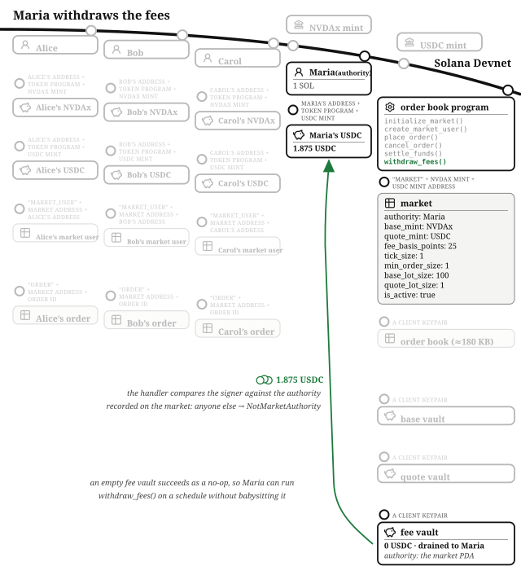

# The Order Book Exchange

NYSE, NASDAQ, and the CME are order book exchanges. On Solana, OpenBook and Phoenix are order book exchanges. By the end of this chapter you will have walked through one, end to end: how orders come in, how they rest, how they match, where the money waits, and how the operator collects fees.

The program lives at `finance/order-book` in the companion repository. It assumes you know the escrow pattern from the Escrow chapter: tokens held in program-owned vaults, terms recorded in data accounts, and every movement gated by who signed. An exchange is that pattern scaled up from one deal to thousands of simultaneous ones.

## A Limit Order Is a Price You Refuse to Cross

A **limit order** is an order with a line drawn on it. A **bid** says "I will buy, but only at or below this price." An **ask** says "I will sell, but only at or above this price." The **order book** is the two lists where those orders wait: bids on one side, asks on the other, best prices at the front. The gap between the best bid and the best ask is the spread, and when a new order's limit reaches across that gap, a trade happens.

The other model for an exchange is the automated market maker, where there are no limit orders and every trade fills immediately against a pooled formula; that is the next chapter. An order book is better at price discovery, because every price on it is a real commitment someone funded. An AMM is better for new assets without much liquidity around them. Real markets need both, which is why this book builds both.

One naming note: this design is traditionally called a *central limit* order book, because the book lives in one central place. Here that place is a Solana account, so the "central" book is stored on a decentralized network. Slightly strange, entirely workable.

## The Cast: One Operator and Three Traders

**Maria runs the exchange.** She is the market authority: she creates the market and she alone can withdraw its fees. Her revenue is a **taker fee** of 25 **basis points**, a quarter of one percent, charged when orders match.

**Alice, Bob, and Carol trade on it.** The market's pair is NVDAx over USDC: NVDAx, a stock, is the **base token**, the thing being bought and sold; USDC is the **quote token**, the thing prices are stated in. You quote in the stable asset so that "250" always means dollars.

## The Account Model: A Market, Its Book, and a Ledger of Who Is Owed What

The **market** is a PDA holding one trading pair's configuration: the two mint addresses, the fee in basis points, the tick size, the lot sizes, the minimum order size, an `is_active` flag, and the authority (Maria). Its seeds are the string `"market"` plus the two mints, so one base/quote pair maps to one market. The market PDA is also the authority of all three vaults, so tokens leave them only through the program's own instruction handlers.

The **order book** is the big one: about 180 KB holding two trees of resting orders (one per side, 1,024 orders each) plus a monotonic `next_order_id` counter. Two things about it are unusual and both are worth learning:

- **It is zero-copy.** An account this large would be prohibitively expensive to deserialize on every instruction, so the program reads and writes fields in place through an `AccountLoader` instead.
- **It is not a PDA.** Solana caps account allocations made from inside a program at 10 KB, so `initialize_market` cannot create it. Instead the client creates the account directly with the System Program before calling `initialize_market`, sized to `ORDER_BOOK_ACCOUNT_SIZE`, owned by the program. And it cannot be a PDA at all, because creating an account that way requires the new account's own signature, which a PDA cannot give. The program instead ties the book to its market with a `has_one = order_book` constraint, checked on every instruction that touches it.

Three **vaults** hold the money: a base vault for locked NVDAx, a quote vault for locked USDC, and a separate **fee vault** for Maria's earnings. The fee vault holds the same token as the quote vault, and keeping them separate means balances owed to users and balances earned by the market can never be confused. That separation turns out to be load-bearing; the failure modes section returns to it.

Each trader gets a **market user** account (seeds: `"market_user"`, the market, the owner), tracking their `open_orders` (capped at 20) and two numbers that make the whole design efficient: `unsettled_base` and `unsettled_quote`, the amounts the program owes them. When the program takes tokens from a user it transfers them immediately into a vault; when it owes tokens to a user it just increments these counters. Users claim what they are owed whenever they like, and many small payouts consolidate into one transfer, saving compute units on the hot path.

Finally, every order placed becomes an **order** account of its own (seeds: `"order"`, the market, the order id): side, price, original quantity, filled quantity, a status that walks Open, PartiallyFilled, Filled, or Cancelled, and a timestamp.

## Why the Book Is a Tree, Not a List

The natural first instinct is to store the bids and asks as sorted arrays. Arrays get slow exactly when an exchange gets busy: inserting into the middle of a sorted list means shifting everything after it, and on a chain where compute is metered, that cost lands on your users.

So the book's two sides are **critbit trees**. The name sounds complex; the idea is not. Each resting order gets a fixed-size binary key, and the tree branches at the first bit where keys differ (the "critical bit"). Inserting an order means walking to where its key diverges and adding one node there; nothing shifts. The key is built from the price in the high bits and a sequence number in the low bits, which yields the exchange rule you want for free: walking the tree visits orders best price first, and within a single price, earliest order first. That ordering has a name, **price-time priority**, and it is the fairness rule every serious exchange runs on.

## Maria Opens the NVDAx/USDC Market

Maria's client first creates the empty order book account, then calls `initialize_market` with her chosen parameters: `fee_basis_points` (25), `tick_size`, `base_lot_size`, `quote_lot_size`, and `min_order_size`. The handler validates all of them: every size must be nonzero, and the fee is capped at 10,000 basis points, because a fee above 100% is nonsense. It creates the market PDA and the three vaults with the market as authority, records every address on the market account, and stamps the order book's first bytes so each tree knows which side it is.

The tick size and minimum order size are market hygiene. Prices must land on a multiple of `tick_size` or the order is rejected, which keeps the book from fragmenting into thousands of dust price levels. Orders below `min_order_size` are rejected outright, which keeps spam from filling the trees.

## Every Trader Gets a Ledger Line

Before trading, each of Alice, Bob, and Carol calls `create_market_user` once. It creates their market user account with zeroed unsettled balances and an empty open-order list. This is the account the exchange will owe money to; think of it as their line in the exchange's internal ledger.

## Alice Asks: Ten Shares at 265

Alice holds NVDAx and thinks AI is overhyped. She wants out, but not at any price: she calls `place_order` with side `Ask`, price 265, quantity ten shares.

The handler validates first: the market is active, the price is nonzero and tick-aligned, the quantity meets the minimum, and Alice is under her 20-open-order cap. Then it takes her money up front. An ask locks the base: her ten shares move immediately from her token account into the base vault. (A bid locks the quote instead: price times quantity.) This lock-on-entry rule is what makes every order on the book a funded commitment rather than a promise; there is no path where a matched order turns out to be backed by nothing.

The book's ask side is empty and no bid reaches 265, so there is nothing to match. Alice's order becomes a **resting order**: a leaf in the ask tree, an order account stamped Open, and an entry in her open-order list. Placing it cost her nothing but rent and the transaction fee; the exchange's own fee only ever applies to fills.

## Bob Bids: Five Shares at 250

Bob wants in, but he is not prepared to pay more than 250. He calls `place_order` with side `Bid`, price 250, quantity five. The handler locks 5 × 250 = 1,250 USDC from his token account into the quote vault. The best ask is Alice's 265, and Bob's limit refuses to cross it, so his bid rests too. The book now has a spread: bid 250, ask 265.

## Carol's Ask at 245 Crosses Bob's Bid

Carol also owns NVDAx and also wants out, and she is less patient than Alice: she asks three shares at 245. Her limit is at or below the best bid, so this order crosses.

Here is how matching actually runs. The planning function, `plan_fills`, walks the opposite side of the book in price-time priority and returns the list of fills without mutating anything. Bob's bid is the best (and only) bid, it covers all three shares, so the plan is one fill: three shares against Bob's order. The walk stops at the first resting order that fails to cross, because if the best price fails, every price behind it fails too.

The fill executes at **the resting order's posted price**: 250, not Carol's 245. This is the standard order book rule, and it is worth internalizing. The maker's posted price is the deal on offer; the taker chose to hit it. The surprise always lands in the taker's favour: a taker bid pays less than its limit allowed, and a taker ask, like Carol's, receives more.

One Solana-specific mechanic makes this work: the program cannot load arbitrary accounts mid-instruction, so Carol's transaction must carry the accounts of the makers she will match with, passed as pairs of (order account, market user account) in the order the book would walk them. The program does not trust that list. It plans fills from its own tree, then verifies each supplied pair against the plan: the order ids must match, the accounts must belong to this market, and each maker order's owner must match its market user. A wrong or missing account fails the transaction with `MakerAccountMismatch` or `MissingMakerAccounts`.

Now the money moves, in the unsettled-balance style. Gross proceeds are 3 × 250 = 750 USDC. Maria's fee is 25 basis points of that: 1.875 USDC, computed with ceiling division so any rounding goes to the market rather than leaking value one minor unit per fill (the fee section below returns to this). Carol's `unsettled_quote` is credited with the net 748.125 USDC. Bob's `unsettled_base` is credited with three shares. The fee moves from the quote vault to the fee vault in a single program-signed transfer at the end, aggregated across all fills in the order. Bob's order account is stamped PartiallyFilled with three of five filled, and the leaf in the bid tree has its remaining quantity reduced to two in place. Carol's order account is stamped Filled; nothing of hers rests.

Notice who did nothing: Bob. Like Alice in the escrow chapter, a maker signs once when placing and the program handles their side of every subsequent fill.

## Bob Cancels the Rest of His Order

Bob decides three shares is enough. He calls `cancel_order` on his order account. The handler checks the signer is the order's owner, and that the status is still Open or PartiallyFilled; a Filled or already-Cancelled order rejects with `OrderNotCancellable`. His remaining two shares at 250 mean 500 USDC of his original lock is still sitting in the quote vault, so his `unsettled_quote` is credited 500, using the same price-times-remaining formula that locked it. The leaf comes out of the bid tree, the order id leaves his open-order list, and the order account is stamped Cancelled, closing out its little state machine. Every state has an exit.

## Bob and Carol Settle Their Funds

Unsettled balances are claims, not tokens. When Bob and Carol want their assets in hand, each calls `settle_funds`, and the market PDA signs the transfers out of the vaults: Bob receives three NVDAx shares and his 500 USDC refund; Carol receives her 748.125 USDC.

The handler contains one line of discipline worth copying into everything you build: it snapshots the unsettled amounts and **zeroes the counters before making the transfers**. If a token transfer could ever call back into this program (token extensions can attach hooks to transfers), a caller re-entering mid-transfer would find balances already zeroed instead of still-credited, making double-withdrawal structurally impossible. The pattern is called checks-effects-interactions, and the Financial Programming Concepts in Solana chapter treats it fully.

## Maria Withdraws Her Fees

At any time, Maria calls `withdraw_fees`, and the fee vault's balance (1.875 USDC so far) transfers to her token account. The handler compares the signer against the authority recorded on the market at creation and rejects anyone else with `NotMarketAuthority`. One operational nicety: when the fee vault is empty it succeeds as a no-op instead of failing, so Maria can run it on a schedule without babysitting it. Scheduled, permissionless-to-run maintenance is the crank pattern from the Solana Building Blocks chapter.

## The Math: Lots, Ticks, and a Fee That Rounds Up

**Lots.** The program never stores "shares" or "dollars"; both sides of the book are denominated in **lots**. The market defines `base_lot_size` and `quote_lot_size`, and the two conversion rules are: raw base = quantity × base lot size, and raw quote = price × quantity × quote lot size. Choosing the lot sizes from the two tokens' decimals (each is ten to the power of the decimal difference, floored at one) makes `price` read as the human quote-per-base rate regardless of how mismatched the mints' decimals are. For NVDAx (8 decimals) over USDC (6 decimals) that gives a base lot of 100 raw NVDAx and a quote lot of 1, and a stored price of 250 reads directly as $250.00 per share. Every real order book, from Serum onward, uses a lot model like this.

**Wider intermediates.** The bid lock and the gross fill amount both multiply three u64 values (price × quantity × lot size), which can genuinely overflow 64 bits with high-decimal mints. The program promotes to u128 for the multiplication and narrows back down afterward, so the failure mode is an explicit error on an amount too large to transfer, never silently wrong arithmetic.

**The fee rounds up.** Fee = gross × fee basis points ÷ 10,000, computed with ceiling division. Rounding down would hand up to one minor unit of quote back per fill, and one minor unit per fill is not small when an attacker can manufacture thousands of tiny fills; rounding against the user, in the program's favour, closes the leak. A defensive check that the fee never exceeds the gross backs the arithmetic up. The rounding section of Financial Programming Concepts in Solana is this paragraph, generalized.

**Price improvement is computed, not assumed.** When a taker bid locks at its own limit but fills at a better resting price, the difference between the lock and the gross is credited back to the taker's unsettled quote, calculated per fill with the same u128 care.

## The Invariants: The Vaults Equal What the Book Owes

- Every resting order's full lock is in a vault: quote for bids (price × remaining × quote lot size), base for asks. The vaults always hold at least the sum of all resting locks plus all unsettled balances.
- Every locked minor unit is accounted for on exit: a fill splits the lock into maker proceeds, taker rebate, and fee, and those three always sum exactly to what was locked for that fill. Cancellation returns exactly the remainder's lock. Nothing evaporates and nothing appears.
- `filled_quantity` never exceeds `original_quantity`, and order status only moves forward: Open to PartiallyFilled to Filled, or out to Cancelled.
- The fee vault only ever receives the computed fee, and only the recorded authority can drain it.
- Every leaf in a tree corresponds to exactly one Open or PartiallyFilled order account, and to an entry in its owner's open-order list.

## The Failure Modes: Vault Swaps, Fake Makers, and Book Spam

- **The vault swap.** The fee vault and the quote vault hold the same token and have the same authority, so a token-program transfer cannot tell them apart. Without further checks, a caller invoking `settle_funds` could pass the fee vault where the quote vault belongs and be paid out of Maria's fees. The defense is `has_one` constraints binding every vault and mint on every instruction to the addresses recorded on the market at creation, and the test suite proves the attack fails. This is the confused deputy from the escrow chapter wearing an exchange costume.
- **The fake maker list.** Takers supply the maker accounts they match against, so a hostile taker will supply the wrong ones. The program re-derives the fills from its own book and verifies every supplied account against that plan: order id, market, and owner all have to line up, or the transaction fails.
- **The rounding drain.** Floor the fee instead of ceiling it and every fill leaks a minor unit, industrialisable through many tiny fills. Covered above; pinned by a test below.
- **Book spam.** A full tree is a denial-of-service on everyone else's orders. Tick alignment, the minimum order size, the 20-open-orders-per-user cap, and the `OrderBookFull` check are all anti-spam walls, and each rejects with its own named error.
- **The unauthorized paths.** Cancelling someone else's order rejects with `Unauthorized`; withdrawing fees without being the authority rejects with `NotMarketAuthority`; placing orders on a paused market rejects with `MarketPaused`.

## The Tests: Every Lock, Match, and Rounding Branch

The suite in `tests/test_order_book.rs` runs against LiteSVM, builds all state through the program's own instruction handlers, and covers each branch above by name:

- Locking: `place_bid_locks_quote_in_vault`, `place_ask_locks_base_in_vault`, and the rejection tests for zero prices, unaligned ticks, and undersized orders.
- Matching, both directions and both partial-fill shapes: `taker_bid_fully_crosses_best_ask`, `taker_ask_fully_crosses_best_bid`, `taker_partially_fills_resting_order_rest_stays_on_book`, `taker_partially_filled_remainder_rests_on_book`, and `taker_crosses_multiple_resting_orders_best_price_first`.
- The fairness rules: `resting_orders_at_same_price_fill_by_time_priority` and `taker_bid_gets_price_improvement_from_resting_ask`.
- The money: `fee_vault_receives_exactly_bps_of_taker_gross`, `fee_rounds_up_when_gross_is_not_a_bps_multiple`, `cancel_and_settle_bid_refunds_full_quote`, and `settle_funds_after_match_pays_out_both_unsettled_balances`.
- The adversarial branches: `settle_funds_rejects_fee_vault_substituted_for_quote_vault`, `cancel_order_rejects_non_owner`, and `authority_can_withdraw_fees_after_match`.

If you write one test after reading this chapter, write the vault-swap one for your own program. The branch where two accounts are interchangeable to the token program but not to your accounting is the branch the bug lives in.

## An Exchange Is Escrows All the Way Down

Strip the tree away and every resting order is the escrow chapter again: funds locked in a program-owned vault, terms in a data account, movement gated by signatures and stored addresses, and an exit from every state. The order book adds three genuinely new ideas on top: a data structure chosen for onchain cost (the critbit tree), an internal ledger that consolidates payouts (unsettled balances), and a fee whose rounding direction is a security decision. All three come back. The AMM in the next chapter replaces the book with a formula; the perpetual futures exchange at the end of the book is this chapter plus leverage, a price feed, and time.
