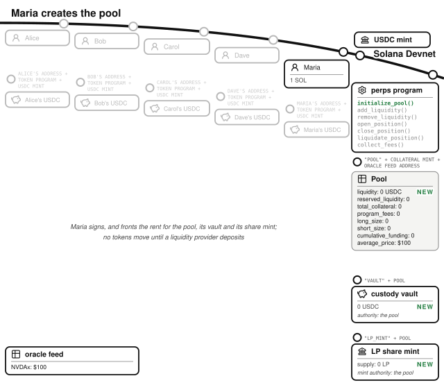

# Chapter 20: Perpetual Futures

Alice thinks NVIDIA is about to have a very good quarter. She could buy NVDAx and wait, but she wants more exposure than her 1,000 USDC buys. Bob thinks the run is over and wants to profit if NVIDIA falls, which owning the stock cannot give him. A **perpetual future** serves them both: a contract that pays the price movement of an asset, long or short, with leverage, without either trader ever holding the asset, and, unlike a traditional future, without an expiry date. Perpetuals trade more volume than any other product in crypto.[^perps-volume] Building one uses everything this book has covered: tokens, PDAs, vault custody, pool shares, offchain truth, liquidation, time, and arithmetic that must round the right way under leverage.

The program lives at `finance/perpetual-futures` in the companion repository. It follows the pool-as-counterparty design of Jupiter Perpetuals rather than an order-book design like Drift: no matching engine, no resting orders, one liquidity pool on the other side of every trade.

## The Pool Is the Other Side of the Trade

In the *Order Book Exchange* chapter, every long met a short: Carol's ask crossed Bob's bid, and the program only recorded the result. A perp that trades against a pool has no orders to match. **Liquidity providers fund one pool, and the pool is the counterparty to every position.** When a trader wins, the pool pays; when a trader loses, the pool keeps the loss. So the LPs hold the opposite of the traders' net position: short NVDAx while more traders are long, long while more are short. An LP's return is the losing traders' losses minus the winning traders' profits, plus the net funding described below. The open and close fees do not go to the LPs: half of each goes to the pool's creator and half to an insurance fund.

That design decision creates the problem the program is organized around: the program must be able to check that the pool can pay every winner, at every moment, **without ever iterating over the open positions**. A program that must touch every position to answer "am I solvent?" stops fitting in a transaction once it has enough open positions. That requirement explains almost every field in the account model.

## Creating the Market, Where the Parameters Are Checked Against Each Other

Maria creates the pool and is its `authority`; her revenue is the share of the open and close fees that accrues to `program_fees`, and the program gives her no path to anyone's collateral. She calls `initialize_pool()` with the market's risk parameters:

- 10 basis-point open and close fees, half of each paid into an insurance fund,
- a 10% initial margin and a 5% maintenance margin,
- a 1% liquidation fee,
- a 1% cap on oracle confidence and a 20% band around the pool's average price,
- and a 10-slot profit warm-up.

The funding rate is set here too, and no handler can change any of them once the pool exists.

The two margins are the two collateral thresholds every leveraged venue has, measured as a share of the position's size:

- The **initial margin**, `initial_margin_bps`, is what a trader must have to open a position. A 10% initial margin means a 5,000 USDC position needs at least 500 USDC of collateral left after the open fee.
- The **maintenance margin**, `maintenance_margin_bps`, is the lower line an open position must stay above. When that position's equity falls to 250 USDC, 5% of its size, anyone may liquidate it.

The initial margin and the **maximum leverage** are the same rule stated two ways: maximum leverage is one divided by the initial margin, so a 10% initial margin is 10x and a 5% initial margin would be 20x. Traders usually quote the leverage; the program stores the margin, so both thresholds are in the same unit. The gap between the two is the room a new position has before it can be liquidated, so `initialize_pool()` refuses an initial margin at or below the maintenance margin with `InitialMarginNotAboveMaintenance` (checked by `test_initialize_pool_rejects_initial_margin_at_or_below_maintenance`).

The handler validates each parameter against `BASIS_POINTS_DENOMINATOR`, and a second cross-check prevents a dead state: `maintenance_margin_bps` must exceed `close_fee_bps`. Otherwise a position could exist that is too healthy to liquidate but too poor to pay its own close fee, and neither `close_position()` nor `liquidate_position()` would accept it, leaving its owner no way to get their collateral out. The test `test_initialize_pool_rejects_close_fee_at_or_above_maintenance_margin` checks it. So the requirement that every participant must be able to get their assets out of every state is enforced in the market's *configuration*, before any position exists.

This one transaction created the three accounts the market needs.

The **pool** account lives at a PDA with seeds `"pool"`, the collateral mint, and the price feed, so one market exists per collateral-and-price-feed pair. Its struct, `Pool`, carries the risk parameters set at creation (`initial_margin_bps`, `maintenance_margin_bps`, `open_fee_bps`, `close_fee_bps`, `liquidation_fee_bps`, `max_confidence_bps`, `max_price_deviation_bps`, `insurance_fee_bps`, `profit_warmup_slots`, `funding_rate_per_second`) and the live accounting this chapter keeps returning to:

- `liquidity`: what the LPs own. It grows with deposits, trader losses, and funding; it shrinks with withdrawals and trader profits.
- `total_collateral`: traders' collateral held for open positions. It is tracked separately from `liquidity` because it belongs to the traders, not the LPs.
- `program_fees`: Maria's accrued fees, separate again.
- `insurance_fund`: the share of every fee set aside to pay losses larger than a position's collateral, and profits larger than `liquidity`.
- `long_size`, `short_size`, `long_size_scaled`, `short_size_scaled`: per-side open-interest accumulators, which make solvency checkable without iteration.
- `cumulative_funding` and `last_funding_timestamp`: the funding index.
- `average_price`, `last_oracle_price` and `average_price_timestamp`: the pool's own running average of the oracle's price, described below.

The pool is the mint authority of the **LP share mint** (seeds `"lp_mint"`) and the token authority of the **custody vault** (seeds `"vault"`), a single token account holding LP liquidity, trader collateral, and fees together, and signs for both with its own seeds. The vault holds everyone's tokens together, and the four ledger fields, `liquidity`, `total_collateral`, `program_fees`, and `insurance_fund`, record how much of it belongs to whom. As in the *Fundraiser* chapter, every handler computes amounts from those fields, never from the vault balance.

## Liquidity Providers Fund the Pool and Get Shares Priced at Mark

Carol is a liquidity provider. She gains what losing traders lose and pays what winning traders win, so she holds whichever side of NVDAx the traders are net against. Funding adds to her return only by the difference between what the heavier side pays the pool and what the pool pays the lighter side. She calls `add_liquidity()` with her whole 1,000 USDC. She is the first depositor, so her shares are her deposit minus `MINIMUM_LIQUIDITY`: a withheld 1,000 minor units, a tenth of a cent, that no one will ever own. That is the same first-depositor defense the *Constant-Product AMM* chapter built. Both `add_liquidity()` and `remove_liquidity()` count the withheld shares in the supply they divide by, so their slice of the pool stays locked for good, and the failure modes below show the attack those withheld shares stop. The *Managed Fund* chapter ignores donations instead. Later deposits mint shares priced against **assets under management marked to market**, rather than against the vault balance or `liquidity` alone: `liquidity` minus the traders' current unrealized profit (or plus their unrealized loss). If LP shares were priced while ignoring open positions, a depositor could buy in cheap the moment traders were winning and dilute Carol at her worst moment. Marking AUM makes entering and leaving the pool fair at any instant, and both `add_liquidity()` and `remove_liquidity()` take a minimum-out argument so a price move between signing and execution fails with `SlippageExceeded` instead of filling badly. Eleven more providers follow Carol in over the morning, and the pool opens for trading with 12,000 USDC of liquidity.

`remove_liquidity()` makes one extra check: a withdrawal can never take more than `liquidity`, the tokens the LPs actually own, even when traders' unrealized losses make the shares worth more. A larger withdrawal fails with `InsufficientLiquidity` (checked by `test_remove_liquidity_capped_at_liquidity`). An unrealized loss is not yet in the vault, so Carol cannot take it out until the losing trader settles it.

## The Price Comes From Outside, So Every Handler Checks It Before Using It

Every trading and liquidity handler begins the same way: read the oracle, validate it, accrue funding, and update the pool's average of the price. The pool records one **price feed** account at creation, the mechanism from the *Offchain Truth* chapter, at production scale. In the companion repository the price feed is `mock-price-feed`, a program labeled not-for-production whose authority sets the price with `set_price()`, so the tests can move it; the production path is a real price feed network's account, decoded and verified with that network's own crate. Either way the program runs five checks on what it reads, in order:

- the account is long enough to contain a price (`OracleDataTooShort`),
- the price is positive (`NonPositivePrice`),
- the price feed's decimal scale equals the one the pool recorded at creation (`OracleScaleMismatch`), so a price feed migration cannot silently shift every price by powers of ten,
- the price is fresh: no older than `MAX_PRICE_STALENESS_SLOTS`, 150 slots (`StalePrice`),
- and the price feed's own uncertainty band, divided by the price, is within `max_confidence_bps` (`OracleConfidenceTooWide`). A leveraged venue trading on a price the oracle itself is unsure of is how liquidation cascades start.

A stale price here invites arbitrage. Anyone who can trade a leveraged market at a stale price against a live market elsewhere drains the pool with no risk. The tests `test_stale_price_rejected` and `test_wide_oracle_confidence_rejected` check both refusals.

## The Pool Averages the Price Itself, and Trades Only Near the Average

The five checks refuse a price that is malformed, stale, or uncertain. A price feed can also publish a confident, fresh price that is wrong, because the markets it reads from were pushed for a few minutes: the *Adversary* chapter's Mango Markets story is that attack. So the pool keeps its own **time-weighted average** of the oracle's price, in `average_price`, and refuses to trade at a price too far from it.

The average updates every time a handler reads the oracle. `last_oracle_price` holds the price seen at the previous read, and the program assumes that price held until now:

- The elapsed time since `average_price_timestamp`, capped at `PRICE_AVERAGE_WINDOW_SECONDS` (600 seconds), is the weight.
- The average moves toward `last_oracle_price` by that weight's share of the window: (`last_oracle_price` − `average_price`) × elapsed ÷ 600, multiplied before dividing.
- Then the price just read becomes `last_oracle_price`, and the timestamp becomes now.

A price only starts counting from the moment it is read. A manipulated price moves the average only if a later read still sees it, by the seconds between the two reads, and any read of the real price in between replaces it. `test_one_manipulated_read_after_idle_does_not_move_average` leaves the pool idle for 15 minutes, reads a price of $160, and asserts the average is still exactly $100.

`open_position()`, `close_position()`, `add_liquidity()` and `remove_liquidity()` compare the oracle's price with the stored average before folding it in. A price more than `max_price_deviation_bps` from the average, 20% in this pool, fails with `PriceOutsideBand` (checked by `test_open_rejected_when_oracle_jumps_outside_band`, `test_close_rejected_when_oracle_jumps_outside_band` and `test_liquidity_changes_rejected_when_oracle_jumps_outside_band`).

`liquidate_position()` folds the price in without the band check. A genuine crash is when positions go underwater, and if liquidations waited for the average to catch up, the losses would grow in the LPs' pool while they waited. `test_liquidation_runs_outside_band` checks that a liquidation succeeds where a close at the same price is refused.

After a genuine move, the average has to catch up before anyone can trade again. Anyone may call `update_price_average()`, which reads and checks the oracle, accrues funding, and folds the price in, with no band check. Calling it as time passes pulls the average toward the new price: `test_price_average_catches_up_after_genuine_move` moves the price to $130 and calls it every two minutes, and trading reopens on the third call, with the average at $110.80. Traders who want to trade, LPs who want to withdraw, and liquidators all have a reason to send it.

## Opening a Long Sets Nothing Aside

Alice thinks the quarter goes NVIDIA's way and goes long; Bob believes the opposite and will open the mirror-image short. Alice calls `open_position()`: side Long, 1,000 USDC collateral, 5,000 USDC size, and an acceptable-price bound (her slippage check; a long opening above it fails with `SlippageExceeded`). Size five times her collateral means **5x leverage**: every 1% move in NVDAx moves her equity by about 5%. The handler charges the open fee on **notional size, not collateral**: 10 basis points of 5,000 is 5 USDC, so her working collateral is 995. Fees scale with exposure because exposure, not deposit, is what the pool underwrites. Then the handler makes one check, and refuses the position if it fails:

- **Initial margin**: net collateral must be at least `initial_margin_bps` of the size: 10% of 5,000 is 500, and her 995 passes. The largest position 995 USDC can open is 9,950 USDC, which is the 10x maximum; she is opening about 5x. Anything larger fails with `InitialMarginNotMet` (checked by `test_open_rejects_position_below_initial_margin`). Because the initial margin is above the maintenance margin, no position can be liquidatable in the transaction that creates it.

The pool sets nothing aside for her, and the size of the pool does not limit the size of her position (`test_open_allowed_without_full_backing`). Whether the pool can pay her profit is decided when she closes, by the haircut described below. Her 5 USDC fee is split by `insurance_fee_bps`: half, 2.50, goes to `program_fees` for Maria and half to `insurance_fund`. The handler also records the slot the position opened in, `entry_slot`, for the profit warm-up.

Her transaction ends with the only token movement: 1,000 USDC from Alice's token account into the vault. Bob opens his mirror-image short the same way: 1,000 collateral, 5,000 size, entry $100, and another 5 USDC fee, split the same way.

Each open creates a **position** account at a PDA with seeds `"position"`, the pool, the owner, and the side (`"long"` or `"short"`), so a trader can hold at most one long and one short per market. The `Position` struct is a snapshot taken at open: `collateral` (net of the open fee), `size` (the notional exposure), `entry_price`, `size_scaled` (size divided by entry price, kept at `SIZE_PRECISION` fixed point), and `entry_funding` (the funding index at entry). Everything the program ever needs to settle the position is derivable from these fields plus the current price, which is what makes settlement **account-local**: closing or liquidating one position touches one position.

## Funding Is a Fee the Crowded Side Pays

A perpetual never expires, so what stops its price drifting away from the asset it tracks? On every venue the answer is **funding**: a periodic payment that makes the popular side pay for its popularity, nudging traders toward balance. This program implements funding in its simplest form: a pool-wide index, `cumulative_funding`, advances by `funding_rate_per_second` every second, in whichever direction the open interest leans; whichever side is heavier pays. Each position remembers the index at its entry (`entry_funding`), and settlement charges size × the index movement since entry, at `FUNDING_PRECISION` fixed point. For example, at the highest rate a pool may have, 277 per second, a 5,000 USDC position held for 2,000 seconds owes 2.77 USDC.

The example documents two simplifications:

- **The pool is the other side of every funding payment.** The heavier side pays the pool, and the pool pays the lighter side at the same rate out of `liquidity`, rather than the two sides paying each other.
- **The rate is flat**, rather than scaling with how lopsided the book is.

Production venues scale the rate with the imbalance and pass each payment from one side straight to the other. They keep this program's bookkeeping: a pool-wide index, and the index value each position recorded when it opened. The test `test_funding_charged_to_long` opens a lone long, lets two thousand seconds pass, and asserts the pool collected exactly the funding the index accrued. To keep every other number in this chapter clean, the walkthrough pool sets the funding rate to zero, as the test suite's default market does.

The rate is quoted per second of wall-clock time, and the index stores the Clock's timestamp at its last advance, so what a position costs per hour is the rate alone, whatever the network's slot length. The rate is fixed when the pool is created: `initialize_pool()` refuses one above `MAX_FUNDING_RATE_PER_SECOND`, 277, just under 0.1% of a position's size per hour, and no handler changes it afterwards. If Maria could change it, she could open a small position on the lighter side from any wallet, raise the rate, and close the position a few seconds later. The pool would pay her that funding out of the liquidity Carol and the other providers deposited. Everyone who opens a position or deposits liquidity has seen the rate, and `test_operator_on_the_lighter_side_earns_only_the_fixed_rate` checks that a wallet on the lighter side earns exactly that rate and no more.

## NVDAx Rallies: The Short Loses Value, and a Liquidator Is Paid to End It

The quarter goes Alice's way: NVDAx climbs to $110. Mark both positions to market with the program's PnL formula: size × price change ÷ entry price. Alice is up 500. Bob is down 500, and Bob's **equity**, working collateral plus PnL minus funding owed, is 995 − 500 = 495 USDC. His maintenance margin is 250, so he is safe: `liquidate_position()` refuses a healthy position with `PositionHealthy`, which `test_healthy_position_cannot_be_liquidated` checks.

At $115, Bob's equity is 995 − 750 = 245, under the 250 maintenance line. He should close, but that means admitting he was wrong, and he keeps putting it off. Dave watches liquidations: he runs a bot that calls `liquidate_position()` on any account whose equity has fallen to or below maintenance margin, and he does it for the liquidation fee, not for the good of the market. Anyone may call `liquidate_position()`, and his bot does: the handler checks the position's health, not who is calling. The payout waterfall, every branch of which the program walks in order:

- Bob's remaining equity, floored at zero: 245 USDC.
- Dave takes the liquidation fee, 1% of the 5,000 notional = 50 USDC, capped at remaining equity: 50.
- Bob is refunded the rest: 195 USDC, plus the rent from his position account, which closes.
- The LPs absorb the difference between Bob's collateral and what was paid out: 995 − 245 = 750 USDC to `liquidity`.

The pool cannot sell Bob's position itself, so the design pays outsiders to call it at the right moment. Dave is the crank pattern from the *Lending and Borrowing* chapter with a profit motive.

If the price had jumped far enough to take Bob's equity below zero before anyone acted, there would be no equity to pay Dave from. The program follows Percolator here: the part of the fee the equity cannot cover is forgiven, and neither the insurance fund nor the LPs pay it. Anyone may still liquidate the position, and the people losing while it stays open have their own reason to: the loss beyond Bob's collateral, called the **deficit**, is paid from `insurance_fund` first and from the LPs' `liquidity` only after the fund is empty. `test_liquidation_of_bankrupt_position_charges_insurance_before_liquidity` liquidates such a position: Dave receives nothing, the position closes, the insurance fund pays 25 of a 40 USDC deficit, and the LPs bear the other 15.

> **Where a loss too big to pay goes.** A leveraged position can lose more than the collateral standing behind it, and somebody still has to pay the winner on the other side. Venues answer with a waterfall, where each tier takes the shortfall from someone different:
>
> - **Liquidation** takes it from the loser, while collateral remains. That is the job `liquidate_position()` does here.
> - **An insurance fund** takes it from a pot the venue filled out of fees. Here, `insurance_fund` pays a bankrupt position's deficit before any of it reaches the LPs.
> - **The LPs** take what the fund cannot.
> - **A haircut** takes it from the winners. Here, when the pool cannot pay every winner in full, each winner who closes is paid the same fraction of their profit, as the next section explains.
>
> Some venues add **auto-deleveraging**, closing the most profitable positions on the winning side early; this program does not. None of these tiers makes a venue's losses smaller. They name, before the loss happens, which users pay for it.

## Profit Is Paid Only as Far as the Pool Can Pay It

A trader's collateral is **senior**: it always comes back, less losses and fees. Their profit is **junior**: it is paid only as far as the pool holds the tokens to pay it. This is the risk model of Percolator, Anatoly Yakovenko's Kani-checked perp risk engine. When `close_position()` settles a winning position, it first computes the **haircut ratio**, `h`:

- The backing is `liquidity + insurance_fund`.
- The liability is the traders' unrealized profit across the pool, from the same per-side accumulators that price LP shares, at the current price. If the closing position's own profit is larger, the liability is that profit instead.
- `h` is the backing divided by the liability, capped at 1, in fixed point at `HAIRCUT_PRECISION`.

The winner is paid their profit × `h`, rounded down. While the pool can pay everyone, `h` is 1 and every profit is paid in full; `test_profit_runs_uncapped_when_backed` checks a profit with no cap on it. When a sharp move leaves traders owed more than the pool holds, every winner who closes is paid the same fraction: `test_haircut_scales_profit_when_pool_stressed` opens two longs owed 1,800 USDC between them against 900 of liquidity, and each is paid exactly half. The withheld part stays in the pool, and `h` rises again as losing positions settle their losses into it. A loss is never haircut.

The handler computes `h` before the closing position leaves the accumulators, so the closer is counted among the winners being paid rather than leaving the others to absorb the shortfall. The payout can never exceed `liquidity + insurance_fund`, so a winning close is never refused for lack of backing, even when losing positions still open on the other side make the pool's net liability smaller than the closer's profit; `test_winner_offset_by_open_loser_is_paid_not_refused` checks that case. The profit is paid from `liquidity` first and from `insurance_fund` for any remainder (`test_insurance_pays_profit_beyond_liquidity`).

A profit can only be taken once the position has been open for `profit_warmup_slots`, counted from `entry_slot`; before then the close fails with `ProfitNotMatured` (checked by `test_profit_blocked_before_maturation` and `test_profit_realized_after_maturation`). Someone who pushes the oracle to a false price cannot open a position and take its profit within those slots; by then the price has had that long to correct. A losing position can close in the slot it opened (`test_loss_not_gated_by_maturation`), and liquidation is never delayed.

## Closing at $120, With the Pool Paying in Full

At $120 Alice takes her win. Her position has been open far longer than ten slots. `close_position()` marks it one last time: profit 5,000 × 20 ÷ 100 = 1,000 USDC. Bob's position has been liquidated, so hers is the only one open, and the pool's 12,000-odd USDC of backing covers her 1,000 profit: `h` is 1. The close fee is 10 basis points of size, 5; her payout is 995 + 1,000 − 5 = **1,990 USDC**. That nearly doubles her stake on a 20% move, which is what 5x leverage means. The LPs' `liquidity` drops by her 1,000 profit, the fee splits between `program_fees` and `insurance_fund`, her position account closes, and the vault pays her out under the pool's signature. A position whose equity cannot cover its own close fee is refused with `PositionNotHealthy` and can only be closed by `liquidate_position()`.

Here is where everyone ends up:

- **Alice** turned 1,000 into 1,990 by being right with leverage.
- **Bob** turned 1,000 into 195 by being wrong and slow.
- **Dave** collected 50 USDC for one well-timed transaction.
- **Maria**'s `program_fees` holds 7.50, half of the 15 USDC charged on two opens and one close (Bob's liquidation charges no close fee); the other 7.50 is in `insurance_fund`, where it stays. She sweeps it with `collect_fees()`, which pays out what the fee ledger holds and sets it to zero. It is the only handler that needs her signature once the pool exists, and it refuses anyone else (`test_collect_fees_requires_authority`).
- **Carol** owns a twelfth of the pool, which absorbed Bob's 750 loss and paid Alice's 1,000 profit: down 250 on the trading, about 21 dollars of it hers. Her next twelfth comes from the traders who follow: their losses, less their profits, plus the net funding.
## The Math: One Formula per Concept, All Floored in the Pool's Favor

Every calculation is checked u128 integer arithmetic, multiply before divide, and every division rounds in the pool's favor: `basis_points_of()` floors fees and margin thresholds, share minting and withdrawal amounts floor against AUM, and PnL truncates toward zero. Prices arrive at the oracle's fixed-point scale (10^8 here) and cancel out of the PnL formula, so positions settle in collateral minor units. The per-side scaled accumulator is what keeps the compute per transaction constant: each open adds size ÷ entry price (at `SIZE_PRECISION`) to its side. The pool's whole unrealized PnL is then two multiplications against the current price, so AUM, and with it LP share pricing and solvency, computes in constant time forever.

## The Invariants: Percolator's Three, Simplified

The three invariants Percolator enforces are the ones to learn, because this program is a simplified working model of each:

- **Realizable credit**: a trader's collateral is senior and their profit is junior, paid only as far as it is backed. Here: the haircut, which never pays a winner more than `liquidity + insurance_fund`, the profit warm-up, and the cap on `remove_liquidity()` at `liquidity`.
- **Account-local safety**: any position can be settled by touching that position and the pool, never a third account. Here: the entry-snapshot fields on `Position`.
- **Bounded progress**: no operation's compute grows with the number of open positions. Here: the per-side accumulators and one-at-a-time liquidation.

The book's standing invariants hold here too. The vault balance always equals `liquidity + total_collateral + program_fees + insurance_fund` plus dust, which the tests' `assert_vault_matches_ledger` checks. Share value cannot be moved by donating tokens to the vault, because AUM reads tracked state, not balances. Every position opened above the initial margin can, at all times, be closed by either `close_position()` or `liquidate_position()`.

## The Failure Modes: Leverage Amplifies Whatever You Got Wrong

- **A stale or manipulated price** is the catastrophic one: with 10x leverage, a 1% price error is a 10% equity error, market-wide, simultaneously. That explains the five checks, the confidence cap, and the band around the pool's own average price. One trust decision stays visible: the pool creator chooses the price feed, and the price feed account's owner is deliberately unchecked. Whoever controls that price feed sets the prices the pool settles at, held within the band and moving only as fast as the average follows.
- **A position gapped through zero**: its deficit is paid from `insurance_fund` before it reaches the LPs, and anyone may liquidate it although the fee is forgiven (checked by `test_liquidation_of_bankrupt_position_charges_insurance_before_liquidity`).
- **First-depositor share inflation**: a donation to the vault moves nothing, because AUM reads `liquidity`, not the vault balance. But `liquidity` grows with every funding payment and trader loss, and a liquidity provider can also be the pool's only trader. An attacker holding a single share can pay funding into the pool from their own position to make that share expensive, then wait for a deposit to round down. The withheld `MINIMUM_LIQUIDITY` makes this cost them, because it counts as 1,000 shares in both divisors: the attacker's share is 1 of 1,001, and almost everything they pay in stays with the locked shares. A deposit mints deposit × (shares outstanding + 1,000) ÷ AUM. In the test the attacker holds a long for ten simulated years at the highest funding rate a pool may have, pumping AUM to about 88,000 minor units. The victim deposits just under twice that, which mints the victim 2,001 shares against the attacker's 1. Dividing by the bare supply of 1 would have minted the victim a single share. `test_inflating_liquidity_through_own_trades_does_not_pay` runs the attack: the attacker pays about 87,000 minor units of funding and gets back 88. Divided by the bare supply instead, the same attack returns them about 132,500, about 44,000 of it from the victim's deposit. `test_first_deposit_below_minimum_fails` checks that a first deposit smaller than `MINIMUM_LIQUIDITY` is refused with `DepositTooSmall`.
- **Winning more than the pool holds**: every winner who closes is paid the same fraction of their profit rather than the first closers being paid in full and the rest nothing (checked by `test_haircut_scales_profit_when_pool_stressed`).
- **Profit from a brief oracle spike**: refused until the position has been open for the warm-up (`ProfitNotMatured`).
- **Sandwiching and price drift**: every trader and LP handler takes a user-supplied bound and fails with `SlippageExceeded` instead of filling at a surprise price.
- **Double close, double liquidation**: the position account closes when the position is closed or liquidated; the second call finds no account.
- **Dangerous configurations**: parameter validation at pool creation, including the two cross-checks: the initial margin above the maintenance margin, and the maintenance margin above the close fee.

## Testing Considerations

The suite is the largest in the companion repository: a mock oracle the tests set prices on, and a `Market` helper that builds the pool, warps slots, and re-derives position PDAs. The pattern to copy is **one test per invariant, named as the sentence it checks**: `test_haircut_scales_profit_when_pool_stressed`, `test_remove_liquidity_capped_at_liquidity`, `test_healthy_position_cannot_be_liquidated`, `test_stale_price_rejected`, `test_collect_fees_requires_authority`.

The band tests set a price, move the clock, and assert the average to the minor unit: `test_single_update_moves_average_by_elapsed_fraction` checks that one read moves nothing and the next moves the average by exactly the elapsed share of the window.

The happy-path tests (`test_close_long_in_profit`, `test_close_long_in_loss`, `test_close_short_in_profit`) check the same hand-computed payouts this chapter walked through. `test_liquidation_of_underwater_long` runs Dave's whole waterfall. When a future change breaks an invariant, the failing test's name says which one.

## What You Learnt from Building the Perpetual Futures Venue

A traditional futures exchange is a matching engine, a clearing house with a margin department, a funding desk, and a floor of liquidation clerks. One rule does most of that work: collateral is senior and profit is junior, so the pool never pays out more than it holds. The pool is the clearing house and the counterparty, the two margins are its margin department, the insurance fund and the haircut are its default fund, the funding index is the funding desk, and a liquidator's bot is the liquidation clerk, paid per correction.

This chapter added seven concepts:

- **Profit is a junior claim.** Pay each winner their profit times a haircut ratio, the pool's backing over what traders are owed, so every winner is paid the same fraction and the pool never pays out more than it holds. Delay profit by a warm-up so a brief false price cannot be cashed out.
- **An insurance fund before the LPs.** Route part of every fee into a fund that pays a bankrupt position's deficit first, and forgive a liquidation fee the position's equity cannot cover.
- **Constant-time accounting.** Per-side scaled accumulators and entry snapshots make solvency, AUM, and settlement computable without ever iterating open positions: realizable credit, account-local safety, and bounded progress, in miniature.
- **Two margins.** Require an initial margin to open a position and a lower maintenance margin to keep it, so a new position has room to move before it can be liquidated. Maximum leverage is one divided by the initial margin.
- **A price band around the program's own average.** Keep a time-weighted average of the oracle's price, credit each interval to the price seen at its start, and refuse trades at prices too far from the average, while letting liquidations through.
- **Funding.** A pool-wide index plus a per-position entry snapshot charges the crowded side a fee without visiting every position. Production venues keep the same bookkeeping and scale the rate with the imbalance.
- **Mark-to-market share pricing.** LP shares price against AUM including traders' unrealized PnL, so entering and leaving the pool is fair at any instant.

This chapter used mints and token accounts, PDAs as vault authorities, shares priced against a pool, and amounts read from state fields rather than vault balances without explaining any of them, because earlier chapters already had. The same goes for a way out of every state for every participant, a signed external price checked before use, cranks run by profit-seekers, and integer arithmetic that rounds in the program's favor. In the *Where to Go From Here* chapter we will cover what this book left out, and how to take a program of your own from an idea to mainnet. The companion repository holds the code.

[^perps-volume]: [defillama.com](https://defillama.com) tracks spot and perpetual volumes side by side, so the two can be compared on one page. It moves with the market.
