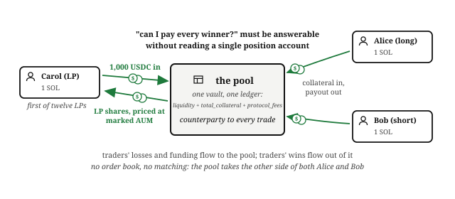
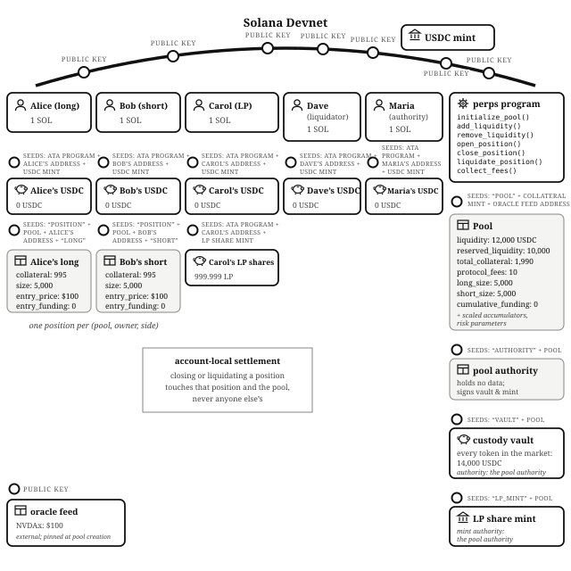
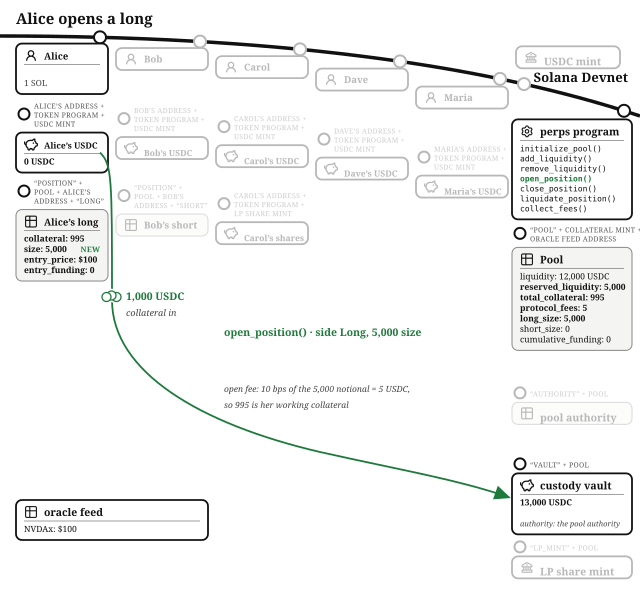
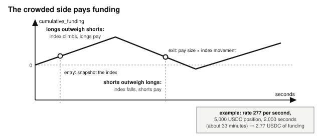
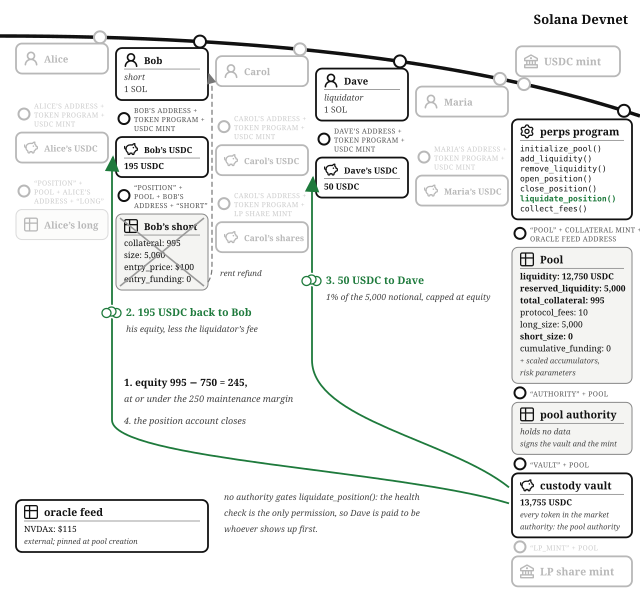

# Chapter 19: Perpetual Futures

Alice thinks NVIDIA is about to have a very good quarter. She could buy NVDAx and wait, but she wants more exposure than her 1,000 USDC buys. Bob thinks the run is over and wants to profit if NVIDIA falls, which owning the stock cannot give him. A **perpetual future** serves them both: a contract that pays the price movement of an asset, long or short, with leverage, without either trader ever holding the asset, and, unlike a traditional future, without an expiry date. Perpetuals are the highest-volume product in crypto trading, and they are this book's capstone because building one honestly requires everything: tokens, PDAs, vault custody, pool shares, offchain truth, liquidation, time, and arithmetic that must round the right way under leverage.

The program lives at `finance/perpetual-futures` in the companion repository. It follows the pool-as-counterparty design of Jupiter Perpetuals rather than an order-book design like Drift: no matching engine, no resting orders, one liquidity pool on the other side of every trade.

## The Pool Is the Other Side of the Trade

In the order book chapter, every long met a short: Carol's ask crossed Bob's bid, and the program merely kept score. A pool-based perp removes the matching problem entirely. **Liquidity providers fund one pool, and the pool is the counterparty to every position.** When a trader wins, the pool pays; when a trader loses, the pool keeps the loss. LPs are running the casino, except the games are price movements and the house edge is fees plus funding.

That one design decision creates the problem the whole program is organized around: the pool must be able to prove it can pay every winner, at every moment, **without ever iterating over the open positions**, because a program that must touch every position to answer "am I solvent?" stops fitting in a transaction the day it succeeds. Hold that thought; it explains almost every field in the account model.

## The Account Model: One Pool, One Vault, One Position per Side per Trader

The **pool** is a PDA with seeds `"pool"`, the collateral mint, and the oracle feed, so one market exists per collateral-and-feed pair. Its struct, `Pool`, carries the risk parameters set at creation (`max_leverage`, `maintenance_margin_bps`, `open_fee_bps`, `close_fee_bps`, `liquidation_fee_bps`, `max_confidence_bps`, `funding_rate_per_slot`) and the live accounting this chapter keeps returning to:

- `liquidity`: what the LPs own. It grows with deposits, trader losses, and funding; it shrinks with withdrawals and trader profits.
- `reserved_liquidity`: the portion of `liquidity` currently pledged as the maximum payout of open positions.
- `total_collateral`: trader money held for open positions. It is tracked separately from `liquidity` because it is not the LPs' money.
- `protocol_fees`: Maria's accrued fees, separate again.
- `long_size`, `short_size`, `long_size_scaled`, `short_size_scaled`: per-side open-interest accumulators, the trick that makes solvency checkable without iteration.
- `cumulative_funding` and `last_funding_slot`: the funding index.

A **pool authority** PDA (seeds `"authority"` + pool) holds no data and exists to sign: it is the mint authority of the **LP share mint** (seeds `"lp_mint"`) and the token authority of the **custody vault** (seeds `"vault"`), a single token account holding LP liquidity, trader collateral, and fees together. The vault mixes custody; the three ledger fields keep the ownership straight, and by now you know the rule that makes that safe: balances are custody, state is truth.

Each position is a **position** PDA with seeds `"position"`, the pool, the owner, and the side (`"long"` or `"short"`), so a trader can hold at most one long and one short per market. The `Position` struct is a snapshot taken at open: `collateral` (net of the open fee), `size` (the notional exposure), `entry_price`, `size_scaled` (size divided by entry price, kept at `SIZE_PRECISION` fixed point), and `entry_funding` (the funding index at entry). Everything the program ever needs to settle the position is derivable from these fields plus the current price, which is what makes settlement **account-local**: closing or liquidating one position touches one position.

## Creating the Market, Where the Parameters Police Each Other

Maria creates the pool and is its `authority`; her revenue is the open and close fees that accrue to `protocol_fees`, and the program gives her no path to anyone's collateral. She calls `initialize_pool()` with the market's risk parameters: 10 basis-point open and close fees, 10x maximum leverage, a 5% maintenance margin, a 1% liquidation fee, and a 1% cap on oracle confidence. The handler validates each parameter against `BASIS_POINTS_DENOMINATOR`, and one cross-check deserves a sentence because it prevents a subtle dead state: `maintenance_margin_bps` must exceed `close_fee_bps`, otherwise a position could exist that is too healthy to liquidate but too poor to pay its own close fee, leaving its owner with no exit at all. The test `test_initialize_pool_rejects_close_fee_at_or_above_maintenance_margin` pins it. Every state needs an exit, and here that principle reaches back into the *configuration* of the market.

## Liquidity Providers Fund the Casino and Get Shares Priced at Mark

Carol is a liquidity provider. Her income is every losing trader's loss and every funding payment; her risk is every winning trader's profit. She is not being generous; she is selling variance for yield. She calls `add_liquidity()` with her whole 1,000 USDC. She is the first depositor, so her shares are her deposit minus `MINIMUM_LIQUIDITY`: a withheld 1,000 minor units, a tenth of a cent, that no one will ever own. That is the same first-depositor defense the constant-product AMM chapter built, and the one the vault strategy chapter named as its own missing guard. It closes the share-inflation attack before it opens. Later deposits mint shares pro rata, but against what denominator? Not the vault balance, and not even `liquidity` alone, but **assets under management marked to market**: `liquidity` minus the traders' current unrealized profit (or plus their unrealized loss). If LP shares were priced while ignoring open positions, a depositor could buy in cheap the moment traders were winning and dilute Carol at exactly her worst moment. Marking AUM makes entering and leaving the pool fair at any instant, and both `add_liquidity()` and `remove_liquidity()` take a minimum-out argument so a price move between signing and execution fails with `SlippageExceeded` instead of filling badly. Eleven more providers follow Carol in over the morning, and the pool opens for trading with 12,000 USDC of liquidity.

Withdrawals have one extra gate: only **free** liquidity, `liquidity − reserved_liquidity`, may leave (`InsufficientLiquidity` otherwise, pinned by `test_remove_liquidity_blocked_by_reserved`). Carol can never pull out money the pool has promised to a winner.

## The Price Comes From Outside, So It Gets Interrogated at the Door

Every handler that touches money begins the same way: read the oracle, validate it, accrue funding. The pool is pinned at creation to one **oracle feed** account, the offchain-truth mechanism from Financial Programming Concepts in Solana at production scale: a price written onchain by a network whose signatures prove its origin, read with the same five-check discipline the prop AMM chapter's whole business rested on. In the companion repository the feed is a mock (`mock-switchboard`, an authority-gated stand-in the tests can set prices on, labeled not-for-production); the production path is a real Switchboard feed verified with the SDK's parse-and-verify call. Either way the program interrogates what it reads, in order:

- the account is long enough to contain a price (`OracleDataTooShort`),
- the price is positive (`NonPositivePrice`),
- the feed's decimal scale equals the one the pool recorded at creation (`OracleScaleMismatch`), so a feed migration cannot silently shift every price by powers of ten,
- the price is fresh: no older than `MAX_PRICE_STALENESS_SLOTS`, 150 slots, about a minute (`StalePrice`),
- and the feed's own uncertainty band, divided by the price, is within `max_confidence_bps` (`OracleConfidenceTooWide`). A leveraged venue trading on a price the oracle itself is unsure of is how liquidation cascades start.

A stale price is not an inconvenience here; it is an arbitrage machine. Anyone who can trade a leveraged market at a minute-old price against a live market elsewhere drains the pool with no risk. The tests `test_stale_price_rejected` and `test_wide_oracle_confidence_rejected` pin both refusals.

## Opening a Long, and the Pool Reserves the Best Case

Alice thinks the quarter goes NVIDIA's way and goes long; Bob believes the opposite and will open the mirror-image short. Alice calls `open_position()`: side Long, 1,000 USDC collateral, 5,000 USDC size, and an acceptable-price bound (her slippage guard; a long opening above it fails with `SlippageExceeded`). Size five times her collateral means **5x leverage**: every 1% move in NVDAx moves her equity by about 5%. The handler charges the open fee on **notional size, not collateral**: 10 basis points of 5,000 is 5 USDC, so her working collateral is 995. Fees scale with exposure because exposure, not deposit, is what the pool underwrites. Then the gates, in order:

- **Leverage**: size must not exceed net collateral times `max_leverage`. 5,000 against 995 × 10 = 9,950 passes; her effective leverage is about 5x. Eleven-x fails with `LeverageTooHigh` (pinned by `test_open_rejects_excess_leverage`).
- **Born healthy**: net collateral must exceed the maintenance margin on her size, 5% of 5,000 = 250 USDC, else `PositionNotHealthy`. A position must not be liquidatable in the transaction that creates it.
- **The reservation**: `reserved_liquidity` grows by her full size, 5,000, and the sum must stay within `liquidity`, else `InsufficientLiquidity` (pinned by `test_open_rejects_when_pool_cannot_back_it`).

That last gate is the solvency design in one line. By reserving the notional, the pool sets aside the most it could ever owe her, because **profit on a close is capped at the position's size**. The cap costs Alice something real: if NVDAx tripled to $300, her raw profit of 10,000 USDC would be paid as 5,000. In exchange, every winner's payout is pre-funded before the position exists; the pool cannot be surprised. The test `test_profit_capped_at_reserved_notional` runs exactly the tripling and asserts the cap. Production venues layer insurance funds and auto-deleveraging above this floor; the floor is the part that must never be missing.

Her transaction ends with the only token movement: 1,000 USDC from Alice's token account into the vault. Bob opens his mirror-image short the same way: 1,000 collateral, 5,000 size, entry $100, another 5 USDC fee to `protocol_fees`, another 5,000 reserved.

## Funding Is the Rent the Crowded Side Pays

A perpetual never expires, so what stops its price drifting away from the asset it tracks? On every venue the answer is **funding**: a periodic payment that makes the popular side pay for its popularity, nudging traders toward balance. This program implements funding in its simplest honest form: a pool-wide index, `cumulative_funding`, advances by `funding_rate_per_slot` every slot, in whichever direction the open interest leans; whichever side is heavier pays. Each position remembers the index at its entry (`entry_funding`), and settlement charges size × the index movement since entry, at `FUNDING_PRECISION` fixed point. Run the numbers once: with a rate of 5,000 per slot, a 5,000 USDC position held through 2,000 slots (about thirteen minutes) owes 50 USDC.

Two simplifications to notice, both documented in the example. The payment goes to the pool, to the LPs, rather than to the lighter side of traders, and the rate is a constant rather than scaling with how lopsided the book is. Production funding is proportional to the imbalance and flows between the sides; the mechanism here teaches the accounting shape, an index plus per-position entry snapshots, which is the part that survives into every real implementation. The test `test_funding_charged_to_long` opens a lone long, warps two thousand slots, and asserts the pool collected exactly the funding the index accrued. To keep every other number in this chapter clean, the walkthrough pool sets the funding rate to zero, exactly as the test suite's default market does.

## NVDAx Rallies: The Short Decays, and a Liquidator Is Paid to End It

The quarter goes Alice's way: NVDAx climbs to $110. Mark both positions to market with the one PnL formula the program owns: size × price change ÷ entry price. Alice is up 500. Bob is down 500, and Bob's **equity**, working collateral plus PnL minus funding owed, is 995 − 500 = 495 USDC. His maintenance margin is 250, so he lives, and `test_healthy_position_cannot_be_liquidated` guarantees Dave cannot touch a healthy position (`PositionHealthy`).

At $115, Bob's equity is 995 − 750 = 245, under the 250 maintenance line. He should close, but that means admitting he was wrong, and he keeps putting it off. The market does not wait. Dave watches liquidations: he runs a bot that calls `liquidate_position()` on any account whose equity has fallen to or below maintenance margin, and he does it for the liquidation fee, not for the health of the ecosystem. His bot fires. Anyone may call `liquidate_position()`; the health check is the only permission that matters. The payout waterfall, every branch of which the program walks in order:

- Bob's remaining equity, floored at zero: 245 USDC.
- Dave takes the liquidation fee, 1% of the 5,000 notional = 50 USDC, capped at remaining equity: 50.
- Bob is refunded the rest: 195 USDC, plus the rent from his position account, which closes.
- The LPs absorb the difference between Bob's collateral and what walked out: 995 − 245 = 750 USDC to `liquidity`.

Notice whose incentive does the system's dirty work. The pool cannot sell Bob's position; a program never acts on its own, somebody has to call it, so the design pays outsiders to call it at exactly the right moment. Dave is the crank pattern from the Lending and Borrowing chapter with a profit motive. And notice the honest gap, documented in the example: the liquidation fee comes out of *remaining equity*, so a position that gaps straight through zero pays Dave nothing, and unattended zombie positions become losses the LPs eat. Production venues fund the liquidator from an insurance fund precisely so the incentive never dies. When your design relies on someone showing up, check what happens when showing up stops paying.

## Closing at $120, and the Pool Pays Without Flinching

At $120 Alice takes her win. `close_position()` marks her position one last time: profit 5,000 × 20 ÷ 100 = 1,000 USDC, under her 5,000 cap; close fee 10 basis points of size = 5; payout 995 + 1,000 − 5 = **1,990 USDC**, nearly doubling her stake on a 20% move, which is what 5x leverage means. Her 5,000 reservation releases, the LPs' `liquidity` drops by her 1,000 profit, `protocol_fees` collects the 5, her position account closes, and the vault pays her out under the pool authority's signature. The same handler protects the pool from the other direction: a position whose equity cannot cover its own close fee is refused with `PositionNotHealthy` and must exit through liquidation, and any payout the pool arithmetic cannot cover fails closed with `PoolInsolvent` rather than overdrawing the LPs.

Where did everyone end up? Alice turned 1,000 into 1,990 by being right with leverage. Bob turned 1,000 into 195 by being wrong and slow. Dave collected 50 USDC for one well-timed transaction. Maria's `protocol_fees` holds 15 from two opens and one close (Bob's liquidation charges no close fee), which she sweeps with `collect_fees()`, the only handler gated on her signature, and only to zero the fee ledger (`test_collect_fees_requires_authority` pins the gate). And Carol? The pool she owns a twelfth of absorbed Bob's 750 loss and paid Alice's 1,000 profit: down 250 on the trading, about 21 dollars of it hers, plus fees and funding on the next thousand traders. The house does not need every hand to win.

## The Math: One Formula per Concept, All Floored the Pool's Way

Every calculation is checked u128 integer arithmetic, multiply before divide, and every division rounds in the pool's favor: `basis_points_of()` floors fees and margin thresholds, share minting and withdrawal amounts floor against AUM, and PnL truncates toward zero. Prices arrive at the oracle's fixed-point scale (10^8 here) and cancel out of the PnL formula, so positions settle in collateral minor units. The one genuinely clever line is the per-side scaled accumulator: each open adds size ÷ entry price (at `SIZE_PRECISION`) to its side, and the pool's whole unrealized PnL is then two multiplications against the current price, which is what lets AUM, and therefore LP share pricing and solvency, be computed in constant time forever.

## The Invariants: Percolator's Three, in Miniature

The example's design notes point at percolator, Anatoly Yakovenko's formally verified perp risk engine, and the three invariants it enforces are the ones to memorize, because this program is a simplified working model of each:

- **Realizable credit**: every payout the system may ever owe is backed before it can be owed. Here: reservations at open, the profit cap, the free-liquidity gate on withdrawals, and the fail-closed `PoolInsolvent` checks.
- **Account-local safety**: any position can be settled by touching that position and the pool, never a third account. Here: the entry-snapshot fields on `Position`.
- **Bounded progress**: no operation's cost grows with the number of open positions. Here: the per-side accumulators and one-at-a-time liquidation.

Plus the book's standing invariants: the vault balance always equals `liquidity + total_collateral + protocol_fees` plus dust; share value cannot be moved by donating tokens to the vault, because AUM reads tracked state, not balances; and every position born healthy has, at all times, at least one working exit.

## The Failure Modes: Leverage Amplifies Whatever You Got Wrong

- **A stale or manipulated price** is the catastrophic one: with 10x leverage, a 1% price error is a 10% equity error, market-wide, simultaneously. Hence the five-check interrogation, the confidence cap, and the one trust decision the program leaves visible: the pool creator chooses the feed, and the feed account's owner is deliberately unchecked. Choose oracles the way you choose custodians.
- **The zombie-position gap**: liquidations that pay nothing do not happen, and the LPs eat the drift. Documented, and the reason production adds an insurance fund.
- **First-depositor share inflation**: closed by `MINIMUM_LIQUIDITY`, and `test_first_deposit_below_minimum_fails` proves a dust first deposit cannot even open the pool.
- **Winning too big**: profit beyond the reservation is clipped by the cap rather than bankrupting the pool, and traders know the cap before they open.
- **Sandwiching and price drift**: every money handler takes a user-supplied bound and fails with `SlippageExceeded` instead of filling at a surprise price.
- **Double close, double liquidation**: the position account closes on exit; the second call finds no account.
- **Config foot-guns**: parameter validation at pool creation, including the maintenance-versus-close-fee cross-check.

## Testing Considerations

The suite is the largest in the companion repository: a mock oracle the tests set prices on, and a `Market` helper that builds the pool, warps slots, and re-derives position PDAs. The pattern to steal is **one test per invariant, named as the sentence it enforces**: `test_profit_capped_at_reserved_notional`, `test_remove_liquidity_blocked_by_reserved`, `test_healthy_position_cannot_be_liquidated`, `test_stale_price_rejected`, `test_collect_fees_requires_authority`. The happy-path tests (`test_close_long_in_profit`, `test_close_long_in_loss`, `test_close_short_in_profit`) assert exact payouts computed by hand, the same numbers this chapter used, and `test_liquidation_of_underwater_long` runs Dave's whole waterfall. When a future change breaks an invariant, the test that fails states, in its own name, which promise you just broke.

## What You Learnt from Building the Perpetual Futures Venue

A traditional futures exchange is a matching engine, a clearing house with a margin department, a funding desk, and a floor of liquidation clerks. This chapter rebuilt the whole stack as one program: the pool is the clearing house and the counterparty, the maintenance margin and reservation are the margin department, the funding index is the funding desk, and a liquidator's bot is the liquidation clerk, paid per correction.

The concepts this capstone added:

- **Pre-funded solvency.** Reserve every position's maximum payout at open, cap profit at the reservation, and gate LP withdrawals on free liquidity, so the pool can never be surprised.
- **Constant-time accounting.** Per-side scaled accumulators and entry snapshots make solvency, AUM, and settlement computable without ever iterating open positions: realizable credit, account-local safety, and bounded progress, in miniature.
- **Funding.** A pool-wide index plus a per-position entry snapshot charges the crowded side rent, the same accounting shape every production venue uses.
- **Mark-to-market share pricing.** LP shares price against AUM including traders' unrealized PnL, so entering and leaving the pool is fair at any instant.

And look back at what this chapter spent without explaining: mints and token accounts, PDAs as vault authorities, shares priced against a pool, state-not-balances, checks-effects-interactions, exits from every state, a signed external price interrogated at the door, cranks run by profit-seekers, and integer arithmetic that rounds toward the house. Every one was a chapter, and every one showed up here as a single sentence doing its job. That is the shape of financial software on Solana: a small number of hard-won disciplines, composed. You now have all of them. The companion repository holds the code; the rest is what you build.
