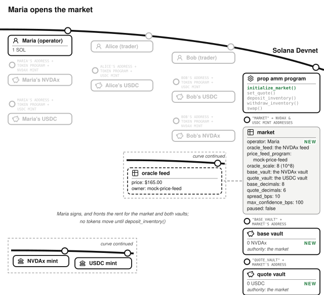
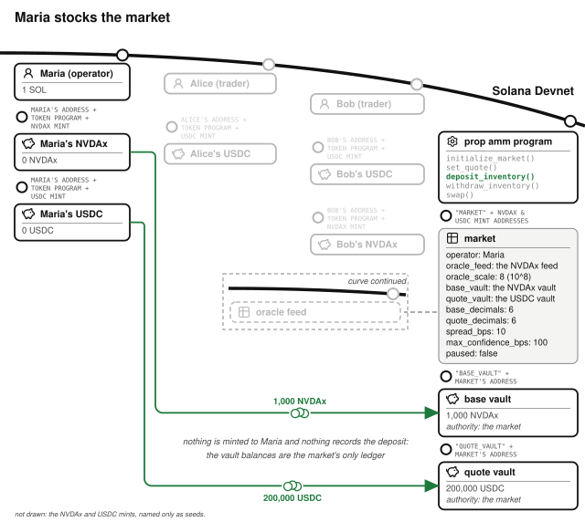
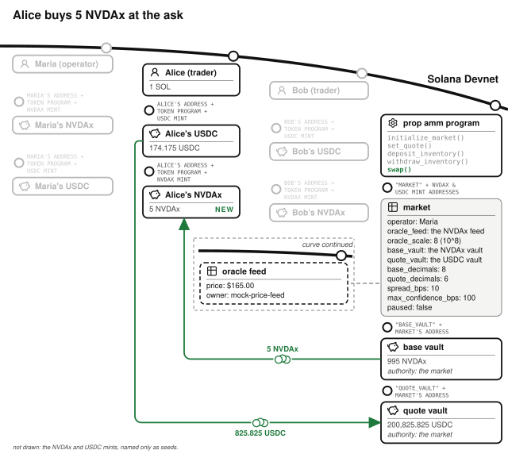
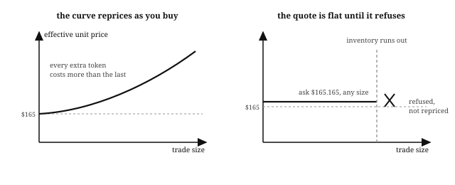
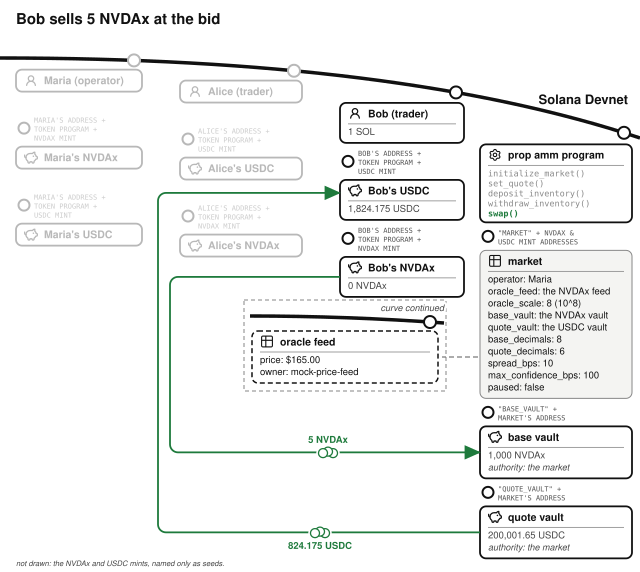
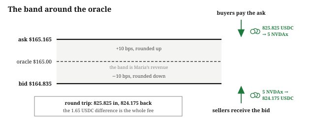
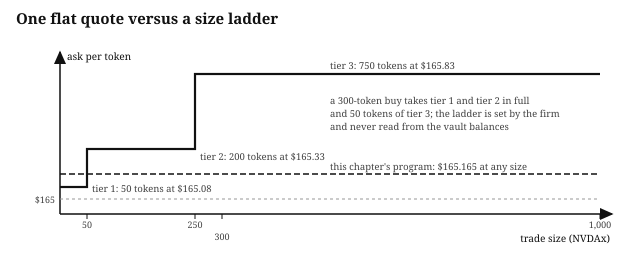
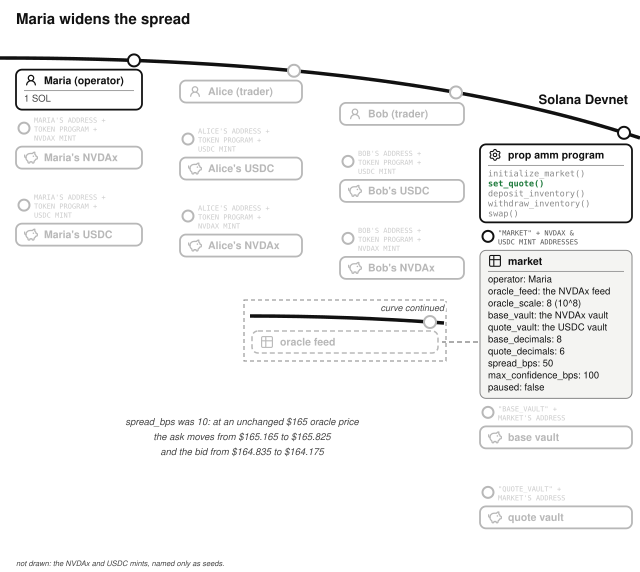
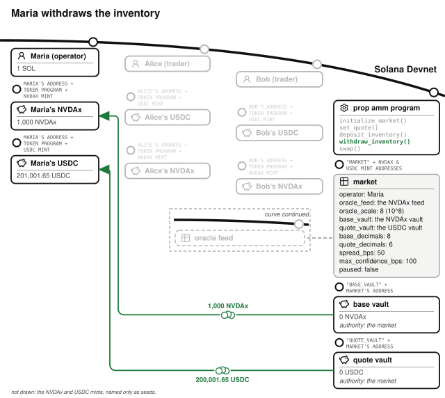

# Chapter 16: The Prop AMM

The *Constant-Product AMM* chapter ended with the formula as the maker: one multiplication replacing the order book, at the cost of price impact and impermanent loss. This chapter builds the **proprietary AMM**, or prop AMM. A market-making firm funds a pool with its own capital and quotes both sides of it. Anyone may buy the base token at the oracle price plus a margin, or sell it at the oracle price minus the same margin. There is no curve, there are no liquidity providers, and there are no LP shares. The operator supplies the only capital in the market, and the name comes from that: "proprietary" trading is trading the firm's own capital.

Lifinity pioneered the model on Solana and wound down in December 2025, and by then the firms that followed it had taken most of its flow.[^lifinity-wind-down] By mid-2026 that volume went through BisonFi, HumidiFi, SolFi, ZeroFi, Tessera, and Obric, among the highest-volume venues on the network.[^prop-amm-share] You have probably never visited any of them, because they have no user interfaces. Their flow arrives through Jupiter, the aggregator that routes each swap to whichever venue quotes best. A firm quoting live oracle prices with its own inventory usually quotes best. The program lives at `finance/prop-amm` in the companion repository.

## The Oracle Is the Price, the Spread Is the Fee

A constant-product pool computes its price from its reserves. Its price is right only after arbitrageurs have made it right, and every trade pays price impact. A prop AMM reads its price from a price feed account, like the one in the *Offchain Truth* chapter. The operator's only pricing decision is the spread. Buyers of the base token pay the ask, which is the oracle price plus `spread_bps`. Sellers receive the bid, which is the oracle price minus it. The bid and ask from the *Order Book Exchange* chapter return, but no one rests orders. The firm *is* both sides of the book, at the oracle price plus or minus its margin.

Two things are absent as a result:

- **No price impact.** A trade's unit price does not depend on its size. The inventory is the only limit on that size.
- **Nothing to sandwich.** The sandwich attack from the *Adversary* chapter needs a price that moves with each trade. This price does not depend on the pool's balances, and it moves only when the oracle does.

## The Market Maker Opens the Market and Stocks It

Maria runs the market-making firm that operates the venue. She stocks it, sets the spread, and takes it off the market when she chooses. She signs with the standard wallet every character carries. Its token accounts hold her own 1,000 USDC, plus 1,000 NVDAx and 200,000 USDC from the firm's treasury. The market trades NVDAx, the NVIDIA stock, against USDC, and in this chapter the oracle quotes NVDAx at $165.

Maria calls `initialize_market()` with `spread_bps` at 10 basis points and a 1% cap on oracle confidence. `spread_bps` is a half-spread: the ask sits 10 basis points above the oracle price and the bid 10 below, so the spread between them is 20. The handler rejects a zero spread and a spread at or above 100%, both with `InvalidParameter`. A zero spread earns nothing, while the market still loses on every fill taken by a trader who knows where the price is going, so the handler refuses it as a mistake. At or above 100% the bid would be zero or below.

This one transaction created the three accounts the venue needs.

The **market** account lives at a PDA with seeds `"market"` and the two mints. That gives one market per pair, because the deployment *is* the firm: real prop AMMs are closed programs deployed by the firms themselves. The struct holds the operator's public key, the price feed, the program that owns it (`price_feed_program`, read from the price feed account's owner), and the price feed's scale, all fixed at creation. It also holds `spread_bps`, a confidence limit, a `paused` flag, and the two token decimals, recorded at creation so the math never trusts a passed-in mint. The market PDA is the authority of the **base vault** and **quote vault**, and the program signs for them with the market's seeds.

The market has no LP mint, because there are no depositors to issue receipts to. It has no fee ledger, because the spread it earns stays in the vaults as inventory. And it has no virtual reserves, because pricing never reads the reserves. The *Fundraiser* chapter's program counts contributions in its own `current_amount` field rather than reading the vault balance. A transfer straight into the vault changes its balance, and the target must count only accepted contributions. Here a donation only adds to Maria's inventory, so the vault balances are all the accounting the market needs.

Then `deposit_inventory()` moves the 1,000 NVDAx and 200,000 USDC from the operator's token accounts into the vaults. No shares are minted, no deposit is recorded, and no `MINIMUM_LIQUIDITY` is withheld. Every defense the *Constant-Product AMM* chapter needed on deposits protects depositors from each other, and this market has one depositor.

## A Buyer Trades at the Ask

Alice, carrying the standard wallet, wants 5 NVDAx. She calls `swap()` with the direction `BuyBase`, and the handler prices her in three steps:

- **The oracle read**, with the checks from the *Offchain Truth* chapter. First, before the handler decodes a byte of it, the price feed account must be owned by the program the market recorded at creation (`PriceFeedNotFromOracle`). An account laid out like a price feed but written by another program is never read as a price. Then come the price feed's layout, a positive price, the scale fixed at creation, freshness within 150 slots (`StalePrice`), a price stamped after the last cluster restart (`PricePredatesRestart`, for the reason the *Time* chapter gives), and a confidence band inside the market's limit (`OracleConfidenceTooWide`).
- **The ask**: $165 plus 10 basis points is $165.165, **rounded up** in fixed point, because the buyer's price rounds against the buyer.
- **Her output**, floored: 825.825 USDC of her 1,000 buys exactly 5 NVDAx.

The handler checks the fill against her `minimum_amount_out`. If the base vault could not cover the fill, the handler would reject the whole trade with `InsufficientInventory`: a prop AMM never partially fills and never prices what it cannot deliver.

If a fund had bought 500 NVDAx instead of Alice's 5, it would also have paid $165.165 per token. In the *Constant-Product AMM* chapter Bob paid an average of $2.46 on a $2.25 quote, because his own trade moved the pool's price. Alice pays the quote.

## A Seller Trades at the Bid, and the Round Trip Is the Fee

Bob needs USDC for a down payment and sells the 5 NVDAx he holds alongside his standard wallet. He uses the same instruction, with the direction `SellBase`. The bid is $165 minus 10 basis points, which is $164.835, **floored** where the ask was rounded up. He receives exactly 824.175 USDC.

A round trip costs 1.65 USDC: buying 5 NVDAx cost 825.825 and selling them back returned 824.175. That difference is the round-trip spread, and it is all of the venue's revenue. It stays in the quote vault rather than in any fee account. The constant-product pool charged 30 basis points and *also* charged price impact. Maria charges 10 each way and nothing else, so the aggregator keeps routing to her.

## Real Venues Price by Size, and the Ladder Is the Part the Firm Keeps to Itself

This program quotes one price per side for any size up to its inventory: one large bid and one large ask, `spread_bps` either side of the oracle price. That is the simplest quote a prop AMM can make, and some venues quote this way. Most quote a **size ladder** instead. The first 50 NVDAx go at 5 basis points, the next 200 at 20, and the next 750 at 50. A taker who wants 300 pays the first two tiers in full and 50 tokens' worth of the third. A small buyer pays less than Alice did and a large one pays more, and the unit price rises with the size taken.

That looks like the constant-product pool's price impact, but the ladder never reads the vault balances. The firm sets it, and reprices it from its own inventory risk. A 300-token fill takes 300 NVDAx out of the firm's inventory, and the firm must buy them back somewhere else. The ladder charges more for the sizes that cost more to hedge. The model that sets the tiers and reprices them is the part of a prop AMM the firm keeps to itself. It runs offchain, in the firm's own systems, with the firm's own view of the market. Only the resulting ladder is written onchain, where the program fills against it and refuses when the price feed is stale. This chapter's program keeps the single tier because the ladder adds arithmetic and no new mechanism. A ladder runs the quote math above once per tier, with the size that tier still has left.

## The Oracle Moves and the Quote Moves With It

If NVIDIA reported earnings and the price feed repriced to $170, the next swap would fill at a $170.17 ask. A constant-product pool reaches a new price only when arbitrageurs trade it there, and their profit comes from the LPs. A prop AMM reads the new price instead.

Reading the price has its own cost. Between oracle updates, even fresh ones inside the 150-slot bound, the market quotes a number that is seconds old. Anyone who knows where the price went in those seconds can buy below true value or sell above it. Market makers call this **adverse selection**: the loss a market maker takes when a trader who knows the price has moved fills a quote before it is updated. The prop AMM carries this cost in place of impermanent loss, and Maria bears all of it.

## The Market Maker Re-Quotes, and Sometimes Refuses to Quote

Maria handles adverse selection with `set_quote()`. When volatility rises, she widens the spread by setting `spread_bps` to 50 basis points, and the next buyer pays $165.825 per NVDAx. When her own view of the market differs from the price feed entirely, she sets `paused`. The market then rejects every swap with `MarketPaused` until she calls `set_quote()` again with `paused` false. Watch the real venues during a fast market and you will see this: their quotes vanish from the aggregator and reappear minutes later, wider.

The oracle checks in `swap()` pull the quote automatically, for the same reasons Maria pulls it by hand. In every other program in this book the staleness check protects users. For a market maker it protects the firm's own capital.

## Real Venues Choose Whom They Fill

Real venues also handle adverse selection by choosing their counterparties. The teams that run prop AMMs come from block building and MEV, and they know that not all flow is alike. A retail swap routed through an aggregator is almost never informed: whoever sent it wants NVDAx, not an edge on the price. An arbitrage bot or a rival market maker that takes the quote the moment the price feed moves is informed by definition, because that is the only reason it trades. Adverse selection comes from the second kind, so the venues segment their flow. They quote a tighter spread for flow they believe is uninformed, and a wider one, or none, for flow they believe is informed. Jupiter built the signal for this into its Ultra router in 2025. A swap from Jupiter's own users reaches the venue marked as one, and the prop AMMs quote tighter for it.[^ultra-signaling]

Some go further and keep a deny list of addresses they will not fill at all. That starts a cycle that does not end, because the refused firm moves to fresh wallets and the venue looks for the pattern behind them.

## The Market Maker Withdraws Everything, Then Closes the Market

When Maria wants her capital back, `withdraw_inventory()` pays her the full balance of both vaults in one instruction, to the last minor unit. She needs nobody's permission, and the handler does none of the share arithmetic the constant-product pool's withdrawal needed. The market account remains, empty, and refuses swaps with `InsufficientInventory`.

To shut the venue down, Maria then calls `close_market()`. It closes both vaults and the market account and returns to her the rent she paid for all three at `initialize_market()`. It refuses with `InventoryNotEmpty` while either vault holds any tokens, even tokens a stranger sent straight to a vault, so she withdraws first. Only the operator can call it. `test_close_market_returns_all_three_rents`, `test_close_market_refuses_while_a_vault_holds_tokens`, `test_close_market_refuses_tokens_sent_straight_to_a_vault` and `test_close_market_rejects_non_operator` check each of these.

## The Math: Every Rounding Favors the Market

Four small functions in `quote_math.rs` do the quote arithmetic, and three more do the invariant check. All use checked u128, multiply before they divide, and round once per quantity. The ask rounds **up**, the bid rounds **down**, and both outputs floor. Every rounding direction favors the market, so the composite invariant holds: value out never exceeds value in, measured at the raw oracle price. The handler still asserts it after computing each fill. It cross-multiplies so the check itself does no rounding, and it fails with `InvariantViolated` if a future refactor breaks a rounding direction. Assert after the math, as the constant-product pool's K check does after each trade. The formula checked here is much simpler.

The unit conversion carries three exponents. Prices arrive at the oracle's fixed-point scale, 10^8 here, while each token has its own decimals. The program records both mints' decimals at creation and carries all three through the arithmetic rather than assuming they cancel. With NVDAx at eight decimals and USDC at six they do not cancel. The chapter's numbers are clean for a different reason: the ask and the bid have three decimal places of a dollar, fewer than USDC's six, and five NVDAx is a whole number of tokens at any decimal count.

## The Invariants: What the Market Guarantees

- The quote brackets the oracle: the bid is at or below the price and the ask is at or above it, and each side's rounding favors the market.
- No swap pays out more value than it takes in, measured at the raw oracle price. The handler enforces this onchain after the math, for each fill.
- Only the operator moves inventory, and the operator can always move all of it. Both inventory handlers check the signer against the operator address stored in the market, and that is all of the access control.
- Traders carry no custody risk. A swap is a single atomic transaction against visible prices. Traders deposit nothing into a prop AMM, so they have nothing there to lose. Every risk in this design falls on Maria: stale quotes, adverse selection, and a bad oracle.

## The Failure Modes: What Attacks a Market Maker

- **The stale quote** is the catastrophic failure, and it needs no exploit: an oracle that lags a moving market is enough. Every fill against a wrong quote is a risk-free profit for the counterparty and a loss for Maria. `StalePrice` and `OracleConfidenceTooWide` refuse those swaps (`test_swap_rejects_stale_price`, `test_swap_rejects_wide_confidence`). In the *Perpetual Futures* chapter leverage multiplies the same failure.
- **Adverse selection** (above). No `require!` can refuse "traders who know something", so it is handled commercially. Maria widens the spread and pauses with `set_quote()`. Real venues add a size ladder and segment their flow. The `paused` flag is a risk control Maria expects to use.
- **The operator chooses which oracle to trust.** The operator picks the price feed at creation, and `PriceFeedNotFromOracle` holds the market to the program that owned it then (`test_swap_rejects_price_feed_from_another_program`). Maria judges whether that program publishes good prices. The *Perpetual Futures* chapter's pool creator makes the same visible trust decision.
- **What is absent.** Of the attacks the *Adversary* chapter covers, two do not apply here. The inflation attack does not: there are no shares, so there is no share price for a first depositor to skew. Nor does the sandwich (above). Nor does the *Constant-Product AMM* chapter's empty-reserve drain: an empty vault rejects with `InsufficientInventory`. Each of those attacks needs a mechanism this program does not have.

## Testing Considerations

The suite (`tests/test_prop_amm.rs`) checks the quote math to the minor unit in both directions: `test_swap_buys_base_at_the_ask` and `test_swap_sells_base_at_the_bid` assert Alice's and Bob's exact numbers, and `test_round_trip_costs_exactly_the_spread` asserts the 1.65 USDC that makes the spread the fee. `test_quote_follows_the_oracle` and `test_set_quote_changes_the_spread` cover the two ways the quote moves. The price rejection tests cover a price feed account owned by another program, stale price, a price from before a restart, wide confidence, a price at or below zero, a price feed at another scale, and a price feed account too short to decode. The rest cover paused market, slippage, zero amounts, an output that rounds to zero, inventory bounds, spread bounds, closing a stocked market, and the four operator-only handlers against an imposter. And `test_operator_can_withdraw_everything_and_swaps_then_fail` checks that Maria can withdraw all of the inventory and that a swap afterwards fails: the capital is Maria's, and without it the market refuses every swap.

## What You Learnt from Building the Prop AMM

A traditional market-making desk quotes two-sided prices on an exchange, hedges its inventory, and pulls its quotes when prices move fast. In this program the desk is the pool: one firm quotes its own capital at oracle prices. The oracle sets the mid-price that the desk's trader would set, and the spread is the firm's margin. `set_quote()` is the risk manager widening quotes when prices move fast, and `paused` is the desk pulling them entirely.

Three concepts came with the prop AMM:

- **Quoting from a price feed.** The price comes from a price feed, not from reserves, so there is no price impact and nothing to sandwich. When the firm supplies the only capital in the market, the oracle checks protect its own capital, and with no shares there is no inflation attack.
- **Adverse selection**, the loss a market maker takes to traders who know the price has moved, and the commercial answers to it: a wider spread, a pause, and on real venues a size ladder and segmented flow.
- **When the vault balances can be the accounting.** With one depositor and no other claimant, the vault balances are the ledger.

Traders must trust one firm, one price feed, and one pause switch. They accept that because they leave nothing in the prop AMM's custody and see their price before they sign. In the *Lending and Borrowing* chapter we will build a program where users do leave their tokens in the program's custody, as supplied loans and as collateral, and the same kind of oracle values that collateral continuously. You will see what a lender has to do to stay solvent when the collateral falls, and who is paid to do it.

[^lifinity-wind-down]: [solanafloor.com/news/lifinity-distribute-43m-token-holders-solana-original-prop-amm-winds-down](https://solanafloor.com/news/lifinity-distribute-43m-token-holders-solana-original-prop-amm-winds-down) reports the December 2025 governance vote that wound the venue down and returned its treasury to its token holders.

[^prop-amm-share]: [defillama.com/dexs/chain/solana](https://defillama.com/dexs/chain/solana) ranks Solana's venues by rolling volume. The share these firms hold moves with the market, and with wherever the aggregators are routing that week.

[^ultra-signaling]: [dev.jup.ag/docs/blog/ultra-v3](https://dev.jup.ag/docs/blog/ultra-v3) is Jupiter's own description of Ultra V3, including the signal that tells a venue whether a swap came from Jupiter's own users.
