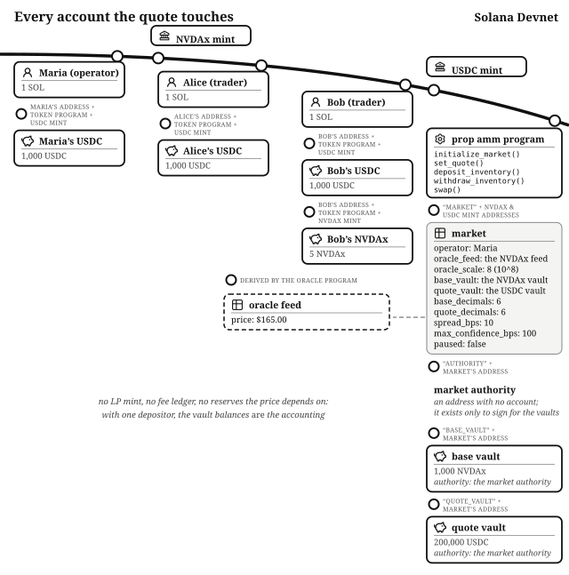
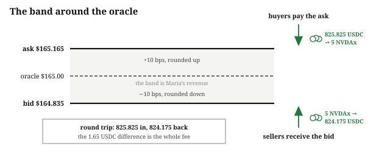
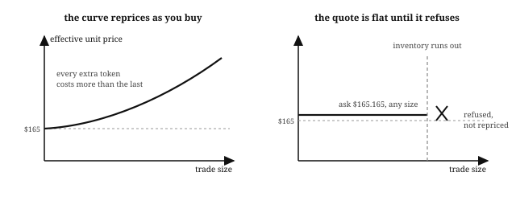

# Chapter 16: The Prop AMM

The *Constant-Product AMM* chapter ended with the formula as the maker: one multiplication replacing the order book, at the cost of price impact and impermanent loss. This chapter builds the **proprietary AMM**, or prop AMM. A market-making firm funds a pool with its own capital and quotes both sides of it: anyone may buy the base token at the oracle price plus a spread, or sell it at the oracle price minus the spread. There is no curve, there are no liquidity providers, and there are no LP shares. The operator is the only capital in the market, which is the property the name comes from: *proprietary* trading is trading the firm's own money.

Lifinity pioneered the model on Solana; by early 2026, venues like SolFi, HumidiFi, ZeroFi, Tessera, and Obric were trading among the highest volumes on the network.[^prop-amm-share] You have probably never visited any of them, because they have no user interfaces. Their flow arrives through Jupiter, the aggregator that routes each swap to whichever venue quotes best, and a firm quoting live oracle prices with its own inventory usually quotes best. The program lives at `finance/prop-amm` in the companion repository.

## The Oracle Is the Price, the Spread Is the Fee

A constant-product pool computes its price from its reserves, which means its price is only right when arbitrageurs have made it right, and every trade pays price impact along the way. A prop AMM inverts that. The price comes from an **oracle feed**, the machinery from the *Offchain Truth* chapter. The operator's only pricing decision is the **spread**: buyers of the base token pay the **ask**, the oracle price plus `spread_bps`; sellers receive the **bid**, the oracle price minus it. The bid and ask from the *Order Book Exchange* chapter are back, except no one is resting orders; the firm *is* both sides of the book, permanently, at whatever the oracle says plus its margin.

Two things are absent as a result:

- **No price impact.** A trade's unit price does not depend on its size, so 500 NVDAx fills at the same price per token as 5, until the inventory runs out.
- **Nothing to sandwich.** The price does not depend on the pool's balances, and the front-run/back-run attack from the *Adversary* chapter needs a price that moves with each trade. This one does not move.

## The Account Model: One Market, Two Vaults, and Nothing Else

The **market** is a PDA seeded by the two mints: one market per pair, because the deployment *is* the firm; real prop AMMs are closed programs deployed by the firms themselves. The struct holds the operator's key, the oracle feed and its scale, both fixed at creation, the two token decimals (recorded at creation so the math never trusts a passed-in mint), `spread_bps`, a confidence limit, and a `paused` flag. The market owns the **base vault** and **quote vault** and, being a PDA, signs for them.

The market has no LP mint, because there are no depositors to issue receipts to. It has no fee ledger: the spread is the fee, and it stays in the vaults as inventory. And it has no virtual reserves, because pricing never reads the reserves. The *Token Fundraiser* chapter's rule was that balances are custody and state is truth. That rule exists because *other people* have claims against the vault that the balance alone cannot express. Here nobody but Maria has a claim on anything, so the vault balances are all the accounting the market needs.

## The Market Maker Opens the Market and Stocks It

Maria runs the market-making firm that operates the venue: she stocks it, sets the spread, and takes it off the market when she chooses. Her personal wallet is the standard one SOL and 1,000 USDC every character carries; the inventory she deploys is the firm's. The market trades NVDAx, the NVIDIA stock the *Order Book Exchange* chapter traded, against USDC, and the oracle quotes NVDAx at $165.

Maria calls `initialize_market()` with a spread of 10 basis points and a 1% cap on oracle confidence. The handler rejects a zero spread (quoting the oracle price for free while paying adverse selection on every fill is a configuration mistake, not a strategy) and a spread at or above 100%, where the bid stops meaning anything (`InvalidParameter` both ways).

Then `deposit_inventory()` moves 1,000 NVDAx and 200,000 USDC from the firm's treasury into the vaults. No shares are minted, no deposit is recorded, and no `MINIMUM_LIQUIDITY` is withheld. Every deposit-side defense the *Constant-Product AMM* chapter needed exists to protect depositors from each other, and this market has one depositor.

## A Buyer Trades at the Ask

Alice, carrying the standard wallet, wants 5 NVDAx. She calls `swap()` with the direction `BuyBase`, and the handler prices her in three steps:

- **The oracle read**, with the checks from the *Offchain Truth* chapter: the feed's layout, a positive price, the scale fixed at creation, freshness within 150 slots, and a confidence band inside the market's limit.
- **The ask**: $165 plus 10 basis points is $165.165, **rounded up** in fixed point, because the buyer's price rounds against the buyer.
- **Her output**, floored: 825.825 USDC of her 1,000 buys exactly 5 NVDAx.

Her `minimum_amount_out` guards the fill, and `InsufficientInventory` would reject the whole trade if the base vault could not cover it: a prop AMM never partially fills and never prices what it cannot deliver.

Had a fund bought 500 NVDAx instead of Alice's 5, it would have paid $165.165 per token all the same. The *Constant-Product AMM* chapter's Bob paid an average of $2.46 on a $2.25 quote for moving the pool; Alice pays the quote.

## A Seller Trades at the Bid, and the Round Trip Is the Fee

Bob holds 5 NVDAx alongside his standard wallet, and sells them: same instruction, direction `SellBase`. The bid is $165 minus 10 basis points, $164.835, **floored**, the mirror image of the ask's ceiling, and he receives exactly 824.175 USDC.

A round trip costs 1.65 USDC: buying 5 NVDAx cost 825.825 and selling them back returned 824.175. That difference is the round-trip spread, and it is all of the venue's revenue, held in the quote vault rather than in any fee account. The constant-product pool charged 30 basis points and *also* charged price impact; Maria charges 10 each way and nothing else, which is why the aggregator keeps routing to her.

## The Oracle Moves and the Quote Moves With It

NVIDIA reports earnings and the feed reprices to $170. The very next swap fills at a $170.17 ask. No arbitrageur had to buy against a stale curve until the pool's ratio caught up, no LP inventory was sold below its value along the way. A constant-product pool only reaches a new price when traders arbitrage it there, and the profit those traders make comes out of the LPs; a prop AMM reads the new price instead.

Reading the price has its own cost, though. Between oracle updates, even fresh ones inside the 150-slot bound, the market is quoting a number that is seconds old, and anyone who knows where the price went in those seconds can buy below true value or sell above it. Market makers call this **adverse selection**: the flow that finds you when your quote is wrong is the flow you did not want. It is the prop AMM's impermanent loss: the structural cost of the business, borne entirely by Maria.

## The Market Maker Re-Quotes, and Sometimes Refuses to Quote

Her defense is `set_quote()`. When volatility rises, she widens the spread to 50 basis points (the next buyer pays $165.825 per NVDAx), and when her own view of the market diverges from the feed entirely, she sets `paused` and the market rejects every swap with `MarketPaused` until she returns. Watch the real venues during a fast market and you will see this: their quotes vanish from the aggregator and reappear minutes later, wider. Pulling quotes is routine for a market maker.

The oracle gates pull the quote automatically, for the same reasons Maria pulls it by hand. A price older than 150 slots is refused (`StalePrice`), because a lagging quote is a free option for whoever notices first. A price whose confidence band exceeds the market's limit is refused (`OracleConfidenceTooWide`), because a tight spread around a number the oracle itself is unsure of will fill at prices well away from the real one, in whichever direction costs Maria money. For every other program in this book the staleness check protects users; for a market maker it protects the firm's own capital.

## The Market Maker Leaves, Whole

When Maria wants her capital back, `withdraw_inventory()` hands her both vaults, to the last minor unit, in one instruction, with nobody's permission. There is no share burn, no pro-rata slice, no locked floor, no waterfall. The exit machinery that filled three chapters exists to divide pooled money fairly among claimants, and this pool has one claimant. The market account survives, empty, refusing swaps with `InsufficientInventory` rather than mispricing them: every state needs an exit, and an empty market's exit is to refuse every swap.

## The Math: Every Rounding Favors the Market

The quote arithmetic is four small functions (`quote_math.rs`), all checked u128, multiply before divide, one floor per quantity. The ask rounds **up**; the bid rounds **down**; both outputs floor. Every rounding direction favors the market, so the composite invariant, that value out never exceeds value in measured at the raw oracle price, holds by construction. The handler still asserts it after computing each fill, cross-multiplied so the check itself does no rounding, and fails with `InvariantViolated` if a future refactor breaks a rounding direction. Assert after the math, as the constant-product pool's post-trade K check does, here guarding a much simpler formula.

The unit conversion is the only complicated part. Prices arrive at the oracle's fixed-point scale (10^8 here) while each token brings its own decimals. The program records both mints' decimals at creation and carries all three exponents through the arithmetic rather than assuming they cancel. With two six-decimal tokens they do cancel, which is why the chapter's numbers are clean; the program cannot assume its tokens will be.

## The Invariants: What the Market Promises

- The quote brackets the oracle: bid at or below the price, ask at or above it, with each side's rounding favoring the market.
- No swap hands out more value, at the raw oracle price, than it takes in, enforced onchain after the math, per fill.
- Only the operator moves inventory, and the operator can always move all of it: checking the signer against the operator address stored in the market, on both inventory handlers, is the entire access control.
- Traders carry no custody risk. A swap is a single atomic transaction against visible prices; nobody deposits anything into a prop AMM, so there is nothing of theirs to lose. Every risk in this design (stale quotes, adverse selection, a bad oracle) falls on Maria.

## The Failure Modes: What Attacks a Market Maker

- **The stale quote.** The catastrophic one, and it needs no exploit, just an oracle that lags a moving market. Every fill against a wrong quote is pure profit for the counterparty and pure loss for Maria, risk-free, which is why the staleness and confidence gates run before every swap (`test_swap_rejects_stale_price`, `test_swap_rejects_wide_confidence`). The *Perpetual Futures* chapter meets the same failure with leverage multiplying it.
- **Adverse selection.** Slower and subtler: even a fresh oracle trails the true price by seconds, and informed flow captures the difference. No `require!` can refuse "traders who know something"; the mitigations are commercial: spread wide enough to pay for it, quotes pulled when the world is moving. The `paused` flag is a risk control Maria expects to use.
- **The oracle is a chosen trust.** The operator picks the feed at creation, and the program deliberately does not verify the feed account's owner, the same visible trust decision the *Perpetual Futures* chapter makes, with one difference: a bad oracle here loses *Maria's* money, not her users'. A production reader should still verify the feed's owning program; the companion repository's oracle module documents the one-call upgrade to a verified Switchboard read.
- **What is absent.** Run the *Adversary* chapter's checklist against this program and whole categories return "not applicable". No inflation attack: there are no shares, so there is no share price for a first depositor to skew. No sandwich: no price impact to squeeze. No vacuous-invariant drain on an empty reserve: an empty vault rejects (`InsufficientInventory`) because inventory bounds the fill rather than pricing it. Each of those attacks needs a mechanism this program does not have.

## Testing Considerations

The suite (`tests/test_prop_amm.rs`) checks the quote math to the minor unit in both directions: `test_swap_buys_base_at_the_ask` and `test_swap_sells_base_at_the_bid` assert Alice's and Bob's exact numbers, and `test_round_trip_costs_exactly_the_spread` asserts the 1.65 USDC that makes the spread the fee. `test_quote_follows_the_oracle` and `test_set_quote_changes_the_spread` cover the two ways the quote moves. The rejection tests cover every gate: stale price, wide confidence, paused market, slippage, zero amounts, inventory bounds, and the three operator-only handlers against an imposter. And `test_operator_can_withdraw_everything_and_swaps_then_fail` checks the rule that defines the genre: the capital is Maria's, and without it the market refuses every swap.

## What You Learnt from Building the Prop AMM

A traditional market-making desk quotes two-sided prices on an exchange, hedges its inventory, and pulls its quotes when the world moves. In this program the desk is the pool: one firm quotes its own capital at oracle prices, with no depositor, curve, or LP token involved. The oracle is the trader quoting two-sided prices, the spread is the firm's margin, `set_quote()` is the risk manager widening quotes when the world moves, and `paused` is the desk pulling them entirely.

Five concepts came with the prop AMM:

- **Oracle-priced quoting.** The price comes from a feed, not from reserves, so there is no price impact and nothing to sandwich; the spread is the entire fee.
- **For a market maker the oracle checks protect its own capital.** Staleness and confidence gates in front of every swap, because a lagging quote is a free option for whoever notices first.
- **Adverse selection.** The flow that finds you when your quote is wrong is the flow you did not want: the market maker's structural cost, mitigated commercially (wider spreads, pulled quotes), never by a `require!`.
- **When balances legitimately are the accounting.** Every deposit-side defense earlier chapters needed exists to protect depositors from each other; with one depositor, the vault balances are the ledger.
- **Attack surface that was never built.** No shares, no curve, no fee ledger: entire classes from the *Adversary* chapter return "not applicable" because each of them needs a mechanism this design does not have.

Traders accept the prop AMM's concentrated trust (one firm, one feed, one pause switch) because they leave nothing in its custody and see their price before they sign. In the *Lending and Borrowing* chapter we will build a program where users do leave their money in the program's custody, as supplied loans and as collateral, and the same kind of oracle values that collateral continuously. You will see what a lender has to do to stay solvent when the collateral falls, and who is paid to do it.

[^prop-amm-share]: [defillama.com/dexs/chain/solana](https://defillama.com/dexs/chain/solana) ranks Solana's venues by rolling volume. The share these firms hold moves with the market, and with wherever the aggregators are routing that week.
