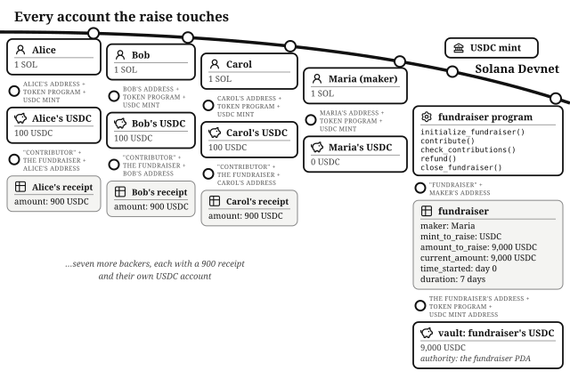
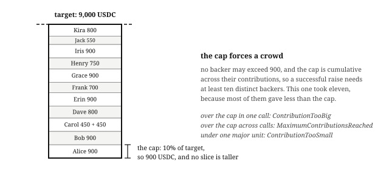

# Chapter 12: Token Fundraiser

Maria has designed a compact commercial espresso machine, and the factory quoted 9,000 USDC for the first production run. The cost is indivisible: the injection-mold tooling has to be cut whole, so 6,000 USDC buys not two-thirds of a run but nothing at all. She could collect preorder promises by hand and hope enough of them are real; or she could put one rule onchain: **everyone's money comes back unless the whole amount shows up**. That rule is this chapter's program: an all-or-nothing fundraiser, the same promise Kickstarter makes, enforced by code instead of by a company.

The program lives at `finance/token-fundraiser` in the companion repository. It is one of the smallest programs in this part of the book: five instruction handlers, two account types, and one vault. Read it as the *Escrow* chapter with the parties rearranged. An escrow locks two strangers' assets until both sides of one deal are ready; a fundraiser locks many strangers' contributions until one shared condition is met. The custody machinery is the same, with one addition: a **deadline**.

## Success and Failure Are Both Written Down in Advance

Two numbers are recorded the moment the fundraiser opens: the **target** and the **duration**. Together they define exactly two endings. If contributions reach the target, Maria takes everything. If the deadline passes first, every contributor takes back exactly what they put in. There is no third outcome, no partial award, and no moment where anyone has to trust Maria with money she has not yet earned: until the target is hit, her claim handler refuses to run.

The two exits are **mutually exclusive by construction**: the claim requires the total to have reached the target, the refund requires it not to have, and the same comparison decides both. No sequence of calls can unlock both.

## The Account Model: A Fundraiser, Its Vault, and a Receipt per Contributor

The program calls the fundraiser's creator the **maker**: Maria here, and her incentive is straightforward: she gets her production run funded all-or-nothing, because 3,600 USDC of a 9,000 USDC mold is scrap metal. There is no platform operator and no fee in this program; the maker runs their own raise, and the only costs anyone pays are rent deposits on the accounts.

The **fundraiser** account is a PDA with seeds `"fundraiser"` and the maker's address, which means one live fundraiser per maker; a second `initialize_fundraiser()` from the same key finds the account already in existence and fails. Its struct, `Fundraiser`, is the terms sheet:

- `maker` and `mint_to_raise`: who is raising, and in what token, USDC here.[^any-mint]
- `amount_to_raise`: the target, 9,000 USDC in minor units. `initialize_fundraiser()` rejects a target below three major units with `InvalidAmount`, so a dust-sized raise cannot exist.
- `current_amount`: the running total the program itself has counted, which is deliberately not the same number as the vault's balance.
- `time_started` and `duration`: the clock's Unix timestamp at creation, and the window length in days. These two fields *are* the deadline.

The **vault** is an associated token account whose authority is the fundraiser PDA, the arrangement the escrow used: tokens sit in an account only the program can sign for.

Each backer gets a **contributor** account, a PDA with seeds `"contributor"`, the fundraiser, and their own address, holding a single number: `amount`, their cumulative contribution. It is a receipt the program writes for itself, and `contribute()` creates it only when it does not exist yet, so a backer's first contribution opens the receipt, every later one adds to it, and it is closed when its purpose is served.

## The Maker Starts the Fundraiser

Maria calls `initialize_fundraiser()` with a target of 9,000 USDC and a duration of 7 days, and this is the last decision she gets to make. Nothing in the program lets her extend the deadline, raise or lower the target, or touch the vault before the target is met. A crowdfunding platform can, and occasionally does, change campaign rules mid-campaign. Here the terms cannot change, because no handler exists to change them.

The handler stamps `time_started` from the cluster clock and stores the duration. Both later handlers reconstruct the deadline the same way: elapsed days are `(now − time_started) / 86,400`, integer division, floored, using the constant `SECONDS_TO_DAYS`. The *Time* chapter's warning applies: with day-granularity math, the window ends at the first tick of day seven, not at some intuitive "end of the seventh day". `contribute()` requires the floored day count to be *less than* the duration; `refund()` requires it to be *at least* the duration. The same expression, compared both ways, so there is no gap and no overlap between "you may still contribute" and "you may now refund": at the moment the elapsed-day count reaches 7, contributions turn off and refunds turn on, atomically, by arithmetic.

## Nobody May Carry More Than a Tenth of the Raise

Eleven backers fund this raise, each starting with the standard wallet of one SOL and 1,000 USDC, and each with their own reason. Alice runs three cafes and wants Maria's machine on her counters. Bob distributes restaurant equipment and wants a new product line to carry. Carol is an espresso enthusiast who wants one at home badly enough to help it exist. None of them will trust Maria, or each other, with a refund promise. They will trust a program that gives Maria no way to redirect the vault to herself, and whose deployed code is verified to match its published source.

Maria is not trying to find one patron; she is trying to prove there is a market for the machine, and a raise that only closes with broad participation is evidence money alone cannot fake. So the program caps what any one backer may carry at a tenth of the target, and the arithmetic follows: **a successful raise needs at least ten distinct contributors**. The cap also makes the obvious manipulation harder: a single large backer filling the raise in one transaction to make demand look broad now needs ten wallets and still shows up as ten receipts on the fundraiser.

Alice tries to contribute her entire 1,000 USDC. The program refuses with `ContributionTooBig`. Her limit, computed by `calculate_max_contribution()`, is 10% of the target: 900 USDC. The constants behind it, `MAX_CONTRIBUTION_PERCENTAGE` over `PERCENTAGE_SCALER`, read 10/100, and the multiply runs in u128 before one floor division, multiply before divide, as in every other chapter.

The cap is not just per call. Carol contributes 450 USDC, then comes back the next day with 450 more, and her contributor account's running total lands exactly on the 900 cap; a third contribution would fail with `MaximumContributionsReached`, because the check runs against her *cumulative* total, not the transaction's amount. And at the bottom end, anything under one major unit rejects with `ContributionTooSmall`, so nobody spams the raise with dust.

So the money arrives like this: Alice 900, Bob 900, Carol 450 and 450, and eight more backers between 550 and 900 apiece. Ten is the floor, not the usual case: it takes eleven here because most of them stopped short of the cap. Each `contribute()` moves tokens from the contributor's own token account into the vault (the contributor signs; inbound transfers never need PDA signatures), bumps their receipt, and adds to `current_amount`. Total: exactly 9,000 USDC.

## The Counter Is the Truth; the Vault Is Just Custody

The claim handler's one gate compares the target against `current_amount`, the program's own count of accepted contributions, and **never against the vault's token balance**. The distinction matters because anyone can transfer tokens to any token account on Solana, no permission required. If the check read the vault balance, Maria could top her own vault up with 5,400 USDC on day six, "reach" the target, and walk off with 3,600 USDC of contributions the target was meant to protect. Because the gate reads the counter, that transfer changes nothing: the test `test_check_contributions_ignores_direct_vault_donations` mints the full target straight into the vault and then watches the claim fail anyway.

The same rule protects the *Constant-Product AMM* chapter's pool pricing, and it applies to every gate: **balances are custody, state is truth**. A gate that unlocks money by reading a balance someone else can inflate can be opened by anyone.

## The Target Is Met: The Maker Claims, and Everything Closes

`check_contributions()` is the maker's claim. Maria signs, the PDA seeds re-derive her fundraiser, and the counter passes the `TargetNotMet` gate. Three things then happen in one transaction: the vault's entire balance transfers to Maria's token account (signed by the fundraiser PDA), the vault closes, and the fundraiser account closes too, returning both rent deposits to her. The fundraiser is not marked finished; its account is gone, so a second claim has nothing to read, and double-claiming is impossible without any flag to check. The test `test_check_contributions_success_pays_maker_and_closes_vault` asserts all three effects.

One problem survives success, and you will meet it in your own designs: the eleven contributor receipts. Their only closing path is `refund()`, and after the claim the fundraiser account a refund must read no longer exists, so each backer's receipt rent (about a thousandth of a SOL) is stuck in an account that can never close. The fix is one more handler that closes a receipt without paying anything once the fundraiser is gone. The program omits it, and the omission is the kind to look for in your own programs: *for every account your program creates, name the handler that eventually closes it.*

## The Target Is Missed: Everyone Leaves With Exactly What They Brought

Now take the other ending. Day seven arrives with only 3,600 USDC in the counter. Nothing announces the failure. The deadline arithmetic flips which handler works. Alice calls `refund()`. The handler checks the deadline has passed (`FundraiserNotEnded` otherwise) and the target was missed (`TargetMet` otherwise). It then reads her receipt's `amount`, subtracts it from `current_amount`, zeroes the receipt, transfers exactly that amount from the vault back to her token account with the PDA's signature, and closes the receipt to return her rent.

The order inside that handler is checks-effects-interactions: the receipt is zeroed and the counter decremented *before* the token transfer. The account close then makes a second refund impossible, because the receipt a second refund would read no longer exists. It is the same close-the-account-to-prevent-double-claims mechanic the escrow used to retire its offers, and it appears wherever money exits in this book.

Refunds are per-contributor and pull-based: each backer collects their own, whenever they like, with no deadline. The contributors are left exactly whole; the all-or-nothing promise was kept by the cheapest mechanism on the chain: an integer comparison.

One exit remains. The fundraiser PDA is derived from `"fundraiser"` and Maria's address alone, so while the failed fundraiser's account exists, Maria can never open another raise from that wallet. Once every contribution has been refunded, she calls `close_fundraiser()`. It checks the deadline has passed, the target was missed, and the counter is back to zero (`RefundsOutstanding` otherwise, so no refund can ever be stranded). It then sweeps any stray direct donations in the vault to her token account, and closes both the vault and the fundraiser, returning her rent. Nothing of the failed raise remains onchain, and Maria can try again next quarter with a smaller target. Every account this program creates has a named closer on the failure path.

## The Math: Three Constants and a Floor

The program's financial arithmetic is four expressions:

- **The cap**: `amount_to_raise × 10 / 100`, in u128, floored.
- **The minimum target**: `3 × 10^decimals` (`MIN_AMOUNT_TO_RAISE`).
- **The minimum contribution**: `10^decimals`.
- **The deadline**: `(now − time_started) / 86,400`, floored.

Every addition and subtraction on `current_amount` and the receipts is checked and maps overflow to `MathOverflow`. No rates, no pro-rata, no prices: refunds pay recorded amounts back verbatim, so, like the escrow, this program never has to *compute* what people are owed.

## The Invariants: The Counter Balances Like a Ledger

- `current_amount` equals the sum of all live contributor receipts, at every moment: contributions add to both together, refunds subtract from both together.
- Tokens that entered through `contribute()` equal `current_amount` plus tokens already refunded; the vault can only exceed that by direct donations, which no check ever reads.
- No contributor's receipt ever exceeds 10% of the target.
- The claim and refund gates read the same comparison with opposite signs, so at most one exit is ever open.
- Money leaves the vault only through those two exits, both signed by the fundraiser PDA, one gated on the maker's signature and the counter, the other gated on the contributor's signature, the deadline, and their own receipt.

## The Failure Modes: One Gate per Attack

- **Claiming early or after a miss** fails on the counter: `TargetNotMet`.
- **Refunding early or after a win** fails on the deadline or the counter: `FundraiserNotEnded`, `TargetMet` (checked by `test_refund_before_deadline_fails` and `test_refund_when_target_met_fails`).
- **Contributing after the deadline** fails with `FundraiserEnded` (checked by `test_contribute_after_deadline_fails`).
- **Capture by one large backer** fails on the cumulative cap: `ContributionTooBig` per call, `MaximumContributionsReached` across calls (checked by `test_contribute_above_cap_fails` and `test_cumulative_contributions_above_cap_fail`).
- **Inflating the vault directly** moves tokens but never moves the counter, so it unlocks nothing.
- **Double refunds** fail because the receipt account is gone.
- **Dust contributions** fail on the one-major-unit minimum: `ContributionTooSmall`.
- **Closing the fundraiser early or with money inside** fails on the close gates: `FundraiserNotEnded` before the deadline, `TargetMet` after a win, and `RefundsOutstanding` while any contribution remains unrefunded.

## Testing Considerations

The suite warps the clock with a helper that advances whole days, and asserts balances after every move. Its anchors are the paired lifecycle tests: `test_check_contributions_success_pays_maker_and_closes_vault` funds the raise with ten contributors at the cap and watches the claim, `test_refund_after_deadline_target_not_met_succeeds` follows the losing timeline to a clean refund, and `test_close_fundraiser_after_failed_raise_allows_a_new_raise` closes the failed fundraiser and proves the same wallet can raise again. Around them, one test per gate. The one to copy into every vault program you write is the donation test: mint tokens straight into your vault outside your own handlers, then assert that nothing unlocks (`test_check_contributions_ignores_direct_vault_donations` on the claim; `test_close_fundraiser_sweeps_direct_donations_to_maker` proves close is where strays finally drain).

## What You Learnt from Building the Token Fundraiser

Kickstarter's all-or-nothing promise is a company policy: the platform holds the pledges, takes its cut, and can change campaign rules mid-campaign. This chapter made the same promise a property of code: no platform, no fee, and terms that cannot change because no handler exists to change them.

The fundraiser added five concepts on top of the escrow's:

- **A deadline that flips which exit is open.** One floored day-count expression, compared both ways, so contributions and refunds can never both be legal at once.
- **The counter is the truth; the vault is just custody.** A gate that unlocks money must read state the program itself wrote, never a token balance anyone can inflate by donation.
- **A receipt PDA per participant**, created on first use, topped up on repeats, and closed when its purpose is served, so double refunds fail once the account is gone.
- **Cumulative caps.** Per-participant limits checked against running totals, which make broad participation a requirement rather than a hope.
- **Name the closer for every account.** The stranded contributor receipts after a successful raise are the omission in this chapter, and the habit that catches it.

In the *Betting Market* chapter we will build a pool that many people pay into, where the exit is decided by something the program cannot see: which outcome happened in the real world. Someone has to tell the program the answer, and you will see how the program limits what that person can do with the money while trusting them for the result.

[^any-mint]: Any mint works, Token Extensions mints included, because every account is declared through the token interface.
