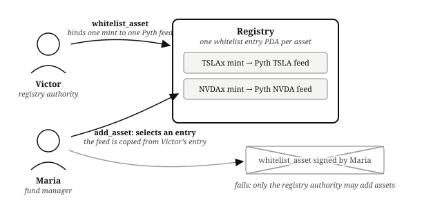
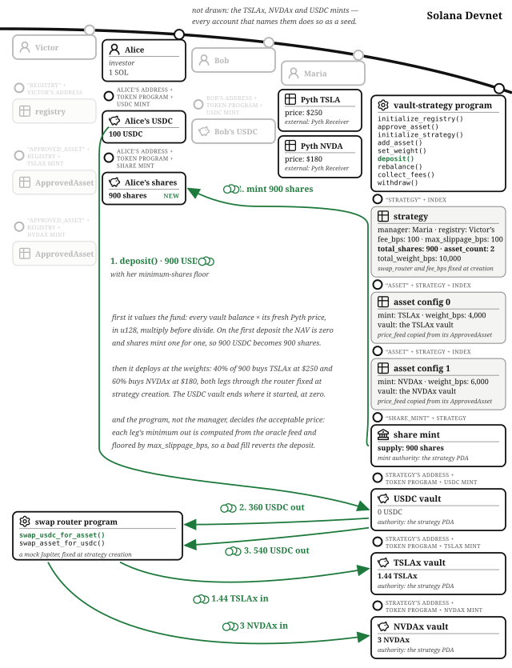
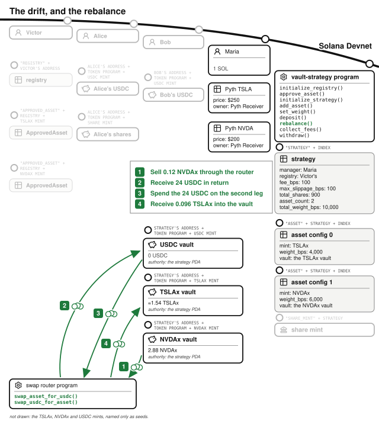
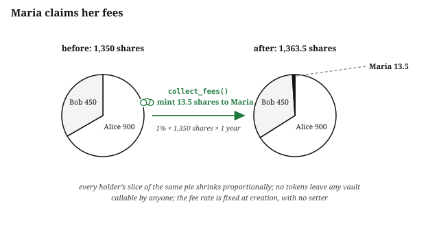
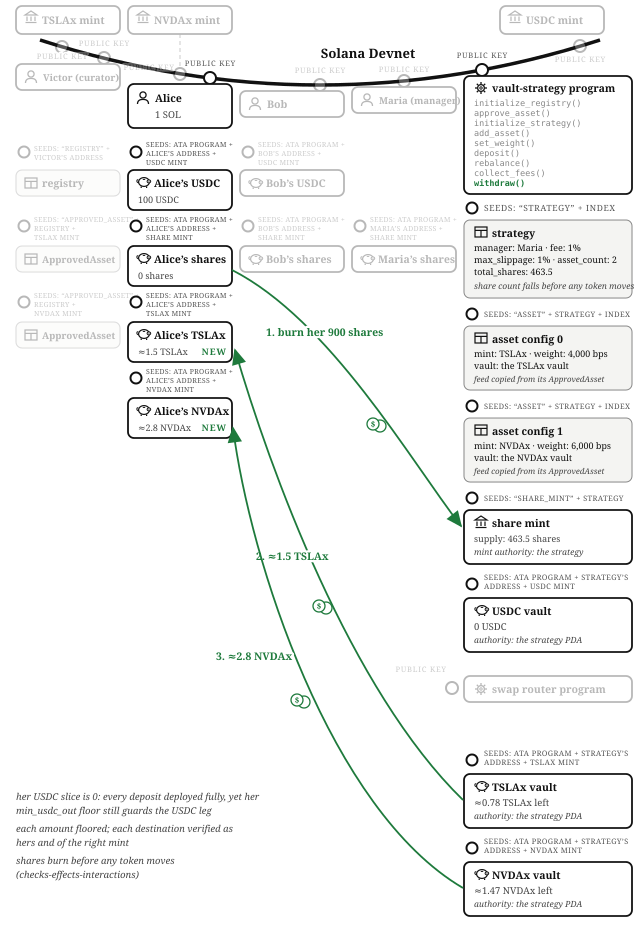

# The Vault Strategy

A **vault strategy** is the onchain equivalent of an index fund. A list of approved assets, a fund manager who picks the allocation, investors who deposit and receive shares, a management fee for the manager's expertise. On Solana you know the genre from Symmetry and Kamino. The program lives at `finance/vault-strategy` in the companion repository, and its story trades stocks: TSLAx and NVDAx, quoted in USDC.

This is the chapter where the original promise of onchain programs pays off most visibly. In a traditional fund, "the manager cannot run off with client money" is enforced by custodians, auditors, and courts. Here it is enforced by the program: **the manager can change the allocation and earn the fee, and can do nothing else.** No instruction in the program moves a vault's tokens to the manager. That sentence is the chapter.

One vocabulary note before the story, because the word is overloaded. On Solana, a **vault** is a token account owned by a program; that is how this book has used it in every chapter. Some platforms call the whole fund product "a vault." This book does not: here **the product is the strategy, and the token accounts are the vaults.**

## The Cast: A Gatekeeper, a Manager, and Two Investors

- **Victor runs the registry.** He is not a fund manager; he is the gatekeeper who decides which assets managers may invest in at all, and which price feed is the truth for each. He operates the platform the strategies live on, and his business is worth exactly as much as its reputation for funds not blowing up: vetting feeds is not charity, it is his product.
- **Maria is the fund manager.** She creates the strategy, sets the weights, rebalances, and earns the fee.
- **Alice and Bob invest.** They deposit USDC, hold shares, and eventually withdraw.

The separation between Victor and Maria is the program's first security decision, so it comes first.

## Victor's Registry: What Managers May Touch at All

Victor runs `initialize_registry` once, then `whitelist_asset` for each approved asset, binding the asset's mint to its official Pyth price feed. The registry's own doc comment states the threat it exists for: the authority vets which assets and which feeds are safe, so a manager cannot list a token they minted themselves, and cannot pair a real asset with a price feed they control. When Maria later adds an asset to her strategy, the feed address is copied out of Victor's whitelist entry; the manager never supplies a price feed, ever.

The list is stocks, bonds, whatever investors actually want. It is not the manager's own personal token, and structurally cannot be: adding a non-whitelisted asset fails because the whitelist entry PDA for it simply does not exist (pinned by `test_add_asset_rejects_non_whitelisted`).

## The Account Model: A Strategy, Its Vaults per Asset, and a Share Mint

The **strategy** PDA (seeds: `"strategy"`, an index) records the `manager`, the `registry` it is bound to, its `fee_bps` and `max_slippage_bps`, the `swap_router` it is allowed to trade through, its running `total_shares` and `total_weight_bps`, and `last_fee_accrual_timestamp` for the fee clock. The **share mint** is a PDA with the strategy as mint authority: shares only come into existence when the program's own math says so.

Each basket asset gets an **asset config** PDA (seeds: `"asset"`, the strategy, an index byte) recording its mint, its feed (copied from Victor's entry), its weight in basis points, and its **vault**, a strategy-owned token account. The strategy holds up to `MAX_ASSETS` (16), and the cap is not about storage: deposit must reference every asset's accounts at once (five per asset), so a full basket runs to 94 accounts, inside Solana's account-lock limit but far past a legacy transaction's size, meaning clients of big baskets send v0 transactions with an address lookup table. Data model decisions are transaction-format decisions.

The indexes matter more than they look: every handler that computes the fund's value walks indexes 0 through `asset_count` and refuses to run if any account is missing (`IncompleteAssetAccounts`), which makes it structurally impossible to omit an asset and understate the fund's value. A retired asset (weight set to zero) keeps its index forever rather than being reused, so the contiguous range the valuation loop depends on stays intact.

## Maria Creates the Strategy and Sets the Weights

Maria runs `initialize_strategy` with index 0, her fee of 100 basis points (1%), a `max_slippage_bps` of 100, and the swap router the strategy will trade through. Both the fee and the slippage tolerance are capped at 10%: the fee is collected by dilution (below), so an uncapped fee would let a manager drain the fund *by configuration*, and the cap is the program refusing to make that a parameter.

She then runs `add_asset` twice: TSLAx at 4,000 basis points, NVDAx at 6,000. Weights may not overflow 100% (`WeightOverflow`), and here is the rule that shapes the whole design: **nobody can deposit until the weights sum to exactly 100%** (`StrategyNotFullyAllocated`). A deposit into this strategy is always fully invested, immediately, at target weights. There is no idle-cash mode, no "the manager will get to it." Maria can change weights later with `set_weight`, and only Maria: the manager gate is pinned by `test_set_weight_rejects_non_manager`.

## Alice Deposits 900 USDC and the Program Goes Shopping

Alice runs `deposit` with 900 USDC and a `minimum_shares` floor. The handler does three jobs in one transaction, and the order is the security model.

**First it values the fund.** It walks every asset: reads the vault balance, loads the Pyth price (rejecting a feed that is not the one recorded in the asset config, a price that is not positive, or a price older than 60 seconds), and accumulates value in u128: amount × price ÷ 10^8, multiply before divide. Plus the USDC vault. That total is the **net asset value**, the NAV. On the fund's first deposit the NAV is zero and shares are minted one-to-one: Alice's 900 USDC becomes 900 shares.

**Then it deploys the money at the weights.** 40% of 900, $360, buys TSLAx at $250: 1.44 TSLAx into the TSLAx vault. 60%, $540, buys NVDAx at $180: exactly 3 NVDAx. The swaps run through the router fixed at strategy creation (the example ships a mock router standing in for Jupiter; a router that is not the configured one is rejected, pinned by `test_deposit_rejects_unregistered_router`), and the strategy PDA signs.

**And the program, not the manager, decides the acceptable price.** For each leg, the handler computes the expected output *from the oracle price* and floors it by the strategy's slippage tolerance: the swap may return at most 1% less than the feed says it should, or the whole deposit reverts. A manager cannot wave a bad fill through, because the minimum is never theirs to supply. This is the single most transferable idea in the chapter: **when an untrusted party routes the trade, the acceptable outcome must be computed from a price source they do not control.**

## The Market Moves and Maria Rebalances

NVDAx climbs from $180 to $200. The fund is now worth $960, so each share is worth about $1.07, and nothing needs to happen for that to be true: the share price *is* NAV divided by supply, recomputed from feeds every time it matters.

But the weights have drifted: NVDAx's gain pushed it to 62.5% of the fund against a 60% target. This is Maria's actual job. She runs `rebalance`, which sells the over-weighted asset for USDC and buys the under-weighted one: 0.12 NVDAx sold for $24, $24 of TSLAx bought, both legs through the fixed router, both legs floored by oracle-anchored minimums exactly like deposits. The weights return to 40/60. Note what rebalancing is not: it is not the manager touching money. Tokens moved between strategy-owned vaults through the approved router at oracle-checked prices, and none of them passed anywhere near Maria.

## Bob Buys In at the New Price

Bob deposits 480 USDC. He is not early, and the share math prices that in: shares = deposit × total shares ÷ NAV, floored. With 900 shares outstanding against a $960 NAV, his 480 buys 450 shares, not 480. Alice's early position is not diluted by his arrival, and the test suite pins the fairness directly (`test_deposit_fair_pricing`). His money deploys 40/60 at current prices, same as hers, same slippage discipline.

## Maria's Fee Arrives by Dilution

Traditional funds sell assets to pay the management fee. This program does what large onchain fund products do instead: it **mints new shares to the manager**, so the fee is paid by diluting every holder proportionally, with no asset ever sold. `collect_fees` computes shares owed as total shares × fee rate × elapsed time over a year, from the strategy's fee clock: at 1% with 1,350 shares outstanding and a year elapsed, 13.5 new shares to Maria. The instruction is deliberately callable by anyone (the fee accrues by time, not by the manager's diligence in claiming it), and the fee rate itself has no setter: it is fixed at strategy creation, so the deal investors joined under cannot be quietly worsened. The escrow chapter snapshotted a fee per offer; the same principle, at fund scale.

## Alice Withdraws In Kind

Alice takes profit with `withdraw`, burning her 900 shares. The program does not sell anything to pay her: it hands her **her proportional slice of every vault, in kind**: her share of the USDC vault, of the TSLAx vault (about 1.5), of the NVDAx vault (about 2.8), each amount floored, each destination account verified to be hers and of the right mint (`InvalidRecipient`). The share count is reduced before any token moves (checks-effects-interactions, as in every chapter), and her `min_usdc_out` floor protects the USDC leg (`test_withdraw_rejects_slippage`).

She entered with $900, rode NVIDIA up, paid Maria 1% by dilution, and left with about $950 of assets. Bob still holds 450 shares, unrealized. Maria holds 13.5 shares, about $14, for running the book. And Victor took no fee on any of it; what he earned is the only thing his platform sells, a track record of funds that cannot be rugged.

## The Math: One Valuation Loop, Floors Toward the Fund

Every formula in the program is a proportion, and they all lean the same way. Shares minted: deposit × supply ÷ NAV, floored. Withdrawal legs: vault balance × shares ÷ supply, floored per asset. Fee shares: supply × rate × time over a year, floored. Deployment per leg: deposit × weight ÷ 10,000, floored. All u128 intermediates, all multiply-before-divide, remainders resting with the fund rather than the transactor. The one multiplication that is not a proportion is the valuation itself, amount × price at the feed's 10^8 precision, and the whole chapter's integrity reduces to that line being run over *every* asset, *every* time, with a *fresh* price.

## The Invariants: Custody Never Moves

- From first deposit to last withdrawal, assets live only in strategy-owned vaults. No instruction handler transfers vault tokens to the manager; the fee path mints shares and touches no vault.
- Deposits are accepted only at 100% allocation, and every deposit is fully deployed in the same transaction.
- NAV computations include every asset index or refuse to run.
- Share supply changes only through deposit, withdrawal, and the time-based fee, and `total_shares` moves before the corresponding CPIs.
- Every swap leg, deposit or rebalance, clears at no worse than the oracle price minus the configured tolerance, through the router fixed at creation.

## The Failure Modes: The Manager, the Feed, and the First Deposit

- **The manager is the threat model**, and the program treats her as such: assets only from Victor's list, feeds only from Victor's entries, swaps only through the fixed router, minimums only from the oracle, fee capped and immutable, custody never hers. What remains to a careless manager is churn: pointless rebalancing that pays market slippage. That hurts depositors, but it does not enrich the manager, which is the design's honest boundary. Aligning *that* incentive is what the fee-on-assets structure is for.
- **The feed is load-bearing.** A stale price fails closed (`StalePriceFeed`, 60-second window), a non-positive price fails (`NegativePrice`), a substituted feed account fails (`InvalidPriceFeed`). What this example does not check is the feed's confidence interval; a production strategy should, and the offchain-truth section of Financial Programming Concepts in Solana explains what confidence means and why "fresh but uncertain" is its own failure mode.
- **The first deposit has no dead-shares guard**, and the chapter says so plainly: the empty-fund deposit mints one-to-one, with no locked minimum like the AMM's `MINIMUM_LIQUIDITY`. The design leans on two mitigations: deposits only open at full allocation, and every deposit deploys immediately, so there is no idle pot to donate into and skew. That narrows the classic inflation attack without formally closing it; a production strategy should add virtual shares or a dead-shares floor, and the empty-pool section of Financial Programming Concepts in Solana shows exactly how. Naming the gap is the chapter's last lesson: knowing which defense your program relies on, and which it lacks, is the difference between a design decision and an accident.
- **Partial baskets are refused**, on deposit, withdrawal, and valuation alike (`IncompleteAssetAccounts`): an attacker who could get the fund valued without its best-performing vault could buy shares at a discount.

## The Test That Catches the Bug

The suite (LiteSVM plus solana_kite, with hand-built Pyth price-update accounts injected so prices are deterministic) covers the full lifecycle end to end (`test_full_lifecycle`) and then pins each wall separately: under-allocated strategies refuse deposits, non-whitelisted assets refuse listing, weight overflows refuse, the 17th asset refuses, non-managers cannot set weights, unregistered routers refuse, slippage floors reject on deposit and withdrawal, incomplete account lists refuse, and later depositors pay fair NAV. The pattern to copy is the price injection: valuation code cannot be honestly tested with prices you cannot control, so the harness makes the feed a fixture and then moves it deliberately.

## What the Program Replaced

An index fund needs a custodian, a compliance officer, a fee schedule in a prospectus, and an auditor checking that the manager's trades match the mandate. This chapter needed a registry PDA, a weight sum that must hit 10,000, a fee constant with no setter, and a slippage floor computed from a feed the manager cannot choose. The perpetual futures chapter closes the book by combining everything: vaults, shares, oracles, funding, margin, and liquidation, in the one program that uses all of it at once.
