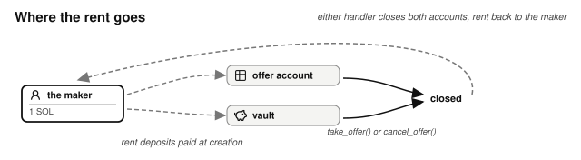

# Chapter 6: State Machines

Every financial program shares one shape: a state machine.

## Financial Software Is a State Machine

The products in this book each move through a few states:

- An escrow offer is open, then taken or canceled.
- A bet is placed, then paid, refunded, or closed.
- An order is open, partially filled, filled, or canceled.
- A loan is healthy or unhealthy; repaying and liquidating both move it back toward healthy.

Before writing any handler, draw this machine: name the states, name every legal transition, and check that nothing is missing.

Then design the handlers from it:

- **Give each transition its own instruction handler.** `take_offer()` moves an offer from open to taken and performs no second transition. Handlers that perform two transitions, or half of one, create bugs.
- **Make the state explicit.** Use a `status` enum on the account or, often better, whether the account exists: the betting market's `Bet` account closes when the position ends, so "already claimed" means the account is gone. Existence is better where the state is terminal, because a closed account cannot be claimed twice and holds no rent. A state worked out from other fields is worse than either. The *Betting Market* chapter shows why its event records a Draft status instead of reading one off an empty pool.
- **Check state, not just signers.** Betting on a settled event, canceling a filled order, and liquidating a healthy loan must fail because the *state* forbids them, with an error that names the rule.
- **Every participant must be able to get their assets out of every state.** If an escrow had no cancel handler, it would strand the maker's tokens if nobody took the offer. If a betting market had no cancel-and-refund path, it would strand every stake if the event was called off. For each state, ask: how does each party get their assets out from here? If any state has no answer, the program strands funds.
- **Where a path ends, make its last handler close the vault and the state accounts it used, and return each account's rent to whoever paid it.** The escrow's `take_offer()` and `cancel_offer()` both do. A pool that stays open for new users has no last handler.

## Whoever Opens an Account Pays Its Rent, and Gets It Back

Whoever wants the account pays its deposit. The maker funds the offer account and the vault, and the taker funds their own token account if it does not exist yet. Closing the account refunds the deposit, as the *Core Building Blocks of Solana* chapter explains. An account left open keeps the payer's rent deposit in it. So for every account your program creates, name the handler that closes it. The escrow program you will build in this book has tests that assert the maker gets back exactly the lamports they paid, and yours should too.

## What You Learnt

- Every financial product is a small state machine. Draw it before writing any handler, name every state and transition, and make sure every participant can get their assets out of every state.
- Give each transition its own handler, and check the account's state, not only who signed. Where a path ends, make its last handler close the vault and the state accounts.
- Whoever opens an account pays its rent deposit and gets it back when the account closes. Name the handler that closes every account your program creates.
