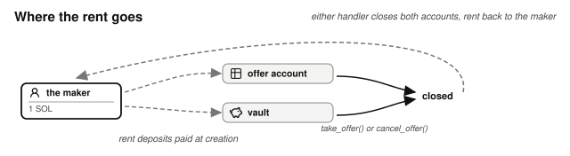

# Chapter 6: State Machines

This chapter covers the shape every financial program shares: a state machine, in which every participant must be able to get their assets out of every state, and every account returns its rent deposit when it closes.

## Financial Software Is a State Machine

Every financial product in this book is a state machine.

- An escrow offer is open, then taken or canceled.
- A bet is placed, then paid, refunded, or closed.
- An order is open, partially filled, filled, or canceled.
- A loan is healthy, unhealthy, repaid, or liquidated.

Before writing any handler, draw this machine: name the states, name every legal transition, and check that nothing is missing.

Most programs are conceptually simple, with design rules that come straight from the state drawing:

- **Give each transition its own instruction handler.** `take_offer()` moves an offer from open to taken and does nothing else. Handlers that perform two transitions, or half of one, create bugs.
- **Make the state explicit.** A `status` enum on the account, or, often better, the account's own existence: the betting market's `Bet` account closes when the position ends, so "already claimed" means the account is gone. Using existence rather than a status is better since the state is recorded in one place rather than two. A state inferred from other fields is worse than either. The betting market could treat an empty pool as "still being set up", but then anyone's first bet would end the setup, so it records a Draft status that only the admin can change.
- **Check state, not just signers.** Betting on a settled event, canceling a filled order, and liquidating a healthy loan must fail because the *state* forbids them, with an error that names the rule.
- **Every participant must be able to get their assets out of every state.** Walking the states with this rule turns up the handler nobody wrote. If an escrow had no cancel handler, it would strand the maker's tokens if nobody took the offer. If a betting market had no cancel-and-refund path, it would strand every stake if the event was called off. Walk each state and ask: how do each party's assets leave from here? If any state has no answer, the program strands funds, and correct arithmetic will not fix that.
- **Ensure the handler that pays out the last of the vault's tokens also closes everything.** It should empty the vault, close the vault and the state accounts, and return each account's rent deposit to whoever paid it.

## Whoever Opens an Account Pays Its Rent, and Gets It Back

We previously mentioned that the handler that pays out the last of the vault's tokens also closes the accounts and returns each account's rent deposit to whoever paid it. That raises a question for a program that creates accounts on its users' behalf: who should pay the deposit in the first place?

- Whoever wants the account pays for it. The maker funds their own offer account and the vault to store the offered tokens; the taker funds their own token account (if it did not exist already) to receive what the maker offered. Rent burdens follow the party who chose to create the state.

- The deposit comes back to whoever paid it when the account is closed (for example after a take, a cancel, a claim, or a refund). A program that leaves accounts unclosed when no longer needed leaves other people's lamports locked in them, so for every account your program creates, name the handler that eventually closes it. The escrow program you will build in this book has tests asserting that the maker gets back exactly the lamports they paid, and yours should too.

## What You Learnt

- Every financial product is a small state machine: draw it before writing any handler, name every state and transition, and make sure every participant is able to get their assets out of every state.
- Give each transition its own handler, and check the account's state, not only who signed. Ensure the handler that pays out the last of the vault's tokens also closes the vault and the state accounts, and returns each rent deposit to whoever paid it.
