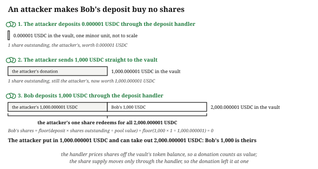

# Chapter 9: The Adversary

The same half-dozen kinds of attack have drained onchain markets for a decade, on every chain and in every framework.

## Anyone Can Take the Tokens a Mistake Exposes

Financial software on a public chain faces a harsher threat model than most software. Every instruction handler can be called by anyone, under any name, for a fraction of a cent. Your compiled program is public, and often your source is too. A mispriced trade, a leaked minor unit, or an unchecked account lets tokens out of a vault, and they go to whoever finds the mistake first.

Three consequences follow:

- **Attacks are automated.** A flaw worth a cent per call is worth $10,000 to a script that calls it a million times. Judge every leak by what it pays when called as fast as the network allows.
- **Attackers see your transaction before it lands.** Anyone can try to get their transaction ordered before or after yours. A pending swap can be sandwiched: the attacker buys first to push the price against it, then sells after it. Any other profitable pending action can be copied and sent ahead of the original. The profit taken this way is called MEV, maximal extractable value. Ordering around a pending transaction is why every trade in this book carries a caller-side bound: a minimum output, or a maximum slippage (how far the price may move against them). The program cannot know the state it will run against; it can only refuse to run against a state worse than the user accepted.
- **Attacks start at the extremes.** Zero amounts, empty pools, dust quantities, and exact thresholds are where comparisons flip and remainders round. Every attack below starts from one of them.

## Validation: Signers, Owners, and the Confused Deputy

Cashio and Wormhole, the two War Stories below, both came from a program trusting an account it should have checked. The caller chooses which accounts an instruction runs against, so each account is only a claim until the program checks it against something it already trusts: a signature, an owner, a stored address, or a derivation.

There are four checks:

- Is the account that authorizes this action a **signer**?
- Is each account **owned** by the program that should own it, so its data can be believed?
- Does each account **match the one recorded** when the relationship was created? This is the **stored-address check**: the vault recorded on the market, the maker recorded on the offer.[^stored-address-per-framework]
- Is each PDA **derived** from the seeds it claims, with its stored bump?

Anchor's account constraints perform all four. The program chapters use them on most accounts, and check the rest by hand in the handler body, as the managed fund does for the accounts it takes per asset.

Any account that holds one user's position, an order, a loan, a bet, needs both the signer check and the stored-address check. A signature proves who is asking, and an order owned by the program proves the order exists, but neither proves the order is the signer's. A program that checks only the signature and the owner lets any user cancel anyone's order. So a position records its owner when it is created, and every handler that acts on it requires that recorded owner to be the signer. Deriving the position's address from seeds that include the signer's public key does the same: a signer's public key leads only to their own accounts. The order book's `cancel_order()` uses both. It derives the trader's account from the signer's public key, and rejects with `Unauthorized` unless the order's recorded owner is the signer; `cancel_order_rejects_non_owner` tests it.

A missing check lets the attacker **substitute** an account: pass a different account from the one the program expects. The classic form was named in 1988 as the **confused deputy**, a program with authority that is tricked into using it for someone else.[^confused-deputy] Your program is the deputy. It can sign for its vaults, and the attacker wants it to sign a transfer while reading the wrong accounts. The attacker passes their own account where the payment destination belongs. Or they pass a data account they created themselves, with the same layout as the real one and numbers of their choosing. Or they pass the fee vault where the user vault belongs: the two hold the same token under the same authority, and only a stored-address check tells them apart. That is why the order book checks every vault it is handed against the addresses its market recorded.

> **War Story: Cashio, $48M, 2022.** Cashio's stablecoin was minted against deposited collateral. The mint instruction handler validated its accounts as a chain, trusting each account because the one before it named it. One link, the collateral token's mint, was never checked against anything the program already knew. An attacker created a fake account for every link, ending the chain in a worthless token, and minted two billion CASH against collateral of no value. They kept about $48M after refunding the accounts under $100,000.[^cashio] Every chain of accounts has to start from an account the program derived or recorded itself.

> **War Story: Wormhole, $326M, 2022.** The Wormhole bridge accepted a "verify signatures" result account as proof that its guardians had approved a message. One handler created those accounts, and it was meant to be the only source. To check that the Instructions sysvar it was given was the real one, that handler called a deprecated function that never checked the account's address. The attacker passed a fake sysvar, got a verification account created from it, and presented that account as proof. They minted 120,000 wrapped ETH backed by nothing.[^wormhole]

## The Empty Pool: Inflation and Donation Attacks

Every pool that issues shares (managed fund, liquidity-provider pool, lending reserve) prices a share as the pool's value divided by the number of shares. That formula breaks down at the start, when both numbers are tiny, and the **inflation attack** exploits it, in three steps.

Take a pool that prices its shares from the token balance in its vault. The first deposit into an empty pool mints one share per minor unit. Every later deposit mints shares in proportion to the value it adds, so a deposit that doubles the pool's value doubles the share supply:

shares minted = floor(deposit × shares outstanding ÷ pool value)

The pool's value here is the USDC in its vault. USDC has six decimals, so a minor unit is a millionth of a dollar. Bob is about to make the first real deposit into a new pool, 1,000 USDC, and the attacker sees his transaction before it lands.

1. **The attacker deposits one minor unit**, 0.000001 USDC, through the deposit handler. The pool is empty, so the first deposit mints one-to-one: one share, against a vault holding one minor unit.
2. **The attacker donates 1,000 USDC straight to the vault** with an ordinary token transfer. Anyone can transfer tokens to any token account, and the deposit handler never ran, so the share supply is still one. The vault now holds 1,000.000001 USDC, and the one share is priced at all of it.
3. **Bob's deposit lands.** The formula takes his 1,000 USDC deposit, times the one share outstanding, divided by the pool's value of 1,000.000001 USDC: floor(1,000 × 1 ÷ 1,000.000001) = floor(0.999999999) = 0. The handler mints him nothing, moves his 1,000 USDC into the vault, and returns success. The vault holds 2,000.000001 USDC against one share, and that share is the attacker's. They put in 1,000.000001 USDC and can now withdraw 2,000.000001: all of Bob's deposit is theirs.

The attack pays exactly what Bob deposited. A larger deposit loses less, but still loses. Had the first real deposit been 1,500 USDC, from a depositor with more than Bob's 1,000, it would have received floor(1,500 × 1 ÷ 1,000.000001) = floor(1.4999) = 1 share. The two shares would then split 2,500.000001 USDC, and the 1,500 would have become 1,250. The fraction of a share that the floor drops stays in the vault, so it adds to the value of the shares that already exist. The attacker can leave the pool in this state and collect that fraction from every later depositor. Taking a whole deposit needs a donation at least as large as the deposit, so the usual form of the attack is front-running: the attacker sees a deposit pending, sizes the donation to match it, and gets both of their transactions ordered ahead of it.

Bob can protect his own deposit with a minimum-output bound, like the `minimum_shares` argument the *Managed Fund* chapter's deposit handler takes, but that protects only a depositor whose wallet sets it. Four changes to the program stop the attack for every depositor:

- **Lock some shares that no one owns.** On the first deposit, the program adds a fixed number of shares to the supply without minting them to anyone, so the supply never starts at dust. Every formula counts the locked shares in the supply it divides by, so zeroing out Bob's deposit takes a donation of about a hundred times its size, nearly all of which belongs to shares nobody can withdraw. The *Constant-Product AMM* chapter runs the numbers for its `MINIMUM_LIQUIDITY` floor.
- **Add virtual shares and virtual value to the formula.** The program adds a fixed number of shares to the supply and a fixed amount to the pool's value, but only inside the division, so it works normally even when no real shares exist. Say a million virtual shares and one virtual minor unit. The attacker's one-minor-unit deposit now buys a million shares, and the donation is split between their million and the virtual million. Bob's 1,000 USDC buys 1,999,999 shares, which redeem for 999.99975 USDC. The attacker's shares redeem for about 500 USDC, and the other half of the donation belongs to the virtual shares, which nobody can withdraw.
- **Ignore donations.** The program records the pool's size in its own state, as the lending market's `available_liquidity` and the managed fund's recorded holdings do, rather than reading the vault's token balance. Step 2 then changes the vault's balance and nothing the handler reads, so Bob's deposit mints what it should and the donation sits in the vault, lost to the attacker; the *Managed Fund* chapter runs Bob's numbers against its program. A recorded size stops donations only while the attacker has no other way to raise it. The *Perpetual Futures* chapter shows one: a provider who is also the pool's only trader can pay funding into it from their own position. The *Lending and Borrowing* chapter shows another: a lending reserve's size counts the interest its borrowers owe, and a supplier may borrow from their own reserve. One minor unit of interest is enough to start. After that, the fraction each of the attacker's own deposits loses to the floor stays in the pool and raises their share further.
- **Require a large first deposit.** If the first deposit must be at least 100 USDC, the attacker's smallest position is 100,000,000 shares. Rounding Bob's 1,000 USDC down to nothing would then take a share price above 1,000 USDC, a vault holding a hundred billion dollars.

A program needs at least one of these four, chosen on purpose, and has to check that nothing else it allows raises the pool's value the way a donation does. The AMM locks shares, and the managed fund ignores donations. The lending market and the perpetual futures pool do both. Each ignores donations by pricing shares from figures it records rather than its vault's balance. Each also locks shares.

## A True Price Can Still Be a Manipulated Price

The checks in the *Offchain Truth* chapter (provenance, freshness, confidence) reject a price that is fake or stale. This attack gets past all of them. The price is real, fresh, and correctly signed, and it accurately reports a market the attacker has just pushed. Push a thin market's price up for one slot, and every program that reads it acts on it. Lending markets extend credit against collateral that looks more valuable than it is. Exchanges settle at a price nobody could trade at a minute later. Liquidations fire on positions that were healthy one slot before.

> **War Story: Mango Markets, $116M, 2022.** An attacker opened large perpetual positions in Mango's own thinly traded MNGO token. They then bought MNGO on the spot markets the oracle read from, pushing the price the oracle reported from about four cents to fifty-four, more than thirteen-fold, in about half an hour. The oracle reported the pushed price accurately. Mango's program used it to mark the attacker's positions as hugely profitable, and the attacker borrowed $116M of the platform's deposits against that unrealized profit and left.[^mango] The attacker described it as "a highly profitable trading strategy." No signature was forged and no account was substituted.

Programs handle this by making manipulation expensive and slow:

- **Time-weight the price.** A **time-weighted average price** (TWAP) over several minutes forces the attacker to hold the pushed price for that long, paying arbitrageurs the whole time, instead of paying for one slot of it.
- **Act on the confidence interval.** When a thin market is being pushed, its oracle's confidence interval widens. A program that pauses borrowing or tightens limits when that happens takes away the profit.
- **Cap how much can move per window.** A limit on how much can be borrowed or withdrawn in each window forces the attacker to take the vault's tokens over many slots, where people can see it happening and respond.
- **Do not lend more against a token than it would cost to move its market.** If pushing the price costs less than the loan the push unlocks, someone will eventually do it.

## A Rounding Error Repeated Enough Times Drains the Pool

The *Arithmetic of Money* chapter set the rounding rules: what the user receives floors, once, and what the user owes, a debt or a fee, rounds up. This attack targets programs that do not follow them. Each rounding in the attacker's favor is worth less than a cent, so the attack repeats it thousands of times. It works best in an **empty or near-empty market**, where the attacker controls both numbers in the ratio and can choose the divisor that makes flooring give away the most.

> **War Story: the Hundred and Sonne drains, $7.4M and $20M.** Hundred Finance (2023) and Sonne Finance (2024) were both copies of the same lending design on EVM chains, and attackers drained both the same way. The attacker found or created a newly listed, empty market. They made a tiny deposit to mint a few shares, then donated a large sum to skew the exchange rate: the first two steps of the inflation attack. The inflated rate valued those few shares as collateral worth more than everything the other markets held, so the attacker borrowed all of it. Then they redeemed the donation: the floored share count burned one share short, so the donation came back while the debt stayed unpaid. An attacker drained Sonne a year after Hundred's post-mortem was published,[^hundred-sonne] because the code Sonne had copied still carried the flaw that post-mortem described. Copied code has to be kept up to date like any other. Where you can, use the original as a maintained dependency. Where you copy it, track the original project's fixes and security advisories and apply them to your copy.

Fix this by following those rounding rules everywhere, and by writing one kind of test: a **round-trip invariant test**. Deposit then immediately withdraw, or swap in then swap back, at hostile sizes (one minor unit, the whole pool, a prime number), and assert the caller never ends with more than they started with. The lending example's `deposit_redeem_round_trip_creates_no_value` runs the round trip fifty times at one size once interest has moved the exchange rate, and asserts the depositor never ends with more than they started with.

## Ordering and Composability: CPI Trust Boundaries

A transaction can call your program, which can make a **cross-program invocation** (CPI), one program calling another, and that program can call a third. The flash loan in the *Core Building Blocks of Solana* chapter is three instructions in one transaction, and each is a point where code you did not write runs: between your instructions in the same transaction, or inside a CPI your program makes.

Code inside a CPI cannot call back into your program. Solana's runtime refuses to invoke a program that is already on the call stack, unless the program is calling itself directly: if your program calls the token program, and a transfer hook on the mint tries to call your program, the transaction fails with `ReentrancyNotAllowed`. A callee upgraded tomorrow or a hook added to a mint next year meets the same refusal. And if any call fails, the whole transaction is undone, including every change your handler made before it. So the order in which a handler updates its own state and calls other programs does not open an attack. Three things at these boundaries do need care:

- **Validate what a CPI returns and what it was given.** Calling a program does not make the accounts it touched trustworthy. The managed fund computes each swap's minimum output from the oracle, because the router it calls is outside its control.
- **Read again what a CPI changed.** A framework that copies an account into memory when the handler starts keeps that copy through the CPI. After a transfer out of a vault, the copy still shows the old balance, and a check against it passes on a number that is no longer true. The AMM re-reads both vaults after its transfers, before it re-checks K.[^reload-per-framework]
- **Assume the instructions after yours are hostile.** Any invariant your program needs must hold at the end of *your* instruction, not at the end of the transaction, because the instructions after yours belong to someone else.

## Every Role Holder Is Also a User

Most programs in this book give someone a role: an operator who creates a market, a manager who runs a fund, an admin who settles an event. The handlers that need that role's signature are only part of what that person can do. They can also call every handler anyone else can call, from their own wallet or from a new one the program has no way to link to them. A program cannot stop its operator trading in their own market, so design as if they will.

For each role, list what its handlers can change, then ask what that change is worth to someone who also trades, deposits, or bets in the same program. A parameter that is harmless on its own becomes an attack when the person who sets it also holds a position:

- **The perpetual futures operator.** A funding rate the operator could set is worth something to an operator who also trades, so the program fixes it when the pool is created; the *Perpetual Futures* chapter runs the attack and names the test that checks the defense.
- **The managed fund's manager.** A manager who could add any token and price it from any price feed could buy a token they had minted themselves at a price they reported. The fund takes assets only from a list a separate curator approved, and price feeds only from that curator's entries (`test_add_asset_rejects_unapproved`). It swaps only through the router fixed at creation with minimums taken from the oracle, and caps the manager's fee and fixes it at creation (`test_initialize_rejects_excessive_fee`).

Where the role is the one reporting a result, like the betting market's admin settling an event they have bet on, the question is who to trust, which the *Offchain Truth* chapter covers.

## What You Learnt

- Anyone can take the tokens a mistake on a public chain exposes: attacks are automated, anyone can get their transaction ordered around yours, and attacks start at the extremes of a range.
- Verify every supplied account, check that any position a handler acts on belongs to the signer, and start every chain of accounts from an account the program itself derived or recorded.
- Build a defense against the inflation attack into any pool that issues shares: locked shares, virtual shares, a pool size kept in program state, or a large minimum first deposit.
- A true price can still be a manipulated price: time-weight it, act on the confidence interval, cap how much can move per window, and never lend more against a token than it would cost to move its market.
- A rounding error in the user's favor gets repeated until the pool is empty, so write a round-trip invariant test to catch it.
- An invariant holds at the end of your own instruction, not the transaction.
- Every role holder is also a user: list what each role's handlers can change and what that is worth to a trader.

[^confused-deputy]: Norm Hardy named it in "The Confused Deputy (or why capabilities might have been invented)", ACM SIGOPS Operating Systems Review 22(4), October 1988, at [dl.acm.org/doi/10.1145/54289.871709](https://dl.acm.org/doi/10.1145/54289.871709).

[^cashio]: The fabricated account chain is taken apart at [rekt.news/cashio-rekt](https://rekt.news/cashio-rekt), which also carries the attacker's message announcing the refund. The team published no lasting post-mortem of its own. Gross figures near $52M appear elsewhere and count what the attacker drained before the refund.

[^wormhole]: Wormhole's own incident report is at [wormholecrypto.medium.com/wormhole-incident-report-02-02-22-ad9b8f21eec6](https://wormholecrypto.medium.com/wormhole-incident-report-02-02-22-ad9b8f21eec6), and the spoofed sysvar is taken apart at [rekt.news/wormhole-rekt](https://rekt.news/wormhole-rekt).

[^mango]: Both US regulators charged it, and their filings describe the trade in detail: the CFTC at [cftc.gov/PressRoom/PressReleases/8647-23](https://www.cftc.gov/PressRoom/PressReleases/8647-23), the SEC at [sec.gov/newsroom/press-releases/2023-13](https://www.sec.gov/newsroom/press-releases/2023-13). The phrase quoted above is the attacker's own, posted on 15 October 2022 at [x.com/avi_eisen/status/1581326197241180160](https://x.com/avi_eisen/status/1581326197241180160) and reproduced in the criminal complaint.

[^hundred-sonne]: Hundred Finance's own post-mortem is at [medium.com/hundred-finance/15-04-23-hundred-finance-hack-post-mortem-d895b618cf33](https://medium.com/hundred-finance/15-04-23-hundred-finance-hack-post-mortem-d895b618cf33), and Sonne's at [certik.com/skynet-report/sonne-finance-incident-analysis](https://www.certik.com/skynet-report/sonne-finance-incident-analysis). Hundred Finance is also written up at [halborn.com/blog/post/explained-the-hundred-finance-hack-april-2023](https://www.halborn.com/blog/post/explained-the-hundred-finance-hack-april-2023), and Sonne, under the name of the design both forked, at [blog.verichains.io/p/compound-v2-forked-vulnerability](https://blog.verichains.io/p/compound-v2-forked-vulnerability).

[^stored-address-per-framework]: Each framework implements the check in its own way, and the way changes between versions. In the companion repository, Anchor 2 puts `address = offer.maker` on the account being checked; Anchor 1 put `has_one = maker` on the account holding the record, and Quasar writes `has_one(maker)` there; the native version is an if-statement comparing the two addresses. The check is the same in all four.

[^reload-per-framework]: In the companion repository, Anchor 1 keeps a copy of each account, so its AMM calls `reload()` on both vaults after the transfers. Anchor 2 and Quasar read token accounts in place, so there is nothing to reload.
