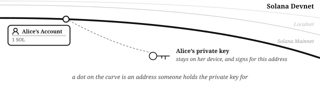
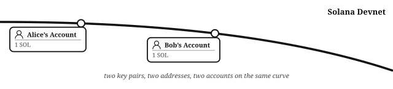
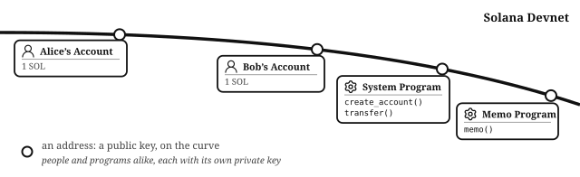
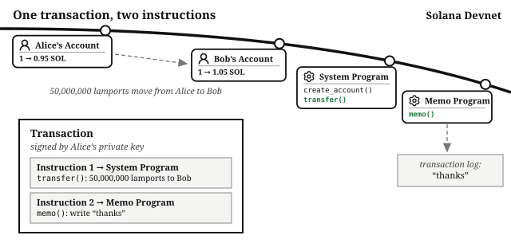
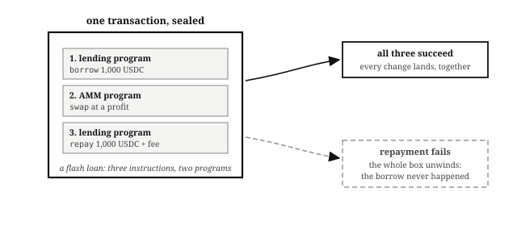
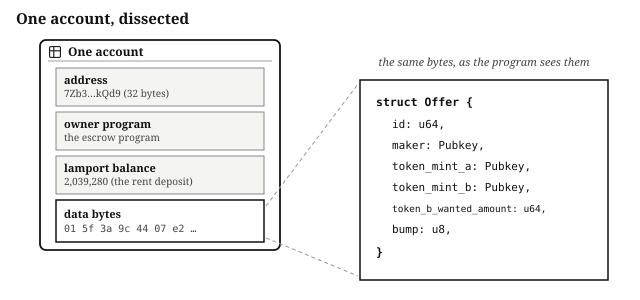
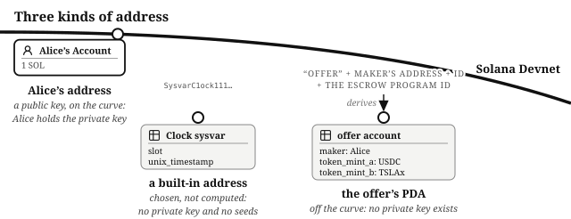
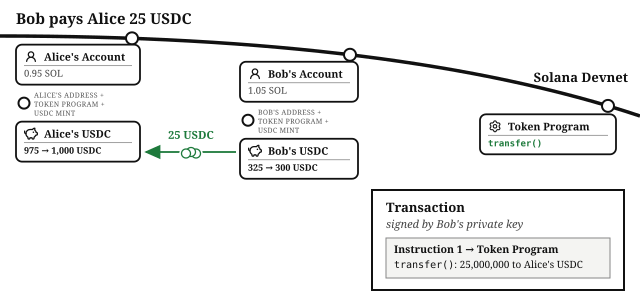

# Chapter 2: The Core Building Blocks of Solana

Nearly every generic introduction describes blockchain as a "shared ledger". This is vague: shared how, and with whom? And most of a program's data is not a balance, and would not appear in a traditional accounting ledger.

Solana (or more specifically, Solana mainnet and devnet) is better understood as **one giant computer that spans the world**. It stores data, it runs programs, and anyone on earth can use it. This chapter follows two people, Alice and Bob, paying each other on that computer.

## A User's Public Key Is Their Address

Meet Alice. Alice has a **key pair**: two mathematically linked keys. Her **private key** is kept secret, stored securely on her device, and is used to sign. The matching **public key** can be shared with everyone, and is used to check those signatures: a valid signature proves that the holder of the private key that matches this public key, and nobody else, produced the signature.

On Solana, as with most blockchains, the public key is also Alice's **address**, the identifier anyone can use to find her and transact with her. Solana public keys are points on a cryptographic curve, so this book draws them as addresses positioned on a curve.

At Alice's address lives Alice's **account**: some data with an address. Her account holds a small balance of **SOL**, the network's native token, which pays the deposit on the space her account occupies (a mechanism called "rent") and the fees on her future transactions. Anyone who knows Alice's address can look up her account, see that balance, and send her more SOL. However, nobody can spend Alice's SOL without her private key.

This figure is the first example of how this book shows people, programs and data on Solana. **A dot sitting on the curve is an address with a private key behind it**, so someone can sign for it. The figures never label those dots, because the dot's place on the curve already says it. Later you will see addresses drawn *off* the curve, listed instead with the **seeds** (the inputs) they were derived from; those have no private key.

> **Key pairs are random, and that is safe.** Nobody issues Alice her key pair: her device generates it from random bytes, with no registry to consult and no permission to ask. That only works because collisions are, in practice, impossible. A Solana private key is drawn from a space of 2^256 possibilities, a number about a thousandth of the count of atoms in the observable universe. If every person on earth generated a billion key pairs per second, the expected wait before any two ever matched would still be about a hundred times the age of the universe. When this book says an address "belongs" to Alice, it means Alice has generated a key pair that nobody else will ever generate, and that only Alice has the private key.

A **wallet** is a key pair being used to sign transactions, with the private key stored somewhere safe. Without its apps and branding, a saved wallet is small: a key pair file on disk, like the `id.json` file the Solana CLI creates, holding 64 bytes. Whoever has those bytes *is* that wallet.

> **64 bytes, but only 32 are secret.** An `id.json` key pair file holds the 32-byte private key followed by the 32-byte public key. The second half is a convenience, not a necessity: the public key is mathematically derived from the private key, so software can recompute it from the first 32 bytes at any time. The private key is the only secret, and the only part that needs protecting.

## There Is More Than One Solana Computer

The bold curve in the figure is labeled **Solana Devnet**, and the faint curves behind it are mainnet and localnet, because there is more than one Solana computer. Each running instance is a **cluster**: the same software, a separate universe. What appears at an address in one cluster can be (and usually is) completely different to what appears at the same address in a different cluster.

| Cluster      | Purpose                                                             | Assets have value?  | Where it runs                |
| ------------ | ------------------------------------------------------------------- | ------------------- | ---------------------------- |
| **mainnet**  | Production: where real financial products run                       | Yes                 | Globally                     |
| **devnet**   | A global network where developers deploy their in-progress software | No: tokens are free | Globally                     |
| **localnet** | Development and fast test loops                                     | No                  | Locally, on your own machine |

There is also **testnet**, where future versions of the Solana software itself are tested before a release reaches mainnet. Other clusters are started up now and then to try out a particular proposed network feature. Your own work happens almost entirely on localnet and devnet: localnet for the fast build-and-test loop, then devnet for a rehearsal on the same software real users will meet. Mainnet is where a finished program goes live. Assets there have real value, which is why a program should be thoroughly audited before it is deployed there.

Each cluster is reached at a URL. Programs and wallets never talk to the network directly: they send transactions to an **RPC endpoint**, a server that holds the cluster's state and relays transactions into it. The endpoint URL is the setting that decides which cluster the Solana SDK reads from, writes to, and deploys to.

The Solana Foundation runs a public endpoint for each cluster, rate limited and meant for learning and light development; anything with real users runs against a dedicated endpoint from an RPC provider instead. Quicknode, this book's publisher, is one of several.

Alice's SOL is devnet SOL. Think of it as the paper banknotes from a board game, which feel real inside the game and buy nothing outside it. Devnet SOL and devnet USDC are given away free.[^faucets] Alice's address is the same on every cluster; the *account* at her address exists per cluster, and nothing in this book needs mainnet tokens to work through.

## Receiving Doesn't Need A Signature, Spending Does

Meet Bob. Bob has his own key pair, and his public key is another point on the same curve. At Bob's address lives Bob's account, holding a small balance of SOL from the same faucet. To send something to Bob, Alice needs only his address. To spend whatever arrives there, Bob needs the private key that matches his address.

## Users Interact With Programs and Each Other by Sending Transactions

Alice wants to send Bob some SOL. The only way to change anything on this computer, whether that is moving a balance or storing data, is to send it a **transaction**.

A transaction carries one or more **instructions**, and each instruction is input for a public function called an **instruction handler** that is part of an **onchain program**: the programs that run on this giant computer. Just like people, every program has its own address:

- The **System Program** has instruction handlers to create accounts and transfer SOL. It sits at `11111111111111111111111111111111`, a **built-in address** with no private key (the kinds of address are covered below), so the figures draw its dot off the curve, labeled with the address itself.
- The **Memo Program** has an instruction handler that writes notes into the transaction log. It was deployed from a key pair, so its address is on the curve like Alice's and Bob's.
- The programs in this book are deployed the same way, so each gets a public key of its own the day you deploy it.

> **An instruction and an instruction handler are two different things.** They are the two halves of every call, and each has its own name:
>
> - An "instruction" is the input a transaction carries: which handler to run, which accounts it may touch, and the arguments.
> - An "instruction handler" is the onchain function that runs.
>
> Older Solana content is loose about this and uses "instruction" for both. You may read or hear "this program has five instructions". In cases like this "instruction" plainly means a function, and you should understand it means "instruction handler".

Alice runs her first transaction. It carries two instructions: the first tells the System Program's `transfer()` handler to move 0.05 SOL from her account to Bob's, and the second tells the Memo Program to write "thanks" to the log.

The transfer instruction does not actually say 0.05 SOL. It says 50,000,000 **lamports**, SOL's **minor unit**: one billion lamports make one SOL, the way one hundred cents make one dollar. Balances are stored as, and calculated with, integers of lamports, so the balance an explorer displays as 1 SOL is the integer 1,000,000,000. Every asset in this book gets the same treatment. The *Arithmetic of Money* chapter builds the rest of the book's arithmetic from these integer minor units.

> **Why "lamport"?** Lamports are named after Leslie Lamport, the Turing Award-winning computer scientist whose work on time, ordering, and consensus in distributed systems underpins every blockchain, Solana included.

## A Transaction's Instructions Succeed or Fail Together

Alice's transaction executes **atomically**: every instruction succeeds, or the whole transaction never happened. If Alice's balance cannot cover the 50,000,000 lamports she wants to send Bob, the transfer fails, and the memo is never written either, even though the Memo Program itself had no complaint. If both instructions succeed, the state changes: Bob's account balance rises by 50,000,000 lamports, and the log says thanks. **There is no partial state**, no "the payment cleared but the delivery failed." One change survives a failure: the transaction fee. The network charges it for processing the transaction, so a transaction that fails still lowers the fee payer's lamport balance. The base fee is 5,000 lamports per signature at the time of writing, which is why Alice ends this transaction at 0.949995 SOL rather than 0.95.

For financial software, atomicity is a primitive you design with. Inside a transaction there is no settlement risk between steps:

- The escrow program in the *Escrow* chapter moves Alice's payment and Bob's stock in one transaction, so if either transfer fails neither happens.
- A lending market can have an instruction to refresh its price before another instruction that depends on the price, so it does not act on stale state.
- A **flash loan**, a crypto-specific concept, borrows in a transaction's first instruction, uses the borrowed tokens in the middle, and repays in the final instruction. The loan needs no collateral because the transaction is atomic: if the repayment fails, the borrow is unwound with it, so the borrowed tokens are back in the lender's vault at the end of every transaction.

Whole categories of arbitrage strategies, and of liquidation (repaying part of a borrower's loan once it passes a safety limit, in return for some of their collateral at a bonus), exist only because transactions are all-or-nothing.

## Less Work Costs Users Less

Work is metered in **compute units** per transaction, and a transaction that sets a priority fee pays it per unit it asks for, so a handler that does less work costs its users less. That is the reason the order book in the *Order Book Exchange* chapter credits each fill to a balance instead of making one transfer per fill: a trader collects every fill's tokens in a single transfer. The programs in this book consolidate work wherever they can for the same reason.

## Every Transaction Is Signed

One thing made Alice's transaction valid: before sending it, she signed it with her private key. The signature covers this exact transaction, not a similar one and not an edited one, and anyone can use Alice's public key to verify it.

You already use digital signatures daily: your bank card has a private key on its chip, and every time you tap, that private key produces a fresh signature proving the card is genuine and was issued by your bank.

The signature is also a grant of authority, but programs decide what it authorizes. Every account has an **owner program**, the only program that may change it, and the owner program decides whose signature each change needs. By signing, Alice supplies her signature to every one of those checks in the transaction:

- **Moving her lamports.** The System Program owns the account at Alice's address, and its `transfer()` handler moves lamports out of an account only when the transaction carries that address's signature.
- **Paying the transaction fee**, the fraction of a cent the transaction costs, which comes out of her balance.
- **Any change a program has recorded her address as allowed to make**, such as moving tokens out of a token account whose owner is her address, or closing that account.

An action's **authority** is the address whose signature that action requires; Solana uses the word for every such address. A program records that address in an account, and the handler checks that the transaction carries its signature before doing the work:

- A token's **mint authority** is the only address that may create new supply of it.
- That token's **freeze authority** is the only address that may freeze a holder's account.
- A program's **upgrade authority** is the only address that may replace the program's code.
- An exchange's **market authority** can pause and resume the market and withdraw its fees.

Different authorities in the same program can be given to different addresses. 

> **What if funds need more than one person's approval?** A transaction can carry several signatures, but for standing control of funds there is a **multisig**: an account that records a set of owners and how many of them must agree, and acts only once enough have. Any authority can be a multisig address rather than one person's wallet. 

## Accounts Store Data, Not Just SOL

Alice's account and Bob's hold a balance and nothing else, and nearly all data on Solana lives in accounts: wallets, token holdings, program code, and program data.[^state-compression]

Besides its address, every account records three things a program reads: a lamport balance, some data, and its owner program. To the chain, the data is just bytes, the way a file on disk is just bytes to the operating system. The owner program is also the one that knows what the bytes mean: it reads them as a struct, works on the struct, and writes the bytes back. Users (or other programs) invoke the owner program to modify the account. Alice's account is the simplest case: just a lamport balance (that is, some SOL), no data, and the System Program as its owner. That is why it was the System Program's `transfer()` handler that moved her lamports to Bob. The figure dissects a data account instead, an offer from the *Escrow* chapter's program: the same four parts, with the bytes read as a struct.

Every account holds a lamport deposit that grows with its size, called **rent**; an account funded to the **rent-exempt** minimum stays until it is closed, and today an account cannot be created with less. Close the account and the lamports are refunded. A tiny part of Alice's SOL balance is the deposit on the space her account occupies; a large account holds a larger one.

The programs themselves are stored the same way. Deploying a program invokes Solana's **loader** program which writes the new program's compiled code into one or more accounts[^loader-version] of its own, which is why deploying a program costs rent in proportion to the size of the binary. Every piece of data the program manages (every market, offer, and balance) lives in a separate data account, not in the accounts that hold the program's code. 

Like the programs on your regular computer and the files they work with, Solana programs use their instruction handlers to read the accounts they are handed, and write new values back. This split, logic in program accounts and state in data accounts, is what makes financial state easy to read. To know a market's condition you read its accounts.

## Addresses Come in Three Kinds

Every account sits at a 32-byte **address**, usually shown base58-encoded. Addresses come in three kinds:

- **Public keys.** Alice's and Bob's wallet addresses are public keys: points on the curve, each with a private key that can sign for it.
- **Program Derived Addresses.** A PDA is computed from a program's address (its **program ID**) and some developer-chosen inputs called seeds. You'll learn more about these in the *PDAs* chapter. A PDA is not a public key, so no private key exists for it.
- **Built-in addresses.** The System Program, the sysvars (system accounts the runtime keeps current), and the few other programs built into the validator itself sit at constant addresses that were *chosen* rather than computed: the Solana core developers picked a memorable byte string. `11111111111111111111111111111111` is the System Program, `SysvarC1ock11111111111111111111111111111111` is the Clock the *Time* chapter reads. Some of the built-in byte strings happen to decode to points on the curve and some do not, but no private key is known for any of them. Other programs, the token programs among them, are deployed from key pairs like the programs in this book, so their addresses are public keys even when they start with a memorable prefix.

## Users Use the Token Program to Send Tokens to Each Other

A week later it is Bob's turn to pay. He owes Alice twenty-five dollars, and dollars on Solana typically mean a **stablecoin**, a token that tracks the dollar one for one, like **USDC**, backed by treasury bills or other assets tied to the currency.

SOL is the network's **native token**, the asset it understands without any program's help. Every other token is defined by a program instead, and is formally an **SPL token**, after the Solana Program Library the original token program shipped in. Most people call all of them tokens, and so does this book. Each distinct token is identified by its **mint**, the account that is the asset's identity onchain, and the *Tokens* chapter covers mints.

Bob's SOL lives in his own account, but his USDC does not: each token balance lives in a **token account** of its own; a wallet's is at an address anyone can compute from the holder's address, the token program, and the mint. Bob's wallet finds Alice's USDC account from her address alone; the *Tokens* chapter covers token accounts.

So Bob signs a transaction carrying one instruction: the **Token Program**'s `transfer_checked()` handler, moving 25 USDC from his USDC account to Alice's. The instruction says 25,000,000, because USDC's minor unit is a millionth, and like a lamport amount it is an integer of minor units. Bob's signature is what authorizes the debit, as Alice's authorized hers: the Token Program checks that the account being debited belongs to Bob, and that Bob signed. Alice's USDC balance rises from 1,000 to 1,025 with no signature from her.

## Instructions Supply the Accounts, Instruction Handlers Check Them

Bob's transfer instruction names every account it touches: Bob's USDC account, the USDC mint, Alice's USDC account, and Bob as the signing owner. Every instruction declares its accounts like this, which is what lets the runtime execute non-overlapping transactions in parallel. One consequence applies to every program in this book: programs do not look accounts up. Instructions supply the accounts as arguments, and instruction handlers check them, because every account specified in an instruction is a claim to verify, as the Token Program did with Bob's account above. The validation section of the *Adversary* chapter covers this in more detail.

## What You Learnt

The building blocks the rest of this part builds on:

- A **key pair**'s public key is an address, and at an address lives an **account**: a user's holds their balance of **SOL**, stored as an integer of **lamports**, its minor unit.
- **Every transaction is signed.** The signature proves the holder of the private key authorized the transaction, and it is what allows the transaction to debit the signer's accounts and pay its fee.
- A transaction bundles **instructions**, each addressed to a program's **instruction handler**, and they succeed or fail together: atomicity is a primitive financial software designs with.
- Accounts store data as well as balances: bytes at an address, with a lamport balance and an owner program that users invoke to change them. A deployed program takes accounts of its own, and the state it manages lives in separate accounts.
- Space is paid for with a **rent** deposit that grows with the account's size, and it is a deposit rather than a fee: closing the account returns it.
- Addresses come in three kinds: **public keys**, which private keys sign for; **PDAs**, which have no private key; and **built-in addresses**, chosen rather than computed, with neither a private key nor seeds.
- Instructions supply the accounts as arguments; instruction handlers check them.

[^faucets]: The `solana airdrop` command sends devnet SOL, as does the faucet at [faucet.quicknode.com/solana](https://faucet.quicknode.com/solana). Circle's faucet at [faucet.circle.com](https://faucet.circle.com) does the same for devnet USDC.

[^state-compression]: The "nearly" is State Compression, a technique for storing bulk data offchain with onchain proofs. None of the financial state in this book uses it.
[^loader-version]: At the time of writing, Loader version 3 uses multiple accounts to store a program, and the upcoming Loader version 4 proposes to use a single account.