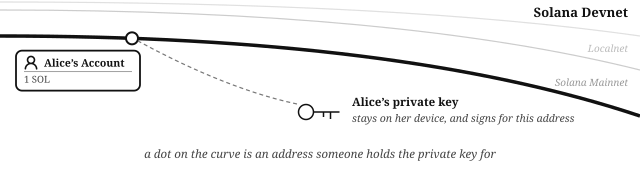
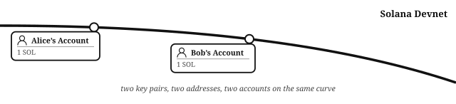
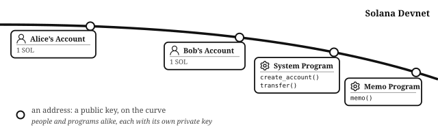
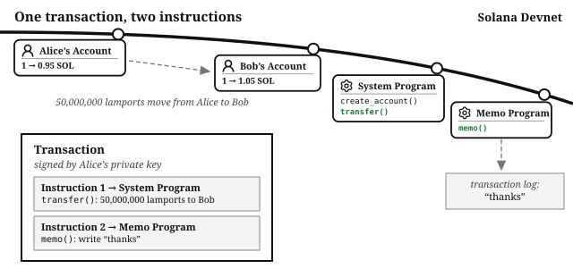
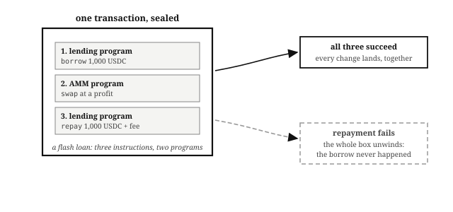
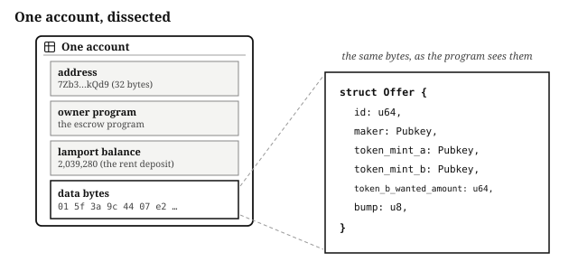
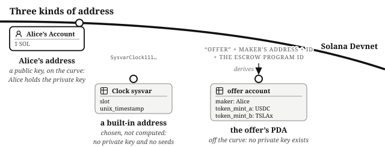
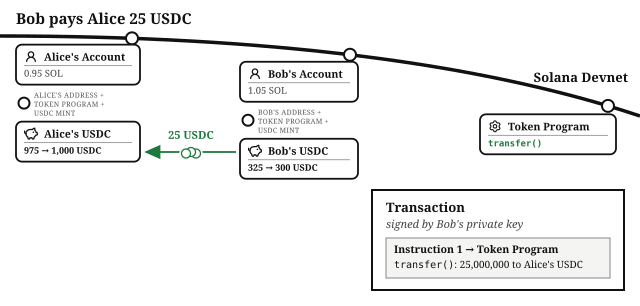

# Chapter 2: The Core Building Blocks of Solana

Nearly every generic introduction describes blockchain as a "shared ledger". This is vague: it does not say how the ledger is shared, or with whom. Most of a program's data is also not a balance, and would not appear in a traditional accounting ledger.

Solana (or more specifically, Solana mainnet and devnet) is better understood as **one giant computer that spans the world**. It stores data, it runs programs, and anyone on earth can use it. This chapter follows two people, Alice and Bob, paying each other on that computer.

## A User's Public Key Is Their Address

Meet Alice. Alice has a **key pair**: two mathematically linked keys. She keeps her **private key** secret, stored securely on her device, and uses it to sign. She can share the matching **public key** with everyone, and anyone can use it to check those signatures. A valid signature proves that the holder of the matching private key, and nobody else, produced it.

On Solana, as with most blockchains, the public key is also Alice's **address**, the identifier anyone can use to find her and transact with her. Solana public keys are points on a cryptographic curve, so this book draws them as addresses positioned on a curve.

At Alice's address lives Alice's **account**: some data with an address. Her account holds a small balance of **SOL**, the network's native token. That SOL pays the deposit on the space her account takes up, a mechanism called "rent", and the fees on her future transactions. Anyone who knows Alice's address can look up her account, see that balance, and send her more SOL. However, nobody can spend Alice's SOL without her private key.

This figure is the first example of how this book shows people, programs and data on Solana. **A dot sitting on the curve is an address with a private key behind it**, so someone can sign for it. After this first figure, the figures leave those dots unlabeled, because the dot's place on the curve already says it. Later you will see addresses drawn *off* the curve and listed with the **seeds** (the inputs) they were derived from. Those addresses have no private key.

> **Key pairs are random, and that is safe.** Nobody issues Alice her key pair: her device generates it from random bytes, with no registry to consult and no permission to ask. That only works because two devices will, in practice, never generate the same key pair. A Solana private key is one of 2^256 possible values, a number about a thousandth of the count of atoms in the observable universe. If every person on earth generated a billion key pairs per second, the expected wait before any two ever matched would still be about a hundred times the age of the universe. When this book says an address "belongs" to Alice, it means Alice has generated a key pair that nobody else will ever generate, and that only Alice has the private key.

A **wallet** is a key pair being used to sign transactions, with the private key stored somewhere safe. Without its apps and branding, a saved wallet is small: a key pair file on disk, like the `id.json` file the Solana CLI creates, holding 64 bytes. Whoever has those bytes *is* that wallet.

> **64 bytes, but only 32 are secret.** An `id.json` key pair file holds the 32-byte private key followed by the 32-byte public key. The second half is there for convenience. The public key is mathematically derived from the private key, so software can work it out again from the first 32 bytes at any time.

## There Is More Than One Solana Computer

The bold curve in the figure is labeled **Solana Devnet**, and the faint curves behind it are mainnet and localnet, because there is more than one Solana computer. Each running instance is a **cluster**: the same software, holding its own separate data. What appears at an address in one cluster can be, and usually is, different from what appears at the same address in another cluster.

| Cluster      | Purpose                                                             | Assets have value?  | Where it runs                |
| ------------ | ------------------------------------------------------------------- | ------------------- | ---------------------------- |
| **mainnet**  | Production: where real financial products run                       | Yes                 | Globally                     |
| **devnet**   | A global network where developers deploy their in-progress software | No: tokens are free | Globally                     |
| **localnet** | Development and fast test loops                                     | No                  | Locally, on your own machine |

There is also **testnet**, where future versions of the Solana software itself are tested before a release reaches mainnet. Other clusters are started up now and then to try out a particular proposed network feature. You will do almost all of your own work on localnet and devnet: localnet for the fast build-and-test loop, then devnet to try the program on the same software real users will meet. Mainnet is where a finished program goes live. Assets there have real value, which is why a program should be thoroughly audited before it is deployed there.

Each cluster is reached at a URL. Apps and wallets never talk to the network directly: they send transactions to an **RPC endpoint**, a server that holds the cluster's state and relays transactions into it. The endpoint URL is the setting that decides which cluster the Solana SDK reads from, writes to, and deploys to.

The Solana Foundation runs a public endpoint for each cluster. These endpoints are rate limited and meant for learning and light development. Anything with real users uses a dedicated endpoint from an RPC provider instead. Quicknode, this book's publisher, is one of several.

Alice's SOL is devnet SOL. Think of it as the paper banknotes from a board game, which feel real inside the game and buy nothing outside it. Devnet SOL and devnet USDC are given away free.[^faucets] Alice's address is the same on every cluster, but each cluster has its own *account* at that address. You can work through this whole book without mainnet tokens.

## Receiving Doesn't Need a Signature, Spending Does

Meet Bob. Bob has his own key pair, and his public key is another point on the same curve. At Bob's address lives Bob's account, holding a small balance of devnet SOL, given away free like Alice's. To send something to Bob, Alice needs only his address. To spend whatever arrives there, Bob needs the private key that matches his address.

## Users Interact With Programs and Each Other by Sending Transactions

Alice wants to send Bob some SOL. The only way to change anything on this computer, whether that is moving a balance or storing data, is to send it a **transaction**.

A transaction carries one or more **instructions**. Each instruction is input for a public function called an **instruction handler**. Each handler is part of an **onchain program**, one of the programs that run on this giant computer. Just like people, every program has its own address:

- The **System Program** has instruction handlers to create accounts and transfer SOL. It sits at `11111111111111111111111111111111`, a **built-in address** with no private key, so the figures draw its dot off the curve, labeled with the address itself. The three kinds of address are explained later in this chapter.
- The **Memo Program** has an instruction handler that writes notes into the transaction log. It was deployed from a key pair, so its address is on the curve like Alice's and Bob's.
- The programs in this book are deployed the same way, so each gets a public key of its own the day you deploy it.

> **An instruction and an instruction handler are two different things.** They are the two halves of every call, and each has its own name:
>
> - An "instruction" is the input a transaction carries: which handler to run, which accounts it may touch, and the arguments.
> - An "instruction handler" is the onchain function that runs.
>
> Older Solana content often uses "instruction" for both. You may read or hear "this program has five instructions". In cases like this "instruction" means a function, so read it as "instruction handler".

Alice runs her first transaction. It carries two instructions. The first tells the System Program's `transfer()` handler to move 0.05 SOL from her account to Bob's. The second tells the Memo Program to write "thanks" to the log.

The transfer instruction does not say 0.05 SOL. It says 50,000,000 **lamports**, SOL's **minor unit**: one billion lamports make one SOL, the way one hundred cents make one dollar. Balances are stored and calculated as integers of lamports, so the balance an explorer shows as 1 SOL is the integer 1,000,000,000. Every asset in this book is handled the same way. The *Arithmetic of Money* chapter builds the rest of the book's arithmetic from these integer minor units.

> **Why "lamport"?** Lamports are named after Leslie Lamport, the Turing Award-winning computer scientist whose work on time, ordering, and consensus in distributed systems is the basis of every blockchain, including Solana.

## A Transaction's Instructions Succeed or Fail Together

Alice's transaction executes **atomically**: every instruction succeeds, or none of their changes take effect. If Alice's balance cannot cover the 50,000,000 lamports she wants to send Bob, the transfer fails, and the memo is never written either, even though nothing was wrong with the memo instruction itself. If both instructions succeed, the state changes: Bob's account balance rises by 50,000,000 lamports, and the log says thanks. **There is no partial state**, no "the payment cleared but the delivery failed." One change survives a failure: the transaction fee. The network charges it for processing the transaction, so a transaction that fails still lowers the fee payer's lamport balance. The base fee is 5,000 lamports per signature at the time of writing, which is why Alice ends this transaction at 0.949995 SOL rather than 0.95.

For financial software, atomicity is a primitive you design with. Inside a transaction there is no settlement risk between steps:

- The escrow program in the *Escrow* chapter moves Alice's payment and Bob's stock in one transaction, so if either transfer fails neither happens.
- The lending market in the *Lending and Borrowing* chapter runs `refresh_reserve()` and `refresh_obligation()` before a borrow, so the borrow reads interest and prices brought up to date in the same transaction.
- A **flash loan**, a crypto-specific concept, borrows in a transaction's first instruction, uses the borrowed tokens in the middle, and repays in the final instruction. **Collateral** is assets pledged to secure a loan, which the lender may seize if it goes unpaid. A flash loan needs none because the transaction is atomic: if the repayment fails, the borrow is undone with it, so the borrowed tokens are back in the lender's vault at the end of every transaction.

Some arbitrage strategies are possible only because transactions are all-or-nothing. A liquidation repays part of a borrower's loan once it passes a safety limit, in return for some of their collateral at a bonus. A liquidator can fund one with a flash loan instead of their own tokens, also only because transactions are all-or-nothing.

## Less Work Costs Users Less

Each transaction's work is measured in **compute units**. A transaction may add a **priority fee**, an extra fee per compute unit that gets it processed sooner. It pays that fee on every unit it requests, so a handler that does less work costs its users less. That is why the order book in the *Order Book Exchange* chapter credits each fill to a balance instead of making one transfer per fill. A trader then collects every fill's tokens in a single transfer. The programs in this book consolidate work wherever they can for the same reason.

## Every Transaction Is Signed

Alice's transaction was valid because she signed it with her private key before sending it. The signature covers only this transaction: it does not cover a similar one or an edited one. Anyone can use Alice's public key to verify it.

You already use digital signatures daily. Your bank card has a private key on its chip. Every time you tap, that private key produces a new signature, which proves the card is genuine and was issued by your bank.

The signature also grants authority, but programs decide what it authorizes. Every account has an **owner program**, the only program that may change it, and the owner program decides whose signature each change needs. By signing, Alice supplies her signature to every one of those checks in the transaction:

- **Moving her lamports.** The System Program owns the account at Alice's address, and its `transfer()` handler moves lamports out of an account only when the transaction carries that address's signature.
- **Paying the transaction fee**, the fraction of a cent the transaction costs, which comes out of her balance.
- **Any change a program has recorded her address as allowed to make**, such as moving tokens out of a token account that names her as its owner (a second meaning of "owner", which the *Tokens* chapter covers), or closing that account.

An action's **authority** is the address whose signature that action needs. Solana uses the word for every such address. A program records that address in an account, and the handler checks that the transaction carries its signature before doing the work:

- A token's **mint authority** is the only address that may create new supply of it.
- That token's **freeze authority** is the only address that may freeze a holder's account.
- A program's **upgrade authority** is the only address that may replace the program's code.
- An exchange's **market authority** can pause and resume the market and withdraw its fees.

Different authorities in the same program can be given to different addresses. 

> **What if funds need more than one person's approval?** A transaction can carry several signatures, but for ongoing control of funds there is a **multisig**: a program that records a set of owners and how many of them must approve, and signs only once enough have. Any authority can be a multisig address rather than one person's wallet. 

## Accounts Store Data, Not Just SOL

Alice's account and Bob's hold a balance and nothing else. But nearly all data on Solana lives in accounts: wallets, token holdings, program code, and program data.[^state-compression]

Besides its address, every account records three things a program reads: a lamport balance, some data, and its owner program. To the chain, the data is just bytes, the way a file on disk is just bytes to the operating system. The owner program is also the one that knows what the bytes mean: it reads them as a struct, works on the struct, and writes the bytes back. Users, or other programs, invoke the owner program to change the account. Alice's account is the simplest case: a lamport balance (some SOL), no data, and the System Program as its owner. That is why the System Program's `transfer()` handler moved her lamports to Bob. The figure shows the parts of a data account instead, an offer from the *Escrow* chapter's program. It has the same four parts, with the bytes read as a struct.

Every account holds a lamport deposit called **rent**, which grows with the account's size. An account funded to the **rent-exempt** minimum stays until it is closed, and today an account cannot be created with less. Closing the account refunds the lamports.

The programs themselves are stored the same way. Deploying a program invokes Solana's **loader** program, which writes the new program's compiled code into one or more accounts[^loader-version] of its own. That is why deploying a program costs rent in proportion to the size of the binary. Every piece of data the program manages (every market, offer, and balance) lives in a separate data account, not in the accounts that hold the program's code. 

Solana programs work like the programs on your regular computer and the files they work with: their instruction handlers read the accounts they are handed, and write new values back. Financial state is easy to read because of this split, with logic in program accounts and state in data accounts. To know a market's condition you read its accounts.

## Addresses Come in Three Kinds

Every account sits at a 32-byte **address**, usually shown base58-encoded. Addresses come in three kinds:

- **Public keys.** Alice's and Bob's wallet addresses are public keys: points on the curve, each with a private key that can sign for it.
- **Program Derived Addresses.** A PDA is computed from a program's address (its **program ID**) and some developer-chosen inputs called seeds. You'll learn more about these in the *PDAs* chapter. A PDA is not a public key, so no private key exists for it.
- **Built-in addresses.** The System Program, the sysvars (system accounts the runtime keeps current), and the few other programs built into the validator itself sit at constant addresses that were *chosen* rather than computed: the Solana core developers picked a memorable byte string. `11111111111111111111111111111111` is the System Program, and `SysvarC1ock11111111111111111111111111111111` is the Clock the *Time* chapter reads. Some of the built-in byte strings happen to decode to points on the curve and some do not, but no private key is known for any of them. Other programs, the token programs among them, are deployed from key pairs like the programs in this book, so their addresses are public keys even when they start with a memorable prefix.

## Users Use the Token Program to Send Tokens to Each Other

A week later it is Bob's turn to pay. He owes Alice twenty-five dollars. Dollars on Solana usually mean a **stablecoin**: a token that tracks the dollar one for one, backed by treasury bills or other assets tied to the currency. **USDC** is one.

SOL is the network's **native token**: its balance is a field of every account, not a token program's record. Every other token is defined by a program instead, and is formally an **SPL token**, named after the Solana Program Library, which the original token program shipped in. Most people call all of them tokens, and so does this book. Each distinct token is identified by its **mint**, the account that is the asset's identity onchain. The *Tokens* chapter covers mints.

Bob's SOL lives in his own account, but his USDC does not: each token balance lives in a **token account** of its own, which the *Tokens* chapter covers.

So Bob signs a transaction carrying one instruction: the **Token Program**'s `transfer_checked()` handler, moving 25 USDC from his USDC account to Alice's. The instruction says 25,000,000, because USDC's minor unit is a millionth. Like a lamport amount, it is an integer of minor units. Bob's signature authorizes the debit, as Alice's authorized hers. The Token Program checks that the account being debited belongs to Bob, and that Bob signed. Alice's USDC balance rises from 1,000 to 1,025 with no signature from her.

## Instructions Supply the Accounts, Instruction Handlers Check Them

Bob's transfer instruction names every account it touches: Bob's USDC account, the USDC mint, Alice's USDC account, and Bob as the signing owner. Every instruction declares its accounts like this, which lets the runtime execute non-overlapping transactions in parallel. One consequence applies to every program in this book: programs do not look accounts up. Instructions supply the accounts as arguments, and instruction handlers check them. Every account named in an instruction is a claim to verify, as the Token Program verified Bob's account above. The validation section of the *Adversary* chapter covers this in more detail.

## What You Learnt

The building blocks the rest of this part builds on:

- A **key pair**'s public key is an address, and an **account** lives at an address. A user's account holds their balance of **SOL**, stored as an integer of **lamports**, its minor unit.
- **Every transaction is signed.** The signature proves the holder of the private key authorized the transaction, and it allows the transaction to debit the signer's accounts and pay its fee.
- A transaction bundles **instructions**, each addressed to a program's **instruction handler**, and they succeed or fail together. Atomicity is a primitive that financial software designs with.
- Accounts store data as well as balances: bytes at an address, with a lamport balance and an owner program that users invoke to change them. A deployed program takes accounts of its own, and the state it manages lives in separate accounts.
- An account pays for its space with a **rent** deposit that grows with the account's size. It is a deposit rather than a fee: closing the account returns it.
- Addresses come in three kinds: **public keys**, which private keys sign for; **PDAs**, which have no private key; and **built-in addresses**, chosen rather than computed, with neither a private key nor seeds.
- Instructions supply the accounts as arguments; instruction handlers check them.

[^faucets]: The `solana airdrop` command sends devnet SOL, as does the faucet at [faucet.quicknode.com/solana](https://faucet.quicknode.com/solana). Circle's faucet at [faucet.circle.com](https://faucet.circle.com) does the same for devnet USDC.

[^state-compression]: The exception is State Compression, a technique for storing bulk data offchain with onchain proofs. None of the financial state in this book uses it.
[^loader-version]: At the time of writing, Loader version 3 uses multiple accounts to store a program, and the upcoming Loader version 4 proposes to use a single account.