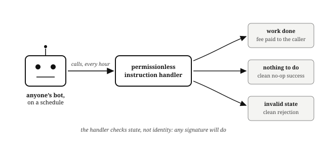

# Cranks

Some work in a financial product has no natural caller. Funding payments must settle, expired offers must process, unhealthy loans must liquidate, and no user has a reason to pay for any of it. The onchain pattern is the **crank**: an instruction handler that anyone may call, safe to call at any time, so that keeping the machine turning is a permissionless job rather than an operator's promise.

A good crank has three properties:

## Permissionless: the Handler Checks State, Not Identity

If the work is valid, anyone's signature will do. Gating maintenance on the operator's key turns the operator's absence into everyone's outage.

## Idempotent and Quiet: a No-Op Succeeds

Calling the crank when there is nothing to do succeeds cleanly (the order book's fee withdrawal exits as a no-op when the vault is empty), so a bot on a schedule never needs babysitting and never fails spuriously.

## Paid, If You Need It Reliable

The strongest cranks carry their own incentive. The lending market's liquidation is the canonical example: Dave is not a volunteer, he is a crank operator earning the liquidation bonus, and the market stays solvent precisely because that job pays. If your design has work that must happen and nobody is paid to do it, you have found a bug in your incentives, not your code.

