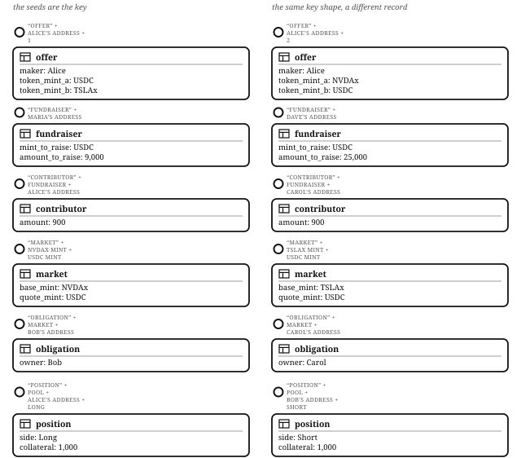
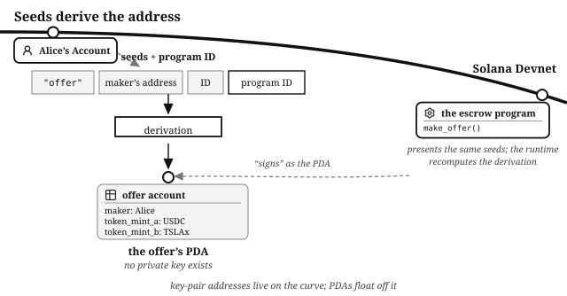

# Chapter 4: PDAs: How Solana Programs Find Their Data

You have been using PDAs since the *Tokens* chapter: every associated token account in this book lives at a PDA of the Associated Token Program, derived from the three seeds that chapter listed.

A **program derived address**, or PDA, is an address computed from a program's ID and some chosen seeds, the inputs to the derivation. The derivation produces an address with no private key: PDA generation tries one extra byte after another, called the **bump**, until the result lands off the curve where public keys live. Programs store the bump they found, so later instructions use the stored bump instead of searching for it again. Only the program whose ID derived the address can "sign" as the PDA, and no signature is ever produced; the boxout below says what the word means here.

PDAs are how Solana programs find their data, and the Associated Token Program chose its seeds to suit its task: find where a wallet's balance of a given token lives. Every other program chooses its own seeds for its own needs. A program's accounts behave like a **key/value store**: the seeds are the key, the PDA they derive is the address that key leads to, and the data in the account at that PDA is the value. The PDA is the address and the account is what sits at it: a program derives the offer PDA, then writes the offer account. Every program in this book keeps its state this way:

- The escrow stores each offer at an address made from `"offer"` + the maker's address + an ID.
- The fundraiser stores its terms at an address made from `"fundraiser"` + the maker's address, and one receipt per backer at an address made from `"contribution"` + the fundraiser + the backer's address.
- The order book stores each market at an address made from `"market"` + the two mints.
- The lending market stores each borrower's loan file at an address made from `"obligation"` + the market + the borrower's address.
- The perpetual futures venue stores each position at an address made from `"position"` + the pool + the owner + the side.

> **"Key" here is the database word.** A key/value store's key is an identifier: the thing a value is looked up by. It has nothing to do with the public and private keys of the last two chapters. A PDA has neither of those, and its seeds are what it is looked up by.

## Seeds Make Data Findable

The market for a token pair, a user's position in it, and the offer with a given ID all live at addresses anyone can compute from the seeds, so exactly one thing exists per key. A program finds any of them by recomputing its address from the seeds.

## Seeds Make Relationships Verifiable

An account that claims to be "the vault for this market" either derives from the market's seeds or it does not. A program checks that the accounts a caller supplied belong together in two ways: it re-derives an address from the seeds, or it compares an address against the one a record stored.

## Funds Under a PDA's Authority Move Only Through the Program

A vault whose authority is a PDA is a vault whose funds move only along the code paths the program defines. When people say that "the program holds the funds", they mean that the funds are stored in a token account that the program controls, and that moving them means invoking the program's instruction handlers.

> **"Signing" with a PDA is not cryptographic signing.** No digital signature is ever produced for a PDA, because there is no private key to produce one. This book still says "sign with the PDA", because that is how Solana itself uses the word, in the runtime and in every library you will touch. When you read about "signing for a PDA", here or anywhere else, translate it to something plainer: the program specifies the seeds of the PDA that controls the token account, the runtime recomputes the derivation, and the movement is allowed.

## What You Learnt

- A **PDA** is derived from a program's ID and seeds and has no private key; only the deriving program can "sign" as it, by presenting the seeds.
- The associated token accounts you already use live at PDAs of the Associated Token Program, and a program's own records work the same way with seeds it chooses.
- A program's accounts form a **key/value store**: the seeds are the identifier, the PDA is where the account lives, and the account's data is the value.
- Seeds make data findable and relationships verifiable.
- A PDA can be a token account's authority, so that account's tokens move only through the program's handlers.
