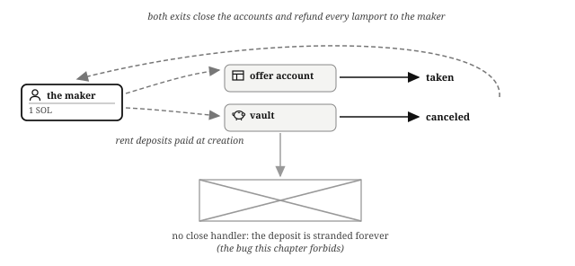

# Chapter 4: PDAs: How Solana Programs Store Data

A **program derived address** (PDA) is an address computed from a program's ID and some chosen seeds, deliberately constructed to have no private key (a **bump** byte, chosen during derivation so the result lands off the curve where keys live, and usually stored so it never needs re-finding). Only the program whose ID derived the address can "sign" as the PDA, and what that really means gets its own boxout below.

PDAs are how Solana programs store data. Taken together, a program's PDAs behave like a **key/value store**: the seeds are the key, and the account's data is the value. ("Key" here means *identifier*, the same word a database would use; it has nothing to do with public or private keys.) Every program in this book keeps its state this way:

- The escrow stores each offer at `"offer"` + the maker's address + an ID.
- The fundraiser stores its terms at `"fundraiser"` + the maker's address, and one receipt per backer at `"contributor"` + the fundraiser + the backer's address.
- The order book stores each market at `"market"` + the two mints.
- The lending market stores each borrower's loan file at `"obligation"` + the market + the borrower's address.
- The perpetual futures venue stores each position at `"position"` + the pool + the owner + the side.

That one mechanism does three jobs in every chapter of this book:

## Seeds Make Addresses Derivable

The market for a token pair, a user's position in it, and the offer with a given ID all live at addresses anyone can compute from the seeds, so exactly one thing exists per key and nobody has to remember where anything is.

## Seeds Make Relationships Verifiable

An account that claims to be "the vault for this market" either derives from the market's seeds or it does not. Combined with stored addresses (`has_one`), derivation is how a program proves that the accounts a caller supplied belong together.

## PDA Authority Makes Custody Programmatic

A vault whose authority is a PDA is a vault whose funds move only along the code paths the program defines. When people say that "the program holds the funds", they mean that the funds are stored in a token account that the program controls, and that moving them means invoking the program's instruction handlers. That arrangement is the foundation of every escrow, pool, and market in the book.

> **"Signing" with a PDA is not signing.** No digital signature is ever produced for a PDA, because there is no private key to produce one; nothing like the cryptographic proof behind Alice's and Bob's transactions exists here. This book still says "sign with the PDA", because that is how Solana itself uses the word, in the runtime and in every library you will touch. When you read it, here or anywhere else, translate it to something plainer: the program specifies the seeds of the PDA that controls the token account, the runtime recomputes the derivation, and the movement is allowed.

> **Why doesn't the program simply authorize the transfer directly, without seeds?** Why not let a program move funds from any token account that names it as authority, instead of making it present seeds? Start with what a PDA "signature" actually is. No signing happens: the runtime checks that the presented seeds plus the calling program's id derive the address, and if they do, it marks the account as a signer for that one instruction. It is authorization granted by the runtime on proof of derivation, not a cryptographic signature.
>
> That reframing answers the question. A program's id is an ordinary on-curve address, generated as a key pair when the program is deployed, so a private key for it exists. If a token account could name the program's address as its authority, whoever holds that deployment key could sign a plain transfer and drain the vault directly, with no instruction handler, no checks, and no program logic in the way. Requiring the authority to be a keyless PDA removes that key entirely: there is no signature that empties the vault, only the program presenting the vault's seeds inside a handler. Every movement goes through code.
>
> Seeds also partition the risk. Giving each vault its own PDA, derived from market-specific seeds, makes the authority over one market's vault a different identity from the authority over another's. A handler that knows only market A's seeds cannot sign for market B's vault even when it is handed B's vault by mistake, because B's authority is a PDA that handler cannot derive. One program as a single authority would be one master key over everything it touches; per-vault PDAs make an accidental or malicious authorization stop at the one vault whose seeds the handler actually presented.

## Storage Is Paid For: Rent

Every account, PDA or otherwise, holds a lamport deposit proportional to its size, called **rent**; an account funded to the **rent-exempt** minimum lives forever, and today an account cannot be created with less. The deposit is not a fee: close the account and the lamports come back.

For financial software, rent is small but real money with a lifecycle, and the design rule is simple: whoever wants the account pays for it. The maker funds her offer account and vault; the taker funds his own token account if he never held that token. Rent burdens follow the party who chose to create the state, and every deposit should find its way home when its account closes; the state-machine chapter of Financial Programming Concepts in Solana turns those exits into a rule.

## What You Learnt

- A **PDA** is derived from a program's ID and seeds and has no private key; only the deriving program can "sign" as it, by presenting the seeds.
- A program's PDAs form a **key/value store**: the seeds are the identifier, the account's data is the value.
- Seeds make addresses derivable and relationships verifiable, and PDA authority over a vault is what "the program holds the funds" means.
- Storage is paid for with a **rent** deposit that returns when the account closes, and whoever wants the account pays for it.
