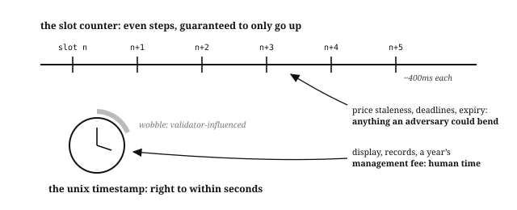

# Chapter 5: Time

Solana has two clocks. Validators can nudge one of them, so measuring the wrong thing with it lets whoever profits from the error shift what your program computes.

| Clock | Source | Guarantee | Use it for |
| --- | --- | --- | --- |
| **slot** | The Clock sysvar's count of block opportunities, roughly 400ms apart | Only goes up, at a rate nobody can meaningfully bend | Anything an adversary would profit from bending: price staleness, per-slot interest |
| **unix timestamp** | The same Clock sysvar, validator-reported wall time | Right to within a few seconds | Humans and long horizons: day-counted deadlines, annual fees, display |

## Slots Are Guaranteed to Progress

The **slot** counts block opportunities, roughly 400ms apart, and its progression is guaranteed by the runtime: slots only go up, at a rate nobody can meaningfully bend. Programs read the current slot from the **Clock sysvar**, a system account the runtime keeps fresh.

Two programs in this book accrue value over time, and both count it in slots: the lending market accrues interest on debt, and the perpetual futures venue accrues funding on open positions. The lending market carries one number per reserve, a **cumulative index** that grows each time anyone touches the market:

```
new index = old index × (1 + rate per slot × elapsed slots)
```

Elapsed slots is the current slot minus the slot of the last refresh, which the reserve stores. Every borrower's debt is their scaled principal times that index, so one multiplication per refresh does the work of looping over every borrower every slot. The *Arithmetic of Money* chapter covers how to build that index safely. It advances by slots, not seconds.

The perpetual futures venue does the same for funding, storing `cumulative_funding` alongside `last_funding_slot`. Both are indexes, both advance by elapsed slots, and both are money. They count slots because a trader who could stretch a slot could stretch what they owe.

## Timestamps Are Validator-Reported

The **unix timestamp** comes from the same Clock sysvar, but it is wall-clock time reported by validators rather than a count the runtime guarantees. It is right to within a few seconds, and validators can nudge it.

Seconds are enough to matter wherever a boundary is worth money. If an auction closes, an option expires, or a penalty starts on a timestamp, whoever can move the clock a little decides which side of that boundary a transaction lands on, and the money follows. So leave a margin wide enough that a few seconds cannot change the answer, and count in slots anything where they could.

There is a third answer, and the order book exchange uses it: where a clock would decide something valuable, count instead. Price-time priority has to know who queued first, so the venue stamps each resting order with a sequence number it allocates as the order rests, and matching reads that. It still records a `timestamp` on the order, and the code says what the field is for: not used by matching, kept so offchain tooling can show an age. A number that decides who fills first is not a number to let anyone influence.

Wall-clock time is still the right tool in places. The vault strategy reaches for it twice, for two different reasons:

- **Its annual management fee accrues by timestamp**, because a few seconds of drift measured against a year is nothing.
- **It checks its price feed's age in seconds rather than slots**, because the feed publishes a wall-clock time, and the comparison has to be made in the units the number arrived in.

Where a program's own deadline is for humans, timestamps are what humans mean.

## Every Consumer Sets Its Own Freshness Window

A price is only usable if it is recent, and how recent is a judgement each program makes for itself. Four of this book's programs make it differently:

| Program | Refuses a price older than | Measured in |
| --- | --- | --- |
| the lending market | 25 slots, about ten seconds | slots |
| the prop AMM | 150 slots, about a minute | slots |
| the perpetual futures venue | 150 slots, about a minute | slots |
| the vault strategy | 60 seconds | seconds |

The three that pick the window pick slots. The vault is the exception that shows the rule: its number is in seconds because the feed it reads publishes a wall-clock time, so seconds is the unit it was handed. The *Offchain Truth* chapter covers what else a program checks about a price before it uses one.

## Integer Day Counts Have a Boundary, and Both Sides Must Use It

A clock gives a program seconds, so counting days means dividing by 86,400. That division is integer division, which throws the remainder away: six and a half days counts as six, and anything short of a full day counts as none of it. The token fundraiser stores `time_started` and a duration in days, and both of its later handlers reconstruct elapsed days the same way:

```
elapsed days = (now − time_started) / 86,400
```

`contribute()` requires that count to be *less than* the duration. `refund()` requires it to be *at least* the duration. One expression, compared both ways, so there is no gap and no overlap between "you may still contribute" and "you may now refund": at the moment the count reaches the duration, contributions turn off and refunds turn on, by arithmetic rather than by a second stored flag anybody has to keep in step.

The trap is what "seven days" then means. With day-granularity math the window ends at the first tick of day seven, not at some intuitive end of the seventh day. That is a fine rule as long as it is the rule you meant and the one you told your users.


Say which edge you mean when you write the terms down. "Seven days to fund" reads to a contributor as a window that closes at the end of the seventh day, and this one closes at its start, a full day earlier than they think. Either edge is defensible; only one of them is what your users were told.

## Slots Stop When the Chain Stops, and the Wall Clock Does Not

Both clocks arrive in the same sysvar, so it is easy to assume they always move together. They come apart when the chain stops.

Solana would rather stop than be wrong. When validators cannot agree which block is real, block production halts instead of continuing down two conflicting histories, and the network sits still until enough of the stake agrees where to resume. That is the trade financial software wants, because a chain that kept producing blocks through a disagreement could settle the same balance twice.

Mainnet has spent hours in that state, but a halt is a rare event: at the time of writing, block production has not stopped for years. Write for the one you will probably never see.

No block is produced during a halt, so the slot count does not move. Wall-clock time does. The first block after a restart therefore carries a slot roughly where the last one left off and a timestamp hours later: everything measured in slots was paused, and everything measured in seconds was running the whole time. Three consequences, one for each way this book's programs use a clock:

- **Per-slot accrual pauses with the chain.** The lending market's index advances by elapsed slots, so a nine-hour halt accrues no interest at all: nobody is charged for a market they could not reach. A fee accruing by timestamp charges the full nine hours, because from its point of view nine hours is what happened.
- **A freshness window measured in seconds is blown at the restart, and one measured in slots is not.** The vault strategy refuses a price older than sixty seconds, so its first call after a halt fails until a publisher posts again. The lending market's 25-slot window sees a price stamped one slot ago, and by the slot count alone it would accept a number that is nine hours old. A price stamped one slot ago is not always a price from four hundred milliseconds ago.
- **A deadline can pass with nobody able to act on it.** The fundraiser's day count runs through a halt like any other nine hours, so a contributor with an hour left can find the window shut when the chain returns. That program survives it because its refund path has no deadline; a design whose only exit was a narrow window would have stranded them.

The slot-counted window has a companion check that closes its gap. The [`LastRestartSlot` sysvar](https://docs.anza.xyz/runtime/sysvars) carries the slot of the most recent cluster restart, or zero if there has never been one, and a price from before the last restart is stale however few slots have passed since. The lending market, the prop AMM, and the perpetual futures venue all make this check in their oracle readers: any price stamped at or before the restart slot is rejected with `PricePredatesRestart`, and the market pauses valuation until the publisher posts again. Make it in any program whose freshness window is counted in slots.

## Which Clock to Use for Each Job

| What you are measuring | Use | Watch for |
| --- | --- | --- |
| interest, funding, anything that accrues and is worth money | **slots** | accrual stops during a halt, so nobody pays for hours they could not trade. That is usually what you want, but say so in your docs rather than finding out during an incident |
| how fresh a price is | **whichever unit the feed stamps**: slots if it publishes a slot, seconds if it publishes a time | a slot-counted window needs the `LastRestartSlot` check above, because slots stop standing in for elapsed time across a restart. A window counted in seconds already fails closed |
| a deadline people agreed to: a week to fund, a quarter to redeem | **timestamps** | validators can nudge them by a few seconds, so never let a few seconds decide who gets paid, and compute both sides of the boundary from one stored expression |
| a rate quoted per year | **timestamps** | it charges straight through a halt. Nine hours against a year is a rounding error; against a week it is not |
| anything a person reads: receipts, reporting, display | **timestamps** | nothing. This is what wall-clock time is for |

Behind the table is one question: who profits if this number is wrong? Measure in slots anything an adversary would bend, and in timestamps anything only a human would notice. The lending market accrues interest per slot for the first reason; the vault strategy's annual management fee accrues by timestamp for the second.



## What the Programs in This Book Chose, and How It Holds Up

Every program in Part II that touches time is in this table, with the two questions worth asking of any answer: what happens if validators lean on the seconds, and what happens if the chain stops.

| Program | What it times | Its answer | If the seconds are nudged | If the chain halts |
| --- | --- | --- | --- | --- |
| token fundraiser | its funding deadline | whole days from one stored timestamp | a few seconds cannot move a count that floors to whole days | the deadline can pass unattended; refunds have no deadline of their own, so nobody is stranded |
| lending market | interest accrual, and price freshness | slots for both, 25 slots for the price | nothing to bend | accrual stops, and `LastRestartSlot` rejects a price from before the restart |
| perpetual futures | funding accrual, and price freshness | slots for both, 150 slots for the price | nothing to bend | the same, and it matters more: leverage multiplies a bad price across the book |
| prop AMM | price freshness | 150 slots | nothing to bend | the same restart check, and the market refuses to quote until a publisher posts |
| vault strategy | an annual fee, and price freshness | timestamps for both, 60 seconds for the price | seconds measured against a year are nothing | the fee charges through the halt, and the price check fails closed on its own |
| order book | who queued first | a sequence number, neither clock | matching never reads a clock, so there is nothing to lean on | queue positions come back exactly as they were |

Two patterns run through the table. Where a number is worth money, it is counted in something nobody can lean on: slots, or a sequence number of the program's own. Where a number is for people, it is a timestamp with enough margin that seconds cannot change the answer.

## What You Learnt

- Solana has two clocks: the **slot**, whose progression the runtime guarantees, and the **unix timestamp**, which validators report.
- Choose the clock by asking who benefits from the error: slots for anything an adversary could profit from bending, timestamps for humans and long horizons.
- Money that accrues accrues per slot, as a **cumulative index** advanced by elapsed slots, so one multiplication replaces a loop over every account.
- A price needs a freshness window, each consumer sets its own, and the unit follows the source: slots where the program chooses, seconds where the feed published seconds.
- A deadline counted in whole days floors, so both sides of it must be computed from the same expression, and the window ends at the first tick of the last day. Say which edge you meant when you write the terms down.
- Where a clock would decide something valuable and neither clock is safe enough, count instead: the order book settles who queued first with a sequence number, and keeps its timestamp for display only.
- Solana halts rather than run two conflicting histories, and during a halt slots pause while wall-clock time keeps running: per-slot accrual stops, second-measured freshness windows blow past their limit at the restart, slot-measured ones are not blown, and deadlines expire with nobody able to act on them. A slot-counted freshness window is paired with a `LastRestartSlot` check, rejecting any price stamped at or before the restart.
