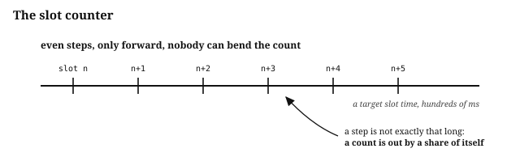
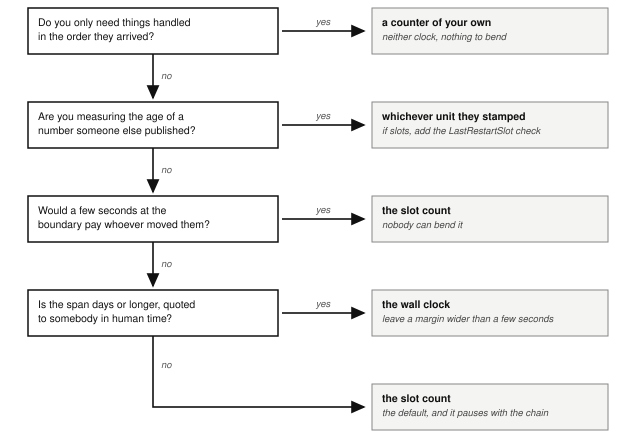
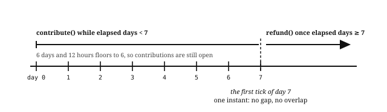

# Chapter 5: Time

Solana has two clocks, and a program reads both from the same account. The **slot** counts block opportunities and only goes up. The **Unix timestamp** is wall-clock time reported by validators, accurate to within a few seconds.

The jobs in this book split cleanly between them. A price freshness window counts slots. A week promised to a contributor runs on the wall clock. Who queued first uses neither, and takes a counter the program keeps itself.

## The Slot Counter

A **slot** is a window in which one leader may produce one block, and the slot count is how many have gone by. Programs read the current count from the **Clock sysvar**, a system account the runtime keeps fresh. Slots only go up, and nobody can rewind the count or jump it forward.



Three things affect how much wall-clock time a number of slots adds up to, and anyone converting between the two should know all three:

- **A slot is not exactly the length the network intends.** The network sets a target, 200 milliseconds, and real slots run a little longer or shorter. A time counted in slots is accurate to around 3%.[^slot-time-live]
- **A leader can stretch its own slots, though it cannot shorten them.** Proof of history fixes the hashes in a tick, so nobody can run ahead of it. What a leader can do is produce its slots slowly, or not at all, which makes those slots take longer in wall-clock time. That loosens a slot-counted window rather than tightening it. How far one leader can stretch depends on how many slots it leads, and that is a matter of stake.
- **The count stops when the chain does.** No block is produced during a halt, so the count stands still while the world outside keeps moving. That pauses per-slot accrual, which is usually what you want, and it makes an hours-old price look one slot old, which nobody wants.

Before each **epoch** of 432,000 slots, about a day at 200 milliseconds, the network draws a **leader schedule**. Every slot is assigned to one validator, in turns of four consecutive slots, and a validator's chance at each turn is proportional to the stake delegated to it. A validator with 1% of the stake leads about 1% of the slots, in turns of four scattered across the epoch, and knows before the epoch starts which slots they are. A small validator can stretch its four slots, and then the schedule moves on. A validator with a large share of the stake leads a matching share of the slots in any window, so it can slow every turn it holds, and a slot-counted window runs long by a share that tracks that stake. Because the schedule is public in advance, it can also time a stretch to a boundary it wants to land on, an auction close or a funding interval. The same stake weights the vote that sets the Unix timestamp, so the same validator has the larger say over the next section's clock. Neither lets it move the slot count: the count still advances one per slot, and its own slots are the only ones it can slow.

## The Unix Timestamp

The **Unix timestamp** comes from the same Clock sysvar, but it is wall-clock time reported by validators rather than a count the runtime guarantees. It is accurate to within a few seconds, and validators can nudge it.


A validator can nudge it by a few seconds, and a few seconds is what it stays however long the span. Put a boundary on a timestamp and somebody can profit by moving it. If an auction close, an option expiry, or the start of a penalty sits on a timestamp, whoever can nudge that timestamp decides which side of the boundary a transaction lands on.

## Which Clock for Which Job



A price three seconds stale can be worth a liquidation to whoever arranged the delay, so freshness counts slots. A contribution three seconds late is worth one contribution, and a margin covers it, so the fundraiser's week runs on the wall clock. The vault's annual fee runs on the wall clock too, because a few seconds against a year change it by nothing anybody can see.

Underneath the four questions is one comparison. A few seconds of wall clock stay a few seconds however long the span runs, while around 3% of a slot count grows with the span, until across a week it is hours.

## Interest and Funding Accrue by Slot

Two programs in this book accrue value over time, and both count it in slots:

- **The lending market accrues interest on debt.** It carries one number per reserve, a **borrow accumulation factor** that grows each time anyone touches the market:

  ```
  new factor = old factor × (1 + rate per slot × elapsed slots)
  ```

  Elapsed slots is the current slot minus the slot of the last refresh, which the reserve stores. Rather than recalculating every borrower's debt, the market stores each borrower's principal and updates the one shared factor, so a borrower's current debt is their principal multiplied by that factor. Its rates are quoted annually, so the conversion divides by the slots in a year, and the reserve stores that divisor as `slots_per_year` rather than working it out. The *Arithmetic of Money* chapter covers how to build that factor safely.
- **The perpetual futures venue accrues funding on open positions.** It does the same, storing `cumulative_funding` alongside `last_funding_slot`. Its funding rate is set per slot to begin with, so the slot time is what decides the cost of an hour.

Both accumulate, both advance by elapsed slots, and both decide what somebody owes, which decides whether a position can be liquidated. A few seconds at that line are worth money to whoever moves them, so the accrual counts slots. The slot count's own error, a percent or two across a year, changes what a borrower pays, and the market owner corrects it by retuning `slots_per_year`.

## How to Turn Time Into Slots

A freshness window is agreed in seconds, a borrower is quoted a rate per year, and each of those has to become a slot count before a program can use it. Divide the time by the length of a slot in milliseconds. Multiplying runs the same arithmetic backwards, for telling a person what a slot count or a per-slot rate comes to in their own units.

The length of a slot is a static value: currently 200 milliseconds.[^slot-simd]

A program can get that length three ways:

- **From Anza's documentation, written into your program.**[^anza-docs] Good while no reduction is pending, and stale from the moment one activates. Keep any rate that depends on the slot length in config, where a transaction can change it, which the section on a shortened slot covers.
- **From the feature gates.** Each shortening of the slot ships as a feature, so a program can check which of them are live and take the shortest, falling back to 400 milliseconds when none are.[^check-slot-time]
- **From the network itself, in future.** While no account reports the slot time in milliseconds at the time of writing, this is expected to change.[^onchain-params] Check Anza's documentation and the companion repository before writing either technique above, in case that day has come.

Avoid the Solana SDK's `DEFAULT_MS_PER_SLOT` - this value is set when the SDK is compiled, so what was true on build day may not reflect the network a program is running on.

The gates give the length the network aims for, and the network can run slower than that. When slots take longer than the configured length, interest that accrues per slot earns less over a real year than its annual rate implies, and a 150-slot freshness window covers more wall-clock time than it was sized for, so it accepts older prices.

To measure the average the network is actually delivering, take the seconds since `epoch_start_timestamp` in the Clock sysvar and divide by the slots since this epoch began, which `EpochSchedule` supplies. Guard that division: the divisor is zero on an epoch's first slot. That measurement comes from the validator-reported clock, so it belongs in offchain tooling, not in a handler. A program counts slots so that nobody can nudge its accrual. Multiply by a measured slot length and the nudge is back.

> **One conversion covers one slot time.** Converting only works over a period where the slot time in milliseconds was constant. If the slot time changed during the period being measured, multiplying by the current figure understates the time that passed, since slots in the past were longer. Converting over a period where the slot time changed means splitting it at each change and converting each piece at the slot time the network used then. A slot count that reaches back across the reduction to 200 milliseconds needs that split, while one that starts after it does not. No reduction below 200 milliseconds is planned.

A program that needs a long span in wall-clock time should store a timestamp beside the slot and subtract.

## The Wall Clock Measures Human Time

The vault strategy uses the wall clock twice:

- **Its annual management fee accrues by timestamp**, because a few seconds either way, measured against a year, are nothing.
- **It checks its price feed's age in seconds rather than slots.** A **price feed** is an account that some publisher keeps updated with a price and the time they published it. This one publishes a wall-clock time, so the comparison has to be made in the unit the number arrived in.

When the deadline is one you promised a person, use timestamps, and leave a margin so a few seconds cannot change who gets paid. A contributor told they have a week to fund is owed seven days of wall-clock time. A week counted in slots is out by hours, which breaks that promise, while a week of wall clock is out by seconds, which the margin covers. Each of these is a span where a few seconds change nothing worth taking.

## Who Fills First Is a Counter, Not a Clock

The order book exchange uses neither clock for the thing traders care most about: who queued first. Each resting order takes the next number from a counter the market keeps, and matching compares those numbers. The order also records a `timestamp`, but this is only kept so offchain tooling can show an age. Two orders can arrive in the same slot and carry the same timestamp. The market's counter still gives them different numbers. A validator can nudge the timestamp; it cannot nudge the counter.

## Every Consumer Sets Its Own Freshness Window

A program reading a price has two questions to answer:

- Whether the source can be trusted.
- Whether the price is recent enough.

The *Offchain Truth* chapter answers the first, along with everything else a program checks about a price before acting on it. This chapter answers the second. Four of this book's programs answer it differently:

| Program | Refuses a price older than | Measured in |
| --- | --- | --- |
| the lending market | 25 slots | slots |
| the prop AMM | 150 slots | slots |
| the perpetual futures venue | 150 slots | slots |
| the vault strategy | 60 seconds | seconds |

For a price fresh to within two seconds, turn that into a slot count once, and check every price against that number of slots. Nobody can move that boundary, and the check needs no conversion. Three of the four count slots, because in a window this short a few seconds of clock would be most of the margin. The vault counts seconds because that is the unit its feed publishes, and a program cannot compare someone else's seconds against its own slots without assuming a slot length. What the three slot counts come to in seconds depends on that length, so a window sized once in slots covers less wall-clock time if the slot is ever shortened.

## Integer Day Counts Have a Boundary, and Both Sides Must Use It

A clock gives a program seconds, so counting days means dividing by 86,400. That division is integer division, which throws the remainder away: six and a half days counts as six, and anything short of a full day counts as none of it. The token fundraiser stores `time_started` and a duration in days, and both of its later handlers reconstruct elapsed days the same way:

```
elapsed days = (now − time_started) / 86,400
```

Both handlers compare that one count against the same duration:

- `contribute()` requires it to be *less than* the duration.
- `refund()` requires it to be *at least* the duration.

One expression, compared both ways, so there is no gap and no overlap between "you may still contribute" and "you may now refund". At the moment the count reaches the duration, contributions turn off and refunds turn on, by arithmetic rather than by a second stored flag anybody has to keep in step.

The trap is what "seven days" then means: the window ends at the first tick of day seven, not at the end of the seventh day.



Say which edge you mean when you write the terms down. A contributor reads "seven days to fund" as a window closing at the end of the seventh day, and this one closes at its start, a full day earlier than they think. Either edge is defensible; only one is what your users were told.

## Slots Stop When the Chain Stops, and the Wall Clock Does Not

Both clocks arrive in the same sysvar, so it is easy to assume they always move together. They come apart when the chain stops.

When validators cannot agree which block is real, block production halts instead of continuing down two conflicting histories, and the network sits still until enough of the stake agrees where to resume. A chain that kept producing blocks through a disagreement could settle the same balance twice.

A halt is a rare event: at the time of writing, block production has not stopped for years. Write for it anyway.

No block is produced during a halt, so the slot count does not move. Wall-clock time does. The first block after a restart carries a slot roughly where the last one left off and a timestamp hours later. That gap has three consequences:

- **Per-slot accrual pauses with the chain.** The lending market's factor advances by elapsed slots, so a nine-hour halt accrues no interest: nobody is charged for a market they could not reach. A fee accruing by timestamp charges the full nine hours.
- **A window counted in seconds refuses the old price. One counted in slots accepts it, which is the dangerous half.** The vault strategy refuses a price older than sixty seconds, so its first call after a halt fails until a publisher posts again. The lending market's 25-slot window sees a price stamped one slot ago and, on the slot count alone, would accept a number nine hours old. A price stamped one slot ago is not always a price from a fraction of a second ago. The damage is largest on the perpetual futures venue, where leverage multiplies a bad price across every open position.
- **A deadline can pass with nobody able to act on it.** The fundraiser's day count runs through a halt like any other nine hours, so a contributor with an hour left finds the window shut when the chain returns. That program survives it because its refund path has no deadline; a design whose only exit was a narrow window would have stranded them.

A slot-counted window needs one more check. The `LastRestartSlot` sysvar[^last-restart-slot] carries the slot of the most recent cluster restart, or zero if there has never been one, and a price from before that restart is stale however few slots have passed since. The lending market, the prop AMM, and the perpetual futures venue all make this check in their oracle readers: any price stamped at or before the restart slot is rejected with `PricePredatesRestart`, and the market pauses valuation until the publisher posts again. Make it in any program whose freshness window is counted in slots.

The order book comes through a halt untouched, because it reads neither clock: queue positions resume exactly as they were.

## A Shorter Slot Tightens Every Window and Speeds Up Every Rate

The network has shortened the slot before, most recently in stages from 400 milliseconds to 200.[^slot-times] This is a rare event rather than a slow slide: the number holds for years, then moves once. A program that planned for it keeps charging what its owner intended; one that did not needs a redeploy.

A shorter slot pulls the two uses of a slot count in opposite directions:

- **A freshness window sized in slots gets stricter.** A 150-slot window covers less wall-clock time than it did, so it refuses prices it used to accept. That costs availability and never safety, and it announces itself the first time a price is refused.
- **A rate expressed per slot accrues faster, and gives no warning.** An annual rate divided by a fixed slots-per-year number has a slot duration baked into it, so halving the slot doubles what a borrower pays in a day while every line of the program stays as it was.

The defense is the same for both: keep the number where a transaction can reach it. The lending market holds its divisor as `slots_per_year`, a config value its owner can retune for this reason. The perpetual futures venue's `set_funding_rate()` does the same job for a per-slot rate, advancing the index at the old rate before storing the new one, so the slots already elapsed are charged at the rate that applied to them. A change to the slot time is then an afternoon's configuration rather than a release.

## What the Programs in This Book Chose

The table lists every program in Part II that touches time, and the clock each one settled on.

| Program | What it times | Its answer | Why |
| --- | --- | --- | --- |
| token fundraiser | its funding deadline | whole days from one stored timestamp | a week of slots is hours out |
| lending market | interest accrual, and price freshness | slots for both | seconds at the liquidation line are worth money |
| perpetual futures | funding accrual, and price freshness | slots for both | the same, and leverage multiplies it |
| prop AMM | price freshness | slots | a stale price is the attack |
| vault strategy | an annual fee, and price freshness | timestamps for both | seconds against a year are nothing, and the feed stamps seconds |
| order book | who queued first | a sequence number, neither clock | neither clock is fine enough to order by |

## What You Learnt

- Solana has two clocks. The **slot** count only goes up and nobody can move it, though what it comes to in seconds varies a little, stops in a halt, and stretches under the leader of the moment, by a share that tracks that leader's stake. The **Unix timestamp** is validator-reported wall-clock time, out by a few seconds somebody chose, however long the span.
- Count slots for price freshness, for accrual, and for anything a few seconds could move money across. Use the wall clock for a span of days or years quoted to a person, with a margin. Use a counter of your own for order of arrival, and whatever unit the publisher stamped for somebody else's number.
- To accrue interest or funding without touching every account, store each account's principal and one shared **accumulation factor** that advances by elapsed slots. A current balance is the principal multiplied by the factor.
- A price needs a freshness window, each consumer sets its own, and the unit follows the source: slots where the program chooses, seconds where the feed published seconds.
- A slot count converts to wall-clock time only at the slot length in force, and only across a span where that length held. Read that length from the slot-time feature gates or measure it against the epoch, and better still hold it as a figure you can update without a redeploy. Anza's documentation carries the current figure, and the companion repository the current way to get it.
- A shortened slot is rare and arrives all at once: every slot-counted window tightens, and every per-slot rate accrues faster without saying so. Keep both where a transaction can retune them.
- A deadline counted in whole days floors, so both sides of it must be computed from the same expression, and the window ends at the first tick of the last day. Say which edge you meant when you write the terms down.
- For order of arrival, use a number of your own: the order book gives each resting order the next number from a counter it keeps, and keeps its timestamp for display only.
- Solana halts rather than run two conflicting histories. During a halt slots pause and wall-clock time keeps running, so per-slot accrual stops, deadlines expire with nobody able to act on them, and a price that is hours old still looks one slot old.
- Pair every slot-counted freshness window with a `LastRestartSlot` check, which rejects any price stamped at or before the last restart.

[^slot-times]: The stages of that reduction are published at [solana.com/upgrades/reduced-slot-times](https://solana.com/upgrades/reduced-slot-times).

[^anza-docs]: Anza maintains the validator client and its documentation, at [docs.anza.xyz](https://docs.anza.xyz).

[^onchain-params]: "Longer term, we will put these parameters onchain so they are client queryable." Brennan Watt of Anza, at [x.com/bw_solana/status/2089740425695535300](https://x.com/bw_solana/status/2089740425695535300).

[^check-slot-time]: Dean Little's `check_slot_time.rs`, at [gist.github.com/deanmlittle/90901c2fdc9f73fe0fcefb0959109825](https://gist.github.com/deanmlittle/90901c2fdc9f73fe0fcefb0959109825).

[^slot-simd]: During the second half of 2026, slot times were slowly reduced from 400 milliseconds to 200, under [SIMD-0525](https://github.com/solana-foundation/solana-improvement-documents/blob/main/proposals/0525-reduce-slot-times.md).

[^slot-time-live]: Solana's slot time tracker at [solana.com/200ms](https://solana.com/200ms). In late August 2026, part way through the reduction, it read about 360 milliseconds against a 350 millisecond target, which is about 3% long.

[^last-restart-slot]: One of the sysvars listed in Anza's runtime documentation, at [docs.anza.xyz/runtime/sysvars](https://docs.anza.xyz/runtime/sysvars).
