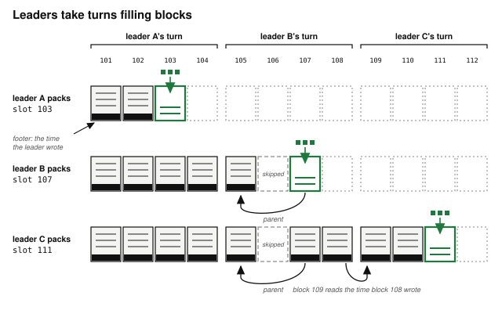

# Chapter 5: Time

A Solana program has three ways to observe the passage of time:

- **The Unix timestamp** is wall-clock time, usually within a second or two of the real time.
- **The slot** is a count that goes up by one for each slot the network runs, roughly every 200 milliseconds, and it only goes up.[^forks]
- **A counter** is something a program can implement: a number stored in one of its own accounts that goes up by one each time something happens, such as an order arriving. It says which of two events came first, but not how far apart they were.

The runtime supplies the first two, and a program reads both from the same account. A program implements the third itself.

Which one to use depends on the job. A week promised to a contributor runs on the wall clock. A price freshness window counts slots. Which order came first uses a counter.

## The Slot Counter

A Solana cluster runs on **validators**: physical computers that each hold a copy of every account and run every transaction. Time on the network is divided into short windows called **slots**, and for each slot one validator is the **leader**. Leaders take **turns** of four slots in a row, assigned in advance in proportion to each validator's stake. The leader gathers transactions into a **block** and sends that block to the other validators, and each block builds on the one before it, its **parent**.

When a leader's block does not arrive in time, the others vote to skip that slot, and the slot passes with no block. The next block names the last block that did arrive as its parent.



The slot count is how many slots have gone by. Programs read the current count from the **Clock sysvar**, a system account the runtime keeps fresh. Slots only go up, and nobody can rewind the count or jump it forward.


Two things affect how much wall-clock time a number of slots adds up to, and anyone converting between the two should know both:

- **Each slot usually runs slightly longer than the network intends.** The network sets a target, currently 200 milliseconds, and real slots mostly run a little over it. On testnet, the only network running Alpenglow at the time of writing, slots averaged 219 milliseconds over an hour, so a time counted in slots ran about 10% long.[^slot-time-live] A slot runs long when its leader was slow or its block was skipped. A slot is a turn, not a tick of a clock: the next one starts when the last one ends, so every delay carries forward and nothing pulls the count back to real time. That extra time adds up but does not compound, because slots do not get slower as they go, and each adds only its own delay. Three slots at 219 milliseconds take 657 milliseconds, 57 more than the 600 they were sized for, and a week of them runs about 16 hours long. So a slot-counted window covers more wall-clock time than it was sized for, which loosens it rather than tightening it.
- **The count stops when the chain does.** No block is produced during a halt, so the count stands still while the world outside keeps moving. That makes an hours-old price look one slot old.

Slots are grouped into **epochs** of 432,000 slots, which is exactly a day at 200 milliseconds a slot, and about two hours longer at testnet's 219. Some changes to the network, a new slot length among them, take effect only when a new epoch begins.

## The Unix Timestamp

The **Unix timestamp** comes from the same Clock sysvar, but it is a time a leader reports rather than a count the runtime guarantees. Each leader writes its own clock's time into the end of its block, and the transactions in the next block read that value. The value stays the same for the whole slot, so every transaction in a block sees one timestamp. The network rejects a block whose time goes backwards, or runs more than two slot lengths ahead for each slot since its parent block, so a leader chooses its time only within that range.[^alpenglow-clock] That range limits how far one block can move the time, not how far the time can drift from the real one. The timestamp is usually within a second or two of real time. It counts whole seconds, it was written one block earlier, and each leader can move it only a fraction of a second for each slot it leads.


A leader can pick any time inside the permitted range, which moves the timestamp by a fraction of a second for each slot it leads. The next leader that writes its own clock's time brings the timestamp back toward real time, so the error does not build up over a long span. Put a boundary on a timestamp and somebody can profit by moving it. If an auction close, an option expiry, or the start of a penalty sits on a timestamp, the leader of the slots around that boundary decides which side of it a transaction lands on. The leader writes the time its own next block reads, and chooses which transactions go in each block, so for most of its turn it controls both. Only the first block of a turn reads a time written by the previous leader. For a boundary days away the timestamp is still the right clock, because a slot count would miss it by hours. The defense is a margin: close betting well before the result can be known, and exercise an option before its last seconds.

## Which Clock for Which Job


A price three seconds stale can be worth a liquidation to whoever arranged the delay, so freshness counts slots. A contribution three seconds late is worth one contribution, and a margin covers it, so the fundraiser's week runs on the wall clock. An option's expiry and a betting market's close are dates quoted to people, days away, so they run on the wall clock too: a leader can move them by a second or two, and a slot count would miss them by hours. Interest, funding, and the vault's annual fee run on the wall clock too. Each is a rate quoted to somebody per year or per hour, and a few seconds against a year change it by nothing anybody can see.

The four questions rest on one comparison. Outside a halt, the timestamp's few seconds of error stay a few seconds however long the span runs. A slot count converted at 200 milliseconds stays about 9% short of the time that passed, so its error adds up slot by slot as the span grows, until across a week it is about 16 hours. The two errors meet at about 20 seconds, where a tenth of the span is the second or two a leader can move the timestamp. Below that the tree counts slots, and above it the timestamp is the default.

## Interest and Funding Accrue by the Wall Clock

Two programs in this book accrue value over time, and both count it in seconds:

- **The lending market accrues interest on debt.** It carries one number per reserve, a **borrow accumulation factor** that grows each time anyone touches the market:

  ```
  new factor = old factor × (1 + rate per second × elapsed seconds)
  ```

  Elapsed seconds is the Clock's current timestamp minus the one the reserve stored at its last accrual, `last_accrual_timestamp`. Rather than recalculating every borrower's debt, the market stores each borrower's principal and updates the one shared factor, so a borrower's current debt is their principal multiplied by that factor. Its rates are quoted annually, so the conversion divides by the seconds in a year. The *Arithmetic of Money* chapter covers how to build that factor safely.
- **The perpetual futures venue accrues funding on open positions.** It does the same, storing `cumulative_funding` alongside `last_funding_timestamp`, and its operator sets the rate per second.

Both accumulate, both advance by elapsed time, and both decide what somebody owes, which decides whether a position can be liquidated. A leader can move the timestamp by a second or two, and at a 20% annual rate two seconds of interest is about one hundred-millionth of the debt. A position that close to the liquidation line crosses it anyway if the leader waits two seconds, so moving the clock gains the leader nothing. A slot count would buy nothing here and cost a guess: a rate quoted per year becomes a rate per slot only through the slot length, which the network changes and does not deliver exactly. That guess is wrong on nearly every slot, and the errors add up rather than cancel. At the 219-millisecond slots measured on testnet, a market that assumes 200 collects about 9% less than it quotes, so a borrower quoted 20% a year pays about 18.3%. Counted in seconds, the error is the second or two a leader can move the clock. Counted in slots, it is nearly a tenth of all the interest.

Both programs treat a timestamp at or before the stored one as no time passed, and leave the stored one where it is. The network already rejects a block whose time goes backwards, so this costs nothing, and it means no second is ever charged twice.

## How to Turn Time Into Slots

A freshness window is agreed in seconds, and it has to become a slot count before a program can use it. Divide the time by the length of a slot in milliseconds. Multiplying runs the same arithmetic backwards, for telling a person what a slot count comes to in their own units.

The network's target slot length is 200 milliseconds at the time of writing.[^slot-simd]

A program can get that length three ways:

- **From Anza's documentation, written into your program.**[^anza-docs] This is correct until the network next shortens the slot, and wrong from then on. Keep any window that depends on the slot length in config, where a transaction can change it, which the section on a shortened slot covers.
- **From the feature gates.** Changes to the network ship as **features**, built into the validator software switched off and turned on across the network at the start of an epoch. Each shortening of the slot ships as one, so a program can check which of them are live and take the shortest, falling back to 400 milliseconds when none are.[^check-slot-time] A new slot time applies from the start of the epoch after its gate activates, not from the moment it does, so check the epoch as well as the gate.
- **From the network itself, in future.** While no account reports the slot time in milliseconds at the time of writing, this is expected to change.[^onchain-params] Check Anza's documentation and the companion repository before writing either technique above, in case such an account now exists.

Avoid the Solana SDK's `DEFAULT_MS_PER_SLOT` - this value is set when the SDK is compiled, so what was true on build day may not reflect the network a program is running on.

The gates give the length the network aims for, and the network can run slower than that. When slots take longer than the configured length, a 150-slot freshness window covers more wall-clock time than it was sized for, so it accepts older prices.

To measure the average the network is actually delivering, take the seconds since `epoch_start_timestamp` in the Clock sysvar and divide by the slots since this epoch began, which `EpochSchedule` supplies. Guard that division: the divisor is zero on an epoch's first slot. That measurement comes from the leader-written timestamp, so it belongs in offchain tooling, not in a handler. A handler that needs wall-clock time should read the timestamp itself, as the lending market's interest does. Multiplying a slot count by a measured slot length carries the timestamp's error and adds the slot count's.

> **One conversion covers one slot time.** Converting only works over a period where the slot time in milliseconds was constant. If the slot time changed during the period being measured, multiplying by the current figure understates the time that passed, since slots in the past were longer. Converting over a period where the slot time changed means splitting it at each change, which always falls on an epoch boundary, and converting each piece at the slot time the network used then. A slot count that reaches back across the reduction to 200 milliseconds needs that split, while one that starts after it does not. At the time of writing, no reduction below 200 milliseconds is planned.

A program that needs a long span in wall-clock time should store a timestamp beside the slot and subtract.

## The Wall Clock Measures Human Time

The managed fund uses the wall clock twice:

- **Its annual management fee accrues by timestamp**, because a few seconds either way, measured against a year, are nothing.
- **It checks its price feed's age in seconds rather than slots.** A **price feed** is an account that some publisher keeps updated with a price and the time they published it. This one publishes a wall-clock time, so the comparison has to be made in the unit the number arrived in.

When the deadline is one you promised a person, use timestamps, and leave a margin so a few seconds cannot change who gets paid. A contributor told they have a week to fund is owed seven days of wall-clock time. A week counted in slots is out by about 16 hours, which breaks that promise, while a week of wall clock is out by seconds, which the margin covers.

## Who Fills First Is a Counter, Not a Clock

The order book exchange uses neither clock for the thing traders care most about: which order came first. Each resting order takes the next number from a counter the market keeps, and matching compares those numbers. The order also records a `timestamp`, but this is only kept so offchain tooling can show an age. Two orders can arrive in the same slot and carry the same timestamp. The market's counter still gives them different numbers. A leader can move the timestamp slightly, but has no way to change the numbers the counter hands out.

## Every Consumer Sets Its Own Freshness Window

A program reading a price has two questions to answer:

- Whether the source can be trusted.
- Whether the price is recent enough.

The *Offchain Truth* chapter answers the first, along with everything else a program checks about a price before acting on it. This chapter answers the second. Four of this book's programs answer it differently:

| Program | Refuses a price older than | Measured in |
| --- | --- | --- |
| the lending market | 25 slots | slots |
| the prop AMM | 150 slots | slots |
| the perpetual futures venue | 150 slots | slots |
| the managed fund | 60 seconds | seconds |

For a price fresh to within two seconds, turn that into a slot count once, and check every price against that number of slots. Nobody can move that boundary, and the check needs no conversion. Three of the four count slots, because in a window this short a few seconds of clock would be most of the margin. The vault counts seconds because that is the unit its feed publishes, and a program cannot compare someone else's seconds against its own slots without assuming a slot length. What the three slot counts come to in seconds depends on that length, so a window sized once in slots covers less wall-clock time if the slot is ever shortened.

## Integer Day Counts Have a Boundary, and Both Sides Must Use It

A clock gives a program seconds, so counting days means dividing by 86,400. That division is integer division, which throws the remainder away: six and a half days counts as six, and anything short of a full day counts as none of it. The fundraiser stores `time_started` and a duration in days, and both of its later handlers reconstruct elapsed days the same way:

```
elapsed days = (now − time_started) / 86,400
```

Both handlers compare that one count against the same duration:

- `contribute()` requires it to be *less than* the duration.
- `refund()` requires it to be *at least* the duration.

Because both handlers compare the same expression, there is no gap and no overlap between "you may still contribute" and "you may now refund". At the moment the count reaches the duration, contributions turn off and refunds turn on, by arithmetic rather than by a second stored flag anybody has to keep in step.

The trap is what "seven days" then means: the window ends at the first tick of day seven, not at the end of the seventh day.


Say which edge you mean when you write the terms down. A contributor reads "seven days to fund" as a window closing at the end of the seventh day, and this one closes at its start, a full day earlier than they think. Either edge works, as long as it is the one your users were told.

## Slots Stop When the Chain Stops, and the Wall Clock Does Not

Both clocks arrive in the same sysvar, so it is easy to assume they always move together. They come apart when the chain stops.

When validators cannot agree which block is real, block production halts instead of continuing down two conflicting histories, and the network sits still until enough of the stake agrees where to resume. A chain that kept producing blocks through a disagreement could settle the same balance twice.

A halt is rare: at the time of writing, block production has not stopped for years. A program should still handle one.

No block is produced during a halt, so the slot count does not move. Wall-clock time does. The first block after a restart carries a slot roughly where the last one left off. Its timestamp cannot jump the hours the halt took either, because each block can move it at most two slot lengths for each slot since its parent. The timestamp trails real time after a restart and gains on it at about one second per second, so a nine-hour halt leaves it trailing for about nine hours more.[^clock-catch-up] That gap has three consequences:

- **Accrual by timestamp charges the halt, late.** The lending market's interest, the perpetual futures venue's funding, and the vault's fee all count seconds, so a nine-hour halt accrues nine hours. It arrives over the nine hours of catch-up rather than in the first block. The loans were outstanding and the suppliers' money was locked for those nine hours, so charging for them is accurate.
- **Neither kind of freshness window refuses the old price on its own.** The lending market's 25-slot window sees a price stamped one slot ago and would accept a number nine hours old. The vault's sixty-second window does no better, because the timestamp it reads is trailing, so a price published just before the halt looks seconds old. The damage is largest on the perpetual futures venue, where leverage multiplies a bad price across every open position.
- **A deadline can pass with nobody able to act on it.** The fundraiser's day count runs through a halt like any other nine hours. A contributor with an hour left before the halt gets about half an hour after it, because the timestamp runs at twice real speed while it catches up. That program survives it because its refund path has no deadline; a design whose only exit was a narrow window would have stranded them.

Every freshness window needs one more check. The `LastRestartSlot` sysvar[^last-restart-slot] carries the slot of the most recent cluster restart, or zero if there has never been one, and a price from before that restart is stale however few slots have passed since. The lending market, the prop AMM, the perpetual futures venue, and the managed fund all make this check in their oracle readers: any price stamped at or before the restart slot is rejected with `PricePredatesRestart`, and the market pauses valuation until the publisher posts again. Make it in any program that checks a price's age, in slots or in seconds.

The order book comes through a halt untouched, because it reads neither clock: queue positions resume exactly as they were.

## A Shorter Slot Tightens Every Window Counted in Slots

The network has shortened the slot before, most recently in stages from 400 milliseconds to 200.[^slot-times] The change is rare and happens in one step: the number holds for years, then moves once.

A freshness window sized in slots gets stricter. A 150-slot window covers less wall-clock time than it did, so it refuses prices it used to accept. That costs availability and never safety, and it announces itself the first time a price is refused. The defense is to keep the window where a transaction can reach it, so the change needs a configuration transaction rather than a redeploy.

A rate counted in seconds is untouched. The lending market's interest and the perpetual futures venue's funding charge the same per hour at any slot length, with nothing to retune. A rate counted in slots gives no such warning when the slot shortens. An annual rate divided by a fixed slots-per-year number assumes a slot length, so halving the slot doubles what a borrower pays in a day while every line of the program stays as it was.

> **War Story: the SPL token-lending slot constant.** The SPL token-lending program, the ancestor of several Solana lending markets, turned annual rates into per-slot rates with a constant built from the SDK's tick rate: ticks per second, divided by ticks per slot, times the seconds in a year.[^spl-slots-per-year] The SDK then ran 160 ticks a second and 64 to a slot, 2.5 slots a second, but integer division threw the half away and compiled the constant for 2. At the 400-millisecond target every borrower paid a quarter more than the annual rate they were quoted. Save's fork wrote the result in as a number, with a comment calling it the slot rate. At 200 milliseconds the same constant charges two and a half times the quoted rate.

## What the Programs in This Book Chose

The table lists every program in Part II that touches time, and the clock each one settled on.

| Program | What it times | Its answer | Why |
| --- | --- | --- | --- |
| fundraiser | its funding deadline | whole days from one stored timestamp | a week of slots is about 16 hours out |
| lending market | interest accrual, and price freshness | timestamps for interest, slots for freshness | seconds against a year are nothing, and a stale price is the attack |
| perpetual futures | funding accrual, and price freshness | timestamps for funding, slots for freshness | the same, and leverage multiplies a stale price |
| prop AMM | price freshness | slots | a stale price is the attack |
| managed fund | an annual fee, and price freshness | timestamps for both | seconds against a year are nothing, and the feed stamps seconds |
| options | its expiry | the timestamp | a date the two parties agreed, days away |
| betting market | when betting closes | the timestamp | a time published to bettors, days away |
| order book | which order came first | a sequence number, neither clock | neither clock is fine enough to order by |

## What You Learnt

- A program has three ways to observe the passage of time. The Unix timestamp is wall-clock time written by a leader, usually out by a few seconds somebody chose. The slot count only goes up and nobody can move it, but each slot starts when the last one ends, so it runs about 10% long on testnet and stops in a halt. A program's own counter records order and nothing else.
- Count slots for price freshness and for any short window an adversary running a leader could profit from shifting by a few seconds. Use the wall clock for a rate or a deadline quoted to a person, with a margin at any deadline, and by default for any span longer than about 20 seconds. Use a counter of your own for order of arrival, and whatever unit the publisher stamped for somebody else's number.
- To accrue interest or funding without touching every account, store each account's principal and one shared accumulation factor that advances by elapsed seconds. A current balance is the principal multiplied by the factor. Counting slots instead collects about 9% less than the quoted rate at testnet's slot length.
- A price needs a freshness window, each consumer sets its own, and the unit follows the source: slots where the program chooses, seconds where the feed published seconds.
- A slot count converts to wall-clock time only at the slot length in force, and only across a span where that length held. Read that length from the slot-time feature gates or measure it against the epoch, and better still hold it as a figure you can update without a redeploy. Anza's documentation carries the current figure, and the companion repository the current way to get it.
- A shortened slot is rare and arrives all at once. Every slot-counted window tightens, so keep windows where a transaction can retune them. A rate counted in seconds is untouched, while one counted in slots accrues faster without saying so.
- A deadline counted in whole days floors, so both sides of it must be computed from the same expression, and the window ends at the first tick of the last day. Say which edge you meant when you write the terms down.
- For order of arrival, use a number of your own: the order book gives each resting order the next number from a counter it keeps, and keeps its timestamp for display only.
- Solana halts rather than run two conflicting histories. During a halt slots pause and wall-clock time keeps running, but the timestamp cannot jump, so it trails after a restart and takes about as long as the halt to catch up. Accrual by timestamp charges the halt during the catch-up, deadlines expire with nobody able to act on them, and a price that is hours old still looks fresh.
- Pair every freshness window, in slots or in seconds, with a `LastRestartSlot` check, which rejects any price stamped at or before the last restart.

[^forks]: Two validators can briefly build on different parents, splitting the chain into **forks**, until the network settles on one. A block for a lower slot on one fork can even be produced after a block for a higher slot on another, but a program only ever sees one of the forks and will only see the slot go up.

[^alpenglow-clock]: The leader's time is carried in a footer at the end of its block. Source: Brennan Watt of Anza, in a message to the author in September 2026, and [github.com/anza-xyz/agave/issues/15441](https://github.com/anza-xyz/agave/issues/15441). Validators enforce the range in `nanosecond_time_bounds`, at [github.com/anza-xyz/agave/blob/master/runtime/src/block_component_processor.rs](https://github.com/anza-xyz/agave/blob/master/runtime/src/block_component_processor.rs).

[^clock-catch-up]: A leader writes its own clock's time, moved into the permitted range if it falls outside, in `skew_block_producer_time_nanos` at [github.com/anza-xyz/agave/blob/master/core/src/block_creation_loop.rs](https://github.com/anza-xyz/agave/blob/master/core/src/block_creation_loop.rs). While the timestamp trails, every leader writes the top of the range, which advances it two slot lengths for each slot that passes.

[^spl-slots-per-year]: The constant is `SLOTS_PER_YEAR` in the program's state module, at [github.com/solana-labs/solana-program-library/blob/master/token-lending/program/src/state/mod.rs](https://github.com/solana-labs/solana-program-library/blob/master/token-lending/program/src/state/mod.rs), and Save's copy is at [github.com/solendprotocol/solana-program-library/blob/master/token-lending/program/src/state/mod.rs](https://github.com/solendprotocol/solana-program-library/blob/master/token-lending/program/src/state/mod.rs).

[^slot-times]: The stages of that reduction are published at [solana.com/upgrades/reduced-slot-times](https://solana.com/upgrades/reduced-slot-times).

[^anza-docs]: Anza maintains the validator client and its documentation, at [docs.anza.xyz](https://docs.anza.xyz).

[^onchain-params]: "Longer term, we will put these parameters onchain so they are client queryable." Brennan Watt of Anza, at [x.com/bw_solana/status/2089740425695535300](https://x.com/bw_solana/status/2089740425695535300).

[^check-slot-time]: Dean Little's `check_slot_time.rs`, at [gist.github.com/deanmlittle/90901c2fdc9f73fe0fcefb0959109825](https://gist.github.com/deanmlittle/90901c2fdc9f73fe0fcefb0959109825).

[^slot-simd]: During the second half of 2026, slot times were slowly reduced from 400 milliseconds to 200, under [SIMD-0525](https://github.com/solana-foundation/solana-improvement-documents/blob/main/proposals/0525-reduce-slot-times.md).

[^slot-time-live]: Solana Explorer's live cluster statistics for testnet, at [explorer.solana.com/?cluster=testnet](https://explorer.solana.com/?cluster=testnet), read on 24 September 2026: 219 milliseconds averaged over the last hour, and 215 over the last minute. Mainnet was not yet running Alpenglow then. Solana's slot time tracker for mainnet is at [solana.com/200ms](https://solana.com/200ms).

[^last-restart-slot]: One of the sysvars listed in Anza's runtime documentation, at [docs.anza.xyz/runtime/sysvars](https://docs.anza.xyz/runtime/sysvars).
