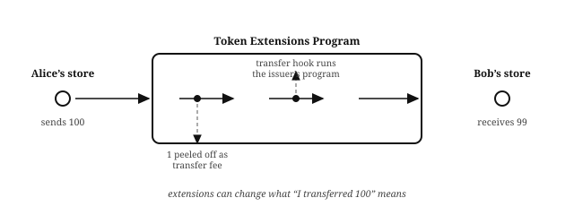

# Chapter 3: Tokens

Assets on Solana are tokens, and tokens are nothing more than accounts with well-known shapes, managed by a token program. Every asset you will meet in this book is a token: stablecoins like USDC and USDT, equities like NVDAx, SPCXx, and TSLAx, and the share and receipt tokens the book's own programs mint.

> **"SPL tokens."** Tokens other than SOL are often called "SPL tokens", after the Solana Program Library the original token program shipped in, but most people just call them "tokens". This book does too.

## Every Distinct Token Is a Distinct Mint

Each kind of token is defined by its own **mint account**. USDC is one mint; NVDAx is another; the shares a fund issues are a third. Two tokens are the same asset if they come from the same mint address, and different assets if they do not: anyone can create a mint whose name and symbol say "USDC", so the address is the identity and the label is decoration. When this book says "USDC" or "NVDAx", the thing that identifies that asset onchain is a mint account, and passing the *right* mint is a validation problem every program chapter takes seriously.

The mint account records the token's definition: its current total supply, its decimals, and its authorities.

## A Mint Is a Factory, and the Mint Authority Is Its Boss

A mint does not just describe a token; it manufactures it. New tokens come into existence when, and only when, the mint's **mint authority** signs a mint instruction: the supply counter rises and the new tokens land in a token account. Burning does the reverse. Nothing else in the system can create or destroy a single unit.

The mint authority is the boss of that factory, and who holds the role is the first question to ask about any token. It can be a person's wallet (they can mint at will: fine for a test token, alarming for money), a multisig (minting takes a quorum), or a PDA, which is how this book's programs use it: the lending market's share mint and the fund's share mint are run by program-owned addresses, so issuance follows code, not a person. The authority can also be handed over, or renounced entirely by setting it to none, which fixes the supply forever; that is what a token means when it claims no more can ever exist.

## Token Accounts Hold Tokens

A **token account** holds one owner's balance of one token. The **associated token account** (ATA) is the canonical token account for a given wallet and mint, at an address anyone can derive from the two (plus the token program that manages the mint): this is how a program knows where Alice's USDC lives without asking her, and how account constraints can verify that a supplied token account really is hers. ATAs are the **PDAs** you met when Bob paid Alice in The Core Building Blocks of Solana: derived addresses that sit off the curve, with no private key. The PDAs chapter explains the mechanism.

Not every token account is an ATA. A token account can live at any address, and the vaults this book's programs hold funds in are token accounts controlled by the programs themselves: some are ATAs of a program-derived address (the escrow's vault is the offer account's ATA), and others are plain token accounts at addresses the program chose. The ATA is simply the canonical, derivable place for *a wallet's* balance of a mint; program-held tokens live wherever the program put them.

This is the other half of the figure convention. An address drawn **off** the curve is captioned with the ingredients it was derived from (for an ATA: the token program, the owner's address and the mint), and that caption is the whole story. No private key exists for it, so only the owning program can move what it holds.

## Decimals Define the Minor Unit

The mint's **decimals** set the **minor unit**, the raw integer everything actually calculates and transfers in: USDC has 6 decimals, so $10 moves as 10,000,000. Programs read decimals from the mint and never assume them, and transfers use `transfer_checked()`, which fails unless the caller states the decimals the mint really has.

## The Freeze Authority Can Stop Any Holder Cold

The mint's other lever is the **freeze authority**, which can freeze and thaw individual token accounts: a frozen account can neither send nor receive. It is the compliance mechanism behind regulated assets (sanctions, court orders, fraud response), and it applies to holders one at a time, not to the token as a whole. Before building on someone else's token, check both authorities: who can mint, and who can freeze, is the token's real constitution.

## Two Token Programs: Classic and Token Extensions

Solana has two token programs. The **Classic Token Program** is the original, and most tokens in circulation use it. The **Token Extensions Program** is its successor: the same core machinery, plus opt-in, per-mint features. Well-written programs support both through a common interface (Anchor's `token_interface`), constraining only that every account in a transaction agrees on which one it is using; every program in this book does so.

The extensions that matter for financial products:

| Extension | What it does | What it means for your program |
| --- | --- | --- |
| **transfer fees** | A cut is withheld on every transfer, for the issuer to collect | Send 100 and 99 arrives: "I transferred X" no longer delivers X |
| **transfer hooks** | A program of the issuer's choosing runs on every transfer | Enables allowlists, and means a transfer can execute foreign code (the ordering section of The Adversary takes this seriously) |
| **confidential transfers** | Amounts are hidden onchain | Balances are visible only to the parties and an auditor key |
| **permanent delegate** | An authority can move any holder's tokens | A seizure power some regulated assets require |
| **interest-bearing** | A rate is stamped on the mint | Balances display accrual without the supply changing |
| **non-transferable** | Tokens are bound to their holder | For credentials and vesting, not payments |

When you build on a token you did not issue, read its extensions first: several of them change what "I transferred X" means.

## What You Learnt

- Every distinct token is a distinct **mint account**: the address is the identity, the label is decoration.
- The **mint authority** and **freeze authority** are a token's real constitution: who can mint, and who can freeze, are the first questions to ask about any token.
- **Token accounts hold tokens**: ATAs are the derivable canonical ones for a wallet, and program vaults can live anywhere the program chose.
- **Decimals** define the minor unit: read them from the mint, never assume them, and transfer with `transfer_checked()`.
- Solana has two token programs, and extensions can change what a transfer means: read a token's extensions before building on it.
