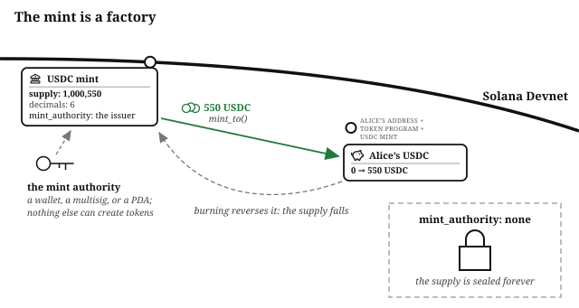
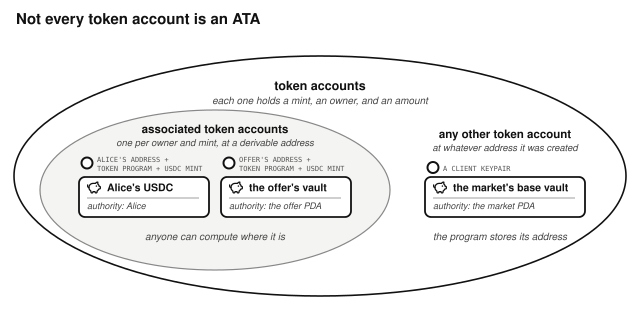
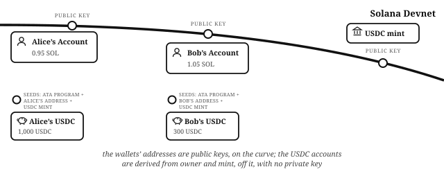
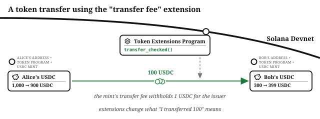

# Chapter 3: Tokens

Assets on Solana are **tokens**, and every token is defined by a mint account and held in token accounts (accounts formatted in a particular way to hold token balances), both managed by a token program. Every asset in this book is a token: 

- stablecoins like USDC and USDT
- equities like NVDAx, SPCXx, and TSLAx
- the share tokens the book's own programs mint

So is every other asset on Solana.

## Every Distinct Token Has Its Own Mint

Each kind of token is defined by its own **mint account**. 

- `EPjFWdd5AufqSSqeM2qN1xzybapC8G4wEGGkZwyTDt1v` defines USDC on mainnet [^usdc-address]
- `Xsc9qvGR1efVDFGLrVsmkzv3qi45LTBjeUKSPmx9qEh` defines NVDAx on mainnet [^nvdax-address]
- An address you will create in the *Vault Strategy* chapter defines the shares that fund issues (on devnet, and on mainnet too if you choose to deploy it for real).

A mint is not itself a token: it is the account a token comes from, and no amount of anything is held in the mint.

Two tokens are the same asset if they come from the same mint address, and different assets if they do not: anyone can create a mint whose name and symbol say "USDC", so the address is the identity and the label is decoration. When this book says "USDC" or "NVDAx", the thing that identifies that asset onchain is a mint account. Instruction handlers are given account addresses as arguments, and must check that any mint account address matches the expected value, so that the asset is the one it claims to be. 

## A Mint Is a Factory, and the Mint Authority Is Its Boss

A mint does not just describe a type of token; it manufactures it. New tokens come into existence when, and only when, the mint's **mint authority** signs an instruction to the **Token Program**'s `mint_to()` handler, the supply counter rises and the new tokens land in a token account. Burning does the reverse. Nothing else in the system can create or destroy a single unit.

As well as the current total supply, the mint account also stores the token's decimals (how many minor units are in a major unit), and its authorities. 

The **mint authority** is the boss of that factory, and who holds the role is the first question to ask about any token. It can be a person's wallet (they can mint at will: fine for a test token, alarming for money), a multisig (minting takes a quorum), or a PDA. This book's programs use a PDA: the lending market's share mint and the fund's share mint are run by program-owned addresses, so issuance follows code, not a person. The authority can also be handed over, or renounced entirely by setting it to none, which fixes the supply forever. Many tokens explicitly advertise a fixed supply, and disabling the `mint_authority` is how it is enforced.

## Token Accounts Hold Tokens

A **token account** holds one owner's balance of a particular type of token, and its data records three facts: 

- which type of token (determined by the mint)
- the account owner
- how much of the token that owner has

The **associated token account** (ATA) is the canonical token account for a given wallet and mint, at an address anyone can derive from three seeds: the owner's address, the mint, and token program used for that token mint. Put in Alice's address and the USDC mint, and out comes the address of Alice's USDC account; put in Bob's, and out comes his. This is how a program knows where Alice's USDC lives without asking her, and how account constraints can verify that a supplied token account really is hers.

An ATA is a **PDA**: a derived address that sits off the curve, with no private key, so no signature for it can ever exist and only the owning program can move what it holds. The *PDAs* chapter explains the mechanism.

Not every token account is an ATA. **A token account can live at any address**, and the vaults this book's programs hold funds in are token accounts controlled by the programs themselves. Some are ATAs of a program-derived address (the escrow's vault is the offer account's ATA), and others are plain token accounts at addresses the program chose. The ATA is simply the canonical, derivable place for *an address's* balance of a given token; program-held tokens live wherever the program put them.

In this book, an address drawn **off** the curve is shown with the seeds its address was derived from (for an ATA: the owner's address, the token program, and the mint). 

## Decimals Define the Minor Unit

The mint's **decimals** set the **minor unit**, the raw integer everything actually calculates and transfers in: USDC has 6 decimals, so $10 moves as 10,000,000. Programs read decimals from the mint and never assume them, and transfers use `transfer_checked()`, which fails unless the caller states the decimals the mint really has.

## The Freeze Authority Can Freeze Any Holder's Account

The mint's other authority is the **freeze authority**, which can freeze and thaw individual token accounts: a frozen account can neither send nor receive. It is the compliance mechanism behind regulated assets (sanctions, court orders, fraud response), and it applies to holders one at a time, not to the token as a whole. Before building on someone else's token, check both authorities: who can mint, and who can freeze.

## Two Token Programs: Classic and Token Extensions

Solana has two token programs. The **Classic Token Program** is the original, and most tokens in circulation use it. The **Token Extensions Program** is its successor: the same core machinery, plus opt-in, per-mint features. Well-written programs support both through a common interface (like Anchor's `token_interface`), and only require that every account in one transaction uses the same token program. Every program in this book works that way.

The table lists the extensions that matter for financial products:

| Extension | What it does | What it means for your program |
| --- | --- | --- |
| **transfer fees** | A cut is withheld on every transfer, for the issuer to collect | Send 100 and 99 arrives: "I transferred X" no longer delivers X |
| **transfer hooks** | A program of the issuer's choosing runs on every transfer | Enables allowlists, and means a transfer can execute foreign code (the ordering section of the *Adversary* chapter takes this seriously) |
| **confidential transfers** | Amounts are hidden onchain | Balances are visible only to the parties and an auditor key |
| **permanent delegate** | An authority can move any holder's tokens | A seizure power some regulated assets require |
| **interest-bearing** | A rate is stamped on the mint | Balances display accrual without the supply changing |
| **non-transferable** | Tokens are bound to their holder | For credentials and vesting, not payments |

Before building on a token you did not issue, check which extensions its mint carries: Solana Explorer lists them on the mint's page, and the table's last column says what each one does to a transfer your program makes.

## What You Learnt

- Every distinct token has its own **mint account**, and that account's address is the token's identity: the label is decoration. A mint defines a token; it is not one.
- The **mint authority** and **freeze authority** are the first questions to ask about any token: who can mint, and who can freeze.
- **Token accounts hold tokens**: ATAs are the derivable canonical ones for an address, and program vaults can live anywhere the program chose.
- **Decimals** define the minor unit: read them from the mint, never assume them, and transfer with `transfer_checked()`.
- Solana has two token programs, the **Classic Token Program** and the **Token Extensions Program**. Some extensions take a fee from every transfer, run the issuer's program on every transfer, or let the issuer move any holder's tokens: check which extensions a mint carries in Solana Explorer before building on it.

[^usdc-address]: Circle, the USDC issuer, lists its mint addresses at [developers.circle.com/stablecoins/usdc-contract-addresses](https://developers.circle.com/stablecoins/usdc-contract-addresses).
[^nvdax-address]: xStocks, the NVDAx issuer, lists its tokenized equities at [xstocks.fi/us/products](https://xstocks.fi/us/products).
